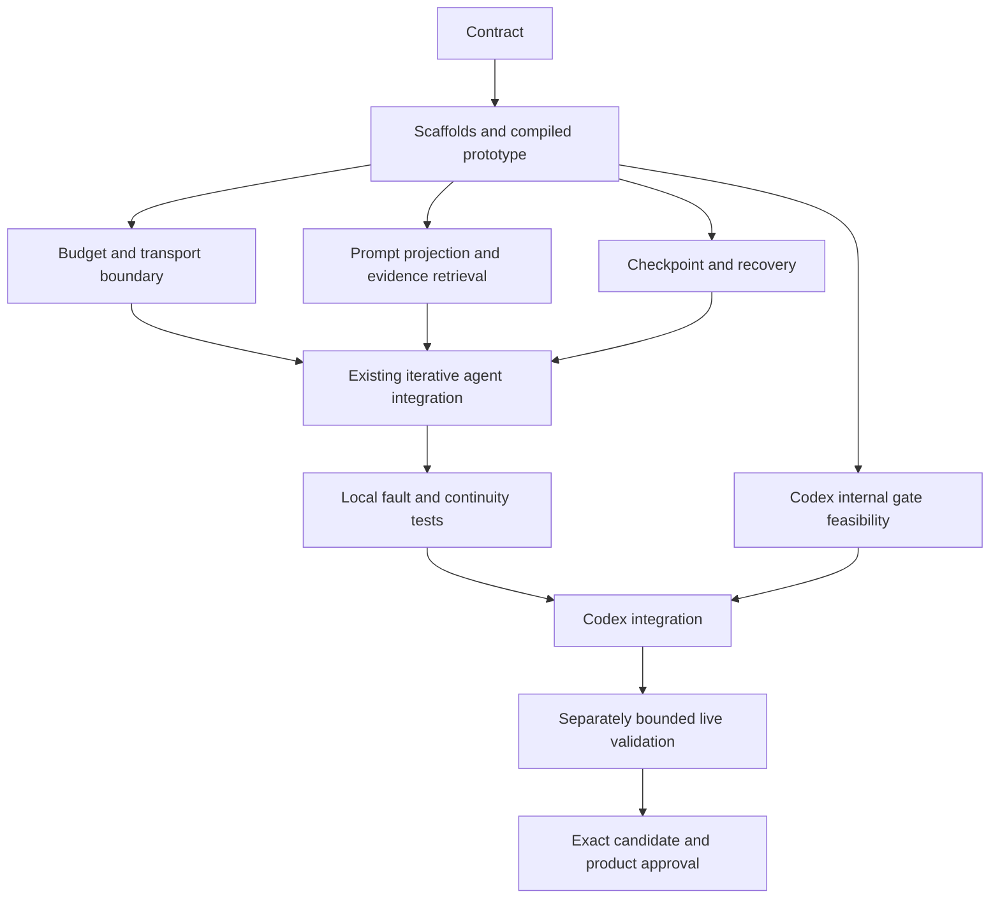

# ARE runtime recycling candidate

Product construction: integrate the existing iterative agent with bounded prompt
projection, evidence retrieval, single-request budget enforcement, and durable
checkpoints. CONTRACT.json owns prototype definitions; SCAFFOLD.json carries
product/business/ontology/DomainSpec prototypes; COMPILED.json is their bounded
compiled projection, not a claim of DomainSpec compiler conformance.

Runnable frontier: C, D and E after the prototype predecessors above. The
integration is opt-in; existing ordinary runtime entrypoints retain their prior
behavior. Unsupported transports are blocked when the recycling option is used.

Operational support: host integrator owns isolated login setup (live validation
stage); user owns a fresh usage allowance (live validation stage); runtime owner
owns later activation; desktop integrator owns client integration after activation.
These are deferred residue, not prerequisites for local product tests.

Causal blocker: the inspected stock Codex app-server cannot synchronously yield
before all internal provider calls and compaction decisions. Local stateless
runtime construction continues independently. Product approval and operational
activation are separate future decisions; this package grants neither.

## Open questions

- Which live adapter can establish exact input bounds, output enforcement and no
  hidden retries? The injected adapter contract alone does not prove this.
- How much task quality and cost improve over a maintained-summary baseline?
- How should an operator reconcile uncertain requests and stale writer locks?
- How should automatic learning update supplied task state across recycling?
