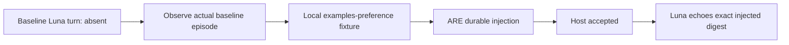

# ARE transport Luna canary

PASS: Luna returned the exact provenance digest supplied through ARE's durable
context-injection transport. The initial uninjected turn reported absent. Both
turns used the same user prompt; the expected digest was absent from that prompt.

| Check | Result |
| --- | --- |
| Model | gpt-5.6-luna, low effort, standard service |
| Authentication | Existing ChatGPT login |
| Native turns | 2 completed / 2 authorized in renewed canary |
| Baseline source_digest | absent |
| Injected source_digest | Exact echo |
| Model tools observed | None |
| Learned preferences | 1, grounded in the actual baseline episode |
| Total reported tokens | 18,579 |
| Input / cached input / output tokens | 18,456 / 11,776 / 123 |
| Reasoning output tokens | 15, included in output usage |
| Account credit deduction | Not measured |
| Host stopped / temporary auth reference removed | Yes / yes |
| Parent task activation | No |

The baseline explanation described caching without an example. After injection,
Luna added the example of a browser caching images. That is consistent with the
injected examples preference, but one pair does not establish causal improvement.
The exact high-entropy digest echo is the bounded evidence of model visibility.

The preference input, mode control and compaction notification were local fixtures.
The baseline prompt and output, host injection acceptance, and second model output
were real. This run does not prove automatic live feedback ingestion, native
steering, native compaction recovery, capability learning or general reliability.

RESULT.json holds both full prompts and responses; TEST-RECEIPT.json records
checks and source hashes. EVENTS.json contains selected native completion and
usage notifications. ARE-LEDGER.jsonl and TRANSPORT-LEDGER.jsonl preserve this
canary's state evidence. No credential contents were saved. The runner is guarded
against reruns and reserves turns durably before requesting generation.

Product frontier: durable transport model visibility observed. Runnable next
construction: automatic native event canary design and exact reconciliation.
Host integrator owns additional model validation and activation decisions. The
renewed two-turn allowance is exhausted. Approval and activation remain separate.
