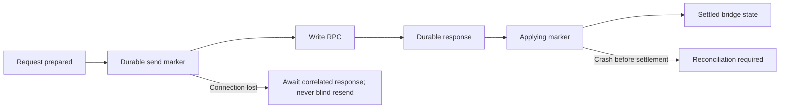

# ARE durable transport prototype

The candidate records bridge requests and pending state in the existing ARE
fsynced ledger before sending JSONL RPCs. The transport serializes operations,
correlates responses, persists them before local application, and records the
successor bridge state. A separate journal is bound to the exact ARE config.
Prior packages remain unchanged.



## Recovery boundaries

| Saved phase | Restart behavior |
| --- | --- |
| prepared | Request is known unsent; eligible to send. |
| sent | May have reached host; wait for correlated response. No automatic resend. |
| received | Correlated response is durable; eligible for local application. |
| applying | Local mutation may have happened; stop for reconciliation. |
| blocked | Preserve evidence; stop for reconciliation. |
| idle | Saved bridge state is settled; next operation may proceed. |

Snapshots include pending RPCs, used IDs and acceptance receipts. Exact binding
checks prevent transfer to another configuration. Optimistic state checks under
a writer lock reject stale transport owners. Corrupt journals fail closed.
A crash while holding a journal writer lock may also require owner-controlled
lock recovery; this candidate does not clear orphan locks automatically.

## Evidence

38 local tests passed: 19 bridge regressions, 11 durable-transport tests and eight
JSONL framing/correlation tests. Restart tests use fresh Node processes; one exits
immediately after the durable send marker. The Applying crash test constructs
that exact journal checkpoint to verify non-replay; it is not a hardware power-loss
or exhaustive crash-window test.

The actual installed app-server accepted a context-injection RPC from this
transport and persisted its exact guidance text. A subsequent thread/read also
succeeded. HOST-RESULT.json is the final run; HOST-RESULT-initial.json preserves
the initial run before a framing validation improvement. Both used disposable,
credential-free environments and a rejecting loopback provider. Both made zero
provider requests, never called turn/start and stopped their server processes.

The ARE active request and compaction source in this check were synthetic fixture
events. This proves real host injection acceptance and persistence, not native
steering/compaction execution or model observation. Normal host settings and the
parent conversation were unchanged.

## Reproduction

Run from this directory:

```sh
node --test --test-reporter=tap bridge.test.mjs transport.test.mjs rpc-client.test.mjs
node host-check.mjs
```

The host check is effectful only within its disposable isolated app-server task.
It starts no generation, uses no login and removes its owned temporary files.
The transport's RPC client never retries a timeout, broken pipe or ambiguous
connection exit. Its caller owns transport startup and action authorization.

Product frontier: durable transport with tested safe-boundary recovery and real
host acceptance. Next construction is exact reconciliation evidence for Applying
checkpoints and a model-observation canary design. Native generation canary and
activation remain operational tasks owned by the host integrator. The original
four Luna turns are exhausted. No product approval or activation is claimed.
