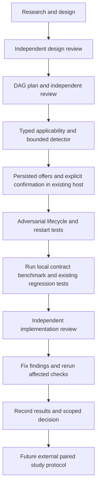

# Representation preference construction DAG

Date: 2026-09-18. Status: reviewed; bounded construction complete; 105/105 selected tests passed. Authority effect none.

## Purpose and boundaries

Implement the user-requested observe → offer → confirm → scoped lesson → apply
loop in the existing interaction review host. [Research](RESEARCH.md) owns the
question, alternatives, benchmark selection, counterevidence and claim limits.
[source-bindings.json](source-bindings.json) pins the lighthouse, original GLM
objective, current ContextBench frontier, continuity policy and ontology method.
This is a first-round product contract study, not a frozen scientific benchmark.
No hypothesis of token savings or general language understanding is accepted by
passing unit tests. The main ContextBench frontier stays unchanged.

## Task dependencies

| Task | Acceptance | Dependencies |
| --- | --- | --- |
| R/V | Sources checked; reviewer blockers resolved in design | none/R |
| P | Reviewer checks exact gates before code | V |
| C | plan/compare × DAG/table/checklist/plain; unknown input abstains; typed scope and conflicts | P |
| H | Offer at third distinct completed request in last 20 requests; stable evidence; acceptance requires exact confirmation and scope; decline/revoke survive restart | C |
| T | Negative quotes/references/negation/duplicates/failure; off/observe; stale offers; current override; task/thread/user/product isolation; legacy replay | H |
| E | All selected contract/regression cases pass once; preserve failures and repair causes | T |
| A/F | No unresolved correctness findings; affected checks pass | E/A |
| D | Report exact counts and limits, runnable example and deferred work | F |

## Construction frontier and operational residue

Current frontier: P, then runnable C/H/T/E. Agent owns bounded implementation.
D65 chain: user requirement → candidate design → reviewed task DAG → exact tested
source → product review. No release, activation, publication or authority claim.
Existing candidate018 evidence is immutable; modifying its source creates a new
working candidate and must be disclosed as release drift. Release owner owns a
later successor freeze/full release verification; it does not block construction.

External evaluation X is a separate future research frontier, owned by the ARE
research owner. It requires pinned data/license review, model/provider choice,
complete input+output accounting, equal-budget arms, frozen development and fresh
confirmation sets, context sizes and an independent continuity freeze review.
No paid external run or benchmark score is promised by this construction plan.
Current local benchmark is synthetic and deterministic, with zero model calls;
its test counts are not external benchmark scores. No claim of token savings.

## Fixed validation and stopping criteria

Run new representation preference tests and existing interaction-learning,
interaction-review, and request-intent learning tests. Any consent, replay, scope,
conflict or revocation failure rejects the candidate until fixed. Tests exercise
the actual persisted host with scripted providers; report scripted output as such.
Run one reviewed suite; rerun only for a change or diagnosed instrument failure.
No repeating model samples until a favorable score appears.

Compare the mechanism against manual-only behavior: before acceptance no lesson
may be selected; after acceptance only applicable requests may select it. Keep
learning disabled and unrelated tasks as negative controls. Scores establish host
selection and recovery behavior, not whether humans want an offer or whether a
model produces a correct DAG. A future output evaluator must validate structure
and acyclicity as well as task quality, not just the word DAG.

## Open Questions

Research questions remain in RESEARCH.md. Full live preference evaluation and a
new release candidate are separate successors; neither is silently complete.

## Independent plan review

Reviewer: preference_review. Verdict: approved for bounded implementation after
the six design corrections. Consent activation follows durable lesson storage,
not HOST_REQUEST presence. Legacy fixture generated before source changes:
/tmp/are-preference-legacy.jsonl, state digest
f6cbf5888604f0ef1352fc5c1ff88ba9e394b713ccf40c4c291bc24072a7dd0b.

## Completion evidence

R/V/P/C/H/T/E/A/F/D complete for the stated construction scope.
See [RESULTS.md](RESULTS.md) and [REVIEW.md](REVIEW.md). X remains a future
external study. The source candidate requires successor release qualification.
