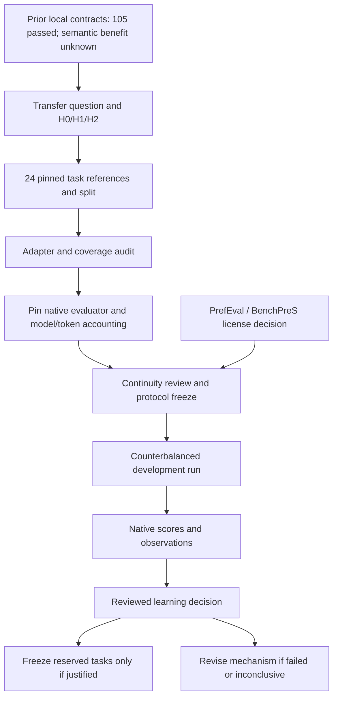

# Preference and memory benchmark pilot

Status: selected tasks and candidate protocol; no live calls. Authority effect none.

## Objective hierarchy

Enduring objective: improve reusable reasoning, useful continuity, recovery,
correctness and completed outcomes within cumulative model input plus output tokens.
Initial GLM objective: finish GLM-5.3-flash qualification, starting with useful
state under small context windows. This pilot initially proposes the same model
and an 8K context cap; the provider model identifier must be pinned before running.
Current milestone: preserve the ContextBench larger-window frontier. This separate
user-requested preference study neither clears nor replaces ContextBench.

The source bindings and canonical objective text are carried in continuity.json.
The prior result is the representation-preference construction study: 105 local
contract tests passed, but semantic quality and total model-token benefit are unknown.

## Research method

objective → gap → question → competing hypotheses → selection → experiment/tasks/criteria → results → observations → reviewed decision → successor

Q: Do scoped retained preferences improve relevant answers without increasing
inappropriate application, forgetting updates, or exceeding the same token budget?
H1: scoped retained state improves these outcomes. H0: existing history/manual
feedback suffices. H2: broad automatic application increases misapplication; scope
selection, rather than memory availability, is the missing mechanism. Native typed
hypotheses and experiment records are generated by build.mjs through the evolution
engine. The existing D07 projector models completed evidence; its root here is the
actual prior contract study with an inconclusive observation about semantic benefit.
No future benchmark result is fabricated to make the historical projector accept it.
D08 attaches upcoming work to that root's open question. Future hypotheses and
experiments remain separately recorded in the evolution ledger until evidence exists.

## Task sample

24 immutable references: eight PrefEval, eight BenchPreS, eight LongMemEval.
Each has four development and four reserved tasks. tasks.json contains revisions,
selectors, record hashes, license provenance and split membership. PrefEval uses
four topic/style strata with deterministic hash sampling. LongMemEval covers
preferences, updates, multi-session reasoning and abstention, without duplicate
question families. BenchPreS uses separate user profiles and recipient contexts
across partitions. These small partitions are smoke tests, not representative scores.
Reserved tasks are unused for tuning; they are not yet independent confirmation.

LongMemEval uses the oracle split (relevant history only). This does not measure
retrieval from the full long-history corpus or provider compaction. Original
questions and histories stay intact. Native task adaptation must be labeled in
reports; do not present adapted scores as official leaderboard results.

## Arms and budgets

A: same model with unmodified available history and no retained lesson projection.
B: same model, same evidence and task, with scoped ARE lesson projection. Any
preference extraction or memory construction is performed from visible history
only and its model tokens count. Never use gold preferences from implicit PrefEval,
BenchPreS labels, or LongMemEval answer markers as treatment memory.

The current offer detector supports only a narrow representation grammar. Its
abstention on these broader tasks is valid evidence. Do not use an oracle extractor
and attribute its benefit to the shipped detector. Adapter task must select and
freeze either an unchanged-system coverage baseline or a separately named semantic
adapter. Controlled replay must use isolated user/product state per task and arm.

Development: 12 tasks × two arms × two repetitions = 48 generator calls maximum.
Use an AB/BA counterbalanced order, identical sampling settings and context limits.
Each generation admits at most 7,168 input and 1,024 output tokens. At most one
judge call per output, bounded to 4,096 input and 512 output tokens. Entire pilot
cap: 614,400 logical input+output tokens, including any memory construction. Cached
input counts; reasoning output counts where provided. Unknown usage blocks scoring.
No silent retries, truncation of evidence, or silent drop of failed tasks. Overlength
tasks fail preflight and require a versioned successor protocol, not deletion.

PrefEval and BenchPreS have CC BY-NC licenses. Only references are stored here;
commercial-use permission/eligibility must be resolved before executing those arms.
LongMemEval is MIT and can advance independently. No author contact is sent.

## Metrics and evaluation

PrefEval: preference-following and independent answer/task-quality assessment;
implicit gold preference is evaluator-only. BenchPreS: AAR and MR separately,
with explicit denominators; no-label denominator is not a zero score. LongMemEval:
answer correctness split by update, preference, multi-session and abstention.
Also record completion, invalid outputs, format/consent leakage, full token use,
model/context identity and source digests. Do not pool unlike native metrics.

Pin rubric, evaluator code, judge identity and blind arm order before dispatch.
Native original evaluators are preferred; changed rubrics are named adaptations.
A scorer cannot pass a format by checking for the word DAG. Pilot human review
checks every disagreement. Evaluator model calls count in the declared budget.

## DAG and current frontier

Machine D08 separates the three benchmark branches. The license gate affects
PrefEval and BenchPreS dispatch only; LongMemEval's construction can proceed.
Current product frontier: inspect source/adapter contracts and implement coverage
measurement. Runnable command: `node .../benchmark-pilot-v1/build.mjs --check`.
Research owner owns model/evaluator binding and reviewed learning decisions.
Keld owner owns the noncommercial-data usage decision for affected branches.
Release owner owns the separate successor product freeze. Publication, release,
serving activation and changes to ContextBench are not effects of this plan.

## Fixed decision rule

Missing source identity, gold leakage, unresolved rights, unknown token accounting
or changed protocol blocks the affected run. Preserve every failed/invalid row.
A valid pilot may advance only if quality is not worse, completion is not worse,
misapplication does not increase, and at least one target metric improves within
the fixed total-token cap. Report individual counts and uncertainty, not significance
from four tasks. Failure leads to a competing-hypothesis review, not repeated sampling
until passing. Reserved tasks remain untouched until a new reviewed freeze.

## Open questions

Which exact adapter supports these natural-language preferences? Does the unchanged
engine abstain too often? Which evaluator/model IDs and budgets are accepted after
instrumentation? Can PrefEval and BenchPreS be used for this commercial research?
These are explicit run blockers, not missing task selections or claimed results.
