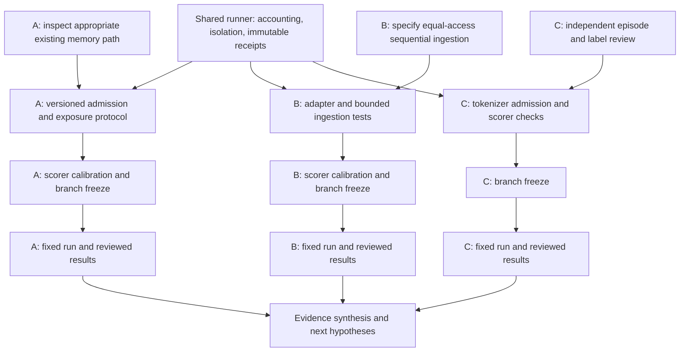

# Parallel pilot execution readiness

Planning addendum, 2026-09-18. Authority effect: none. This updates the runnable
frontier of [PLAN.md](PLAN.md), preserving its historical planning state and frozen
source records. “langMemoryBench” is interpreted as LongMemEval.

## Objective and method

Measure whether ARE improves useful continuity, correctness and completed outcomes
within total model input plus output tokens. This preference study does not replace
GLM qualification or the separate ContextBench frontier.

Every branch retains the research chain: objective → question → competing
hypotheses → frozen experiment → evidence → observation → reviewed decision →
successor. H1 is useful scoped state; H0 is sufficient visible history; H2 is
insufficient detector/adapter coverage. Bind future observations and decisions to
the existing hypothesis, experiment, continuity, research-DAG and work-plan records.
Preparation tests and tokenizer results are not benchmark quality scores.

## Verified preparation

| Branch | Evidence | Current frontier |
| --- | --- | --- |
| A: LongMemEval oracle | [Preflight](execution/longmemeval/preflight/result.json): input counts 3,836; 6,990; 11,261; 6,856. All four select zero representation lessons. | Original four-task 8K run is blocked by one overlength task. Existing representation learner has no treatment exposure. |
| B: PersonaMem-v2 text | [Admission](execution/personamem/context-admission.json): 31,629–32,127 input tokens; [preparation and attribution](execution/personamem/README.md). | All four development histories exceed 8K after removing the privileged persona summary. Separate history-ingestion protocol needed. |
| C: Original ARE selectivity | [Offline results](execution/selectivity/OFFLINE-TEST-RESULTS.txt): 3/3 tests passed; [adapter and episodes](execution/selectivity/README.md). | Independent label review, shared-runner checks, tokenizer admission and branch freeze remain before generation. |

These receipts contain no scored model generations. Empty representation lessons
establish a coverage limitation of that specific path, not failure of every ARE
memory mechanism. Reserved tasks remain outside live evaluation and tuning.

## DAG and task order

1. Coordinator completes shared runner validation: exact model/settings, per-call
   admission, cumulative usage, crash recovery without duplicate calls, gold
   isolation and immutable output receipts. Preserve unknown usage as a stopped
   run, not zero tokens.
2. In parallel, A inspects the existing memory path and proposes a versioned
   LongMemEval protocol; B specifies ingestion; C receives independent label review.
3. Freeze and run each eligible branch independently. C is currently closest to
   a scored run; A remains the external benchmark priority. No branch waits for
   unrelated preparation, and preparation need not imply simultaneous API calls.
4. Publish each branch's results when available. Join only with explicit completed,
   valid-failed, inconclusive or blocked evidence for every branch. A blocked branch
   cannot be represented as a completed evaluation.

## Exact branch decisions before execution

**A:** Do not silently drop the 11,261-token task. First establish which existing
ARE state path can consume visible history without answers or manufactured consent.
If no eligible path exists, record H2 coverage evidence and propose a separate
candidate. A 16K full-history successor is a possible diagnostic, subject to actual
tokenizer admission; it is not an 8K result or proof of compaction. Sequential
ingestion is an alternative requiring its own equal-access freeze. Select and
review one protocol before scoring; preserve the original blocked 8K suite.

**B:** Prefer a separately named 8K sequential-ingestion experiment. Specify
chronological chunk boundaries, boundary overlaps, retained state, control memory
policy, query visibility and every processing call. Both arms receive equal source
access. Count ingestion tokens and verify the full schedule fits the branch budget
before starting. If it cannot, preserve the blocker and propose an explicit revised
budget/sample protocol before observing scores. Removing the source's oracle
persona system message is gold isolation; removing history to fit is not allowed.

**C:** Review apply, unrelated-task suppression, current override and revoke/change
labels independently. Confirm actual offer → consent → persistence → selection
traces. Validate DAG structure and answer content, not the literal word “DAG”.
Name the structured-output transport limitation in results. Include only selected
state items in treatment prompts; keep original visible messages equal across arms.

## Freeze and result contract

The original contract remains four development tasks × two arms × two repetitions
(AB then BA): 16 scored generations per eligible branch. Four reserved tasks per
branch stay untouched. A successor that changes window or ingestion must bind its
own complete schedule rather than inheriting admission from the old experiment.

The 8K protocol permits 7,168 input tokens plus 1,024 output tokens per generation.
Original budget: 204,800 total model tokens per branch, 614,400 combined; count
cached input, reasoning output, ingestion, extraction and judges. Freeze evaluator
calibration accounting too. No hidden retries, cropping, outcome-based substitutions
or unchanged reruns until favorable.

Before each live branch: reviewed hypothesis and protocol, exact source/code hashes,
offline checks, tokenizer admission, real exposure trace, calibrated scorer and
passing scoped continuity freeze. Report task-level correctness/completion,
appropriate application, misapplication, state exposure and total tokens. Keep native
benchmark scores separate. No exposure is inconclusive about benefit; zero metric
denominators are N/A. Four development tasks support pilot conclusions only.

## Ownership, construction and operational residue

Coordinator owns shared runner, independent reviews, freeze gates and synthesis.
A owner owns LongMemEval and memory-path inspection; B owner owns PersonaMem;
C owner owns original selectivity fixtures. Preserve the separate write scopes in
PLAN.md. Preparation has been delivered by the B and C helpers; this document does
not claim they are still running.

Construction chain: objective → source-bound protocol → candidate plan → tested
instrument → branch freeze → measured evidence → product review. Planning is not
an admitted execution state. Provider identity/availability blocks live stages only;
scorer readiness blocks its own branch. Publication, release and deployment remain
deferred to their owners and are not prerequisites for this pilot.

Storage remains capped at 256 MiB for combined source cache/scratch; require 2 GiB
free before hydration or runs. Retain selected-source hashes, protocols, results,
usage and decisions. Cleanup must identify regenerable files explicitly.

## Open questions

- A owner: which existing memory mechanism supports native history without oracle
  help, and which versioned protocol establishes genuine treatment exposure?
- B owner: can equal-access sequential ingestion fit the original total-token cap?
- Coordinator: do the provider usage fields and judge calibration satisfy the
  shared accounting and scoring contract?
- Coordinator: does the independent C review find any label or prompt bias?

These questions block the named stages, not all parallel preparation.
