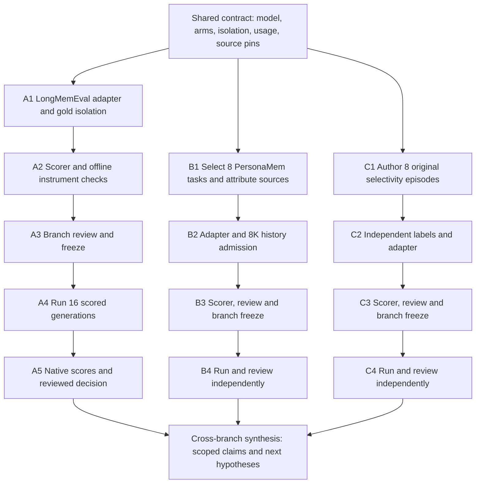

# Parallel preference and memory pilot

Status: reviewed planning candidate; execution has not started. Authority effect none.
Successor to benchmark-pilot-v1. Interpret the user's “langMemoryBench” as LongMemEval.
The v1 artifacts remain immutable history. PrefEval and BenchPreS are excluded from
this successor's execution scope, not silently relabeled as new benchmarks.

## Objective hierarchy

Enduring objective: improve reusable reasoning, useful continuity, recovery,
correctness and completed outcomes within cumulative model input plus output tokens.
Initial GLM objective: finish GLM-5.3-flash qualification, starting with useful
state under small context windows. Start this pilot with the existing GLM provider
and an 8K context cap; verify the exact provider model identifier before freeze.
Current milestone: preserve the existing ContextBench larger-window frontier.
This separate user-requested study does not replace or clear that milestone.

## Research method

objective → gap → question → competing hypotheses → selection → experiment/tasks/criteria → results → observations → reviewed decision → successor

Observed gap: 105 local contract tests passed, but no live external quality or
model-token benefit has been measured. H1: existing scoped ARE state improves
appropriate answers within a fixed budget. H0: available history is sufficient;
ARE adds no measurable benefit. H2: the bounded detector/adapter has insufficient
coverage, so missing extraction or scope decisions explain failure. H2 motivates
a separately frozen semantic-adapter successor; do not change the system mid-run.
Each branch reports its own native outcomes; an aggregate of unlike scores is invalid.

D01 hypotheses and D03 prospective experiments remain candidate records. The D07
research graph retains actual prior local conformance evidence and its open question.
D08 work tasks attach to that question. D02 observations and D04 learning decisions
are added only after real results. D05 retention requires exact tested implementation
and evidence; no new improvement retention is claimed by this plan.

## Sample and comparison contract

| Branch | Development | Reserved | Scope |
| --- | --- | --- | --- |
| A: LongMemEval oracle | 4 already selected | 4 already selected | Preference, updates, multi-session reasoning, abstention |
| B: PersonaMem-v2 text | Select 4 | Select 4 | Implicit preference, update, other-person attribution, do-not-remember |
| C: Original ARE selectivity episodes | Author 4 | Author 4 | Apply, suppress, override, revoke/change |

LongMemEval source and question IDs are preserved in sources.json. PersonaMem's
source revision and CC BY 4.0 license declaration are pinned there; attribution
and changes must accompany adapted examples. Branch B must confirm those four
strata exist in the actual schema; if a stratum is absent, record a selection gap
rather than invent a native label. Split by persona, not neighboring question rows.
Use original text only, avoiding inherited image dependencies. Do not download the
whole dataset. Original C episodes use independent wording and data, with no copying
or paraphrasing of restricted benchmark examples. Label C as an ARE benchmark.

Control: same model, original admissible history, no ARE state projection.
Treatment: same model, same source history, existing ARE state path enabled.
Pin precisely which state mechanism each branch exercises. Record selected lessons,
state digest and projected input. If no treatment state is selected, report no
exposure/coverage, not evidence of an ineffective memory mechanism. Do not inject
labels, gold preferences, answer markers or ideal summaries into treatment memory.

An 8K window is the actual tokenizer/model-context admission limit, not a byte
estimate. LongMemEval oracle is relevant-history-only and does not test full-corpus
retrieval. PersonaMem histories may exceed 8K: either freeze a clearly labeled
sequential-ingestion protocol with equal source access and accounted tokens, or
report overlength and create a separate window-study successor. No silent cropping
or cherry-picking after observing model outcomes.

Each branch starts with four development tasks × two arms × two repetitions:
16 scored generations, counterbalanced AB then BA. The reserve stays out of the
schedule and tuning. Use identical model and sampling settings across arms.
Per branch: 204,800 total logical model input+output tokens; combined ceiling 614,400.
Target generation cap: 7,168 input + 1,024 output per call. Judge cap: 4,096 input +
512 output, at most one judge per scored generation. Any additional extraction or
history-processing model calls consume the same budget and must be preregistered;
there is no extra allowance for them. Cached input and reasoning output count.
Choose zero additional extraction calls for the unchanged-system first pass unless
the existing mechanism requires them; freeze their schedule before proceeding.

## Parallel DAG

Branch A freeze/run does not depend on B or C. Shared contract work and B/C source
preparation can start immediately; adapters depend on the shared interface only.
A provider outage blocks live calls, not data/scorer preparation. Report A's result
as soon as it exists; do not wait for the final join to make it visible.

## Ordered work and evidence gates

| ID | Work | Required completion evidence |
| --- | --- | --- |
| S | Pin provider/model, sampling, state boundary, usage schema, output isolation and cache policy | Shared contract and tokenizer/accounting checks; no secrets in evidence |
| A1 | Load the four selected oracle tasks; separate gold; wire existing ARE/control arms | Exact source hashes, gold-isolation tests, treatment exposure trace |
| A2 | Bind native scoring and task completion; calibrate with known good/bad/abstaining outputs | Evaluator/rubric hash; blind arm mapping; token and failure accounting checks |
| A3 | Review H0/H1/H2, task/context admission, fixed schedule and current sources | Passing branch continuity freeze and signed/attributed review record |
| A4 | Run once under the frozen schedule | Complete raw outputs, usage, state references and failures; no hidden retries |
| A5 | Score and review the branch | Native metrics by category, paired counts, token totals, limitations, learning decision |
| B1 | Select source-pinned disjoint personas and retain license attribution | Four development/four reserved rows, schema and provenance review |
| B2 | Adapt visible history; settle long-history admission before testing outcomes | No gold leakage; equal-source protocol; 8K admission or explicit blocked state |
| B3/B4 | Calibrate evaluator, freeze, then run and review | Same integrity gates as A; native preference metrics kept distinct |
| C1 | Author original user-history/task pairs with explicit application labels | Four development/four reserved scenario families and origin record |
| C2 | Independently review labels and wire full offer/confirm/apply lifecycle | Positive/negative matched cases, ambiguity notes, consent and scope checks |
| C3/C4 | Validate format/semantic checks, freeze, then run and review | AAR/MR-inspired counts with named denominators; zero denominator is N/A |
| J | Compare mechanisms and derive next hypotheses | Preserve every branch's failures and no-exposure cases; no pooled benchmark score |

Original C must exercise repeated requests, confirmation, an unrelated task,
a current override, and revocation across the episode fixtures. Use structural
DAG validation where a DAG is required, not the word “DAG”. A correct refusal to
save before consent is a success even if personalization would otherwise help.
Template siblings stay in the same split; use different reserved wording and domains.

## Delegation sheet for execution

This is a proposed three-worker arrangement, not a record of dispatched agents.
The coordinator owns S, shared interfaces, branch freeze reviews and J. Once S's
interface is fixed, one worker may own each branch. The LongMemEval worker owns
the reusable runner; others consume its interface rather than editing it concurrently.

| Role | Write scope | Dependency | Gate and close condition |
| --- | --- | --- | --- |
| A worker | New successor run package under longmemeval/ and agreed shared runner files | S for adapter; existing task refs available now | A1–A5 evidence, or exact diagnosed blocker; preserve partial outputs |
| B worker | New successor run package under personamem/ only | B1 source selection independent; S before adapter | B1–B4 evidence or explicit context/data blocker |
| C worker | New successor run package under selectivity/ only | C1 authorship independent; S before adapter | C1–C4 evidence; labels reviewed before freeze |
| Coordinator | Shared contract, review receipts, planning/work events and synthesis | Branch evidence for review/join | No unresolved integrity finding in any claimed result |

Do not mutate shared production code, frozen manifests, historical source records
or another worker's scope. A necessary engine change creates a named candidate,
separate regression evidence and a successor hypothesis before a new live run.
Join rule: each branch reports completed, valid-failed, inconclusive, or blocked
with exact evidence; missing branches never count as passes. Operational issues
stay scoped to the stage they actually prevent.

## Construction frontier and operational residue

Current runnable product work: S shared contract, B1 source selection, C1 original
episode authorship, and A source/adapter inspection. Execution routing is a separate
IMPLEMENT/VALIDATE boundary; this PLAN output is not an admitted execution state.
D65 chain: exact user objective → source-bound design → candidate plan → tested
adapter/instrument → branch freeze review → measured result → product review.
No publication, deployment, serving activation or release approval is inferred.

Provider availability and model identity: coordinator; blocks A3/A4 and corresponding
live stages only. Dataset attribution: B owner; blocks B3 only if unresolved.
Independent C label review: coordinator; blocks C3, not A. New release freeze:
release owner; deferred and unrelated to this pilot's construction. No PrefEval or
BenchPreS permission task remains in the active v2 graph.

Storage: one selected-data cache shared read-only by branches, separate small result
folders, a combined scratch cap of 256 MiB, no full dataset clones. Check free disk
before hydration/run; stop if less than 2 GiB remains. Keep selected source hashes,
protocols, results, usage and decision records. Delete regenerable scratch only
through an explicit cleanup manifest; never delete prior evidence to free space.
Parallel preparation does not require simultaneous provider calls. Serialize calls
if necessary for rate limits or cache/order control; retain branch independence.

## Fixed decision rule

Instrumentation, source drift, gold leakage, unknown usage or inadequate context
admission blocks the affected run. Preserve its diagnostics and all partial outputs.
Do not repeat unchanged until favorable. A valid failure returns to competing
hypotheses. No exposure is inconclusive about benefit and motivates a coverage
hypothesis, not an automatic semantic upgrade. Advance to a fresh reserved freeze
only if quality and completion do not worsen, misapplication does not increase,
and at least one target quality metric improves within budget. Report pilot counts
and uncertainty; four tasks do not justify a population or cross-model claim.

## Open questions

Which exact existing ARE memory path can receive native task history without oracle
help? Are all selected LongMemEval histories admissible at 8K? Which PersonaMem
rows support the requested strata and how should longer histories be presented?
Which exact model/judge IDs and provider usage fields will be frozen? These are
named implementation tasks with owners, not reasons to stop independent branches.
