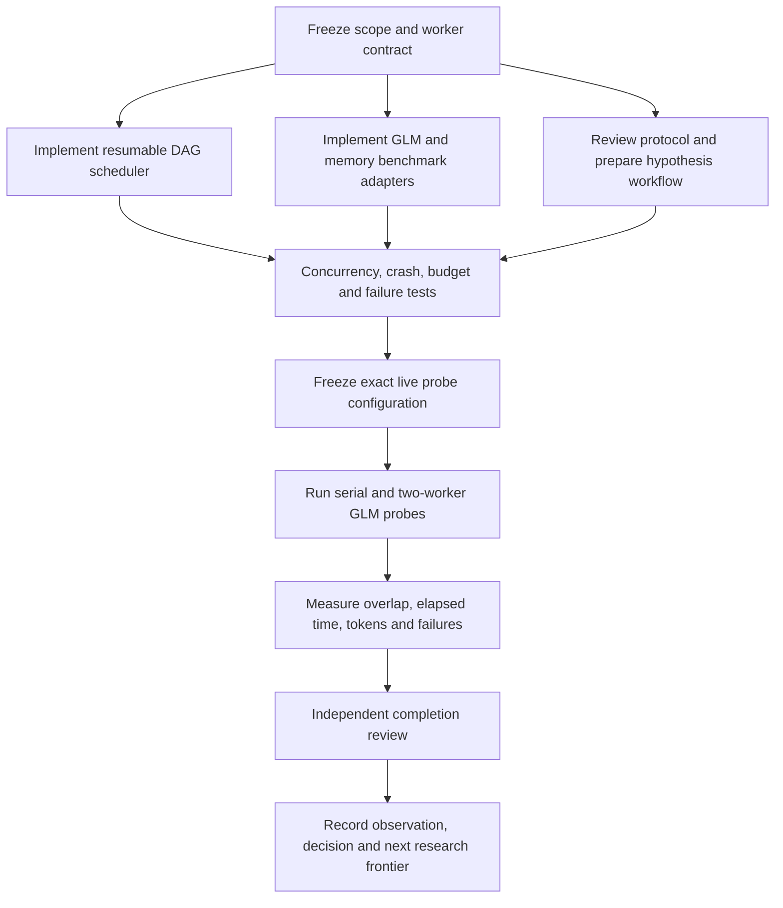

# Concurrent benchmark execution

Status: implementation in progress, owner-directed prototype. Authority effect: none.

## Objective hierarchy

Enduring objective: useful reasoning, continuity, recovery, correctness and completed
outcomes within cumulative model input plus output tokens. Reduce elapsed time and
coordinator work for reproducible experiments serving this objective.
Initial GLM objective: finish GLM support, beginning with small context windows.
Current milestone: clear the declared ContextBench contract through evidence-led
rounds. This infrastructure study supports that work; the milestone remains open.
Infrastructure throughput is not evidence of memory quality or benchmark clearance.

The user authorized planning and executing the previously proposed concurrent
scheduler and bounded research-helper workflow. Existing pilot evidence is immutable.
Implementation scope is this directory and
`implementation/agent-reasoning-engine/packages/benchmark-scheduler/`.

## DAG and task order

S and A are independent implementations sharing an explicit interface. R reviews
both and does not author the code it approves. The coordinator owns integration,
live dispatch, reports and final verification. A failure must have a recorded
disposition; it cannot be erased by retrying until successful.

## Worker dispatch sheet

| Worker | Scope | Dependency / gate | Close condition |
| --- | --- | --- | --- |
| scheduler_core | scheduler.mjs and scheduler.test.mjs | P; no provider calls | Contract and failure tests pass |
| scheduler_adapter | adapter.mjs, adapter.test.mjs, cli.mjs | P; shared scheduler contract | Real adapter admission/dependency tests pass |
| scheduler_review | REVIEW.md and research-workflow.json | P then code and results | Defects reported and final closure independently assessed |
| coordinator | plan, integration, native research records, probes and report | T and review before live | Requirement-by-requirement evidence audit |

Future research helpers receive bounded evidence packages rather than the entire
conversation. They independently analyze omissions, reasoning failures and current
request precedence. Candidate hypotheses join at review before implementation or
benchmark dispatch. Hypothesis generation never receives reserved answers.

## Execution contract

One process owns a durable run directory and dispatches concurrent asynchronous
GLM requests. Jobs have unique IDs, explicit dependencies and token reservations.
Each job stores its own memory and result. Ingestion steps remain sequential;
independent tasks can overlap. Preserve AB then BA order with explicit edges.

Reserve input plus maximum output before dispatch, including reservations held
by in-flight jobs. Reconcile known usage including failures. Unknown usage holds
its reservation and is explicitly reported. A process interruption cannot cause
an already-started generation to be silently repeated. The manifest hash must
match on resume. An exclusive lock rejects concurrent owners; never steal a lock
based only on elapsed time. Completed jobs are reused, failed dependencies block
their descendants, and unrelated work may finish within budget.

Begin at two workers. Rate-limit/overload signals reduce future dispatch concurrency;
no hidden generation retries. Four workers remain conditional on measured support,
not a completion requirement or an assumed account allowance. Fixed output caps,
real tokenizer admission, model identity and complete receipts remain mandatory.

## Research method

objective → gap → question → competing hypotheses → selection → experiment/tasks/criteria → results → observations → reviewed decision → successor

Use native evolution-runtime D01/D03 before execution, D02/D04 after measured results,
and source-bound D07/D08 projections. The implementation DAG does not replace the
research DAG. No D05 improvement retention follows from a tiny throughput probe.

## Fixed decision rule

H1: independent GLM requests overlap and reduce elapsed time without lost jobs,
duplicate attempts, broken dependencies or token-accounting violations.
H0: provider limits or local overhead prevent useful throughput improvement.
Compare identical small synthetic tasks at concurrency one and two, each with its
own immutable run directory and same model/settings. This is an infrastructure
probe, not a LongMemEval score. Maximum combined model reservation: 16,384 tokens.
Use a predeclared exact-output scorer and record failures as failures. Record start,
finish, maximum overlap, total tokens, completion, elapsed time and queue state.
No automatic four-worker escalation or expensive full benchmark rerun.

Tests cover independent overlap, dependency order, concurrent budget reservations,
resume without repeats, interrupted/unknown calls, manifest drift, invalid/cyclic
DAGs, exclusive ownership, rate-limit response, and tokenizer admission before
generation. Integrate the existing LongMemEval note/answer adapter without gold
exposure; tests must prove notes flow only through the correct dependencies.

## Construction and operational lanes

Product frontier: scheduler and adapters, followed by tested prototype and measured
live probe. User-directed implementation does not claim governance admission or
production approval. This plan carries the D65 distinction between construction,
test evidence and a later owner decision on product approval.

Operational prerequisites for L: existing credential access, provider availability,
at least 2 GiB free disk, exact frozen settings and remaining probe budget.
Coordinator owns them; they block only live probes, not implementation/tests.
Operational residue: higher provider quota, deployment, release, broad benchmarks,
paid capacity changes and four-worker scaling are deferred. No publication occurs.

## Completion evidence

Close after runnable queue/adapter/CLI, passing meaningful tests, machine-readable
research workflow and DAG, real GLM probe receipts (including any measured provider
blocker), automatic result report, native hypothesis/observation/decision linkage,
and independent review. A throughput failure is a valid measured result; absent
execution is not a success. Quality improvement is a separate future experiment.

## Open questions

What concurrency does this account actually sustain? How much latency is provider
generation versus local setup? Which omission/reasoning hypotheses survive review?
Does higher throughput preserve result quality on a prospectively frozen larger
cohort? The final report owns their evidence and successor disposition.
