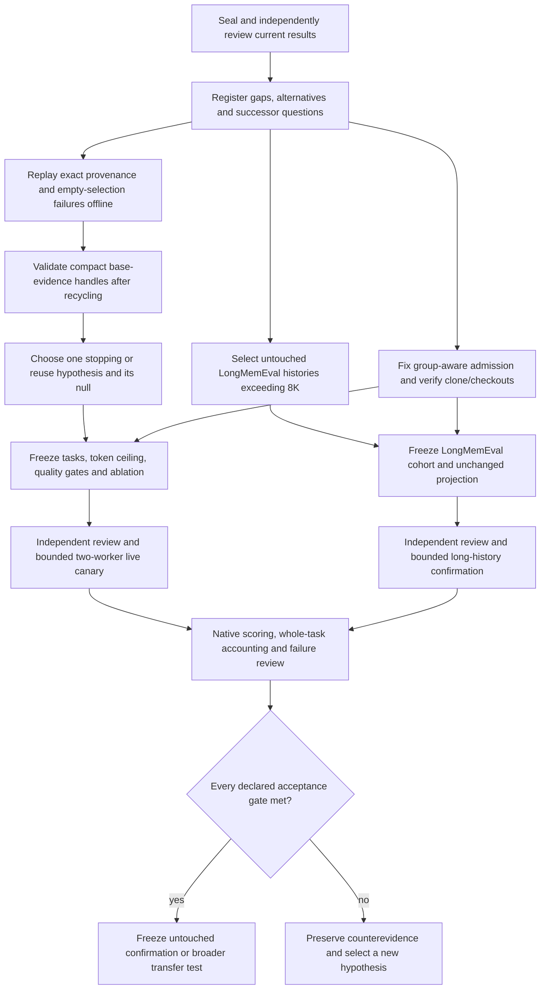

# Successor research plan

Status: proposed successor; no successor model calls are authorized by this file.
The current experiment and its amendment retain their original settings and results.

## Objective and method

Keep the initial objective: qualify GLM at small windows while improving reusable
ARE reasoning and evidence retention. Keep the current requirement: at least 15%
fewer cumulative input plus output tokens on long tasks, without losing quality or
completion, at an 8,000-token request boundary. Include ingestion, cached inputs,
reasoning, failed calls and model judging. Do not substitute prompt-byte reductions
or early failures for whole-task efficiency.

Use the same research chain: objective → measured gap → question → competing
hypotheses → reviewed selection → frozen experiment and tasks → results → native
observations → reviewed decision → successor. Create native D01/D03 records before
successor dispatch and D02/D04/D07/D08 evidence afterward. This document proposes
questions and order; it does not register an experiment retrospectively.

## Evidence that changes the next question

See [the failure analysis](contextbench/FAILURE-ANALYSIS.md), original results and
the amended results. The current ContextBench intervention isolates compact
requests. It does **not** include H72 terminal handles and cannot supersede the
earlier Round 55 confirmation. H72's confirmation was phase-specific; integrating
it into a new full-trajectory controller is itself a hypothesis to verify.

The first-pass trace evidence identifies three distinct mechanisms:

1. Smaller calls can permit more exploration before the same token-driven stop.
2. Real delivered reads can be invalid final evidence because they include edited
   lines absent from the pinned source revision.
3. A recycled prompt can expose no evidence IDs even though the receipt archive
   contains many reads. An empty selection then saves tokens without completing
   the benchmark task.

These are state validity and stopping problems, not reasons to weaken scoring.
The pinned-cache failure also requires a real clone-and-checkout preflight; merely
finding a commit object in the cache was insufficient.

## Competing successor hypotheses

| Candidate | Mechanism | Falsifier |
| --- | --- | --- |
| C-state | Present compact handles for relevant, delivered, base-projectable evidence at a terminal decision after recycling. Resolve handles privately and validate the complete selection schema. | Invalid or empty selections persist, or added state reduces quality or increases whole-task cost. |
| C-stop | Use retained progress and evidence state to propose a terminal decision when further exploration adds no useful evidence, while retaining the original maximum budget when readiness is not established. | Earlier decisions lose native quality/completion, or saved calls do not cover the state/review token cost. |
| C-reuse | Avoid repeated delivery of already represented observations while preserving access to exact source evidence. | Omitted repeated evidence is needed, or total savings remain below 15%. |
| C-output | Allocate or recover a bounded response allowance when output is incomplete, while preserving the 8K and cumulative limits and counting every attempt. | Completion does not improve or the extra model tokens negate the saving. |
| C-null | Compact requests merely fund extra exploration; the available state cannot reliably establish readiness. | A fixed, complete comparison achieves the token and quality criteria and replicates on untouched tasks. |
| L-transfer | The fixed LongMemEval projection transfers to untouched histories longer than 8K. | It loses answers requiring assistant context, temporal updates, implicit references or abstention, or fails the token criterion. |

Do not change multiple mechanisms without an ablation. First restore and validate
the terminal evidence contract, then compare a fixed state-aware baseline against
one stopping or reuse intervention. Do not select a lower spending cap and call
the resulting truncation an efficiency gain.

## Task DAG and order

1. Close this experiment before tuning its tested implementation.
2. Replay the actual failures locally. Assert revision validity, schema completeness,
   handle resolution, source availability after recycling and unchanged evidence.
3. Make group admission happen before reserving an execution slot. Test unequal
   task durations so one benchmark cannot strand the other's available workers.
4. Verify every pinned repository through the actual clone-and-checkout path.
5. Predeclare a bounded live canary and its full model-token ceiling. Use two workers
   per benchmark first; the present eight-request overlap supports capacity only,
   not a blanket future concurrency guarantee.
6. Keep the LongMemEval projection unchanged for confirmation. Select at least
   eight new histories exceeding 8K, preserve question-type coverage and exclude
   exposed development identities. Determine the precise cap from measured input
   lengths before dispatch; retain a separately metered, blinded judge.
7. Require both completion and native quality alongside the 15% reduction. Report
   all assigned cases, unknown usage and failures. Continue at small windows;
   do not reopen SWE-bench or claim full-benchmark clearance from these pilots.

## Open Questions

Can compact state recover valid base evidence without costly repeated source reads?
Can a general readiness rule distinguish productive search from redundant calls?
Does LongMemEval performance survive assistant-dependent facts and much longer,
unfiltered histories? Will eight concurrent requests remain reliable under longer
loads? These questions require new evidence, not stronger wording of current scores.
