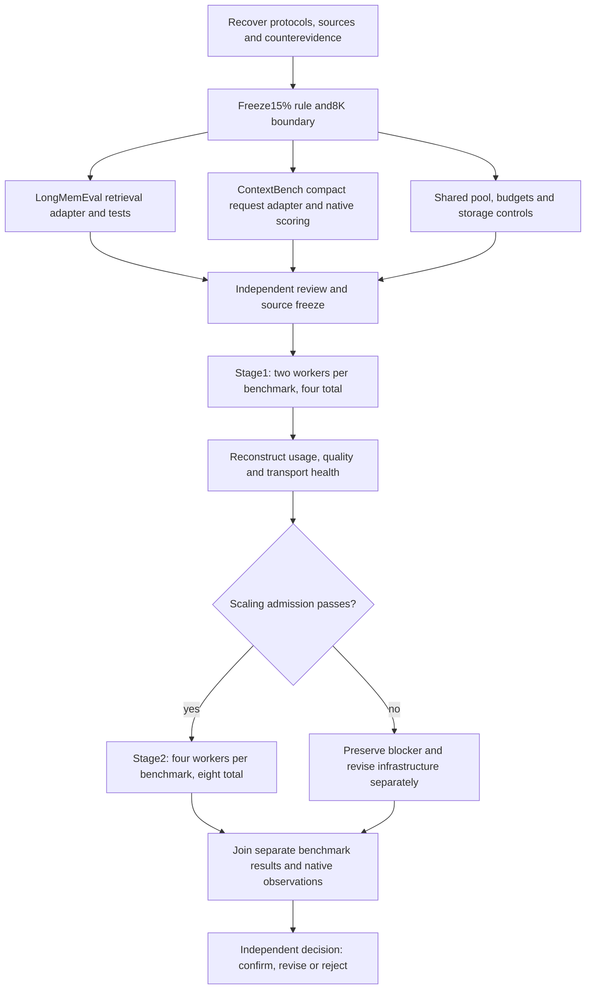

# Dual benchmark 8K token-efficiency experiment

Status: candidate implementation and preflight. Authority effect: none.

## Objective hierarchy

Enduring objective: improve reusable ARE reasoning, continuity, evidence recovery,
correctness and completed outcomes within cumulative model input plus output tokens.
Initial GLM objective: finish GLM-5.3-flash qualification beginning with small windows.
Current milestone: preserve the bounded 8K ContextBench confirmation and investigate
substantially better whole-task token efficiency, alongside LongMemEval memory quality.
The full ContextBench acceptance contract, larger windows and general transfer are
distinct from the bounded chapter already reported as confirmed in Round 55.

The user now requires at least **15% fewer total model tokens** on long tasks and
asks to run both benchmarks at 8K, first with two workers per benchmark and then
evaluate four per benchmark. Use **8,000 tokens**, not 8,192, as the maximum actual
input plus reserved output per request in both new branches. Existing studies are
preserved under their original window definitions.

## Research method

objective → gap → question → competing hypotheses → selection → experiment/tasks/criteria → results → observations → reviewed decision → successor

Preserve native D01/D03 hypotheses and experiments, D02 observations, D04 decisions,
D07 research DAG and D08 work evidence. Implementation DAGs do not substitute for
the research method. Source-bound continuity and independent review precede live
dispatch; observations follow actual results. No automatic retention or release.

## Gap and competing hypotheses

ContextBench Round 55 improved selection quality but reduced full logical tokens
only 0.608% (3,568 of 586,770). Its shared prefix alone costs 571,555 logical tokens
per arm aggregate; even free treatment suffixes could not yield 15% reduction.
The prior LongMemEval adaptation achieved control6/8 versus treatment3/8 with about
2% extra tokens. Source references and notes are not established improvements.

- LongMemEval H1: deterministic archival projection preserves useful exact user
  evidence and retrieves relevant assistant context, avoiding model-generated
  ingestion costs while preserving answer quality. H0: discarded dialogue or
  implicit references cause quality loss. This is an explicit retrieval-versus-
  sequential-notes adaptation, not the official full-history benchmark score.
- ContextBench H1: compact repeated tool/system descriptions and redundant tool
  metadata reduce whole-trajectory tokens while preserving source evidence,
  request constraints and native selection quality. H0: instructions or metadata
  removed by the projection were necessary, or savings fail to reach15%.
- Concurrency H1: the account sustains four total workers and then eight on these
  long workloads. H0: provider limits, saturation or local overhead prevent scaling.
  Throughput evidence and token-efficiency evidence remain separate.

## Work DAG

## Worker scopes and construction lanes

| Role | Scope | Dependency/gate | Join condition |
| --- | --- | --- | --- |
| dual8k_longmem | new longmemeval/ adapter, source-only selection, tests, run and score interface | fixed protocol, no gold in generator | reproducible branch result or explicit failure |
| dual8k_context | new contextbench/ adapter, native episode/scorer, cache preparation | original source versions, actual prompt capture | native result and exposure/usage evidence |
| dual8k_review | REVIEW.md, review-contract.json and independent reviews | both branch sources and tests | defects resolved and claims bounded |
| coordinator | pool, continuity, source freeze, live dispatch and synthesis | branch test/review gates | fixed denominators, native research linkage, auditable results |

User-directed construction is confined to this successor directory and any
explicitly reviewed additive shared helper. Historical runtime sources stay frozen;
necessary copies carry exact ancestry and narrow differences. Construction tests
and prototype evidence precede later product approval under D65. No admission,
release, deployment or publication is authorized by this plan.

Operational lane: credential/provider access, native scorer environment, correct
repository revisions, token budgets, storage and no overlapping stale processes.
The coordinator owns exact live prerequisites; no provider quota purchase is planned.

## Cohorts and comparisons

LongMemEval keeps all four previously selected development tasks, including failures,
with one repetition at each worker stage. Report all-task results and a separately
declared long-history stratum (unabridged input exceeds8,000 measured tokens).
Do not claim that short oracle histories represent the entire long-history dataset.
No gold is loaded by retrieval or prompting. All archives remain available to both
arms; model-generated sequential notes versus deterministic query-time projection
is the declared causal difference. Projection omissions are measured and disclosed.

ContextBench uses the first four tasks in the historical Round52 development
selection, fixed before new outcomes. They are exposed development evidence, not
untouched confirmation. Run full trajectories at8K; terminal-only suffix replay is
insufficient. Both arms use identical task revisions, model settings, source access,
request caps and native scorer. The treatment intervention acts before the actual
prompt capture so reconstruction verifies the real request. Preserve all delivered
source text, paths, spans and receipt identities. Native final Span-F1, coverage,
precision and valid selections remain the quality measurements; repair success
is not inferred from these scores.

Stage1 uses AB order per pair; stage2 reverses to BA. Four independent task pairs per
benchmark permit two then four concurrent pair workers. Each worker makes sequential
provider calls. Per-benchmark pair limits plus a global limit of four/eight bound
aggregate concurrency. Do not secretly substitute a tiny synthetic speed test for
either benchmark. Scaling admission is based on accounting and transport health,
not selecting favorable quality outcomes. Stage2 is a declared repetition, not a
retry of failed generations and not held-out confirmation.

## Fixed decision rule

For each benchmark separately:

`reduction = 1 - sum(treatment input + output) / sum(control input + output)`

Require reduction >=0.15, no worse quality or completion, full planned denominators,
and no unknown usage for an efficiency success claim. Count ingestion, reasoning,
cached input, repeated histories, failed calls and any model-based scoring. Keep
benchmark execution tokens separate from research-helper tokens; disclose both
when available. Fewer calls caused by failure or skipped exposure is not a win.

For this development experiment, ContextBench quality nonregression means macro
Span-F1, span coverage/precision, file coverage/precision and valid-selection count
are each at least control. This is a new local efficiency criterion, not satisfaction
of the legacy +5pp confirmation or full acceptance criteria. LongMemEval requires
native-rubric correct count and completion at least control, with the long-history
stratum reported separately. A task with missing required exposure or an incomplete
generation cannot establish a complete-pair efficiency gain.

ContextBench logical totals include complete prefixes for each arm. If any prefix
is physically shared, count it once for physical spending but once per logical arm
for the matched comparison. This successor intends independent full trajectories,
so expose rather than hide divergences in tool use and evidence delivery. Do not
change the existing full-benchmark acceptance criteria or label a small result as
global clearance. LongMemEval uses blind native-rubric review with ambiguity retained.

LongMemEval cap:204,800 tokens per stage across four pairs. ContextBench cap:96,000
tokens per arm,192,000 per pair,768,000 across four pairs per stage. Combined maximum
reservation is972,800 per stage and1,945,600 across both stages. These are ceilings,
not targets or measured spending. Reserve whole-pair ceilings before starting jobs;
each branch additionally enforces actual per-request and cumulative caps. Never
spend an uncertain job's reservation again or count missing usage as zero.

Scaling to four per benchmark requires stage1 complete accounting, no duplicate or
ambiguous calls, no rate-limit/overload signals, valid8K admission and storage health.
Observe actual per-benchmark request overlap and latencies. Any rate-limit signal
reduces future concurrency; keep in-flight requests and failures in evidence.
There are no hidden model retries or source/outcome-based replacements.

## Storage and run controls

Keep new repository worktrees/caches on disk-backed `~/.local/share/are/`, not `/tmp`
(currently a small memory-backed mount). Require2GiB free in both evidence and cache
locations before dispatch. Bound copied repositories and preserve small source,
request, usage, prompt-capture and scorer receipts. Clean only run-owned disposable
worktrees after independent scoring/reconstruction; keep manifests and results.

## Completion and successor rule

The planned execution must produce actual results for both benchmarks, distinct
15%/quality/completion verdicts, and an explicit four-worker scaling decision. If
admitted, execute stage2 as well. A failed hypothesis is preserved and drives a
new version; do not claim the requested efficiency has been achieved without data.
Promising development results require a separately frozen untouched confirmation
before a general quality/efficiency claim. No automatic move to larger windows.

## Open questions

Will deterministic source projection preserve implicit preferences and updates?
Can repeated schema/metadata reduction reach15% without changing ContextBench task
behavior adversely? Does the provider sustain four/eight total concurrent workers
on real long trajectories? What fresh long-history confirmation cohort should
follow if both development branches pass? Results and reviewed decisions own these.
