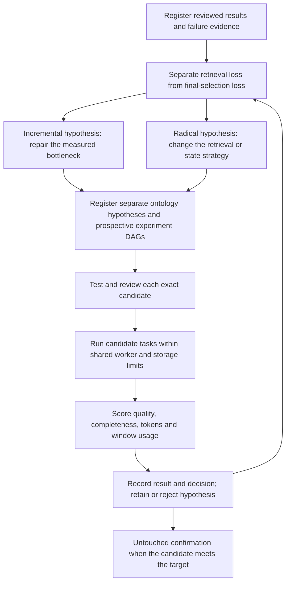
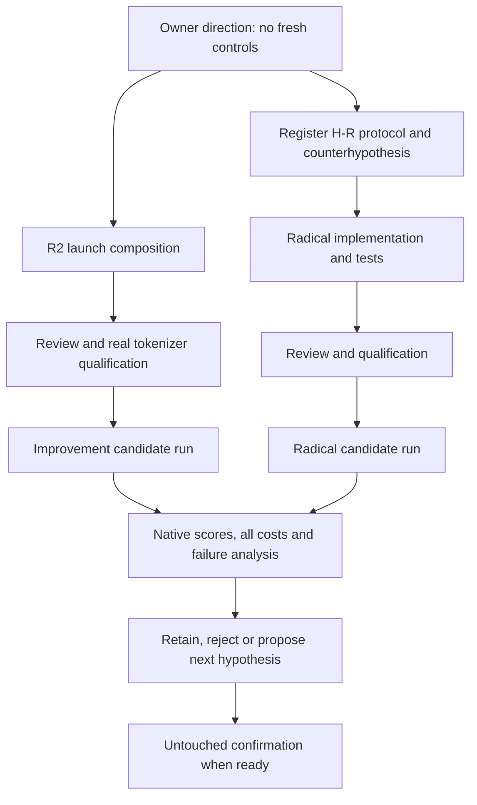
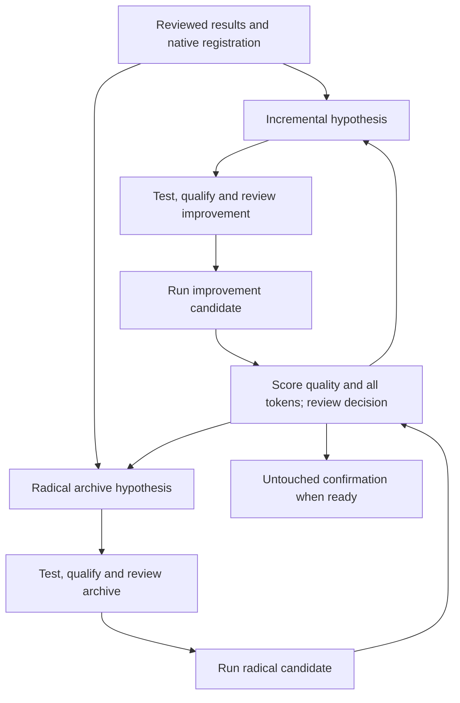
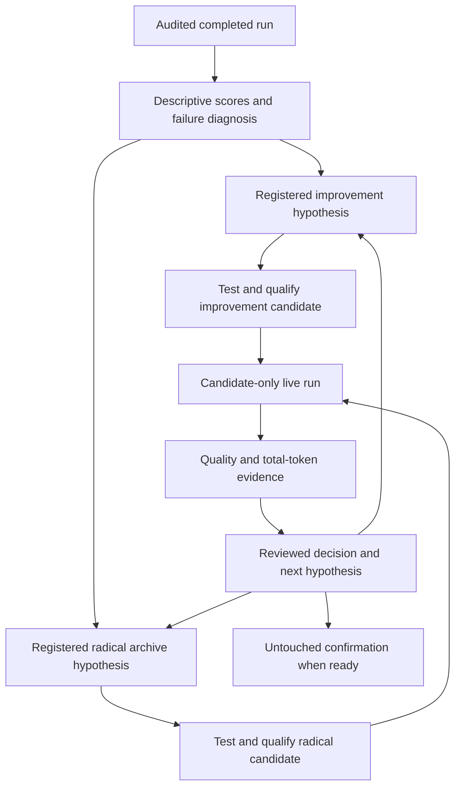

## Rounds 76–78 completed: clear live findings

Four new assigned runs settled, with **106 model calls and 864,835 tokens fully
accounted**. Round 76's failed candidate cost 6,627 tokens and remains retained.
The corrected identity candidate completed Svelte in round 77: 49 calls, 186,628
tokens, Span F1 28.64%, File F1 28.57%. Its 126 runtime call IDs verify; the live
sample did not repeat a raw provider ID. Twelve offline tests pass.

The separate round 78 deadline-only pair used original round 74 generation with
300-second nominal deadlines. DSH completed simdjson: 587,645 tokens, Span F1 78.70%,
File F1 57.14%. ARE stopped after 83,935 known tokens when GLM returned nine tool
calls against an eight-call ceiling. No completed request exceeded 120 seconds,
so the longer deadline's necessity is not established. Eleven offline tests pass.

This is clear diagnostic evidence, not whole-benchmark clearance or a 15% gain
without quality loss. Historical unknown usage remains unknown. No further paid
run is queued. The next hypothesis is bounded complete-response validation and
feedback, preserving execution and token budgets. Twenty-four completed native
research records verify across the three rounds.

[Full report, evidence, next DAG and open questions](contextbench/deepseek-deadline-78/REPORT.md).

## H-L terminal tokenizer qualification passed

Fresh control runs remain suspended. The exact reviewed H-L final-request stage
qualified all four fixed tasks with projected complete envelopes of 3,867 / 3,637
/ 3,389 / 3,855 tokens. The packets exposed 46 / 34 / 20 / 32 delivered evidence
handles. Each task used one request-tokenizer and one index-tokenizer receipt;
there were zero model calls, retries or evaluator calls. The child exited zero,
without force, and its process group is absent. Sealed result SHA256:
`480aa6ef337c7ff357ac1ed2337b23c6c937648e43d54dd72b8d11ab064a113f`.

Independent result review approved the artifact with 3,019 exhaustive bindings,
JSON SHA256 `15bf09011bef9b50135e5cde1739f4fd9cceb21c0854844846f32ee70ca3ecfc`.
It reconstructed all four donor packets and every prompt/receipt hash exactly.

This closes initial, populated exploration and representative terminal 8K fit
for H-L. It does not measure benchmark quality or token savings. The next work
is the exact H-L GLM
production composition, freeze/review, four candidate tasks, native scoring and
mechanism/token decision. The radical branch stays separate and no control run
is added.

### Open Questions

Will H-L improve native quality and useful confirmed-source recall per total
model token? Perfect quality, >=15% total-token reduction and untouched
confirmation remain unachieved.

## H-L populated-ledger tokenizer qualification passed

Fresh control runs remain suspended. The exact R3 H-L qualification completed
all four fixed tasks with two workers and clean local process settlement. It
measured all 85 reviewed historical discovery requests; 77 requests contained
visible recent-evidence ledger entries. The maximum complete request envelope
was 7,988 of 8,000 tokens. The run made zero model-generation calls and the
independent binding verifier accepted the sealed result at SHA256
`f02f94504dd0eaedf99b95b14af3b544086ddcdd6baf979abe637877af307a13`.

This establishes real tokenizer fit for populated exploration requests. It is
not a benchmark quality result and does not establish token savings. Independent
result review remains the final integrity gate for this artifact.

Product task order: independent result review -> representative terminal-request
qualification -> exact H-L production freeze/review -> four-task GLM candidate
run -> native quality, mechanism and total-token analysis -> retain or reject
H-L. The radical candidate remains a separate hypothesis and may follow the same
shared worker capacity after H-L settles. No new control branch enters this DAG.

### Open Questions

Does the representative final-selection request fit the same strict 8K envelope?
Will the model use the more visible recent evidence to improve native quality and
total-token efficiency? Perfect quality, the original >=15% token reduction and
untouched confirmation remain unachieved.

## Owner direction: improvement candidates and radical hypotheses only

Fresh control runs remain disabled. Preserve historical controls and frozen
results as reference evidence; do not spend new provider tokens rerunning them.
Historical comparisons remain descriptive, not matched causal or savings proof.

The two research branches are incremental improvement (current H-L recent
confirmed-evidence ordering) and a separate radical approach (H-R explicit
exploration frontier and visited-evidence policy). Register each hypothesis,
expected mechanism, falsification criteria and measurement contract before its
run. Keep the fixed cohort, 8K limit, token accounting and two-worker cap.
The reusable ARE objective and original >=15% total-token reduction target remain.

Initial H-L tokenizer qualification completed successfully: four projected
requests contain 4,119 / 4,108 / 4,226 / 4,286 tokens, zero model-generation calls,
and clean process settlement (exit 0, process group absent). Evidence:
[initial qualification](contextbench/recent-evidence-initial-tokenizer-live-r1/supervision/RESULTS.json).
This is initial request fit, not populated-ledger fit or new benchmark quality.

Product task order: review initial result integrity -> qualify populated-ledger
and terminal requests -> bind exact production launch -> run four candidate tasks
-> native scoring and mechanism analysis -> retain/reject hypothesis and select
next incremental or radical experiment. Radical hypothesis design can proceed
alongside qualification; its execution needs its own registered experiment.
Research operator owns storage checks, source integrity and process supervision;
these affect live launch. Publication and release remain deferred.

### Open Questions

Does actual model behavior improve quality and total-token efficiency? Does the
radical frontier outperform incremental ordering? Perfect quality, >=15% token
reduction and untouched confirmation remain unachieved.

## H-L campaign integration approved; initial qualification constructed

Candidate runner, exact schedule and receipt-bound mechanism census pass 11 tests
and independent review (2,841 bindings). Historical replay reproduces 335,219
model tokens, 43/72 repeated direct reads and 66/73 ledger omissions exactly.

Campaign accounting, outcome sealing, native reconstruction and H-L adjudication
pass 10 tests and independent review (2,856 bindings). Tests cover fixed failed
denominators, unknown reservations, post-score measurement failures, zero direct
read use, and every registered support threshold. Original native perfect-quality
gates remain unchanged. These are local fixtures, not a new benchmark score.

Tokenizer-only initial qualification now has 16 passing tests across request,
process and parent boundaries; construction review is approved (2,867 bindings).
Initial stage freeze contains 2,868 files, SHA256
7636702500e850a9bfc4c4c58642e1737896a5d6e067c114233f0c403ca0419e.
Exact tokenizer launch review is pending; no provider call has been made. Read-only WSL/D storage preflight
admitted the 2,583,691,264-byte growth reservation with 16,654,442,496 host-free
bytes; launch must recheck this live value.

Product frontier: exact tokenizer launch review -> real initial tokenizer run. Then qualify populated ledger requests and
terminal selection, bind the supervised production launch, and run all four fixed
tasks. Research operator owns source integrity, process settlement and live WSL/D
guards. No fresh control, retry, task replacement, budget increase or release.

### Open Questions

Actual tokenizer fit and new model behavior remain unmeasured. Does reordered
confirmed evidence improve useful exported coverage per token? Raw retrieval vs
source-delivery/projection loss remains unresolved. Perfect quality, original
≥15% token reduction and untouched confirmation are not achieved.

## H-L registered; live qualification remains next

Recent-evidence ledger construction is independently approved: 13 tests pass,
source coverage is unchanged, and same-entry-count replay reduces latest confirmed
path omissions from 62/69 to 10/69. This is presentation evidence, not measured
model behavior, actual token fit or a new benchmark score.

The schema-agreement retrospective result R2 is independently approved: six
native records, 77 historical DAG nodes and five successor tasks. R1 and its
rejection are preserved. Important correction: the 58.4% recall gap is absent
from the exported confirmed-source union, not proof that raw retrieval never
returned it. Delivery/projection loss remains unresolved. See
[corrected decomposition](contextbench/SELECTION-LOSS-ANALYSIS-R2.md).

[H-L protocol](contextbench/RECENT-EVIDENCE-LEDGER-PROTOCOL-R1.md), measurement
contract, candidate-only schedule and native prospective registration now exist:
three hypotheses, one selected experiment, 11 DAG nodes and 17 edges. Registration
review R1 is approved (2,826 bindings); no live admission. Four fixed tasks, two shared workers and 384K campaign ceiling;
no fresh controls, automatic retries or task replacements. Radical exploration
frontier remains a separate proposed hypothesis, not part of this intervention.

Product frontier: candidate runtime/measurement integration
-> exact-source freeze and actual tokenizer qualification -> supervised run ->
native score, mechanism audit and research decision. Research operator owns launch
storage/process guards. No provider calls this turn; release remains deferred.

### Open Questions

Will real token fitting retain the visibility benefit, and will the model use it
to improve native quality per token? Where does missing exported evidence drop out
between raw output and confirmed projection? Perfect score, original ≥15% token
reduction and untouched confirmation remain unachieved.

## Recent-evidence ledger candidate implemented

[Candidate and validation](contextbench/RECENT-EVIDENCE-LEDGER-R1.md): 8 focused
ledger tests and 5 episode integration tests pass. The episode changes only ledger
ordering and candidate identity. Frozen implementation and results are preserved.
Offline replay: latest confirmed path omissions fall from 62/69 to 10/69 at the
same entry counts, with identical source evidence. Real token fit and model
behavior remain unmeasured; no provider call or live launch occurred.

Product frontier: native retrospective result registration, H-L prospective
measurement/schedule/DAG and independent candidate review, then real tokenizer
qualification and supervised run. Research operator owns live storage/process
guards. No fresh controls; radical policy remains separate; release is deferred.

### Open Questions

Does recent-first ordering improve native recall per token under actual token
limits? Perfect score, original token target and untouched confirmation remain
unachieved. See candidate notes for limits and remaining gates.

## Next measured bottleneck: ledger hides active source coverage

[The trace audit](contextbench/LEDGER-VISIBILITY-AUDIT-R1.md) finds the latest
returned read path absent from 66/73 exploration ledgers; 43/72 successful direct
reads repeat only previously returned lines. Alphabetical prefix truncation is
confirmed in the renderer. Causality remains a hypothesis.

Next incremental candidate: recent confirmed evidence first within the existing
ledger budget. Preserve original observation order across replay and source
version separation. Register H-L and its prospective DAG before candidate launch;
implementation/replay and independent review precede live qualification. The
radical exploration-frontier candidate stays separate. No provider calls this turn.

### Open Questions

Will better ledger visibility improve acquired recall per token? See the linked
audit for proposed falsification gates and the distinction between returned and
delivered evidence. Perfect score and untouched confirmation remain unachieved.

## Acquisition failure now quantified

The reviewed result and reproducible [selection-loss analysis](contextbench/SELECTION-LOSS-ANALYSIS-R1.md)
show that acquisition is the largest remaining gap. Selection-only changes
cannot yield perfect quality on three of four tasks. Prioritize an acquisition
hypothesis for the next live candidate; keep final-selection repair separate.
The result integrity review is approved (older pending-review entries below are
historical). No new provider run occurred. Native retrospective registration,
trace-level mechanism analysis, and separate prospective hypotheses remain next.

### Open Questions

Which acquisition strategy improves recall per token and generalizes to untouched
tasks? See the linked analysis for measured losses, assumptions and proposed tests.

## Current owner direction: candidate-only research

The user requests: "we should stop the branch of control, and focusing in only improving results and radicals".
No fresh control runs are planned. Preserve historical controls and immutable
experiment evidence; use historical comparisons descriptively, not as proof of
causal improvements or matched token savings. This direction supersedes any
older plan requesting a new control arm. No benchmark worker was observed
running at this update; no process was terminated and no live run was launched.

The objective remains reusable ARE reasoning and evidence retention with better
quality and at least 15% fewer total model input/output tokens on long tasks.
The token target remains unproven. Keep the 8K envelope, fixed tasks, full
accounting, two shared workers, and existing per-task/campaign limits.

Do not bundle radical changes with incremental fixes in one experiment. Each
hypothesis needs a falsifiable prediction, fixed measurement criteria and a
result-to-decision link. Radical work must test a distinct mechanism; a small
parameter adjustment does not establish a new approach. Candidate selection
uses quality and token evidence together, including regressions and failures.

Product frontier: complete the current retrospective registration and failure
analysis, then define the two candidate experiments. Runnable work is analysis
of existing evidence; the next live candidate is not yet qualified. The research
operator owns source review, launch preflight, WSL/D storage and process guards;
these apply at each live launch. Publication and release remain deferred.
This is a planning update, not admitted execution state or a new launch receipt.

### Open Questions

Which failures come from missing evidence versus dropping useful evidence at
final selection? Which distinct radical mechanism merits the next bounded run?
Can a candidate meet quality and token targets on untouched confirmation tasks?

## Real schema-agreement benchmark completed and scored

Exact production launch review approved the fixed candidate run. Parent session
93690 completed exit0/statusscored; generation child554954 settled0, groupabsent,
no force. All four tasks valid, zero perfect. Every gate passes except perfect
quality. Complete known/conservative accounting:335219tokens,89modelcalls;
maximum projected request7987 (<7999).

Mean span-F1 .3917843227829315; mean file-F1 .47490842490842494; meanQ
.049285014729090575. Versus previous ranked candidate:span +2.846pp and1811fewer
tokens (0.537%). Versus registered measured-terminal baseline:span −0.503pp and
1593moretokens. Historical comparisons remain descriptive only.

Eligible registered outcome is counterevidence:Q improves and ranked rejection
falls from30/50(60%) to6/14(42.86%), but span-F1 misses the .396810484 quality
threshold. All37search calls retained; six rejected, all nonempty ranked prefix.
Task spanF1:0/.8079622304/.4466372572/.3125378035. Tasktokens:
83786/85224/83729/82480. No perfect task; original goal remains active.

Score SHA256ac8aff4bc99749b52803e6811e4662f458b527af7353ded5f16d54591c18def8.
Independent RESULT-REVIEW-R1 is pending. POSTRUN-DIAGNOSTIC-R1.json pins sources,
comparisons and unresolved mechanism questions. No frozen implementation changed.

Product frontier: complete result review, register native research result/decision,
distinguish acquisition shortfall from final-selection loss, and register the
next incremental or radical hypothesis. Path-scoped retrieval remains the radical
alternative; no new experiment admitted yet. Research operator owns next live
WSL/process guards. No controls, retries, publication or release.

### Open Questions

Task1 union source recall .0786 yields final spanF1zero; task2 union recall1 yields
final spanF1 .808. Which acquisition and selection mechanisms limit quality?
Perfect score, original ≥15% token reduction and untouched confirmation remain
unverified. Schema validity alone has not solved task completion.

## Exact production freeze and preflight ready

Production construction review R1 approved27tests and2,501bindings. Created
schema-agreement-production-live-r1/FREEZE.json with2,502files, SHA256
 a0ddd1293d0b30abb29020774c70c7a2c5639dd011d39c2bb13858c235628f86.

Read-only production preflight passed: source commits, qualification/research
bindings, credential reference and Dstorage verified. PREFLIGHT-R1.json records
16,761,835,520host-freebytes against2,583,691,264growthreserve. No provider calls.
Exact production launch review is pending. Production run has not started.

Product frontier: exact launch review → supervised four-task candidate run →
settled native scoring and complete call/cost analysis → next evidence-based
hypothesis or untouched confirmation. Fixed4/2workers/384K/8K, no retries,
transfers, replacement tasks or controls. Research operator owns live guards;
publication/release remain deferred.

### Open Questions

Model adherence, quality improvement and net token efficiency remain unmeasured.
Perfect scores and untouched confirmation are not achieved.

## Production launch binding implemented

Output/final result reviews R1 approved their real single-attempt tokenizer
receipts, source visibility, source hashes and clean settlement. All three
qualifications now have independently reviewed results.

Added candidate production launcher, generation/scoring workers and process
wrappers. Production freeze verification binds the prospective overlay and
registration review, all three current qualifications and their reviews, exact
new search schema, fixed cohort/budgets and candidate scorer. Source preparation
explicitly requires admitted D storage before creating the production directory.

27tests pass:22process/launcher/failure tests plus5real-qualification binding
checks. Old advertised schema, substituted hashes/cells, oversized final requests
and forced settlement are rejected. Saved PRODUCTION-LOCAL-EVIDENCE-R1.json.
Production construction review R1 is pending; no provider calls this turn.

Product frontier: approve construction, prepare exact production freeze, run
read-only preflight and exact launch review, then run4tasks/2workers/384K with
native scoring and complete call/cost census. Research operator owns WSL and
process guards. Fresh controls/publication/release remain suspended.

### Open Questions

Actual model quality, rejection improvement and net token efficiency are still
unmeasured for this candidate. Perfect score and untouched confirmation remain
incomplete; tokenizer success is not a quality result.

## All three real tokenizer qualification stages passed

Output and final launch reviews approved exact sequential tokenizer-only runs.
Both completed exit0, groups absent, no forced termination, zero model calls.

- Output:6165/6387/6610/6294 projected tokens;3/4/5/3windows retained, source
  visible in every task.4request tokenizer receipts. Child499366 settled.
  Result SHA25654b552c983e85553c5bd273707d439a511c974dac30f5dc5c2f12c5daa0060ff.
- Final:4763/4116/3063/4991 projected tokens;93/63/3/79handles.
  4request+4index tokenizer receipts. Child513209 settled.
  Result SHA25658ed6066edb880fbba01f68194b215718714228fd4143f6f5f6d9032dc323588.

All are strictly below7999. Output adds84tokens versus the preceding candidate;
final envelopes are unchanged. Initial qualification already passed and its result
review approved. Output/final result reviews are pending. No model-score evidence.

Product frontier: finish result reviews; bind new production launcher to exact
three qualifications, prospective research overlay, candidate scorer and process
supervision; review/freeze production and execute fixed4tasks/2workers/384K.
Research operator owns WSL disk/process guards. No fresh controls/publication.

### Open Questions

Will fewer rejected calls improve quality enough to offset schema overhead?
Perfect scores, original token reduction and untouched confirmation remain open.

## Output and final freezes prepared

Output/final construction review R1 approved all49tests and2,434bindings.
Created exact freezes (2,435files each), no provider calls:

- schema-agreement-output-tokenizer-live-r1/FREEZE.json:
  65ba6befc1baafb05ff0192c3783a75a993d1b155fb7406d49281e55307c9a9d
- schema-agreement-final-tokenizer-live-r1/FREEZE.json:
  d5c162e5d69491c235a201a330ca056a2a59ab10d52e1ad563ee5415d8f262ff

Exact tokenizer launch reviews are pending. Planned order is output then final,
sequentially, preserving at most2workers. D guard admitted512MiB combined reserve
with16,780,009,472bytesfree at preflight; each invocation must recheck.

Product frontier: execute exact-reviewed tokenizer stages, review measured results,
then bind the production launcher to all three qualifications and prospective
research overlay. Research operator owns live storage/process gates. Controls
and publication/release remain suspended.

### Open Questions

Output/final measured envelopes and GLM behavior remain unverified. Perfect
quality, original token reduction and untouched confirmation remain incomplete.

## Output and final qualification implemented and locally verified

Initial real result review R1 approved: all four qualified, 12 single-attempt
HTTP200 tokenizer receipts, no models, unchanged sources and clean settlement.

Added candidate-specific output/final qualification, representative source, donor,
process/worker/stage/command and binding modules. 49 tests pass (19final,
22output/source/process/parent,8historical binding integrity). The binding decoder
uses historical fixtures only; this is not new candidate qualification evidence.

Read-only actual donor preflight succeeds for all four tasks. Output donors bind
the reviewed new initial prompts/indexes; final donors preserve historical source
delivery93/68/3/124reads. No donor is credited as delivery by the new candidate.
Saved SCHEMA-AGREEMENT-OUTPUT-FINAL-LOCAL-EVIDENCE-R1.json. Package review pending.

Product frontier: approve package, create exact output/final freezes, obtain exact
launch reviews, execute and review real tokenizer measurements, then complete
production launch binding. Research operator owns storage/process live gates.
No provider calls this turn. Controls, publication and release stay suspended.

### Open Questions

New output/final envelope sizes and conditional-schema model behavior remain
unverified. Perfect score, original token reduction and untouched confirmation
remain incomplete; no new native benchmark results this turn.

## Real initial tokenizer qualification passed

Exact launch review R1 approved the frozen initial tokenizer invocation. Completed
run schema-agreement-initial-tokenizer-live-r1: all four requests qualified, with
projected envelopes 4119 / 4108 / 4226 / 4286 (strictly below 7999).
Each run stores one request tokenizer receipt and two index tokenizer receipts:
12 tokenizer receipts total, zero model calls. Child448008 exited0, process group
absent, no forced termination. Parent invocation exited0.

Result: supervision/RESULTS.json SHA256
078fee95bb3f0e3bfed46c07206b0d4cac4605776e149cb4b8bad12cf972bba2.
Independent result review R1 is pending. Every initial envelope is84tokens larger
than the preceding ranked-read candidate; rejection/quality benefits remain
unmeasured. Tokenizer success proves request acceptance/size, not model adherence.

Product frontier: finish result review, qualify representative output and final
requests for this candidate, then review exact supervised four-task launch.
Research operator owns WSL host-disk growth and process guards at each live stage.
Fresh controls remain suspended; no publication or release effects.

### Open Questions

Will the model use the truthful schema to reduce errors enough to improve quality
per total model token? Perfect scores, original token savings and untouched
confirmation remain unverified. No new native benchmark scores this turn.

## Initial tokenizer qualification frozen for exact launch review

Campaign review R1 approved bounded integration. Initial qualification review R1
approved all 16 local tests (8 request, 2 parent, 6 process) with 2,360 bindings.
Saved SCHEMA-AGREEMENT-INITIAL-LOCAL-EVIDENCE-R1.json.

Created schema-agreement-initial-tokenizer-live-r1/FREEZE.json with 2,361 source
bindings; SHA256 f7032a74102c3c1126fe671258bf519a7a66fa32db9a243e9628653f0f2d14ff.
The first preparation invocation lacked the required VM flag and failed before
stage creation; the corrected invocation succeeded. No provider/model calls.
Exact tokenizer-only launch review is pending. New roots are fresh.

Bound WSL D guard admitted 2,583,691,264 bytes growth with 17,152,569,344 bytes
host free at preflight. Recheck immediately before execution; guest free space
alone is not sufficient evidence of host capacity.

Product frontier: receive exact launch review, execute initial tokenizer-only
qualification, verify its results, then qualify output/final envelopes and launch
the fixed candidate run. Research operator owns exact storage/process checks.
No fresh controls, publication or release.

### Open Questions

Tokenizer success proves endpoint acceptance and measured envelope only. GLM's
handling of conditional schema constraints requires model-response evidence.
Perfect native quality, token reduction and untouched confirmation remain open.

## Full candidate campaign and scorer integration passes locally

Adjudication review R1 found an accepted/structurally-invalid contradiction.
R2 rejects inconsistent classification/structure/outcome combinations while
retaining valid-structure semantic rejections. Six tests pass; review R2 approved.

Added schema-agreement campaign, queue, storage, outcome seal, evidence manifest,
ledger, accounting, summary, combined census and score-schema-agreement-r1.mjs.
Candidate identity and schedule are distinct; original guards and native gates
remain. The scorer forwards complete search accounting to the registered decision.

Three end-to-end local HTTP tests pass: all four fixture tasks complete with
verified census; unknown provider usage preserves every assigned outcome;
measurement failure preserves native outcomes and costs. Scores in these tests
are fixtures, not real benchmark improvement. Campaign review R1 is pending.

Product frontier: finish campaign review, bind candidate qualification/launcher,
verify real provider schema compatibility and 8K request envelopes, then run the
four fixed candidates. Research operator owns WSL/process guards at live stages.
No external provider calls this turn; controls and release remain suspended.

### Open Questions

Real provider conditional-schema support and benchmark benefit remain unverified.
Perfect quality, original token reduction and untouched confirmation remain open.

## Candidate orchestration approved; decision logic tested

Census/episode review R2 approved. Orchestration review R1 verified all four
production cells against the schedule and approved bounded construction with
2,331 bindings. Three real-transport/local-HTTP tests pass: native export,
mixed literal/ranked identities, and unknown HTTP outcomes without retries.
Episode R2 corrects saved success/failure arm identities to schema-agreement;
the earlier reviewed episode remains preserved.

Added schema-agreement-adjudication-r1.mjs and four tests. The decision requires
complete quality/cost/search evidence, registered Q and span thresholds, and
pooled ranked rejection strictly below 0.6. Zero use or incomplete evidence is
inconclusive; missing thresholds is counterevidence. No completion/savings claim.
Adjudication review is pending; production scorer integration is not finished.

Product frontier: review adjudication, wire candidate census/scorer/outcome
boundaries, verify provider compatibility, qualify exact requests and run the
fixed four candidates. No external provider calls this turn. Research operator
owns disk/process guards at live stages. No fresh controls or release effects.

### Open Questions

Live schema support and quality benefit remain unverified. Perfect score,
original token reduction and untouched confirmation remain open.

## Complete search accounting and episode wiring

Shared-schema implementation review R1 approved bounded construction. Added the
schema-agreement episode; four tests pass and verify the actual offered search
schema, source delivery and preservation of paid failures.

New search census records malformed, invalid, default-mode and unresolved calls.
Reviewer found that R1 lost a known token component when the other was missing.
R2 preserves each known input/output component and marks incomplete usage
inconclusive. Six census tests pass. R1 evidence remains for audit.

Pinned historical replay R2 reconstructs 58 search calls, 50 ranked calls,
30 rejections and 337030 model tokens across all four tasks. Structural agreement
in this replay refers to the new local schema, not the old live offered schema.
No new provider calls or benchmark score. Census R2 and episode review pending.

Product frontier: finish census/episode review, connect candidate identity and
scoring, verify provider compatibility, qualify exact requests, then run fixed
four-task candidate. Research operator owns disk/process guards at live stages.
Controls remain suspended; publication and release remain deferred.

### Open Questions

Provider conditional-schema support, live score improvement, perfect native
quality, original token reduction and untouched confirmation remain unverified.

## Shared schema implemented; local replay passes

Registration review R2 approved bounded construction after the prospective graph
repair. Added schema-agreement-arguments-r1.mjs and schema-agreement-tool-r1.mjs.
The model-facing schema and runtime share one immutable structural contract.

Four argument tests pass: 189 field/boundary cases, all 50 pinned historical
ranked calls (30 rejected and 20 accepted), semantic byte/UTF8 limits and bounded
diagnostics. Ten adapter tests pass with retrieval/source integrity preserved.
Evidence: contextbench/SCHEMA-AGREEMENT-LOCAL-EVIDENCE-R1.json. Implementation
review R1 is pending. No provider or benchmark calls were made.

Product frontier: review the candidate, integrate complete search-call census
and candidate identity, then verify provider compatibility and exact 8K request
qualification before the four-task run. Research operator owns WSL/process guards
at live stages. Controls remain suspended; release and deployment remain deferred.

### Open Questions

Does GLM preserve the conditional schema, and does it improve source coverage and
quality per total model token? Malformed-call accounting and live integration are
still needed. Perfect quality and untouched confirmation remain unverified.

## Prospective registration and DAG repair

Schema-agreement registration produced three native hypotheses and one experiment.
Independent review R1 verified records, measurements, schedule and 2,301 bindings,
but rejected the copied historical DAG because it omitted the prospective records.

Added SCHEMA-AGREEMENT-PROSPECTIVE-OVERLAY-R1.json: 12 nodes, 19 edges, ten
layers linking the parent question, all three hypotheses, selection, experiment
and six unverified task gates. Three tests pass, including cycle, missing-edge,
selection, reference and missing-record rejection. Historical records are preserved.
Combined registration and overlay review R2 is pending. No provider calls made.

Product frontier: finish overlay review, implement shared structural schema and
replay all 50 historical calls plus the complete field-boundary matrix. Live
qualification and WSL/process guards remain prerequisites at the live stage,
owned by the research operator. No fresh controls or release effects.

### Open Questions

Provider schema compatibility, malformed-call census and actual quality benefit
remain unverified. Perfect quality and untouched confirmation remain incomplete.

## Active research direction: candidates only

Owner direction reaffirmed: stop fresh control runs. Allocate future experiments
to incremental improvements and radical alternatives. Preserve historical control
results, failed runs and frozen evidence. Do not restart controls automatically.

Verified current ranked-read schedule: four candidate slots, no fresh controls,
two shared workers and a 384,000 total model-token ceiling. The 8K window and
fixed tasks remain. No benchmark worker was found running during this check.

Task order: register the schema-agreement successor → review its measurement
contract → implement and test the shared schema → qualify and run the candidate
→ score native quality and all model input/output tokens → decide whether to
retain the improvement or test a separately registered radical alternative.
The ranked-read run is complete; it must not be relaunched as pending work.
Each hypothesis keeps its counterhypothesis, falsification criteria, research
ontology record and DAG dependencies. Select the next lane from the evidence;
do not spend tokens rerunning controls.

Product frontier: schema-agreement prospective registration and implementation.
Incremental lane: repair disagreement between advertised and enforced schemas.
Radical lane: separately test path-scoped retrieval or a different evidence
selection mechanism; specify its counterhypothesis and failure criteria first.
Research operator owns WSL disk and process guards at live stages. No new model
run is started by this direction update; release and deployment remain deferred.

### Open Questions

Which candidate improves quality per total model token? The original ≥15% token
reduction objective remains unproven. Historical comparisons cannot establish
matched-control savings or causal benefit. Untouched confirmation remains needed.

## Schema-agreement prospective registration prepared

Added schema-agreement-schedule-r1.mjs and register-schema-agreement-r1.mjs.
Exact schedule checks pass for four candidates/two workers/384K; controls, extra
workers, increased task tokens and old candidate identities are rejected.

The registration script preserves the reviewed design and original campaign
gates, creates three competing hypotheses plus an experiment, and pins exact
measurement/schedule artifacts. Metrics include all-search-invalid-rate and
unclassified/malformed-search counts so ranked-only denominators cannot silently
hide errors. Zero use or incomplete classifications is inconclusive.

The retrospective research result review is now approved (2,295 bindings).
The prospective registration script executed successfully: three native hypotheses
and one experiment, four fixed candidate tasks, two workers, 384K total tokens,
zero provider calls. Independent registration review is pending. The copied
retrospective DAG may omit prospective nodes; resolve that linkage before
implementation. No new model run is admitted.

Product frontier: execute prospective registration,
review records/measurement contract, then implement shared structural schema.
Research operator owns later qualification and WSL/process guards; no fresh
controls; release deferred.

### Open Questions

Malformed-call census implementation, provider schema compatibility and model
benefit need verification. Perfect quality, original token reduction and untouched
confirmation remain open.

## Ranked experiment recorded in native research DAG

Schema agreement design review R1 approved the audit, baseline arithmetic and
bounded design for prospective registration. Provider schema compatibility and
malformed-call accounting still need explicit treatment before live execution.

Added register-ranked-read-result-r1.mjs and
contextbench/ranked-read-production-live-r1/RESEARCH-RESULT.json.
Native validation passes six records,71DAGnodes and six successor tasks, preserving
the historical registration/overlay chain. Confirmed ranked use is narrow evidence
only; the registered quality-efficiency hypothesis receives counterevidence.
The learning decision selects review/registration of schema agreement and preserves
ranking relevance and path-scoped retrieval as competing hypotheses.

Postrun research review requested. Product frontier: finish retrospective review,
create distinct candidate schedule and prospective native hypotheses/experiment
with exact measurement contract, then implement all-field schema agreement.
No runtime change or new model call. Research operator owns qualification and
WSL/process guards at later live stages; no controls; release deferred.

### Open Questions

Provider schema compatibility, malformed-call accounting and observed model
benefit remain unverified. Perfect quality, original15%token reduction and
untouched confirmation remain open.

## Next improvement design: advertised and runtime schema agreement

Result review R1 approved the completed ranked run: 4valid/0perfect,
337030tokens/95calls/maxwindow7975. Reproducible audit now proves all30 rejected
ranked calls passed the schema offered to the model. Twenty other ranked calls
succeeded. This is structural contract disagreement, not evidence of model
noncompliance; its causal contribution to quality regression remains unknown.

New evidence: contextbench/RANKED-SCHEMA-AGREEMENT-AUDIT-R1.json and generator
audit-ranked-schema-r1.mjs. Proposed protocol:
contextbench/RANKED-SCHEMA-AGREEMENT-PROTOCOL-R1.md. Select schema agreement as the
next improvement design; retain ranking relevance as counterhypothesis and
bounded scoped ranking as a separate radical. All-field boundary matrix,
deterministic old-trace replay, fixed numeric quality/efficiency thresholds and
original perfect-quality/untouched gates are specified. Design review requested.

Product frontier: review design, register native postrun result/hypotheses/
experiment/DAG, then implement. No new model run started. Research operator owns
live qualification and WSL/process guards at later stages. No fresh controls;
historical evidence and frozen sources unchanged; release deferred.

### Open Questions

Provider support for the selected schema representation and model response to
schema agreement need verification. Ranking relevance, scoped retrieval,
generalization, perfect quality and original token savings remain unresolved.

## Ranked-read candidate completed and scored: hypothesis counterevidence

The run finished successfully and native scoring completed. Tool session 16768
is terminal exit0; generation child61708 settled/group absent/no force. Do not
restart this stage. Four valid tasks, zero perfect. Total model tokens337030;
mean span-F1 0.36332406471879203, mean file-F1 0.38253968253968257. All gates pass
except each_task_perfect. Acquisition measurement eligible, counterevidence:
span-F1 delta -0.03348641930947566 versus historical measured-terminal candidate;
coverage per10000tokens delta -0.001725058000123486. No matched-control claim.

Score: contextbench/ranked-read-production-live-r1/score/RESULTS.json,
SHA818bbfe61996e18c61b850e1d926b0d6b1098dd79b32992f8557df881ede21ad.
Independent result review requested. Trace diagnostic saved as
contextbench/ranked-read-production-live-r1/POSTRUN-DIAGNOSTIC-R1.json:
50ranked calls,20success,30rejected;29for forbidden path_prefix,1for limit>5.

Product frontier: verify result/diagnostic integrity; register next hypothesis,
counterhypothesis, falsification criteria and DAG from these failures. Candidate
directions: explicit smaller ranked-tool schema or bounded path-scoped ranking.
Neither is admitted as the next experiment yet. Do not patch one offending field
without examining the full interface contract. Research operator owns WSL/process
guards for later runs. No fresh controls; frozen sources preserved; release deferred.

### Open Questions

Does tool-interface mismatch explain wasted calls or quality loss? No causal
conclusion yet. Perfect native quality, token reduction and untouched confirmation
remain unverified. No benchmark process remains active for this stage.

## Ranked-read candidate benchmark started

Production freeze verified: ea4fdb96776755afdde5ab7906a0c9365a47f1f79d6526a10a143c8e721a3846,
1962 files. Exact live review SHA256
6144d89433b98a9e8b87f2878e217d3c831526f0e9b2cc9bbfa77e68a9a14483
admitted this candidate run. Local preflight passed with zero provider calls and
D 17,685,880,832 bytes free against 2,583,691,264 bytes reserved growth.

The actual candidate generation/native-scoring command is now running:
tool session 16768, root PID 61299, child PID 61708, log /tmp/ranked-live209.log.
Root process and session were observed live after launch. Do not restart from an
observation timeout; poll the same session and inspect process/result evidence.
Stage: contextbench/ranked-read-production-live-r1. Four candidate tasks, two
workers, 8K window, 384K total model-token ceiling; no fresh controls.

Product frontier: monitor this single run through settlement and native scoring,
then review all outcomes, receipts, quality and acquisition measurements. No score
is available yet. Research operator owns WSL/process guards. Release deferred.

### Open Questions

Completion, native quality, perfect score, token reduction and untouched
confirmation remain unverified. Launch approval does not prove outcome success.

## Candidate production composition binds all three qualifications

Added ranked production verifier, stage/worker, run command and preparation script.
Production requires frozen initial/output/final qualification results and their
source-bound reviews. Initial request limit is strictly below 7999. The output
binding requires visible source, exact request/tokenizer hashes and healthy
tokenizer-only receipts. Live review must select the exact frozen initial result.

All three real qualification artifacts validate. Eight output-binding tests reject
semantic corruptions (including zero exposure, 7999 tokens and changed prompts);
five stage tests pass. Preparation syntax checks pass. Production composition and
preparation review requested; no production freeze or model run yet.

Output tokenizer result review approved: four successful tokenizer calls, zero
models/retries, all 3/4/5/3 windows visible. Launcher review approved 11 tests.

Product frontier: close production review, prepare/verify freeze, obtain exact
candidate execution review, run generation and repaired native scorer. Research
operator owns WSL/process guards; same fixed4/8K/two workers/384K ceiling, no fresh
controls. Release deferred.

### Open Questions

Production freeze integration and actual native quality remain unverified. Perfect
quality, original token reduction and untouched confirmation remain open.

## Real ranked-output tokenizer qualification passed

Prepared/reviewed output freeze SHA256
42a3afa66d8619c0c77c33904454e94cde9ed74c4ec26d8a69207e9079809ccd
with 1920 files. Exact tokenizer-only execution passed all four combined requests:
6081 / 6303 / 6526 / 6210 projected tokens, retaining 3 / 4 / 5 / 3 source windows.
Every row has source_output_visible:true. Zero model calls; child 11556 exited 0,
settled with its process group absent and no force.

Evidence: contextbench/ranked-read-output-tokenizer-live-r1/supervision/RESULTS.json,
SHA256 ee2d7e62791f8dd647428831697bbec80c6a6d0d559d9db94e339410f33e4145.
Result review requested. Initial, representative output and final request classes
now have real tokenizer evidence; scripted output is not confirmed model delivery.

Added candidate launcher using ranked schedule/process/accounting and repaired
score-ranked-read-r2. Eleven tests pass for settlement, timeout, evidence binding
and retained failure costs. Launcher review requested.

Product frontier: close output-result/launcher reviews; compose production freeze
and exact generation entry binding all three qualifications, then run candidate
generation/native scoring. Research operator owns WSL/process guards; no fresh
controls, release deferred.

### Open Questions

Actual model use, native quality, perfect score, original token reduction and
untouched confirmation remain unverified.

## Ranked output qualification chain connected

Added pinned initial donor loader and representative output campaign. All four
actual initial donors validated locally. The loader binds reviewed prompt/task/
index/results and clean source identity. The campaign persists scripted evidence,
snapshots, expected manifest and provenance before creating a tokenizer client.
It requires both qualified:true and source_output_visible:true.

Added frozen output stage, worker and supervisor with explicit Python source
pins and per-row visible-source admission. Seven campaign and six process tests
pass, including evidence-write failure before tokenization, zero exposure,
receipt retention, timeout/cancellation and invalid freeze. Full chain review
requested; no provider/model calls in this step.

Product frontier: review chain, add preparation/parent command and freeze exact
representative output run, then perform real tokenizer qualification before
candidate generation/scoring. Research operator owns WSL/process checks.
No fresh controls; release deferred.

### Open Questions

Combined request tokenizer fit and retained source exposure remain unmeasured.
Actual benchmark quality, token reduction and untouched confirmation remain open.

## Representative ranked source builder verified on fixed tasks

Added task-derived source builder; real index/native-reader tests pass and
independent review approved. Queries use the task text UTF-8 prefix up to 4096
bytes. Rebuilt index identity must match the saved initial index; native snapshots
and actual ranked adapter validate returned bytes. No benchmark answers used.

Read-only local checks on the four pinned initial task sources returned 3/4/5/3
source windows. No provider/model calls. Diagnostic:
contextbench/RANKED-READ-REPRESENTATIVE-YIELD-R1.json. This establishes nonempty
raw source yield only, not useful model delivery or tokenizer fit. The initial
real-tokenizer result review also approved all four results and twelve tokenizer
calls with zero models/retries.

Product frontier: persist reviewed task/prompt/index/source evidence into the
representative output qualification chain, measure combined requests, then compose
candidate generation/scoring. Research operator owns WSL/process guards; release
deferred. No fresh controls.

### Open Questions

Combined request fit, retained source exposure and actual benchmark benefit remain
unverified. Perfect quality, token reduction and untouched confirmation remain open.

## Real initial-request tokenizer qualification passed

Exact reviewed execution completed with all four initial prompts qualified.
Projected tokens: 4035 / 4024 / 4142 / 4202; zero model calls. Child 4133419 exited
0, settled with its process group absent and no forced termination.

Evidence: contextbench/ranked-read-initial-tokenizer-live-r1/supervision/RESULTS.json,
SHA256 495b57d304b9a60f8b6b163954d989041067e40efc78811c2f62fac1dfcafd51.
Saved prompts, task checkouts and index manifests now exist for representative
ranked-output qualification. Independent result review requested.

Product frontier: bind a task-derived ranked query and exact native source output
to these saved initial prompts, measure useful source exposure, then finish
candidate generation launch and native scoring. Initial and final fit are measured;
no new benchmark quality score exists. Research operator owns live WSL/process
guards; no fresh controls, release deferred.

### Open Questions

Ranked-output fit/usefulness, model benefit, perfect quality, original token
reduction and untouched confirmation remain unverified.

## Initial tokenizer entry and frozen inputs prepared

Process review R1 approved all 12 worker tests. Added a frozen initial stage,
parent command and preparation script. The stage validates candidate schedule,
task pins, source/review bindings, native Python, fresh roots and WSL storage;
the parent supervises execution and retains failure evidence. Two denial tests
pass before output creation.

Prepared contextbench/ranked-read-initial-tokenizer-live-r1/FREEZE.json:
SHA256 84fe23903fe855d66f68f0e3794b135a9b1dbd8f17b0a0932f45c4f4bb351874,
1861 files. Storage guard passed before preparation. Zero provider/model calls.
Independent construction and exact tokenizer invocation review requested.

Product frontier: review and execute real initial qualification, bind representative
ranked-output evidence to the resulting prompt/source artifacts, then compose
candidate generation and native scoring. Research operator owns live WSL/process
guards; release deferred. Candidate-only direction remains.

### Open Questions

Initial and ranked-output real tokenizer fit, useful evidence exposure and native
benchmark quality remain unverified. Final request fit alone is not completion.

## Ranked initial qualification and generation supervision connected

Added candidate initial-qualification worker/process and generation worker/process
wrappers. They call the ranked-read qualifier, campaign and guarded storage while
reusing the reviewed Linux process supervisor. Twelve tests pass: successful
settlement, retained failure evidence, cancellation/deadline, bounded output,
orphan cleanup, and actual malformed-schedule rejection before provider access.
Independent process review requested. No provider calls were made in this step.

The real final tokenizer result review is now approved: all four requests fit,
eight successful tokenizer calls, zero model calls/retries; source hashes,
receipts, ledgers and settlement verified.

Product frontier: finish frozen initial qualification entry and representative
ranked-output source binding, then compose candidate generation and native scoring
with these workers. Research operator owns WSL/process guards. No fresh control
runs; release remains deferred.

### Open Questions

Real initial/ranked-output fit and useful source exposure remain unverified.
Perfect native quality, original token savings and untouched confirmation remain
open; process tests are not benchmark scores.

## Real ranked final tokenizer qualification passed

The exact reviewed tokenizer-only run completed successfully with four qualified
final requests. Projected tokens: 4763 / 4116 / 3063 / 4991; rendered handles:
93 / 63 / 3 / 79. Eight tokenizer receipts, zero model calls. Child 4101132
exited 0, settled with its process group absent and no forced termination.

Evidence: contextbench/ranked-read-final-tokenizer-live-r1/supervision/RESULTS.json,
SHA256 2fd976b3af695609053875c5b943d4f79a02d0ef2ffcab0374188d97a50acc40.
Independent result review requested. These are real tokenizer counts for pinned
historical donor final requests, not new benchmark quality or ranked-use evidence.

Product frontier: initial-request and representative ranked-output qualification,
then frozen supervised candidate generation and native scoring. Final-request fit
is now measured; model benefit remains untested. Research operator retains live
WSL/process guards; no fresh controls. Release remains deferred.

### Open Questions

Will actual candidate requests expose useful ranked source evidence and improve
native quality per total model token? Perfect quality, original token savings and
untouched confirmation remain unverified.

## Ranked final tokenizer inputs frozen

Final-chain review R1 approved 11 tests and independently reconstructed all four
historical donors (93/68/3/124 reads). Added preparation and parent command for
ranked final qualification; two denial tests pass before output creation.

Prepared contextbench/ranked-read-final-tokenizer-live-r1/FREEZE.json:
SHA256 1b622722a37ddde3672e29d98612a9de333fbfbf30d1834cce5966d292a197c9,
1825 pinned files. Preparation made zero provider/model calls. Current storage
guard admitted 128 MiB reserved growth; D free bytes 18122870784, guest free bytes
925159260160. These are point-in-time readings, rechecked at execution.

Product frontier: exact tokenizer invocation review requested, then run the
supervised final tokenizer stage and inspect every task result. Representative
ranked-output input binding and production generation launch still remain.
Research operator owns live storage/process checks; release remains deferred.

### Open Questions

Real tokenizer measurements are pending. No new benchmark quality result,
perfect score, token reduction or untouched confirmation is established.

## Ranked final qualification campaign and supervision wired

Output qualification review R1 approved its bounded offline construction and
five tests. Useful source exposure still requires source_output_visible:true.

Added ranked final donor, campaign, stage, worker and process descendants. The
donor verifies pinned historical ranked-source-hints results against the same
candidate task identity; it supplies tokenizer-only representative evidence.
The campaign uses the ranked schedule/client/final qualifier, preloads all four
donors, limits execution to two workers and retains failed measurement receipts.
The stage verifies frozen sources and storage; the supervisor requires settled
child processes. Five campaign and six process tests pass, including cancellation,
deadline, invalid freeze and report preservation. Final-chain review requested.

Product frontier: review this chain, finish representative output input binding
and production launch/freeze composition, then perform real tokenizer checks
before candidate execution. No provider calls or new benchmark scores occurred.
Research operator owns WSL/process guards; release remains deferred.

### Open Questions

Actual source-bound donor qualification and real provider tokenizer fit remain
unverified, as do benchmark quality, token reduction and untouched confirmation.

## Ranked source-output qualification boundary repaired

The representative output qualifier double-counted the transport's two-token
guard. Its aggregate limit now uses 8000 including that guard; its independent
native projected request check remains strictly below 7999.

Five local HTTP tokenizer tests pass: ordinary source output, 7998 accepted,
7999 rejected, all source deferred with source_output_visible:false, and an
unexpected model receipt rejected. No model calls were dispatched. Empty source
exposure is explicitly not evidence of useful ranked delivery. Removed unrelated
copied fixture helpers from the test. Independent output qualification review
requested; no new benchmark score or live qualification follows from these tests.

Product frontier: close output qualification review; bind representative inputs
and supervised launch to frozen source, then perform real tokenizer qualification
before the candidate-only benchmark. WSL/process checks remain owned by the
research operator at live stages; release remains deferred.

### Open Questions

Real tokenizer fit, model use of ranked evidence, native quality, token reduction
and untouched confirmation remain unverified.

## Scorer report preservation repaired; initial qualification wired

Campaign R1 review reproduced report loss when baseline validation throws after
native evaluation. Preserved R1. Additive `score-ranked-read-r2.mjs` catches
acquisition failure, persists every native outcome and known/conservative cost,
sets acquisition_measurement_verified:false and null-Q/inconclusive acquisition.
Independent native integrity remains separately reported. Three campaign tests
pass, including report persistence after injected post-evaluation failure. R2
review includes an isolated real-baseline-drift reproduction and is pending.

Added ranked initial-request qualification using the actual candidate runner,
schedule/client/storage and projected<7999. Eight local tests pass, including
ranked schema in saved prompts, zero model dispatch, oversized inputs, all model
receipt families, infrastructure/provider failures and final-persistence evidence.
These use a local tokenizer fixture, not the real provider tokenizer.

Product frontier: close scorer/initial-qualification reviews; implement representative
ranked-read and final-request qualification, supervised worker/launch wiring and
source freeze. Real tokenizer qualification and exact live review precede paid
four-task dispatch. No paid calls/new benchmark scores. Fixed8K/384K/two workers,
no controls and immutable reviewed sources remain. Research operator owns live
WSL/process guards; release deferred.

### Open Questions

Actual tokenizer fit, supervised launch/freeze integrity and real model benefit
remain unverified. Perfect quality, original token savings and untouched
confirmation remain open.

## Ranked campaign and score reporting pass local integration

Measurement R1 review found contradictory complete-cost witnesses could still
support a hypothesis. Preserved R1; approved adjudicator R2 now rejects unequal or
malformed known/conservative costs and explicit unknown/reserved-usage witnesses.
Null Q/inconclusive rows retain spend and witness fields. Eight R2 tests pass.

Added ranked campaign queue, accounting, outcome store, run/transport reconciliation,
evidence manifests, guarded storage, score summary and score loader descendants.
Score preparation reads the pinned source index, rebuilds native prediction and
census, then rechecks all source evidence. The final report includes four-task
acquisition adjudication. Candidate window gate now requires projected tokens<7999.

Two campaign integration tests pass using actual transport/storage and a local HTTP
provider: four returned candidate tasks seal/reconcile/reconstruct, and unknown
provider cost stops scheduling while all four assignments remain in reports.
Score orchestration uses explicitly synthetic native evaluator metrics in these
tests; no claim of actual benchmark quality follows. No paid calls/new scores.
Campaign review is pending.

Product frontier: close campaign/scorer review, then wire supervised production
entry/source freeze and initial/ranked/final tokenizer qualification for the new
candidate. Complete real qualification and exact live review before dispatch.
Four fixed tasks,8K,384K/two-worker budget and no new controls remain unchanged.
Research operator owns WSL disk/process guards at live stages; release deferred.

### Open Questions

Supervised launch/qualification provenance and real GLM behavior remain unverified.
Perfect quality, original token savings and untouched confirmation remain open.

## Ranked measurement adjudication and census implemented

Loopback review approved offline production construction. Added
`contextbench/ranked-read-adjudication-r1.mjs` and `ranked-read-census-r1.mjs`.
Eight tests pass. Adjudication uses the pinned baseline, equal weighting across all
four fixed tasks, per-task deltas, and null ratios/inconclusive disposition for
missing/invalid costs, incomplete evidence or zero confirmed ranked use. It cannot
override campaign gates or claim matched savings. All failures remain in cohort.

The successful-run census first reconstructs the saved native prediction, verifies
every model response capture against its receipt, distinguishes requested/raw/
receipt-confirmed observations and counts empty outputs/navigation-only responses.
Total model tokens include finalization. Missing response history cannot be reported
as a complete census. Failed runs still need caller-side incomplete census/cost
reporting. Measurement implementation review is pending.

Product frontier: close measurement review; connect score preparation/native
trajectory union recall and census to cohort adjudication; wire the ranked campaign
queue/accounting/outcome/run manifests and supervised production entry. Then freeze,
real tokenizer qualification and live review. No paid calls/new benchmark scores.
Fixed four tasks,8K,384K/two-worker budget and no-new-controls remain unchanged.
Research operator owns live storage/process guards; release deferred.

### Open Questions

Full campaign/score integration, real tokenizer admission and actual GLM benefit
remain unverified. Perfect quality, original token savings and untouched
confirmation remain open.

## Actual transport and storage loopback passes

`contextbench/ranked-read-loopback-r1.test.mjs` exercises the actual production
arm, native driver/recycler, HTTP transport, guarded persistence, real repository
index/reads, terminal export and saved-file prediction reconstruction against a
local provider. Three tests pass: complete ranked run, unknown HTTP outcome with
one model call/no retry/conservative unknown-spend reservation, and a mixed ranked
plus literal batch with two source identities but one confirmed ranked identity.
Successful model request envelopes remain below7999; no pending persistence leases
or poisoned guard remains. Earlier fixture config omissions were fixed in tests.

Loopback review is pending. The local HTTP tokenizer and index-tokenizer stub do
not qualify the real GLM tokenizer or demonstrate model quality. No paid calls or
new benchmark scores. Prior prediction reconstruction review approved offline.

Product frontier: close loopback review; implement mechanism census and connect
ranked schedule/arm/reconstruction to campaign persistence, score loading and
production supervision. Then freeze exact sources, perform real tokenizer
qualification and obtain exact live review before running four candidate tasks.
Existing fixed cohort,8K,384K/two-worker limits and no-controls direction remain.
Research operator owns WSL disk/process checks at live stages. Release deferred.

### Open Questions

Full campaign reconciliation, complete metrics, tokenizer qualification and real
GLM performance remain unverified. Perfect quality, original token savings and
untouched confirmation remain open.

## Saved-run reconstruction implemented; production arm bound

Wiring and episode reviews approve offline construction. Added
`contextbench/ranked-read-prediction-r1.mjs` to reconstruct native predictions
from JSON records before evaluator access. It checks manifest digest/counts,
snapshot hashes, record/event/raw-output agreement, actual discovery response
call/receipt bindings, settled index-query digests, terminal join and exact exports.
Two tests pass using the real local index/repository/native export, including
missing or changed evidence, query settlement, model-call and output rejection.
Prediction review is pending; outer production file pinning remains required.

Added ranked candidate orchestrator, arm and live-client wrappers. All four cell
objects exactly match the registered schedule, and the old control arm is rejected.
The orchestration export receives explicit pinned-index/base-source context.
Syntax/cell checks do not establish real transport readiness.

Product frontier: close prediction review; exercise the actual transport/storage
orchestrator against a loopback provider; integrate census, score loader, campaign
and source qualification consumers. Freeze and real native tokenizer/live review
remain prerequisites to paid generation. No paid calls or new benchmark scores.
Two workers, fixed cohort, 8K/384K limits and no-controls direction remain.
Research operator owns WSL/process live checks; release remains deferred.

### Open Questions

Actual transport/recycler admission, run artifact pinning, complete mechanism
census and production score reconstruction remain unverified. Perfect score,
original token savings and untouched confirmation remain open.

## Ranked episode reaches native export in local end-to-end test

Added `contextbench/ranked-read-episode-r1.mjs` and the candidate native-driver
wrapper. The episode replaces only its search tool schema/execution, persists
source-bound ranked records before offering results, uses ranked archive/coverage
views, and restores records for the terminal join/export. Literal search and
existing ranking/hint tools remain available. Reviewed historical sources unchanged.

Four episode tests pass with a scripted model, real Python index, real repository
reads and native final export. Direct ranked search reaches final export in three
scripted model calls; hint-only execution cannot create source evidence. Tampered
source metadata and failed evidence persistence both abort after the first call,
retain120scripted tokens, and grant no final export. These are integration results,
not paid GLM results or a new perfect benchmark score.

Product frontier: close downstream wiring and episode reviews; implement census
and persisted-record reconstruction in actual native scoring, production run and
qualification consumers. Then freeze, real tokenizer qualification and exact live
review before the four-task candidate run. Existing two-worker/384K/8K envelope
and no-new-controls direction remain. Research operator owns live storage/process
checks; release deferred.

### Open Questions

Production artifact reconstruction, complete mechanism counters, mixed-batch native
tokenization and live model behavior remain unverified. Perfect quality, original
token reduction and untouched confirmation remain open.

## Ranked projection approved; downstream evidence wiring implemented

Projection supplement and implementation passed independent review:
[review](contextbench/RANKED-READ-ACQUISITION-PROJECTION-REVIEW-R1.md).
Partial views retain exact leading observations and raw execution counters;
receipt validation reconstructs the view from source-validated raw evidence.
Zero views grant no source credit. Original raw outputs remain recoverable.
Native aggregate measurement and halving remain; no fake paging or tool calls.

Added candidate join, export, coverage-ledger and archive-view modules. Three
integration tests verify persisted evidence/global receipt coordinates, exact
confirmed coverage ranges and immutable replay. The combined local suite passed
35 tests. Downstream wiring review is pending. No provider calls or new native
benchmark scores; no fresh controls.

Product frontier: close wiring review, then integrate actual episode execution,
record persistence/loading, postrun census and native-driver/scorer consumers.
End-to-end native export and failure accounting need tests before source freeze,
real tokenizer qualification and live review. Two workers, fixed four tasks and
384K campaign remain unchanged. Research operator owns disk/process live checks;
release remains deferred.

### Open Questions

Runtime evidence authenticity, recovery attribution, empty/ranked mixed batches,
complete export and metrics are unverified. Perfect quality, token savings and
untouched confirmation remain open.

## Ranked receipt binder approved; persistence implemented

Adapter R2 review approved; receipt binder R1 review now approves source-bound
ranked delivery with eight passing tests. It preserves actual model request hashes,
call identities, complete token accounting and literal-search checks. Archive-only,
tokenizer-only, failed and undispatched results grant no source credit. Empty ranked
results require provenance too. These are local integration tests, not benchmark scores.

`contextbench/ranked-read-evidence-r1.mjs` adds JSON evidence records that bind
call/result/hints, the complete expected-index digest and source snapshot references.
Full source files are not duplicated per record. Two persistence tests pass,
including digest/manifest/snapshot tampering and duplicate call rejection.

Current product frontier: durable loader integration, archive projection, then
join/export/episode/census integration. Existing ranked-source-hints-admission-r1
still enforces literal query inclusion and adds literal-search paging metadata when
truncating outputs. Ranked projection needs an explicit source-bound treatment;
exact raw-result binder R1 cannot accept arbitrary truncated output. Preserve raw
execution evidence and actual receipt bytes. Close that contract before live use.
Then run complete integration tests, freeze, qualify native tokenization and review
candidate-only dispatch. No control workers or paid generation were started.
Research operator owns WSL disk/process checks at live stages; release deferred.

### Open Questions

Projected ranked results, recovery attribution, persisted provenance loading and
full native export require verification. Perfect quality, original token savings
and untouched confirmation remain unproven.

## Ranked-read adapter R2 closes two review defects

R1 review reproduced argument substitution and incomplete result validation.
R1 remains preserved. Additive `contextbench/ranked-read-acquisition-tool-r2.mjs`
binds parsed actual tool-call arguments before side effects and requires pinned
hints plus full source snapshots at independent result validation. All observation
fields and actual-call handles are verified. Seventeen tests pass, including both
regressions and tampering with recomputed handles. R2 review is pending.

Next product work: close R2 review, add candidate-specific receipt binding with
these source dependencies, integrate episode/export/census, then qualify and run.
Method R2 is approved; there is no live admission or new benchmark score. Historical
controls remain reference-only; no fresh control branch. Disk/process guard owner
and deferred release work remain as recorded below.

### Open Questions

Receipt/export integration must preserve actual request hashes and source evidence.
Perfect quality, token savings, mode usage and untouched confirmation remain open.

## Ranked-read measurement approved; adapter implemented (2026-09-19)

[Research R2](contextbench/RANKED-READ-ACQUISITION-RESEARCH-R2.json) registers
three hypotheses and one experiment with the pinned measurement contract.
[Method review R2](contextbench/RANKED-READ-ACQUISITION-RESEARCH-REVIEW-R2.md)
approves the method. All four historical baseline rows, source hashes and
coverage-per-token arithmetic were independently recomputed. Comparisons remain
descriptive. No fresh controls, budget increases or provider calls.

Candidate argument validation and source-read adapter are implemented in
`contextbench/ranked-read-arguments-r1.mjs` and
`contextbench/ranked-read-acquisition-tool-r1.mjs`. Their 15 tests pass: all-field
errors, UTF8 limits, native literal delegation, exact source verification,
tampered hints, deterministic read failures, handle-inclusive byte fitting and
empty results. Adapter review is pending; these tests do not prove live quality.

Current product frontier: close adapter review, then add ranked-mode receipt
validation across delivery/export consumers. Both native delivery.mjs and the
current bounded-archive-frontier delivery binder require literal query inclusion;
ranked observations need explicit source-bound validation without rewriting
receipt bytes or fabricating tool calls. Follow with episode/census integration,
full tests, source freeze, real tokenizer qualification and reviewed candidate run.
Two shared workers and the four-task 384K envelope remain unchanged.
Research operator owns WSL disk/process checks at live stages. Release is deferred.

### Open Questions

Adapter call-argument identity and result-validator trust boundaries need review.
Mode use, retrieval relevance, perfect quality, original token savings and
untouched confirmation remain unproven. Protocol R2 owns the remaining questions.

## Owner direction: improvement and radical candidates only (2026-09-19)

Stop the control research branch. Do not schedule fresh control runs. Keep all
historical controls, failed runs and frozen evidence for descriptive reference.
A process inspection found no active benchmark workers; nothing needed termination.
The current ranked-read schedule already sets `fresh_control_runs: false` and
contains four candidate slots with two shared workers.

The two research lanes are incremental improvements to the current approach and
radical alternatives. Both retain the hypothesis → counterhypothesis → registered
experiment → review → implementation/tests → qualification → candidate run →
native scoring → evidence/next hypothesis cycle. Compare quality and total model
input/output tokens on the fixed tasks; do not claim matched control savings from
historical comparisons. The original quality and at least 15% token-reduction
objectives remain; their achievement is not established by this direction change.

Current product frontier: ranked-read acquisition. Method review R1 requires exact
usage metrics, baseline and token-efficiency arithmetic before adapter construction.
Runnable next work: close that measurement gap, review the amended registration,
then implement and test the source-bound adapter. No new live run is admitted by
this note. Research operator owns WSL disk and process checks at live stages;
release and deployment remain deferred operational work.

### Open Questions

Will ranked reads improve useful evidence per total model token? Will the model
use them? Generalization and untouched confirmation remain unproven. See
[protocol](contextbench/RANKED-READ-ACQUISITION-PROTOCOL-R2.md) and
[method review](contextbench/RANKED-READ-ACQUISITION-RESEARCH-REVIEW-R1.md).

## Ranked-read design approved and prospective experiment registered

R2 design resolves exact mode/default/schema, handle-inclusive8,192byte output,
closed metadata, deterministic read/prefix failures and integrity aborts.
[Approved design](contextbench/RANKED-READ-ACQUISITION-DESIGN-REVIEW-R2.json).

Prospective registration created three hypotheses and one experiment with the
same four exposed tasks,384Kcampaign tokens and two workers. Exact schedule checks
passed and reject added controls or enlarged budgets. Zero provider calls.
[Research](contextbench/RANKED-READ-ACQUISITION-RESEARCH-R1.json).
[Schedule](contextbench/RANKED-READ-ACQUISITION-SCHEDULE-R1.json).
Independent method/schedule review is pending; no live admission.

Product frontier: implement the separate ranked search adapter and full schema
validator; test exact native observations, byte fitting including handles, failure
accounting and unchanged literal delegation. Then integrate the episode/census,
freeze/qualify/review, and run the four candidate tasks. Research operator owns
WSL capacity/process guards at affected live stages. Release remains deferred.

### Open Questions

Optional mode use, query relevance and useful coverage per total model token stay
unproven. Zero-use is inconclusive for direct-read benefit. Perfect quality,
original token reduction, generalization and untouched confirmation remain open.

## Catalog result registered; ranked-read acquisition proposed

Postrun review approved the exact census. Native result registration completed:
6records,65DAGnodes,6successor tasks. Supporting evidence for catalog access and
counterevidence for perfect quality/efficiency are separate observations.
[Registration](contextbench/measured-terminal-catalog-production-live-r1/RESEARCH-RESULT.json).

Proposed radical: explicit ranked mode on existing search executes pinned source
windows directly, avoiding a separate pointer-to-read model step. Literal search
already supplies exact line observations and remains available. Wider catalogs
remain. Counterhypotheses: irrelevant ranking and poor/unused queries. No gold,
new controls, retries or budget increase.
[Protocol and DAG](contextbench/RANKED-READ-ACQUISITION-PROTOCOL-R1.md).

Native registration and design review are pending. Product frontier: close review,
register the exact experiment/schedule, implement source-bound ranked reads, test
all schemas/provenance/limits, then real qualification and candidate-only run.
Research operator owns WSL/storage/process checks at qualification/live stages;
release remains deferred. No benchmark process is active.

### Open Questions

Will direct reads improve useful evidence per token rather than merely add text?
Will the model use the mode, and is ranking relevance adequate? Perfect quality,
original token reduction, generalization and untouched confirmation remain open.

## Postrun diagnosis: catalog omission removed; acquisition gaps remain

Independent result integrity approved4valid/0perfect,333,626tokens/85calls,
zero unknown usage, maximum dispatched envelope7,970. Source-bound postrun
analysis completed with no new provider/evaluator calls and is under review.
[Analysis](contextbench/measured-terminal-catalog-production-live-r1/POSTRUN-ANALYSIS.json).

All eligible handles were shown:114/43/19/25, with zero catalog omissions.
Final reference-span coverage equals confirmed exported-union coverage on all
four tasks:6.56%/100%/31.10%/4.06%. Thus no recall loss is measured between that
union and final selection in this run. Tasks1/3/4 still lack reference spans
before selection; task3 has two unmapped changed lines, so preserve that caveat.
Task2 covers all reference spans but includes extra material. These are observed
failure locations, not a causal comparison or proof of model understanding.

Product frontier: close postrun review, inspect acquisition trajectories, then
register a new hypothesis and counterhypotheses targeting useful source discovery
and bounded reading. Keep the successful wider catalog and candidate-only loop.
No benchmark process remains live. Research operator owns WSL evidence retention;
release remains deferred.

### Open Questions

Which acquisition change improves reference coverage without spending more model
tokens? Original≥15%token reduction, perfect scores, generalization and untouched
confirmation remain unproven.

## Measured catalog benchmark completed: valid4, perfect0

Session6337 exited0 and native scoring completed. All four tasks were valid,
window-verified, long, fully accounted, and passed post-score integrity. Mean
span-F1 39.68%, file-F1 55.54%; 333,626 model tokens/85calls. No perfect tasks.
[Result summary](contextbench/measured-terminal-catalog-production-live-r1/RESULT-SUMMARY.md).

Historical ranked-source comparison: +1.78pp mean span-F1 with62,977more tokens
(+23.27%); almost all extra tokens arose on task3. Descriptive only, no matched
savings claim. Generation child3615090 settled/groupabsent/notforced; no active
benchmark job remains. Do not restart the completed session.

Independent result review is running. Product frontier: execute the prepared
source-bound postrun analyzer after review, separate acquisition/catalog/selection
loss, then register the next evidence-driven hypothesis and candidate-only DAG.
Research operator owns WSL capacity and retained evidence; release deferred.

### Open Questions

Perfect scores, original token reduction, generalization and untouched confirmation
remain unproven. Wider catalog fit alone did not solve the quality problem.

## Candidate benchmark running — resume the existing process

Exact live review approved the four-task candidate-only run with 1,432 bindings.
Live review SHA256: 024970a7a0c9c297f5f845de4305e1a7353b4d27bdef023af3fa1f14c9713b99.
The frozen production command started successfully and remains live at last check:
exec session **6337**, parent PID **3614789**, generation child **3615090**.
Log: `/tmp/catalog-benchmark-live181.txt`.
Stage: `contextbench/measured-terminal-catalog-production-live-r1`.

Latest verified progress: task00 completed final_context_selected at84,866tokens; task01 completed final_context_selected at82,747tokens. Task02 is active at12calls/43,093tokens; task03 is active at2calls/5,632tokens. No unknown usage or failure is recorded. Session6337 remains live. Quality scores are pending.
At most two workers, fixed four candidates, 384K campaign tokens; no controls.
Do not launch again on a polling timeout. Poll session6337; if unavailable inspect
those exact processes and durable settlement/output before deciding it is terminal.
Product frontier: monitor this run through generation settlement and native
scoring, then audit outcomes and choose the next hypothesis. Research operator
owns WSL capacity and process settlement; release deferred.

### Open Questions

No new benchmark scores yet. Perfect quality, original token reduction and
untouched confirmation remain unproven. Initial/final qualification success
establishes fit only.

## Real initial qualification passed; benchmark admission pending

All four real initial requests qualified at 3,994 / 3,983 / 4,101 / 4,161
projected tokens, zero model calls. Session18772 exited0; child3583168 settled,
process group absent, not forced. Initial qualification SHA256:
361746be43d93fd1de4eef1b6a0322a2ad9cff2377fe6a63e05440bfaa54be74.
[Initial result](contextbench/measured-terminal-catalog-production-live-r1/qualification/QUALIFICATION.json).
The parent postcheck failure-reporting defect was repaired additively in R2 and
reviewed before this run; R1/rejection remain preserved.

Both initial and representative final tokenizer qualification now pass. Exact
benchmark live review is pending: frozen R1 CLI in run mode only, fixed four
candidate tasks, at most two workers, 384K campaign tokens, original per-task
8K/96K limits. Product frontier: approved four-task generation, native scoring,
result integrity audit and next hypothesis based on remaining errors. No controls.
Research operator owns WSL guards and process settlement; release deferred.

### Open Questions

Qualification proves request fit, not improved quality. Perfect scores, original
token reduction and untouched confirmation remain unproven.

## Production launch assembled and frozen

Real final qualification received independent integrity approval: eight tokenizer
calls, no models or retries, all eligible handles fit. New candidate production
chain requires that reviewed result as well as initial qualification before live
generation. Twenty-four launch/gate checks passed, covering settlement, accounting
failure recovery, candidate-only denominator and altered final measurement denial.
[Launch evidence](contextbench/MEASURED-TERMINAL-CATALOG-LAUNCH-EVIDENCE-R1.json).

Production manifest verified with 1,383 files, SHA256
511d2ecf3eb5433ecba56bcb48c20caba27590efb6991d8652ab3b448bf57aa6.
[Freeze](contextbench/measured-terminal-catalog-production-live-r1/FREEZE.json).
Initial tokenizer-only launch review is pending. Product frontier: run reviewed
initial qualification, then exact benchmark generation admission and four-task
candidate execution/scoring. No fresh controls. Research operator owns WSL guards
and process settlement; release remains deferred.

### Open Questions

Final requests fit, but initial qualification and new quality scores are still
pending. Perfect scores, original token reduction, and untouched confirmation
remain unproven.

## Real final-tokenizer qualification passed all four tasks

The reviewed R2 parent completed real final qualification: projected request
sizes 4,763 / 4,116 / 3,063 / 4,991 tokens, all below 7,999. Catalogs expose
93 / 63 / 3 / 79 handles. Zero model-generation calls. Session 70641 exited 0;
child 3534243 settled, process group absent, no forced termination.
[Durable result](contextbench/measured-catalog-final-tokenizer-live-r1/supervision/RESULTS.json).
Result SHA256: f175ef36402fbffd731a5d5d88abce7ac6ace6a3e9c49a25206fb9e656eb3247.
The earlier parent filename rejection remains preserved; R2 uses admitted final
artifact names and passed actual guard/persistence tests.

Independent result-integrity review is pending. Initial qualification worker and
process adapter were also added and pass six process tests (no provider calls).
[Initial process evidence](contextbench/MEASURED-TERMINAL-CATALOG-INITIAL-PROCESS-EVIDENCE-R1.json).
Product frontier: finish initial qualification launch/freeze and real measurement,
then exact benchmark launch review, four-task candidate generation and scoring.
No fresh controls. Research operator owns WSL/process guards; release deferred.

### Open Questions

Final qualification proves representative request fit, not improved quality or
future universal fit. Native admission remains active. Perfect scores, original
token reduction and untouched confirmation remain unproven.

## Final tokenizer stage frozen for launch review

The final campaign received construction approval. Source-frozen final stage,
supervised child, and bounded process adapter are implemented. Six process checks
passed, including child failure, deadline, cancellation and invalid-freeze denial.
The final tokenizer manifest pins 1,333 files and verified successfully with no
provider calls. SHA256: 3d849d7622c530e89386250dbfa239ca2bf9ef8d7db16631994f5a55ff4de689.
[Stage evidence](contextbench/MEASURED-TERMINAL-CATALOG-FINAL-STAGE-EVIDENCE-R1.json).

Exact tokenizer-only launch review is pending. Product frontier: close that review
and run supervised final measurements; compose and run initial qualification,
then exact benchmark live review and four-task candidate generation. The final
stage freezes/rechecks donor inputs and source closure, retains native admission,
and caps output at 64 MiB. Research operator owns WSL storage and process settlement.
No fresh controls or release work.

### Open Questions

No real tokenizer measurements or new benchmark scores exist for this candidate
yet. Perfect quality, token savings and untouched confirmation remain unproven.

## Four-task final qualification runner implemented

The donor loader received independent construction approval. The new final
qualification campaign preloads all four donors, uses at most two shared workers,
reverifies donor integrity after measurement, preserves measured evidence on
failure, and stops unstarted slots after failure. Five orchestration fault tests
passed with injected dependencies and zero provider calls.
[Evidence](contextbench/MEASURED-TERMINAL-CATALOG-FINAL-CAMPAIGN-EVIDENCE-R1.json).

Campaign review is pending. Product frontier: supervised launch composition and
exact source/donor freeze for real initial plus final tokenizer qualification,
then live admission and four-task candidate execution. This runner's tests are
not provider qualification or quality scores. No fresh controls. Research
operator owns WSL capacity, source checks and process settlement in the launch.
Release remains deferred.

### Open Questions

Live tokenizer fit, native quality, the token reduction objective, perfect fixed
scores and untouched confirmation remain unproven.

## Historical final-qualification donors reconstructed

Final qualifier R2 received independent bounded construction approval. The new
source-bound donor loader reconstructs all four reviewed ranked-source episodes
without importing or running the evaluator. It returns confirmed branch evidence,
task, snapshots, and exact source bindings; donor counts are 93/68/3/124.
Three read-only checks passed, including wrong review pin and task substitution
rejection. No provider/evaluator calls occurred.
[Donor evidence](contextbench/MEASURED-TERMINAL-CATALOG-DONOR-EVIDENCE-R1.json).

Donor review is pending. Product frontier: compose the bounded initial and final
qualification launch, freeze the exact sources and donor inputs, run the real
tokenizer, then obtain live review and execute the four candidate tasks. The
launch must recheck donor integrity around qualification. No fresh controls.
Research operator owns WSL storage/process guards. Release remains deferred.

### Open Questions

Representative final qualification does not guarantee every future request fits;
native admission stays active. Perfect quality, token efficiency and untouched
confirmation remain unproven.

## Final qualification receipt accounting repaired

Independent qualification review R1 rejected the final qualifier: a model receipt
in the index receipt family could incorrectly qualify with zero model calls.
R1 and its rejected review remain preserved. Additive final qualifier R2 rejects
model evidence across both receipt families, reports it on failure, and rejects
misplaced tokenizer receipt kinds. Five loopback regression checks passed,
including model evidence combined with an oversized request.
[Repair evidence](contextbench/MEASURED-TERMINAL-CATALOG-QUALIFICATION-EVIDENCE-R2.json).

R2 independent review is pending. No real provider qualification or benchmark
calls occurred. Product frontier remains source-bound donor loading and launch
composition for initial plus final real-tokenizer qualification, followed by
exact live review and candidate-only execution. This repair supersedes R1 for
future final qualification; it does not change the benchmark candidate itself.
Research operator owns WSL guards and process settlement; release remains deferred.

### Open Questions

Real qualification, quality improvement, token efficiency, perfect scores and
untouched confirmation remain unproven. The donor loader must use confirmed
historical delivery evidence without evaluator gold.

## Initial and final qualification construction verified

The measured-catalog initial qualifier now uses the candidate's own schedule,
runner, client, and storage. Its eight checks plus four final-envelope/qualifier
checks passed (12 total, exit 0), with no live model calls. Native final admission
accepts 7,998 projected tokens and rejects 7,999. These are fixture and loopback
checks, not real-provider qualification or benchmark quality results.
[Exact evidence](contextbench/MEASURED-TERMINAL-CATALOG-QUALIFICATION-EVIDENCE-R1.json).

Independent qualification review is pending. The earlier construction review
approved its separate 12-test scope. Next runnable product work: bind historical
confirmed-delivery donor evidence, compose the initial and representative final
qualification launch, freeze exact sources, and qualify with the real tokenizer
before live review and four-task candidate execution. No fresh controls.

Research operator owns WSL storage and process settlement at run boundaries.
Release remains deferred and does not block this construction work.

### Open Questions

Real provider admission, wider-catalog quality, the original token reduction
objective, perfect fixed-task scores, and untouched confirmation remain unproven.

## Active direction: improvement and radical candidates only

The user reaffirmed that the control branch must stop. Do not schedule fresh
control runs in ContextBench or LongMemEval. Keep historical controls, failures,
and their receipts unchanged. The current measured-terminal-catalog schedule
already has four candidate slots and `fresh_control_runs: false`. A process
inspection found no active benchmark workers; no control process required stopping.
This direction supersedes older plan entries that would restart controls.

Allocate new experimental work to incremental improvements and radical hypotheses.
Keep the research chain explicit: objective → evidence gap → hypothesis and
counterhypotheses → fixed-task experiment → native scores and token accounting →
analysis → next decision. Historical comparisons remain descriptive; they cannot
establish matched token savings. The original ≥15% token-reduction objective stays
open alongside quality, context retention, and generalization.

Next task order:
1. Complete source-bound initial and final tokenizer qualification for the wider
   catalog candidate. Its construction review approved 12 tests; newer final-envelope
   tests and qualification code require their separate review.
2. Freeze and review the exact candidate, then run the fixed four ContextBench tasks
   with at most two shared model workers and the existing 8K/token/storage limits.
3. Score quality and total model tokens, analyze failures, and select the next
   improvement or radical hypothesis. Do not add a control branch to this loop.

Product frontier: candidate qualification and benchmark execution. The research
operator owns WSL disk guards and process cleanup at run boundaries. Publication
and release remain outside this bounded owner-authorized construction work.

### Open Questions

Will broader final evidence visibility improve selection? Acquisition failures
remain a separate hypothesis. LongMemEval needs its own candidate qualification;
ContextBench outcomes do not prove long-term conversational memory improvements.

## Wider catalog production and failure tests passed

The distinct measured-catalog production chain now reconstructs48selected handles
on every task of a four-task loopback campaign. All4outcomes reconcile with
complete token accounting; actual transport requests stay below the native7999
threshold. Three production tests cover ordinary completion, unknown-spend queue
stopping, and the wider48-handle case. Three additional episode tests retain spend
and refuse retries after invalid-schema, length-truncated or admission failure.
Together with the preceding6core/episode tests,12checks passed.
[Evidence](contextbench/MEASURED-TERMINAL-CATALOG-INTEGRATION-EVIDENCE-R1.json).

Corrected prospective research reviewR2 approved native records and the schedule;
rejected R1 preserves the old-metadata timing history.
[Method review](contextbench/MEASURED-TERMINAL-CATALOG-RESEARCH-REVIEW-R2.json).
Independent construction review is running. No paid provider/evaluator calls.

Product frontier: close review findings, prove actual final transport probe bounds
and oversize rejection, build source-bound initial+final tokenizer qualification,
then exact freeze/qualification/live review before a four-task run. Acquisition
and source-index service are reused unchanged. Research operator owns WSL storage
and nested process settlement. Controls/release remain deferred.

### Open Questions

The integration evidence owns pending real-final admission/qualification checks.
More visible evidence does not prove useful selection or perfect quality.
Original token efficiency, generalization and untouched confirmation stay open.

## Measured catalog registered and initial construction tested

R2 design approved after pinning full native envelope<7999, separate index/request
probe bounds, and failure without fallback/retry.
[Design review](contextbench/MEASURED-TERMINAL-CATALOG-DESIGN-REVIEW-R2.json).
Prospective selected/counterhypotheses and four-task schedule are generated;
independent method review is running. Perfect-all-task acceptance stays unchanged.

Separate packet/export/episode now pass6tests, including96confirmed observations
through native export, duplicate/unknown/forged-handle rejection, nonmonotonic
token measurements, eleven-probe exhaustion, fixed bounds and real index episode.
[Construction evidence](contextbench/MEASURED-TERMINAL-CATALOG-CORE-EVIDENCE-R1.json).
No provider or evaluator calls occurred. Predecessors remain unchanged.

Product frontier: finish strict submission/output and final-request boundary
tests, full production wiring/reconstruction, then construction review and exact
freeze with initial AND final-stage real tokenizer qualification before live review.
Research operator owns WSL storage/process settlement checks at live stages.
Controls/release remain deferred; no new live run admitted.

### Open Questions

See construction evidence and the R2 protocol. Missing acquisition, catalog
omission and model selection remain separate; wider visibility does not imply
relevance, efficiency or perfect quality. Untouched confirmation remains pending.

## Ranked-source result audited; next hypothesis targets catalog capacity

Independent result and postrun reviews approved the scored evidence and exact
confirmed-source census. All93/68/3/124observations reached export; no unmapped
lines. All4valid,0perfect,270649tokens/78calls,zero unknown,maxwindow7996.
[Postrun review](contextbench/ranked-source-production-live-r1/POSTRUN-REVIEW.json).

Additional [terminal capacity census](contextbench/ranked-source-production-live-r1/TERMINAL-CAPACITY-CENSUS.json)
shows93/63/3/79eligible observations versus32/32/3/32listed. Catalogs omit
61/31/0/47 while using628/576/118/778 of2048text tokens. This establishes unused
capacity, not the relevance of omitted evidence. Acquisition and final selection
remain separate gaps. Raw hint-following0/0/2/1 is not causal benefit.

Native result/observation/decision registration completed with5records,
59DAGnodes and6tasks.
[Research result](contextbench/ranked-source-production-live-r1/RESEARCH-RESULT.json).
The next proposed improvement branch is a measured wider terminal catalog,
preserving acquisition and all model budgets. It cannot invent unread evidence.
[Prospective protocol and DAG](contextbench/MEASURED-TERMINAL-CATALOG-PROTOCOL-R1.md).

Product frontier: independent native-method and design review is running.
After review, register selected/counterhypotheses and exact schedule, implement
the separate packet/validator and production integration, test, qualify and run.
Research operator owns source/storage/process checks for live stages.
No new model or evaluator calls occurred. Controls and release remain deferred.
Perfect quality and untouched confirmation remain unproven.

### Open Questions

Does the32handle cap hide relevant evidence? Will wider catalogs improve recall
or add distraction? How should missing acquisition be addressed after measuring
this isolated finalization change? The protocol owns these questions.

## Ranked-source live run scored: four valid, zero perfect

Live session70875 is terminal exit0; do not restart it. Generation child3226848
exited0, process group absent, forced=false. Native scoring completed and reports
post-score integrity verified. All four tasks are valid with complete accounting,
verified request windows and recorded long trajectories.

| Task | Span-F1 | File-F1 | Model tokens |
| --- | ---: | ---: | ---: |
| 1 | 0.00% | 0.00% | 83,597 |
| 2 | 98.53% | 66.67% | 81,541 |
| 3 | 46.51% | 80.00% | 19,115 |
| 4 | 6.55% | 30.77% | 86,396 |

Total270,649 tokens/78calls; mean Span-F1 37.90%, File-F1 44.36%.
[Summary](contextbench/ranked-source-production-live-r1/RESULT-SUMMARY.md).
The historical prior used331,476 tokens with37.45% mean Span-F1. The18.35%
lower token count is descriptive, not accepted matched-control savings.
Task-level regressions prevent a broad improvement claim. Perfect score failed.

Product frontier: independent result-integrity review is running. Then run the
prepared source-bound postrun census, review the diagnosis, register a successor
hypothesis/experiment/DAG and test it. No successor dispatch is admitted yet.
Research operator owns source/storage/process evidence; release and fresh controls
remain deferred. Do not change frozen source or result artifacts.

### Open Questions

Source acquisition versus final-selection loss; ranked-hint use; repeated invalid
read sizes; next registered experiment; untouched confirmation. Exact postrun
evidence must decide the next candidate. Original objectives remain unchanged.

## Frozen ranked-source GLM run started

Exact [live review](contextbench/ranked-source-production-live-r1/LIVE-REVIEW.json)
approved the frozen four-task candidate and real tokenizer qualification.
The supervised live command is running as exec session70875, command parent
PID3226608 and generation childPID3226848. Log: /tmp/ranked-live162.txt.
Poll that same session/process; do not restart on an observation timeout.

At the latest receipt check, task00 had 3 completed model receipts and11528
known tokens; task01 had6 and22399. Both had a model request pending, so these
are partial lower bounds, not settled totals. Tasks02/03 remain queued.
No quality result is available. Controls remain off; four tasks, two workers,
384K campaign and existing8K/phase limits remain unchanged.

Product frontier: monitor generation through settlement and native scoring,
then independent result integrity review and postrun diagnosis. Research operator
owns process/storage/receipt checks. A distinct postrun analyzer is prepared
to count successful ranked hints and subsequent base reads, while preserving
the native confirmed-evidence coverage census. It has only passed syntax check;
do not run it before scored result review.
Release is deferred and perfect score remains unproven.

### Open Questions

Native scores, complete spend, hint use and generalization are pending.
The R4 protocol and exact live review own the remaining experimental constraints.

## Exact radical candidate frozen; real tokenizer qualification passed

Independent construction review approved the bridge and production chain.
[Review](contextbench/RANKED-SOURCE-INTEGRATION-REVIEW-R1.json).
The exact launch freeze binds 903 files, including the Python executable,
supervisor, isolated worker and core. SHA:
ae328605c5812b9cd4531a5e7033babdf625cfc9b4fc6ff7d4d2bfee1bd9de77.
[Freeze](contextbench/ranked-source-production-live-r1/FREEZE.json).

Eight offline qualification tests passed. Real tokenizer qualification then
passed all four pinned tasks with initial projected request tokens
3994 / 3983 / 4101 / 4161, including safety margin and output reserve.
No model generation occurred. Worker3198581 exited0; its process group was
absent and forced termination was false.
[Qualification](contextbench/ranked-source-production-live-r1/qualification/QUALIFICATION.json)
SHA08a8ee87c0f7724cb51c9a4c1a40c71f94bc765adc6e3af49a1c49d1e10534f1.

Product frontier: exact live review is pending the qualification audit; after
approval run the frozen four-task candidate through its supervised command and
native scorer. Research operator owns storage/process checks and receipt
collection. Two workers, 384K campaign and existing phase budgets remain.
Controls and release remain deferred. No new model quality score is claimed.

### Open Questions

Exact live review owns launch admission. Native quality, total model-token
efficiency and untouched perfect-score confirmation remain unproven.
Candidate questions remain in the R4 source-acquisition protocol.

## Production source-hint integration passed local campaign tests

The distinct candidate production chain now passes two full loopback tests:
four completed candidate tasks with four reconciled native evaluator inputs, and
a provider-disconnect case that stops the queue and preserves unknown-spend
accounting. The success fixture delivered nonempty ranked hints through the real
Python bridge, measured transport requests, and reconstructed native predictions.
Its 92 model requests were simulated loopback requests, not paid GLM calls.
[Evidence](contextbench/RANKED-SOURCE-INTEGRATION-EVIDENCE-R1.json)
and [test output](contextbench/RANKED-SOURCE-INTEGRATION-TEST-R1.txt).

The initial source-index manifest is now pinned by the campaign manifest and
checked during durable reconciliation. Its digest and query process settlements
are checked; changing the saved manifest causes reconciliation to fail.
No native quality score or perfect-score claim follows from these fixture tests.

Product frontier: independent bridge/production review is running with the
existing reviewer. Next runnable product work is exact launch/qualification
composition, followed by resolving review findings, source freeze, real-tokenizer
qualification, exact live review, four-task generation and native scoring.
Research operator owns process settlement and storage prerequisites.
Launch binding must explicitly include the Python supervisor, worker, index core,
and interpreter: the existing ESM collector does not follow Python imports.
Controls and release remain deferred; existing 8K and campaign budgets remain.

### Open Questions

The integration evidence owns remaining review/qualification gaps.
The R4 protocol owns experimental questions; real candidate quality and
untouched perfect-score confirmation remain unproven.

## Real source-index bridge verified; production wiring pending tests

Seven tests pass using real Git fixtures, the isolated Python index and the
supervised Node process boundary. Worktree edits cannot change pinned hints;
the manifest is saved once across queries. Admission and invalid-commit failures,
deadline settlement and forged-digest rejection are covered. Semantic rejection
now retains worker output and settlement evidence. No worker remained running
after checks. The real bridge also passed native episode tests: rank then read
exports only read evidence; hints alone cannot produce a successful export.
[Bound construction evidence](contextbench/RANKED-SOURCE-BRIDGE-EVIDENCE-R1.json).

A distinct ranked-source native driver and orchestrator now initialize the index
before creating the model client, persist the initial manifest and query receipts,
and provide the hint service to the episode. Both pass syntax checks only;
production transport/accounting/storage integration is not yet verified.
Product frontier: test that production path, review the bridge, then freeze,
qualify and review before the four-task candidate run. Research operator owns
process settlement and WSL storage checks. Controls remain suspended, no model
calls occurred, and perfect score remains unproven. Release is deferred.

### Open Questions

See the bridge evidence for pending production verification and the
[source-acquisition protocol](contextbench/RADICAL-SOURCE-ACQUISITION-PROTOCOL-R4.md)
for experimental questions.

## Owner direction: improvement and radical candidates only (2026-09-19)

The owner explicitly suspended the control branch. Do not schedule fresh control
runs for this research; restarting controls requires a new owner decision.
Preserve existing control outputs, failed trials and frozen experiment records.
The process check at this update found no active benchmark jobs to terminate.
The current [candidate schedule](contextbench/ranked-source-hints-schedule-r2.mjs)
already sets fresh_control_runs=false.

New experimental work has two permitted directions: incremental improvements to
the strongest evidenced candidate, and radical hypotheses that change the
approach. Keep the research chain explicit: objective → observed gap → hypothesis
and counter-hypothesis → registered experiment/DAG → run → native scoring and
token accounting → decision. Compare absolute quality, completion and total model
tokens under the existing budgets. Historical comparisons are descriptive;
matched control savings and causal improvement remain unevaluable without a
matched control. The original ≥15% token-reduction target remains unproven.

Current product frontier: complete and verify the supervised source-index bridge
for the ranked-source-hints radical candidate, then production integration,
freeze, tokenizer qualification, review, and the four-task candidate run.
Runnable work is bridge/integration verification. Research operator owns exact
source, process-settlement and WSL storage checks before live dispatch.
Keep two shared workers and existing 8K/task/campaign budgets; this direction
does not increase budgets. Release, deployment and fresh controls are deferred.
No new benchmark score is claimed by this update.

### Open Questions

Which candidate improves measured quality and token efficiency? Resolve through
registered candidate runs. Detailed candidate questions remain in
[the source-acquisition protocol](contextbench/RADICAL-SOURCE-ACQUISITION-PROTOCOL-R4.md).

## Cancellation fixed and native hint episode tested

Worker R2 passed independent construction review: eight tests, including SIGTERM
with open/closed output pipes and SIGINT, prove worker-group settlement and
restoration of caller handlers. Rejected R1 and its evidence remain unchanged.
[Worker review](contextbench/RANKED-SOURCE-WORKER-REVIEW-R2.json).

The additive source-hint tool, admission, archive views and episode now pass five
contract tests and five native episode tests. Ranking discovers an unread file;
a subsequent real native base read alone reaches terminal source export. Hints
alone produce no source evidence. Forged hashes fail, oversized measured summaries
prevent dispatch, and whole-hint reduction preserves omission counts.
[Evidence](contextbench/RANKED-SOURCE-HINTS-EPISODE-EVIDENCE-R1.json).
Independent episode review is pending. Tests use a scripted model and injected
query service; they do not yet join the Python worker to production.

Product frontier: address episode review, implement the Node-to-Python supervised
source-index service, join it through a distinct native driver/orchestrator and
production candidate, then full transport/accounting/storage/reconstruction tests.
Persist the initial manifest once; subsequent query receipts should bind the same
index without duplicating full manifests. Preserve cancellation and bounded I/O
across that bridge. Exact freeze, real tokenizer qualification and separate live
review precede the next four-task run. No fresh controls or new provider/evaluator
calls occurred. Research operator owns source/storage/supervision prerequisites.
Open questions remain in R4 and the pending episode review. Perfect quality and
untouched confirmation remain unproven.

## Native-readable hints and isolated corpus indexing now tested

Core R3 and prospective research R2 passed independent reviews. The R4 protocol
pins native eligibility: files<=2,000,000bytes and joined read spans<=32,768bytes.
Sixteen core tests pass, including actual native reader parity and oversized
context reduction. Unreadable matching lines/fallbacks are counted separately.
No ranking-only evidence credit or model-quality claim is made.

Worker R1 adds startup-verified512MiB RLIMIT_AS, bounded Git/input/output pipes,
60second parent deadline, separate process-group settlement and parent failure
evidence. Seven tests pass, including blocked stdin, output flooding and an
oversized allocation denied by the actual worker's applied address-space limit.
[Worker evidence](contextbench/RANKED-SOURCE-WORKER-EVIDENCE-R1.json).

All four pinned corpora indexed sequentially with zero model/evaluator calls:
| Task | Admitted files | Postings | Time | Peak RSS |
| --- | ---: | ---: | ---: | ---: |
| 1 | 399 | 604,111 | 2.96s | 113.97MiB |
| 2 | 519 | 652,665 | 3.38s | 122.09MiB |
| 3 | 286 | 125,124 | 1.55s | 41.36MiB |
| 4 | 7,661 | 709,991 | 32.03s | 157.41MiB |

[Capacity results](contextbench/ranked-source-capacity-r1/RESULTS.json).
Every worker settled cleanly. Partial manifests expose encoding exclusions
(14/11/7/110 respectively) and two task4 files above the native size limit.
No global index cap was exhausted; peak RSS is observation, while RLIMIT_AS is
the enforced virtual-address-space limit.

Product frontier: independent worker review, then explicit external cancellation
handling before native integration. Known concern: SIGTERM to the supervisor may
bypass Python finally and leave its separately grouped child alive. Reviewer is
testing this with bounded fixtures; do not admit R1 for live integration until
resolved. Next: source-hint tool/episode/admission wiring, native no-credit/read
reconstruction tests, production storage, exact freeze/qualification/review/run.
No active corpus/model/evaluator job remains from these checks. Research operator
owns cancellation/source/storage gates. Open questions belong to R4 and the worker
evidence. Controls stay off; perfect quality remains unproven.

## Ranked-source core R2 fixes a reproduced native-reader mismatch

Independent core review rejected R1: it counted a trailing LF as an additional
source line, unlike the native reader. R1 and its failed review remain preserved.
Additive R2 removes that extra line;13tests pass, including actual native
repository-tools reads for LF, CRLF, trailing blank and no-final-LF fixtures.
[Evidence](contextbench/RANKED-SOURCE-HINTS-CORE-EVIDENCE-R2.json).

Next product frontier: review R2 and resolve native source accessibility before
worker/integration. The index allows8MiB blobs, but native read_file refuses
files above2,000,000bytes and spans above32,768bytes. Pin an honest hint eligibility
or bounded-read policy in prospective protocol/registration before live use.
Do not silently relabel unreadable hints as delivered evidence or bypass native
limits. Then implement isolated worker, measure corpora, integrate and qualify.
No model/evaluator calls or quality improvement are claimed by these tests.
Research operator owns later storage/source/supervision gates. Open questions
remain in R3 and the R1 core review. Perfect-score goal remains active.

## Radical experiment registered and ranking core implemented

The receipt-budget result/census is now independently reviewed and registered:
five native records, 53 DAG nodes and six successor tasks.
[Postrun registration](contextbench/receipt-budget-production-live-r2/RESEARCH-RESULT.json),
[method review](contextbench/receipt-budget-production-live-r2/RESEARCH-REVIEW.json).

The separate ranked-source-hints candidate has three hypotheses plus an experiment,
a fixed four-task schedule and an independently reviewed method/source binding.
[Prospective research](contextbench/RANKED-SOURCE-HINTS-RESEARCH-R1.json),
[review](contextbench/RANKED-SOURCE-HINTS-RESEARCH-REVIEW-R1.json).
Same8K/96K/2048 limits,384Kcampaign,two workers,no controls or retries.
No candidate quality improvement or live admission is claimed.

The deterministic Python index/ranker core is implemented with12passing offline
tests: unread-source hints, normalization/ranking, disjoint windows, path fallback,
atomic file/posting exclusion, visible omissions, base snapshot identity and bounded
hint responses. Output contains no source text/read identifiers.
[Evidence](contextbench/RANKED-SOURCE-HINTS-CORE-EVIDENCE-R1.json).
Independent core review is pending. This does not yet prove native hint-only
zero-credit behavior or worker resource enforcement.

Product frontier: address core review, implement the isolated Python worker with
verified address-space/time/output limits, and measure all four pinned corpora.
Then wire the distinct source-hint tool, test native reads/reconstruction/storage,
freeze/qualify/review, and run the candidate. Research operator owns live
source/storage/supervision prerequisites. No active model/evaluator run remains.
Open questions are in the reviewed R3 protocol. Perfect quality, original token
savings target and untouched confirmation remain unproven.

## Receipt-budget result audited; acquisition remains the main quality gap

Independent result review approved 789 exact bindings: four valid outputs,
331,476 known tokens / 92 model calls, zero unknown usage, maximum dispatched
window 7,887, clean settlement. No perfect outputs or matched-savings claim.

The reconstructed census projects/exports every confirmed observation:
95/60/29/68 respectively, with zero unmapped changed-line occurrences.
Exported-union span coverage is 6.56% / 69.74% / 30.30% / 22.03%.
Final selection additionally loses 3.78 / 13.97 / 0 / 0 percentage points.
Every task lacks relevant spans even before final selection; improving final
selection alone cannot reach perfection from these delivered sources.

All four exploration phases crossed the existing 80K pre-next-request cutoff
while the model was still requesting tools. Actual request-tokenizer receipts
were 49/43/43/43, with no poisoned reserve. Nine oversized read requests failed
schema validation across tasks 2–4; those failures remain in all cost accounting.
More available exploration did not establish universal quality improvement.

Sources: [result audit](contextbench/receipt-budget-production-live-r2/RESULT-REVIEW.json),
[census](contextbench/receipt-budget-production-live-r2/POSTRUN-ANALYSIS.json).
Independent census review is pending. Product frontier: record native
counterevidence/decision, then prospectively register the reviewed radical source
hint protocol and implement its bounded index. No live model/evaluator job remains
from this run. Research operator owns source/storage/settlement prerequisites.
Open questions remain in R3 and the resource hypothesis plan. Controls stay off.

## Receipt-budget R2 scored: four valid completions, no perfect outputs

Generation session 60654 is terminal exit 0. Child 2873922 settled cleanly with
process group absent and no forced termination. All four outcomes received native
scores and post-score integrity verification. No model workers remain for this run.

| Task | Span-F1 | File-F1 | Model tokens | Calls |
| --- | ---: | ---: | ---: | ---: |
| 1 | 2.85% | 28.57% | 83,084 | 24 |
| 2 | 71.39% | 57.14% | 84,424 | 23 |
| 3 | 46.51% | 80.00% | 81,142 | 23 |
| 4 | 29.06% | 13.33% | 82,826 | 22 |

All-four cost: 331,476 tokens / 92 calls; mean span-F1 37.45%, file-F1 44.76%.
No unknown usage; all four measured-window/accounting checks passed. None is
perfect, so the strong H-A quality hypothesis failed. Historical comparison is
descriptive: one additional completion and mixed quality changes, with higher
all-four token spend. No efficiency or causal claim follows.

[Result summary](contextbench/receipt-budget-production-live-r2/RESULT-SUMMARY.md).
Independent result audit is pending. The census script is ready and requires the
audit before reconstructing exact native predictions and evidence coverage.

[Radical R3 protocol](contextbench/RADICAL-SOURCE-ACQUISITION-PROTOCOL-R3.md)
passed [design review](contextbench/RADICAL-SOURCE-ACQUISITION-PROTOCOL-REVIEW-R3.md)
for prospective registration and bounded construction. It is not implemented or
live-admitted. Product frontier: complete audit/census, record counterevidence and
decision, register the separate source-hint experiment, then build/test its index.
Operational owner: research operator; storage/source/supervision gates continue.
No fresh controls. Open questions belong to R3 and the resource hypothesis plan.

## Live receipt-budget run progresses; radical specification resolved

Previous goal turn made concrete progress: the R2 candidate was frozen, reviewed,
qualified and launched. This turn re-polled live session 60654 rather than
restarting it. First two tasks completed final context selection at
83,084 tokens/24 calls and 84,424 tokens/23 calls. Remaining tasks are running;
native scores are not yet available. These counts are a historical snapshot.

The independent radical review identified corpus/ranking/resource/delivery gaps.
The [R3 specification](contextbench/RADICAL-SOURCE-ACQUISITION-PROTOCOL-R3.md)
resolves them with optional ranked base-source hints followed by native reads.
[Corpus sizes](contextbench/RADICAL-SOURCE-CORPUS-SIZES-R1.json) were measured
directly from all four pinned Git trees; no evaluator inputs were used.
R3 design review is pending. No index implementation or radical launch is claimed.

Product frontier: finish and audit the current run; register the radical protocol
after review, then construct its bounded index. A receipt-budget postrun census
script is prepared but intentionally waits for a reviewed scored result.
Operational owner: research operator; exact source bindings, WSL limits and clean
settlement remain required. Controls remain suspended. Open questions are owned
by the R3 protocol and resource hypothesis plan.

## Receipt-budget candidate is running; radical protocol drafted

Exact launch review approved 457 bindings. Generation started under supervised
session 60654 (parent PID 2873680); log: /tmp/receipt153-live.txt. Re-poll that
handle or inspect process settlement before any restart. At the latest observed
snapshot, slots 00 and 01 each had seven settled model receipts; no native scores
or terminal campaign result existed. Do not treat this snapshot as current liveness.

Frozen launch SHA256:
48810ae79cefd76db6688f309e5b781cb268858745f369f0e0e0d6aa5ae77401.
Real qualification SHA256:
2e60640aa1f0ef0dde8a261e8402690855a26be650fb00eb655ec01d3c94e865.
Four initial projected totals: 3783, 3774, 3893, 3947 tokens; zero model calls in
qualification. Fresh controls remain suspended.

Product frontier: finish candidate generation, native scoring and audited failure
analysis. In parallel, review the
[radical acquisition design](contextbench/RADICAL-SOURCE-ACQUISITION-PROTOCOL-R1.md).
That protocol is draft only; it has no live admission or additional workers.
Operational owner: research operator, responsible for storage and clean settlement.
Open questions remain in the radical protocol and
[resource hypotheses](contextbench/FRONTIER-RESOURCE-HYPOTHESES-R2.md#open-questions).

## Receipt-budget R2 launch composed and tokenizer-qualified

The exact production launch now binds 418 files and selects the R2 controller
through the R2 campaign, arm, orchestrator and driver. Eight qualification tests
passed. Real tokenizer qualification passed all four initial prompts, with zero
model calls and clean process settlement. Exact launch review is the remaining
prerequisite before the four-task candidate run; no fresh controls.

Product frontier: reviewed candidate generation, native scoring and failure census.
Research operator owns the exact live review, storage checks and settlement.
Offline tests and initial qualification do not prove native quality or perfect
scores. Frozen evidence:
[launch freeze](contextbench/receipt-budget-production-live-r2/FREEZE.json),
[qualification](contextbench/receipt-budget-production-live-r2/qualification/QUALIFICATION.json).
Open questions: [resource hypotheses](contextbench/FRONTIER-RESOURCE-HYPOTHESES-R2.md#open-questions).

## Current owner direction: improvement and radical candidates only

Fresh control runs are suspended. Do not allocate workers or model tokens to the
control branch, or automatically re-enable it in a successor plan. Preserve all
historical controls and failed candidate results. Process inspection at this
update found no active benchmark worker, so no live process required termination.

Two research paths remain active:
- Improvement: finish the receipt-budget R2 launch composition, qualification,
  candidate run and native scoring. Independent offline integration review is
  approved: 14 core tests and 4 integration scenarios passed. This is not live
  quality evidence.
- Radical: register the H-R source-inventory and query-driven acquisition protocol,
  including its counterhypothesis, falsifier, budget and evidence requirements;
  then implement, review, qualify and score it as a separate candidate.

Every experiment must retain the objective → hypothesis → falsifier → protocol →
DAG → evidence → decision chain. Preserve the 8K envelope, fixed task identities,
known total model-token accounting, two-worker ceiling and WSL storage guards.
Track completion, span-F1, file-F1, evidence coverage and total model tokens.
Candidate-only historical comparisons are descriptive; the original >=15% savings
target remains unproven without an appropriate matched comparison. No new control
run is implied by that unresolved target.

Product frontier: R2 launch preparation and H-R protocol design can proceed
independently. Exact source review, real qualification, storage capacity and clean
process settlement gate each live run. Research operator owns those prerequisites;
release and publication remain deferred and do not block local construction.

Live candidate runs share the worker and storage limits; parallel design does not
authorize doubling live concurrency. Historical entries below describe earlier
states. Open questions remain in the
[resource hypothesis plan](contextbench/FRONTIER-RESOURCE-HYPOTHESES-R2.md#open-questions).
Review: [R2 integration](contextbench/RECEIPT-BUDGET-INTEGRATION-REVIEW-R2.md).

## Receipt-budget R2 passes production and cutoff-isolation tests

Review found two R1 integrity gaps; R1 sources/rejection remain preserved. Additive
R2 latches receipt corruption permanently, checkpoints newly observed receipts
before callbacks, and rejects initial unsettled receipts.14core/episode tests
and4production integration tests pass.

The isolation fixture completes32model calls per task at74879tokens, with183
measurement operations but only61actual request-tokenizer calls and4index calls.
It passes the former artificial operation threshold inside unchanged8K/96Kbounds.
Separate large-result stress still passes. This proves accounting behavior in a
local fixture, not live quality. [Evidence](contextbench/RECEIPT-BUDGET-INTEGRATION-EVIDENCE-R2.json).

Next product frontier: independent R2 integration review, exact launch composition,
real tokenizer qualification and four-task GLM candidate run. Use R2controller,
episode/native-driver,arm/campaign and orchestrator; do not launch rejected R1core.
Operational owner: research operator; source/storage/settlement requirements remain.
No fresh controls or new live model calls. Open questions:
[resource plan](contextbench/FRONTIER-RESOURCE-HYPOTHESES-R2.md#open-questions).

## Receipt-budget successor registered and core tested

H-A now has a distinct receipt-budget schedule and four verified native research
records, preserving the four tasks,384Kcampaign,8Krequests,96Ktask budgets and2048
outputcap. The new reserve charges actual request receipts, separates index
measurements and reserves in-flight capacity. Cache hits do not consume request
capacity. Missing failure receipts poison continuation; receipt rewriting,
unexpected retry growth and cross-family activity fail closed.

All11core/episode tests pass, including edit/recovery/native-export fixtures.
[Evidence](contextbench/RECEIPT-BUDGET-CORE-EVIDENCE-R1.json). Request limit192,
final reserve32; separate index limit512/reserve32. Iteration headroom19request
operations and5indexoperations. No new model calls or quality claim.

Next product frontier: production integration and long real-transport loopback
fixtures, including actual cache receipt behavior, then reviewed launch and real
qualification. Operational owner: research operator; source/storage/settlement
gates remain live prerequisites. Frozen predecessors unchanged. Open questions:
[resource hypothesis plan](contextbench/FRONTIER-RESOURCE-HYPOTHESES-R2.md#open-questions).

## Census audited and next resource hypothesis registered

The census confirms all66/26/69observations reached projection and all66/28/69mapped
source events reached export. Task3's59unmapped changed-line occurrences represent
41distinct snapshot-line identities across two edited snapshots, not59unique lines.
Native union coverage remains62.35%/30.30%/0.76%; selection alone cannot supply
missing evidence. All four costs remain226272tokens/64calls.

Five native research records now retain counterevidence in a47-node DAG with six
successor tasks. [Registration](contextbench/bounded-archive-frontier-descriptive-live-r2/RESEARCH-RESULT.json).
[Successor plan](contextbench/FRONTIER-RESOURCE-HYPOTHESES-R2.md): register H-A →
receipt-based reserve/separate index accounting → bounded transport tests → real
qualification/review → four-task run → audited decision. Plan review requested.
H-O response-budget changes and H-R radical acquisition remain separate alternatives.
No quality improvement is inferred from hypothetical extra exploration.

Current product frontier: prospective H-A registration and accounting correction
after plan review. Keep8K/96Kbudgets,2048outputcap,two workers,no retries or controls.
Operational owner: research operator; exact review/storage/settlement gate live
launch. No active benchmark process. Open questions owned by the successor plan.

## Native descriptive scores obtained; no perfect output

Scoring session68383 is terminalexit0 with clean evaluator settlement. Tasks2–4
now have measured native metrics, with post-score integrity verified; independent
result review is requested. All four costs remain226,272tokens/64calls and task1
remains failed. No new model calls.

- contextbench-2: span-F1 76.39%, file-F1 100.00%, exported-union span coverage 62.35%.
- contextbench-3: span-F1 46.51%, file-F1 80.00%, exported-union span coverage 30.30%.
- contextbench-4: span-F1 0.98%, file-F1 15.38%, exported-union span coverage 0.76%.

Next product frontier: result audit, confirmed-delivery/export census, then native
counterevidence and successor hypothesis registration. Do not conclude that
better final selection alone can repair missing union coverage. Operational owner:
research operator; no active model/evaluator process remains. Open questions:
[descriptive summary](contextbench/bounded-archive-frontier-descriptive-live-r2/RESULT-SUMMARY.md#open-questions).

## Descriptive scoring R2 qualified; exact evaluator review pending

The live result audit approved708bindings and reconstructed all three completed
exports. Diagnostic R1 qualification caught an inherited worker assertion for
old eligible slots[0,2]; actual completed slots are[1,2,3]. It failed cleanly before
any evaluator call, and its freeze/failure/rejected review remain preserved.

R2 replaces that fixed list with exact comparison against all original completed
outcomes. Three cohort tests plus eight scorer tests pass. Freeze741bindings:
`86c4cf71002b4b1103befe7289efeb63461446724e25dbf936e8fd235067a892`.
[Diagnostic stage](contextbench/bounded-archive-frontier-descriptive-live-r2/).
Qualification session37922 is terminalexit0, child2745093 clean/groupabsent;
qualifiedtrue, zero new models/evaluators. Do not repeat qualification.

Next: exact diagnostic review, native scoring of tasks2–4, reviewed quality/census,
then next hypothesis. All four assignments and226,272tokens remain in reports.
Operational owner: research operator; isolated evaluator/storage and source
integrity remain required. No new native scores yet. Open questions:
[original run summary](contextbench/bounded-archive-frontier-production-live-r1/RESULT-SUMMARY.md#open-questions).

## Live candidate finished: three completions, one response truncation

Session98797 is terminal, clean exit0. Four assignments used226,272known tokens
and64model calls, zero unknown usage. Tasks2/3/4 completed; task1 hit its2048-token
response cap. All request-window and accounting gates passed; all-task completion
and perfect-quality gates failed. The all-or-none native preflight skipped every
score; zero summary F1 values are placeholders, not measured results.
[Run summary](contextbench/bounded-archive-frontier-production-live-r1/RESULT-SUMMARY.md).

Next product frontier: reviewed result evidence, descriptive evaluation of the
three completed outputs keeping all four costs, then census and native research
decision. Investigate conservative tokenizer charging separately from response
truncation; causal quality effects remain unproven. No restart/replacement/control
runs. Operational owner: research operator; isolate descriptive evaluator and
verify source freeze and clean settlement. Open questions: run summary above.

## Live run observation: first task output truncated; remaining queue active

Session **98797** remains live (polled directly this turn). Task 1 terminated
with `glm.incomplete-output` after four calls and 16,638 known model tokens;
zero unknown calls. Its last provider receipt is HTTP200, `finish_reason:length`,
2,048 output tokens at the 2,048 cap. This is a response-length failure, not an
8K request-envelope rejection. Preserve all costs and the failed assignment.
Task 2 continues; task 3 has started. No restart or replacement task.

The current run cannot satisfy the all-four perfect/completion criterion.
Continue generation and scoring of eligible evidence before selecting the next
hypothesis. Adaptive output allocation remains a prospective alternative; do not
modify this frozen run or treat it as proven by one response failure. Native
quality is pending. Evidence: task00 result and transport ledger under
[the active stage](contextbench/bounded-archive-frontier-production-live-r1/).
Operational owner: research operator; process/storage guards remain active.
Open questions: [successor plan](contextbench/BOUNDED-ARCHIVE-FRONTIER-R1.md#open-questions).

## Bounded archive/frontier GLM run started

The [exact launch review](contextbench/bounded-archive-frontier-production-live-r1/REVIEW.json)
approved 456 bindings, the 417-file freeze and real-tokenizer qualification.
The four-task candidate-only GLM run is active under exec session **98797**.
Log: `/tmp/frontier144-live.txt`. Freeze SHA:
`f78d6390cbd20a060e38cea97a96fca1b5da63e71efbd7fb0658fcf1ade9ba3a`.
At most two workers; unchanged 384K campaign, 96K/96 calls per task and 8K
request envelope. No fresh controls. Do not restart on observation timeout.

Next work: monitor the same process, inspect settled generation/evaluation
results, audit costs and source integrity, and register the next decision.
Operational owner: research operator; host storage guards and clean child
settlement stay active. No completion, perfect score or savings claim yet.
Open questions: [successor plan](contextbench/BOUNDED-ARCHIVE-FRONTIER-R1.md#open-questions).

## Successor frozen and real-tokenizer qualification passed

The candidate freeze binds 417 files:
`f78d6390cbd20a060e38cea97a96fca1b5da63e71efbd7fb0658fcf1ade9ba3a`.
All eight qualification tests passed. The real model-disabled qualification
passed all four task requests at projected 3,783 / 3,774 / 3,893 / 3,947 tokens,
with zero model generation calls. This is initial-request qualification only;
later requests still require full measured admission.
[Qualification](contextbench/bounded-archive-frontier-production-live-r1/qualification/QUALIFICATION.json)
SHA `9100350a087e87eb6440517550a2db4ad2723fef97417122de6c38ad3cd432e2`.
Session 89857 is terminal, child 2657145 exited zero, no forced termination,
process group absent. Do not restart qualification. Launch sources are frozen.

Integration review is approved. Exact launch review is requested against the
freeze and real qualification. Next action after that review: four-task GLM
candidate-only generation, two workers, unchanged 8K/96K per-task budgets,
then native scoring and audited decision. Operational owner: research operator;
D:/WSL guards and clean process settlement remain mandatory. No live quality
score yet and no fresh controls. Open questions:
[successor plan](contextbench/BOUNDED-ARCHIVE-FRONTIER-R1.md#open-questions).

## Production generation and scoring reconstruction pass loopback stress

Three integration tests pass: four long candidate-only trajectories with exact
prediction reconstruction; unknown provider usage stops the queue while retaining
all assignments; and larger source batches exercise measured reduction. The
large case completes 14 model calls per task, 73 transport tokenizer calls,
12 bounded views and 60 projection attempts. Four run directories use 26,008,568
allocated bytes, below the 256 MiB run limit. All evaluator inputs reconstruct.
[Integration evidence](contextbench/BOUNDED-ARCHIVE-FRONTIER-INTEGRATION-EVIDENCE-R1.json).

These are local provider/tokenizer fixtures, not live GLM or native quality
scores. Recovery construction review is approved; integration review is next.
Product frontier: exact launch composition and qualification tests, reviewed
source freeze, real tokenizer qualification, then four-task candidate-only GLM
run. Operational owner: research operator; D:/WSL admission and process settlement
remain launch prerequisites. The 14-call storage fixture does not prove worst-case
96-call growth. No perfect-quality or savings claim. Open questions:
[successor plan](contextbench/BOUNDED-ARCHIVE-FRONTIER-R1.md#open-questions).

## Model-visible immutable recovery reaches native export in tests

All 23 successor tests pass. The new recover_archived_read tool resolves exact
read/search archive bytes by digest and bounded range. A repository fixture
forces complete read omission, edits the working source, then uses recovery
arguments from the model's visible prompt to retrieve the original bytes. Those
bytes reach native export only after confirmed delivery; the omitted raw read
itself never enters the delivered union. Invalid recovery identity/metadata and
unconfirmed receipts fail closed.
[Recovery evidence](contextbench/BOUNDED-ARCHIVE-FRONTIER-RECOVERY-EVIDENCE-R1.json).

Construction review is requested for additive admission, delivery, join and
terminal-export adapters. Next product frontier: resolve review findings, wire
production queue/prediction/scoring to this candidate, and run long transport
fixtures. Operational owner: research operator; real tokenizer qualification,
storage growth admission, exact launch review and settlement still precede GLM.
No new benchmark score, perfect-quality or savings claim. Fresh controls remain
suspended. Open questions:
[successor plan](contextbench/BOUNDED-ARCHIVE-FRONTIER-R1.md#open-questions).

## Confirmed source revision metadata bound

The ledger now derives source revision, declared base commit and source extent
from exact successfully receipt-bound tool outputs. Base/current reads stay
separate even when content hashes match; current is explicitly a read-time label.
Source extent must match the hash-verified full snapshot. All 19 tests pass.
[Evidence](contextbench/BOUNDED-ARCHIVE-FRONTIER-REVISION-EVIDENCE-R1.json).

Next product frontier: expose mutation-safe archived recovery to the investigator
and carry those newly delivered bytes through exact receipt binding and native
export. Internal archivedOutput lookup alone does not satisfy that requirement.
Then complete production wiring, long trajectory checks and real qualification.
No new model calls or quality improvement claimed. Operational owner: research
operator; launch review, D:/WSL storage admission and clean settlement remain live
prerequisites. Open questions:
[successor plan](contextbench/BOUNDED-ARCHIVE-FRONTIER-R1.md#open-questions).

## Bounded frontier runtime integrated in scripted repository tests

The successor episode now uses measured stable views, receipt-confirmed coverage,
and bounded recall. All 17 tests pass, including real repository edits with a
scripted model and native base-context export. Tokenizer accounting reserves 32
of 192 operations for finalization; exploration starts an iteration only with 24
operations available. Ledger rendering is capped at four entries/384 tokens,
with explicit omissions; recall tests at most one older exchange. Every final
request still goes through full-envelope measurement.
[Runtime evidence](contextbench/BOUNDED-ARCHIVE-FRONTIER-RUNTIME-EVIDENCE-R1.json).

No live GLM call or benchmark-quality improvement is claimed. Construction review
is requested. Next product work: address review findings, source revision binding,
mutation-safe archived recovery, production integration and long-loopback tests.
The new native-driver adapter is not yet wired into a production launcher.
Operational owner: research operator; real tokenizer qualification, exact launch
review, storage guard and clean settlement remain required at live launch. Fresh
controls remain suspended. Open questions:
[successor plan](contextbench/BOUNDED-ARCHIVE-FRONTIER-R1.md#open-questions).

## Immutable archive and stable-view construction tested

Five view/archive tests pass, including raw assistant reasoning preservation,
measured reduction, immutable replay, rejected-prompt reconstruction, preserved
tool failures, call identity conflicts, storage/probe failure handling and exact
archived-output lookup. [Evidence](contextbench/BOUNDED-ARCHIVE-FRONTIER-VIEWS-EVIDENCE-R1.json).
The helper caps each admission at 16 probes; this does not yet reserve the global
transport tokenizer budget. No live model calls or benchmark-score improvement.

Next product frontier: bind source revision labels, integrate views and ledger
into the continuous investigator, reserve global finalization tokenizer capacity,
and test recovery with changed working-tree sources. Archived-output lookup is
currently internal; continuation reads alone do not guarantee recovery after a
source mutation. Operational owner: research operator; full rejected-prompt
journals must be covered by storage admission before launch. Controls remain
suspended. Open questions: [successor plan](contextbench/BOUNDED-ARCHIVE-FRONTIER-R1.md#open-questions).

## Bounded archive/frontier candidate registered; ledger tests pass

The distinct candidate-only successor now has four verified native research
records and a four-task schedule, preserving the 384K campaign budget and no
fresh controls. The receipt-confirmed coverage ledger passed five focused tests:
range merging, exclusion of unconfirmed requests, replay/version separation,
source integrity, and bounded rendering with explicit omitted-entry counts.
Evidence: [core construction](contextbench/BOUNDED-ARCHIVE-FRONTIER-CORE-EVIDENCE-R1.json).

No live model calls were made. This is core construction, not runtime integration
or benchmark improvement. Source versions are content-hash separated; base/current
revision labels still need binding. The 384-token ledger cap is provisional;
full-request measurement remains mandatory. Next product work: immutable raw
journal and stable bounded views, revision metadata, runtime integration and a
tested finalization tokenizer reserve, then long-trajectory checks and real
qualification. Operational owner: research operator; source review, D:/WSL disk
admission and clean settlement apply at launch. Open questions:
[successor plan](contextbench/BOUNDED-ARCHIVE-FRONTIER-R1.md#open-questions).

## Active direction: improvements and radical candidates only

Owner instruction: “we should stop the branch of control, and focusing in only improving results and radicals”.

Fresh control runs are suspended across this dual-benchmark plan. New model
calls go to improvement or radical candidates only. Preserve historical control
runs and frozen schedules as evidence; they are not instructions to resume controls.
No active benchmark worker was found during this steering check.

Two research lanes remain: incremental improvements to completion, evidence
acquisition and total token efficiency; and radical alternatives to the current
state/context representation. Both retain the research ontology method:
observations → competing hypotheses → registered experiment and DAG → tests and
review → bounded candidate run → audited result → next hypothesis or untouched
confirmation. Keep all failures and total model tokens in the results.

The current product frontier remains bounded archive views plus a receipt-confirmed
coverage ledger. Its [research/plan review](contextbench/query-archive-descriptive-live-r1/RESEARCH-REVIEW.md)
is approved for prospective construction; live launch still requires implementation
tests and qualification. The existing eight-task successor order remains in effect.
Operational owner: research operator; launch prerequisites are source review,
measured 8K admission, D:/WSL disk guard and clean process settlement. Keep the
existing two-worker ceiling and per-task budgets. No new controls are a prerequisite
for candidate construction or candidate-only scoring.

Historical comparisons are descriptive. The original reusable-retention objective
and ≥15% total model token reduction target remain; this change does not establish
matched savings. Perfect quality is still unachieved. Resuming controls requires
new user direction. Open questions remain in the
[successor plan](contextbench/BOUNDED-ARCHIVE-FRONTIER-R1.md#open-questions).

## Archive census and native successor DAG recorded

The [census review](contextbench/query-archive-descriptive-live-r1/POSTRUN-REVIEW.md)
verified 49 and 33 confirmed observations on the two completed tasks, producing
49 and 36 exported events. Every confirmed observation reaches projection and
every mapped delivered event reaches export. Task 3 has five changed current
lines without unchanged base mappings; do not claim zero mapping loss. Final
selection cannot reach perfect coverage from these exported unions.

The [native research result](contextbench/query-archive-descriptive-live-r1/RESEARCH-RESULT.json)
registers counterevidence to perfect quality with five native records, a 41-node
research DAG and eight successor tasks. All four assignments, 276,040 model
tokens, 62 calls and the two over-budget failures remain visible. Registration
and successor-plan review is pending. No model or evaluator calls were made.

Selected next construction direction:
[bounded archive views and a coverage ledger](contextbench/BOUNDED-ARCHIVE-FRONTIER-R1.md).
Preserve exact raw evidence, admit stable measured working views with explicit
omissions/continuation, and track receipt-confirmed coverage of visited sources.
This ledger is not task relevance or reference coverage. Tokenizer finalization
capacity must be reserved explicitly. Admission and representation change together;
no causal isolation claim follows from one candidate run.

Product task order: prospective registration → parallel view/ledger construction
→ integrated runtime → long trajectory checks → real qualification/review →
four-task candidate run → audited decision or untouched confirmation. Operational
owner: research operator; source freeze, D:/WSL storage and clean settlement affect
live launch. Keep 8K requests, 96K/96 calls per task, two workers, no fresh controls,
and the original reusable-retention objective. Perfect score remains unachieved.
Open questions: [successor plan](contextbench/BOUNDED-ARCHIVE-FRONTIER-R1.md#open-questions).

## Archive survivor scores audited; no perfect result

The [descriptive result review](contextbench/query-archive-descriptive-live-r1/RESULT-REVIEW.md)
verified task 1 at 0.00% span-F1 / 20.00% file-F1 and task 3 at 41.91% / 66.67%.
Exported union span coverage is 0.00% and 30.30%, respectively. Tasks 2 and 4
remain failed; all four assignments and 276,040 model tokens remain accounted.
Generation session 62345 and evaluator session 8549 are terminal. No new model
calls were made for this diagnostic. No quality or matched-savings goal passed.

Structural dataset/source checks found no task identity, checkout or native range
mismatch. This does not prove semantic annotation relevance or task-text provenance.
Details: [result summary](contextbench/query-archive-descriptive-live-r1/RESULT-SUMMARY.md).

Next product frontier: confirmed-delivery/export census and native result/decision
registration, then select competing request-sizing and acquisition hypotheses.
Do not assume fixing overflow alone fixes missing coverage. Operational owner:
research operator; any successor live run retains exact review, measured 8K
admission, D:/WSL guard and clean process settlement. No fresh controls, worker
expansion or release. Open questions:
[result summary](contextbench/query-archive-descriptive-live-r1/RESULT-SUMMARY.md#open-questions).

## Archive live run finished: two completions, two size failures

The [run summary](contextbench/query-archive-production-live-r1/RESULT-SUMMARY.md)
records two final context selections and two mandatory latest-exchange overflows,
276,040 model tokens and 62 calls with complete accounting and clean settlement.
Session 62345 is terminal; do not restart it. No fresh controls were run.

Failed request projections were 8,079 and 8,034 tokens; they were not dispatched.
All dispatched requests passed 8K checks. Native evaluation was skipped by the
all-or-none prediction preflight. Zero F1 fields are placeholders, not measured
quality. Exact result review is pending.

Next product frontier: audited descriptive scoring of the two completed outputs,
then native result registration and competing request-sizing hypotheses. Keep all
four assignments and costs visible; retain the 8K limit and perfect-quality goal.
Operational owner: research operator. Future candidate runs need separate source
review, measured qualification, D:/WSL disk admission and clean settlement.
Controls, worker expansion and release remain deferred. Open questions:
[result summary](contextbench/query-archive-production-live-r1/RESULT-SUMMARY.md#open-questions).

## Query-archive GLM run started

The [exact launch review](contextbench/query-archive-production-live-r1/REVIEW.json)
approved 446 bindings and actual model-disabled tokenizer qualification. The
four-task candidate-only GLM run is active under tool session 62345. At most two
workers share the unchanged 384K campaign/96K task ceilings and measured 8K
request limit. No fresh controls are scheduled.

Monitor this process; do not restart on observation timeout. Command log:
`/tmp/archive130-live.txt`. Durable [production stage](contextbench/query-archive-production-live-r1/).
Freeze SHA: `5dd35522a52736780c205892d97ad0092ac504eccb026a4c559b5c037fa75ee1`.
Launch review SHA: `0feed07ca7b426f104d79d23615da753aa32c8d5ecfe849624521e9a14632545`.

Product frontier: finish generation, score native quality, audit source evidence
and select the next hypothesis. Native quality remains pending. Operational
owner: research operator; D:/WSL disk guard and clean process settlement remain
active. The effective 192-tokenizer ceiling may stop investigation despite
remaining model budget. No quality, savings or completion claim. Open questions:
[archive protocol](contextbench/QUERY-ARCHIVE-CANDIDATE-R1.md).

## Archive candidate qualified on the real tokenizer

The [integration review](contextbench/QUERY-ARCHIVE-INTEGRATION-REVIEW-R1.md)
approved 377 exact bindings. The [production freeze](contextbench/query-archive-production-live-r1/FREEZE.json)
binds 407 files, SHA `5dd35522a52736780c205892d97ad0092ac504eccb026a4c559b5c037fa75ee1`.
[Actual initial-request qualification](contextbench/query-archive-production-live-r1/qualification/QUALIFICATION.json)
passed all four requests at 3,517 / 3,508 / 3,627 / 3,681 tokens, zero model
calls and clean child settlement. Session 25108 is terminal; do not restart it.
Qualification SHA: `f50fda7d444f724dd535628d6a1c2f2551561458642497a2824a2b02c286195a`.

Exact live launch review is pending. Next product frontier: the four-task
query-archive GLM run, native scoring and source-bound failure analysis. At most
two workers, 384K campaign/96K task model-token ceilings, measured 8K requests,
and no fresh controls. Later prompts are admitted at runtime; initial
qualification does not prove every future exchange fits or tokenizer capacity
suffices. Perfect quality remains unachieved.

Operational owner: research operator. Disk admission passed for qualification;
recheck D:/WSL at launch and preserve clean child settlement. No release or
matched token-savings claim. Open questions:
[archive protocol](contextbench/QUERY-ARCHIVE-CANDIDATE-R1.md).

## Archive production integration passes; launch qualification is next

The [offline core review](contextbench/QUERY-ARCHIVE-REVIEW-R1.md) approved
309 exact bindings and all 14 tests. The distinct query-archive candidate now
has production scheduling, queue, storage, accounting, ledger reconciliation,
source orchestration and native prediction reconstruction.

[Two integration tests passed](contextbench/QUERY-ARCHIVE-INTEGRATION-EVIDENCE-R1.json):
four long loopback trajectories completed with 56 scripted model calls, all four
predictions reconstructed, and 165,552 synthetic accounted tokens. A separate
unknown-provider-usage test stopped dispatch and preserved all four assignments.
These are fixture values, not GLM quality or efficiency evidence.

[Eight qualification tests passed](contextbench/QUERY-ARCHIVE-LAUNCH-EVIDENCE-R1.json).
The separate launch composition is prepared. Integration review is running;
next are its findings, exact source freeze, actual model-disabled tokenizer
qualification, exact launch review and candidate-only GLM execution. No real
model calls were made. The 192-request tokenizer ceiling and mandatory latest
exchange overflow remain explicit candidate failure risks, never silent success.

Product frontier: qualified live archive evaluation. Operational owner: research
operator; D:/WSL disk admission and clean child settlement apply to launch.
Controls remain suspended, at most two workers, and all model costs remain in
the result. Perfect native quality and untouched confirmation remain unachieved.
Open questions: [candidate contract](contextbench/QUERY-ARCHIVE-CANDIDATE-R1.md).

## Radical archive candidate implemented and tested offline

The [prospective native registration](contextbench/QUERY-ARCHIVE-RESEARCH-R1.json)
records three competing hypotheses and a distinct four-task `query-archive`
schedule. The continuous investigator replays complete original tool exchanges,
keeps the latest exchange, retrieves older exchanges by task/query terms and
measures the full request before selection. Archive selection never proves delivery.
The phase contract is 88K/95 exploration calls and 8K/one final call.

[Fourteen offline tests passed](contextbench/QUERY-ARCHIVE-EVIDENCE-R1.json),
including real fixture repository reads/edits, receipt-bound native export,
rejected edits, unknown-cost failure, whole-exchange preservation, identity
collisions, request limits and separate phase ceilings. No GLM calls or native
quality evaluation occurred. Independent review is pending.

Next product frontier: resolve review findings, connect the distinct candidate
through production queue/accounting/export reconstruction, run long production
fixtures, then real-tokenizer qualification and exact launch review. The archive
currently uses complete executed history plus persisted tool-result events;
production storage and source closure still need verification. Fresh controls
remain suspended. Operational owner: research operator; D:/WSL disk admission
and process settlement apply at live launch. No release or benchmark completion
is claimed. Open questions: [candidate contract](contextbench/QUERY-ARCHIVE-CANDIDATE-R1.md).

## Active direction: improvements and radical candidates only

Owner direction: “we should stop the branch of control, and focusing in only improving results and radicals”.
Fresh control runs remain suspended. New model calls in this 8K research track
are for improvement candidates or distinct radical candidates only. Historical
controls remain immutable reference evidence. The candidate scheduler rejects
control assignments; all three scheduling tests passed on 2026-09-19. A local
process check found no active benchmark runner to stop.

The latest finding-reference R2 campaign is complete: four valid outcomes,
207,204 model tokens, 97 calls, mean span-F1 26.30%, mean file-F1 51.98%, and
zero perfect tasks. The [reviewed census](contextbench/finding-reference-production-live-r2/POSTRUN-REVIEW.md)
verified all 412 confirmed observations reached native export, with zero
unmapped changed lines. Missing coverage precedes confirmed-evidence export;
raw acquisition versus prompt delivery and semantic understanding remain open.
The [native research result](contextbench/finding-reference-production-live-r2/RESEARCH-RESULT.json)
is recorded; its separate registration review is pending.

Current product frontier and next task order:

1. Review the native result registration and register competing archive hypotheses.
2. Implement the distinct [query-archive candidate](contextbench/QUERY-ARCHIVE-CANDIDATE-R1.md):
   one continuous investigator with deterministic recall of exact older tool exchanges.
3. Test archive selection, actual evidence delivery, native export and full token accounting.
4. Qualify exact 8K requests and review the separate frozen candidate.
5. Run the candidate on the four exposed tasks with at most two workers; score
   quality, completion and all tokens, then record counterevidence and the next decision.
6. Use untouched tasks to confirm a promising candidate before generalizing.

Incremental improvements remain a separate research branch and may run when
ready; radical readiness does not block them. Every experiment retains the
objective → gap → question → competing hypotheses → selected experiment →
results → reviewed decision → successor method. The original reusable context
retention objective and 15% token-reduction target remain; candidate-only runs
cannot establish matched-control savings.

Operational owner: research operator. Each live launch requires D:/WSL disk
admission, exact source review, measured windows and clean process settlement.
These launch prerequisites do not block local construction. Fresh controls,
worker expansion and release remain deferred. No new model calls were made
for this direction update. Older progress entries below are historical.

### Open Questions

Does query-based replay improve missing-context coverage within the same budget?
Can the gains generalize beyond these exposed tasks? See the
[radical candidate contract](contextbench/QUERY-ARCHIVE-CANDIDATE-R1.md).

## Finding-reference R2 live run finished: all four valid, quality insufficient

The [audited result](contextbench/finding-reference-production-live-r2/RESULT-SUMMARY.md)
records4/4valid native outcomes,207,204tokens,97model calls and zero unknown usage.
All12finding submissions passed on the first attempt. Mean span-F1 is26.30%,
mean file-F1 is51.98%; no task is perfect. All other reported gates passed.
Session15662 is terminal; do not restart it. No fresh controls were run.

Next product frontier: register the completion result and quality counterevidence
in the native research DAG; census the current evidence path; specify and test
the separate radical acquisition/retention mechanism. Native exported unions
still miss reference spans on all tasks, so final-selection tuning alone is
insufficient. Do not attribute the gap to acquisition until export census passes.

Operational owner: research operator. The next live candidate still requires
source review,8Kqualification,D:/WSLdisk admission and clean settlement. Two-worker
limits and full cost accounting remain active; release and fresh controls are
deferred. Open questions: [result summary](contextbench/finding-reference-production-live-r2/RESULT-SUMMARY.md).

## R2 candidate live generation started

The [exact launch review](contextbench/finding-reference-production-live-r2/REVIEW.json)
approved the881-file freeze and both initial-request and finalization tokenizer
evidence. The four-task candidate-only GLM run is active under tool session15662;
both initial assignments have successful real model responses. There are no fresh
controls. Two workers share the unchanged384Kcampaign/96Ktask ceilings.

Monitor this existing process; do not restart after an observation timeout.
Command log: /tmp/finding-live-run122.txt. Durable evidence:
[R2 production stage](contextbench/finding-reference-production-live-r2/).
Freeze SHA:3700686473929bf475af2a6d4432829316247aa39c876d0374f18b5bb9180f79.
Native quality is pending. Product frontier: complete and score this run, then
use observed failures or gains to select the next hypothesis. Operational owner:
research operator; runtime window, disk and settlement checks remain active.
Open questions: [R2 protocol](contextbench/FINDING-REFERENCE-CANDIDATE-R2.md).

## R2 qualified on real tokenizer; exact launch review pending

R1 tokenizer qualification exposed correction overflow: two initial prompts fit
4K, but feedback increased them to4,056/4,027. That run stopped early with zero
model calls. The evidence and R1 sources remain frozen.

R2 reserves measured feedback headroom before catalog selection and measures
bounded correction feedback against the unchanged catalog. Nine revised tests
passed, including four full production-path trajectories; eight initial-request
qualification tests also passed. The [R2 review](contextbench/FINDING-REFERENCE-REVIEW-R2.md)
replayed164 real tokenizer receipts across all12retained investigation branches.
Initial/correction maxima were3,949/3,985, with zero model calls.

The [881-file production freeze](contextbench/finding-reference-production-live-r2/FREEZE.json)
is prepared. Actual model-disabled initial qualification passed allfourtasks at
2,682/2,673/2,792/2,846tokens; the child settled cleanly. Qualification SHA:
053bbf7080425c81763c8c67cd38fd0e4bab82755542c0bb8d0ea1a9b4548732.
Freeze SHA:3700686473929bf475af2a6d4432829316247aa39c876d0374f18b5bb9180f79.

Exact launch review is pending. Next is the authorized candidate-only GLM run
once that review verifies the separate production composition. No R2 model calls
have occurred. Two workers,384Kcampaign/96Ktask ceilings,8Krequests and complete
failure accounting remain unchanged. Fresh controls and release remain deferred.

Product frontier: measured live completion and native quality. Operational owner:
research operator; disk admission and process settlement apply at launch. The
[tokenizer research result](contextbench/FINDING-REFERENCE-TOKENIZER-RESULT-R2.json)
records the feasibility finding without claiming quality. Open questions:
[R2 protocol](contextbench/FINDING-REFERENCE-CANDIDATE-R2.md).

## Finding candidate passes production admission and accounting tests

The [offline review](contextbench/FINDING-REFERENCE-REVIEW-R1.md) passed.
Separate production dispatch now connects the finding-reference investigator to
existing transport, storage, source preparation, accounting and native export.
[Two integration tests](contextbench/FINDING-REFERENCE-INTEGRATION-EVIDENCE-R1.json)
pass: four long loopback trajectories with invalid-reference correction and exact
prediction reconstruction, plus fail-stop accounting for unknown provider usage.
Every corrected finding carries exact confirmed native IDs. No live GLM calls.

Next: actual tokenizer qualification for finalization and correction prompts,
separate production launch composition and exact review, then candidate-only live
execution. First-request qualification alone is insufficient for this interface.
The prior frozen candidate remains the historical launch entry point.

Operational owner: research operator. Two-worker ceiling, full failed-run costs,
D:/WSL disk admission and clean settlement remain required. Fresh controls and
release are deferred. Open questions: [protocol](contextbench/FINDING-REFERENCE-CANDIDATE-R1.md).

## Finding-reference candidate implemented and tested offline

The [prospective experiment](contextbench/FINDING-REFERENCE-RESEARCH-R1.json)
records the selected completion hypothesis and competing quality/budget explanations.
The separate investigator now uses confirmed short references, schema-wide feedback
and at most one correction. It preserves 8K phase-finalization reservation with two
requests capped at 4K each, within the unchanged 24K investigation budget.

[Eleven tests passed](contextbench/FINDING-REFERENCE-EVIDENCE-R1.json), including
real repository reads through final native export with a scripted provider,
complete multi-field diagnostics, fabricated and cross-branch references, catalog
tampering, expanded-size limits, correction accounting and pre-dispatch envelope
rejection. No live provider or evaluator calls were made. Offline review is pending.

Next product frontier: connect this additive investigator to a separate production
runner; run long trajectory fixtures and real-tokenizer qualification; review exact
sources before a candidate-only GLM run. The production runner still selects the
previous frozen candidate today. Radical retrieval remains independent.

Operational owner: research operator; two-worker ceiling, D:/WSL disk admission,
source freeze and process settlement apply before live execution. No release or
fresh controls. Open questions: [candidate protocol](contextbench/FINDING-REFERENCE-CANDIDATE-R1.md).

## Export census complete; native successor DAG recorded

The [independent census review](contextbench/independent-descriptive-live-r1/POSTRUN-REVIEW.md)
verified 177 and 63 confirmed observations, all projected and exported, with
zero unmapped changed lines. The missing reference coverage is upstream of
confirmed evidence export; raw acquisition versus prompt delivery remains open.
Five oversized read_file calls were rejected across the two completed tasks.

The [native research result](contextbench/independent-descriptive-live-r1/RESEARCH-RESULT.json)
records counterevidence to the perfect-quality hypothesis and links five native
records into a 29-node research DAG with seven successor tasks. Exact research
registration review is pending. No model or evaluator calls were made.

Next product work: prospectively register the finding-interface experiment,
then build and qualify short confirmed references and bounded correction.
The radical acquisition hypothesis remains independent. Fresh controls are
suspended; two-worker, 8K and full token-accounting limits remain unchanged.
Operational owner: research operator; future live runs require exact freeze,
disk admission and process settlement. No current operational blocker prevents
local construction. Open questions:
[next experiment](contextbench/INDEPENDENT-NEXT-EXPERIMENT-R1.md).

## Latest result: independent survivor scores verified

The [descriptive result audit](contextbench/independent-descriptive-live-r1/RESULT-REVIEW.md)
passed. Completed tasks 2 and 3 scored 64.36% and 46.51% span-F1, and 44.44% and
80.00% file-F1. Neither is perfect. The other two tasks failed finding validation;
all four assignments and 200,173 tokens remain in the campaign record.

Native cumulative exported span coverage is 57.14% and 30.30%. Final selection
alone cannot reach perfect quality from that exported union. A separate census
must distinguish acquisition gaps from any observation-to-export loss before
attributing the missing coverage. No fresh controls or new model calls were
used for descriptive evaluation. Both generation and evaluation are terminal.

Next: register the audited result and competing successor hypotheses in the
research ontology/DAG; inspect acquisition versus export; implement and qualify
a bounded finding interface improvement. Radical query-driven archive work
remains an independent candidate, not a launch prerequisite.

Open questions and exact measurements:
[result summary](contextbench/independent-descriptive-live-r1/RESULT-SUMMARY.md).
The candidate-only direction and operational boundaries below remain active.

## Current direction: candidate improvements and radical experiments

Fresh control runs remain suspended by explicit owner direction. Allocate new
model calls only to improvement candidates and radical candidates. Retain old
control evidence as descriptive reference; do not claim matched token savings
from these candidate-only runs. The scheduler rejects control assignments.

The independent-investigation run has **finished**, with two completed outputs
and two finding-binding failures. Its [result integrity review](contextbench/independent-candidate-production-live-r1/RESULT-REVIEW.md)
verified all four outcomes, 200,173 tokens, 91 model calls, zero unknown usage
and a maximum request window of 7,896. No native evaluations occurred: zero F1
summary fields are placeholders. Session 68830 must not be restarted.

Current product frontier and ordered candidate work:

1. Preserve the failed campaign and evaluate the two completed outputs
   descriptively, keeping all four assignments and costs visible.
2. Diagnose both finding-binding failures and register a falsifiable improvement
   hypothesis before implementing its repair.
3. In parallel in the research DAG, specify a radical query-driven archive
   candidate with its own hypothesis, bounded budget and acceptance criteria.
4. Test each candidate locally, qualify its exact 8K requests, review its frozen
   inputs, then run the ready candidate. Radical readiness does not block a
   ready improvement candidate.
5. Record native quality, completion, total tokens and counterevidence; select
   the next hypothesis from the results. Confirm a promising result on untouched
   tasks before generalizing it.

Dependency DAG:

The two incoming branches to the run node are alternatives: each qualified
candidate can run independently. Keep at most two workers across this track.
The original objective remains reusable reasoning and context retention with
better quality and at least 15% fewer cumulative model tokens. That efficiency
target remains unproven while fresh matched controls are suspended.

Operational support owner: research operator. D:/WSL disk preflight and process
settlement checks affect each live launch; neither currently blocks diagnosis.
Worker expansion, fresh controls and release remain deferred. This is an
owner-directed research plan, not governance admission or product approval.

### Open Questions

Can a bounded finding interface prevent reference errors without adding too
many tokens? Does the radical archive improve evidence acquisition?
See [the existing experiment questions](contextbench/CANDIDATE-NEXT-EXPERIMENT.md).

## Historical progress entries

The entries below record earlier states and are superseded by the current
direction above.

## Independent-investigation live run started

The [exact independent launch review](contextbench/independent-candidate-production-live-r1/REVIEW.json)
approved the 431-file freeze and four real tokenizer qualifications. Generation
is running under tool session 68830; the first two assignments have each received
a successful real GLM model response. There are no fresh control assignments.
Four tasks share two workers and the unchanged 384K token ceiling.

Monitor the existing process; do not restart on an observation timeout. Command
log: `/tmp/independent-live-run113.txt`. Durable evidence:
[independent live stage](contextbench/independent-candidate-production-live-r1/).
Freeze SHA256: `257a51174fdd2faed87b4bbf57eb32a44f55a250b627e6c881ec252e8622153f`.
Native scores remain pending. Open questions:
[independent protocol](contextbench/INDEPENDENT-CANDIDATE-LIVE.md).

## Independent candidate prepared; real tokenizer qualification passed

The separate [independent-candidate freeze](contextbench/independent-candidate-production-live-r1/FREEZE.json)
binds 431 files and the existing retained three-investigation runtime. Ten
candidate-specific tests pass, including four full scripted trajectories and
prediction reconstruction. No controls are scheduled.

[Real tokenizer qualification](contextbench/independent-candidate-production-live-r1/qualification/QUALIFICATION.json)
passed all four initial requests at 2,682 / 2,673 / 2,792 / 2,846 projected tokens,
with zero model-generation calls and clean child settlement. Exact independent
launch review is pending; generation has not yet started for this candidate.
The same 8K request, 96K-per-task, 384K-total and two-worker limits apply.

Next: exact launch review, live generation, then native scores and source-bound
acquisition/selection analysis. [Protocol and open questions](contextbench/INDEPENDENT-CANDIDATE-LIVE.md).

## Completed live run: four valid outcomes, quality target missed

The current-ARE candidate run finished and its independent result audit passed.
All four outcomes are valid, accounting is complete, and verified requests stay
within 8K (maximum 6,906). It used 322,452 tokens over 116 model calls, with no
unknown usage. Mean span-F1 is 25.21%, mean file-F1 53.33%, and zero tasks are
perfect. Fresh controls remain suspended; no matched savings are claimed.

[Native scores](contextbench/candidate-only-production-live-r1/score/RESULTS.json),
[result review](contextbench/candidate-only-production-live-r1/RESULT-REVIEW.json),
[source-bound diagnosis](contextbench/candidate-only-production-live-r1/POSTRUN-ANALYSIS.json).
Every task lacks reference spans from its confirmed delivered-evidence union;
all confirmed observations were exported with zero unmapped changed lines.
Final selection alone cannot achieve perfect quality. Tool logs contain 29
unlisted-handle failures, 24 stale-cursor failures and five oversized read calls;
these counts do not establish causal token cost.

The [native result and successor DAG](contextbench/candidate-only-production-live-r1/RESEARCH-RESULT.json)
record counterevidence and select the already-tested independent-investigation
candidate next. Its [prospective experiment](contextbench/INDEPENDENT-CANDIDATE-ONLY-RESEARCH-R1.json)
and four-task schedule are recorded: same 8K, 96K per task, 384K total and two
workers. Exact independent-candidate live freeze and qualification are next.
The distinct query-driven archive and cursor-interface studies remain parallel,
not launch prerequisites. No new model calls were made for this analysis.

Open questions and ordered work: [next experiment](contextbench/CANDIDATE-NEXT-EXPERIMENT.md).
The completed session 31019 must not be resumed or restarted.

## Live candidate-only GLM generation has started

The [exact launch review](contextbench/candidate-only-production-live-r1/REVIEW.json)
approves the four-task current-ARE run. Generation started under tool session
31019; the first two assignments have dispatched real model requests. This is
not a fixture. Two workers share the fixed 384,000-token campaign ceiling;
fresh controls remain suspended. No native scores are available yet.

Monitor the existing run, do not restart it on an observation timeout. The live
command log is `/tmp/candidate-live-run110.txt`; durable outcomes, transport
ledgers and final supervision records are under
[the live stage](contextbench/candidate-only-production-live-r1/).
Exact freeze SHA256: `cc813667321211cb0909a9f38e7d7429904ccb6b29fdbca64231414e39bc4ffd`.

Next: allow this process to settle, reconcile all four outcomes and native
scores, then use its measured failures or successes to select the next
hypothesis. The goal remains unproven. Open questions:
[live protocol](contextbench/CANDIDATE-ONLY-LIVE.md).

## Candidate-only live preflight passed

The [430-file prospective freeze](contextbench/candidate-only-production-live-r1/FREEZE.json)
is prepared. Real tokenizer-only qualification passed all four tasks, with
initial projected requests of 3,970 / 3,961 / 4,080 / 4,134 tokens and zero model
calls. The qualification child exited cleanly with its process group absent.
[Qualification evidence](contextbench/candidate-only-production-live-r1/qualification/QUALIFICATION.json).

Sixteen launch qualification, process-settlement and dependency-binding tests
pass. The freeze includes the CommonJS validator package dependencies and runtime
schema. Independent exact launch review is in progress; paid generation has not
yet started. The next action is the already-authorized four-task candidate run
once that exact review is complete. Fresh controls remain suspended.

Open questions: [live protocol](contextbench/CANDIDATE-ONLY-LIVE.md).

## Candidate-only execution integrated and native research plan recorded

The candidate-only queue, outcome store, accounting, evidence reconciliation,
transport factory, worker and scorer are now composed. Eight tests pass,
including four long scripted ARE trajectories through the production candidate
runner and reconstruction of native evaluator inputs. All four reconcile.
Unknown provider spend stops the queue and remains in accounting.

[CANDIDATE-ONLY-RESEARCH-R1.json](contextbench/CANDIDATE-ONLY-RESEARCH-R1.json)
records three native hypotheses, the selected four-task experiment and an
eight-task research DAG linked to the audited historical question. Radical
research is independent; fresh controls remain suspended. Exact live source
freeze, request qualification and launch review remain. These tests made no
paid GLM calls and provide no new quality scores.

Evidence: [offline integration](contextbench/CANDIDATE-ONLY-INTEGRATION-EVIDENCE-R1.json).
Open questions: [candidate-only plan](contextbench/CANDIDATE-ONLY-PLAN.md).
This supersedes that plan's earlier statement that integration and prospective
native records are pending; it does not assert live admission.

## Current 8K direction: controls suspended by owner

New runs will focus on improving ARE and testing alternative architectures.
The [candidate-only plan](contextbench/CANDIDATE-ONLY-PLAN.md) supersedes the
older next-run instructions below that require a fresh twelve-slot comparison.
Historical results and registrations remain unchanged. The new tested schedule
can run current ARE on four tasks without waiting for the radical branch;
production integration and native registration are still pending.
No new live GLM score is claimed. Matched-control savings are not evaluable
while fresh controls are suspended. Perfect-quality, accounting, 8K admission
and untouched-confirmation requirements remain.

Open questions and ordered DAG: the linked plan. Other experiment tracks retain
their own status below.

## Round75 offline audit corrects the round74 DSH result

The corrected count is **DSH3/4, ARE2/4 valid scored selections**. Our read-only
export container lacked writable /tmp for source mapping. Replaying the unchanged
frozen exporter with bounded tmpfs validates DSH task1: SpanF1 2.60%, FileF1 28.57%,
380,058 tokens. No paid calls were added. The older round74 section below describes
the initial result; [corrected results](contextbench/deepseek-audit-75/CORRECTED-RESULTS.json)
supersede its DSH completion count. Unknown aggregate usage remains unresolved.

ARE task4 failed because GLM reused a tool-call ID for a different search. An
isolated candidate scopes IDs per response and retains provider mappings in durable
receipts. Twelve offline tests pass; ten native research records verify in an
11-node/10-edge research DAG. No live confirmation or production promotion is claimed.
Next: identity-only task4 confirmation, then a separately registered deadline
experiment on task2. [Report, DAG and open questions](contextbench/deepseek-audit-75/REPORT.md).

## GLM output-allowance round 74 completed

All eight runs settled with 1M configured context and 8,192 output tokens.
ARE and DSH each produced two valid scored selections out of four. On the only
paired valid task, ARE used 21.66% fewer tokens (240,586 versus 307,103), with
Span F1 53.67% versus 51.25% and equal File F1 of 80%. This is one exposed example,
not benchmark clearance or generalized superiority.

Each harness has one paid call with unknown usage from task two; aggregate
savings are not evaluable. Known token lower bounds are 874,594 ARE and
1,165,546 DSH. Task four exposed an ARE history-projection conflict; DSH task
one failed source-selection export validation despite process exit success.
Eight native research records verify, with a six-node/five-edge research DAG.
Offline failure audits precede any proposed longer-deadline paid successor.

[Report and evidence](contextbench/deepseek-output-74/REPORT.md).
[Next hypothesis, DAG, and open questions](contextbench/deepseek-output-74/NEXT-HYPOTHESIS.md).

## Full offline stress now completes all twelve assignments

The [retention and storage candidate](contextbench/INVESTIGATION-RETENTION.md)
passes five final tests, including the full repeated-read campaign. Every
assignment selects context and reconciles within unchanged model/phase/request
budgets. Independent investigations use latest-exchange replay and reserve a
finding request inside each 24K phase. Historical evidence remains receipt-bound.

The explicit fixture-only storage allocation is 128 MiB for run artifacts with
16 MiB final reserve, plus the existing 32 MiB outcome guard. Artifacts use about
72.2 MB and outcomes 12.3 MB; source fixtures are cleaned up. No production cap,
paid GLM run or native evaluator changed. This is not a benchmark quality score.

Next: independent review, exact prospective source freeze and native experiment
registration, then a live comparison under all original acceptance criteria.
The retrieval-first competing hypothesis still requires its exact contract.

Open questions: the linked candidate and native research follow-up.

## Final persistence repair: 11 regression tests pass

The [prepared-runner repair](contextbench/FINAL-PERSISTENCE-PRESERVATION.md)
preserves verified saved results when later writes fail. Completion-write
injection passes for each arm, and actual storage exhaustion no longer causes
the saved/returned mismatch. The queue still fails and missing evidence remains
unreconciled; these are failure-handling tests, not campaign success.

Next: independent branch retention and budgeted finalization, explicit bounded
campaign storage allocation, then full long stress and fitting-budget assessment.
No cap was raised, paid model called, or native evaluator run. The full research
objective remains unproven.

Open questions: the linked repair report and native research follow-up.

## Longer stress: real limiting conditions found; campaign still fails

[The longer fixture](contextbench/LONG-STRESS-FINDINGS.md) uses measured simulated
input usage. Minimal history completed 14 calls per task. Current ARE and
independent investigations first hit retained-context overflow. A candidate
repair lets current ARE use its existing recycler and complete the first task.

Later writes hit the 24 MiB ordinary guard; a concurrent final-write failure
exposed another saved/returned result mismatch. Independent history remains
unbounded. The full stress campaign has NOT passed; no paid GLM/evaluator ran.

Next order: persistence-failure identity → independent history policy →
explicit bounded campaign storage allocation → repeat long stress → candidate
review and prospective experiment. Full quality/savings/confirmation gates remain.

Open questions: the linked findings and native research DAG.

## Archive references: less disk use with exact reconstruction

The [reference archive candidate](contextbench/TOOL-ARCHIVE-REFERENCES.md) passes
five tests, including all twelve oversized assignments and reconstruction of
every archive reference. Allocated run artifacts fell from 11.10 MB to 9.87 MB
(about 11%). Model and tokenizer call counts are unchanged; this is disk savings,
not model-token savings. Missing or modified evidence is rejected.

Next runnable work remains a fitting-budget policy and bounded long-trajectory
stress test, then independent review and a prospective live experiment freeze.
No paid model or native evaluator ran; full benchmark acceptance is unproven.

Open questions: the linked archive contract and capacity review.

## Capacity probe: short runs fit; long-trajectory readiness remains open

The [capacity review](contextbench/ADMISSION-CAPACITY-REVIEW.md) measured all twelve
oversized fixture assignments. They finish and reconcile, using 11.1 MB for run
artifacts and 2.1 MB for separately guarded outcomes. Each oversized batch needs
5–6 tokenizer measurements; inherited total caps average only 2–3 per model call.

Next runnable work is an explicit fitting-budget policy, deduplicated durable
archive references, and a bounded long-trajectory stress test. No cap was raised
and no paid experiment launched. These capacity findings refine the shared
delivery task; they do not change quality, token-savings or confirmation gates.

Open questions: the linked review and native research follow-up.

## Shared admission: all three arms integrated; 15 offline tests pass

The [composed candidate](contextbench/CURRENT-ARE-ADMISSION.md) preserves each
runner's threshold, source provenance, recovery messages and canonical outcomes.
All twelve oversized fixture assignments finish and reconcile. A discovered
7000-versus-7999 threshold mismatch was corrected without changing those limits.

Next runnable work: bound tokenizer fitting work and check archive growth, then
independent candidate review and prospective experiment freeze. The radical
retrieval-first branch still needs its exact treatment and registration. No paid
GLM call or native evaluator ran; full benchmark acceptance remains unproven.

Open questions: the linked integration report and native research follow-up.

## Aggregate admission: transport and two candidate runners integrated

The [native integration](contextbench/AGGREGATE-NATIVE-INTEGRATION.md) passes six
integration tests. Real HTTP transport and native driver code, with a loopback
provider, reduce an oversized batch and preserve measurement receipts, retained
reasoning reservations, and stable projected evidence. Prepared-runner tests
retain canonical persistence and reconcile twelve healthy fixture assignments.

Minimal-history and independent-investigation candidates are wired; current ARE
still needs equivalent admission before a fair live comparison. No external
model or native evaluator ran. Independent review, full composition and the
retrieval-first experiment contract remain pending.

Open questions: the linked integration report. Full acceptance remains unchanged.

## Aggregate tool admission: candidate module implemented

The [aggregate admission candidate](contextbench/AGGREGATE-TOOL-ADMISSION.md)
passes seven offline tests. It archives full results, measures complete candidate
requests, reduces source output by whole lines/items, and preserves continuation
arguments. Real receipt binding verifies that only projected read bytes enter
delivered evidence. Oversized mutation results remain explicit failures.

Next runnable work is integration with the real tokenizer and guarded runner
persistence, followed by composition with planner-v2 and canonical outcomes.
Independent review and a prospective experiment freeze remain pending. No paid
model or evaluator ran; perfect quality and 15% savings remain unproven.

Open questions: the linked candidate contract.

## Canonical outcome repair: 14 offline tests pass

The additive [dispatcher repair](contextbench/CANONICAL-OUTCOME-REPAIR.md)
preserves saved results through provider failures. Real runner, local transport,
storage, sealing and reconciliation tests retain known/unknown costs; all twelve
healthy fixture assignments reconcile. The original dispatcher reproduces the
mismatch in a negative regression test. No external model or evaluator ran.

Independent review and production composition remain pending. Next order:
aggregate source-output admission → compose shared repairs → define and register
the retrieval-first experiment → exact review → exposed screening → fresh full
comparison → untouched confirmation. The radical branch keeps the same research
method and full acceptance criteria.

Open questions: the linked repair report and retrieval-first screening draft.

## Shared planner repair: candidate implemented and historical failures replayed

The additive [structural planner validator](contextbench/INVESTIGATION-PLAN-V2.md)
passes14offline tests. Both receipt-bound planner responses that failed on slash
prose or an issue filename now validate as provisional questions. A full scripted
candidate episode preserves evidence joins, phase budgets and final source
selection; forged evidence remains rejected. Invalid plans retain bounded,
structured diagnostics. No model/evaluator calls occurred.

Original frozen code and results remain unchanged. The candidate episode is not
yet selected by production dispatch. Independent exact candidate review approved739bindings; it grants no live launch.
Future production freezes must include Ajv CommonJS dependencies and the parser
runtime schema. Next shared repairs are aggregate source-output admission and canonical
outcome persistence; prospective retrieval-first screening still requires its
exact treatment/ablation contract and launch review. Original perfect-quality,
15%total-token savings and untouched-confirmation targets remain unchanged.

Open questions: the linked candidate contract and native research follow-up.

## Confirmed coverage diagnosis and prospective radical branch

A source-verified analysis found that native trajectory coverage is cumulative,
not individual-step coverage. The [additive correction](contextbench/TRAJECTORY-SEMANTICS-CORRECTION-R1.json)
preserves the earlier audit. No additional evaluator or model calls were needed.

For completed slots01/03/07, confirmed exported tool evidence covered **2.67%,
32.60%, 32.74%** of reference spans. Final selection retained **0%, 32.60%,
31.50%**. All19/67/23 confirmed observations were projected/exported; none had
unmapped changed lines. This supports investigating retrieval/delivery coverage;
it does not prove semantic forgetting or architecture superiority.

The supplementary [native registration](contextbench/compact-comparison-production-live-r1/RESEARCH-RESULT-R3.json)
contains five records, a17-node research DAG and eight successor tasks. Independent
method review approved763bindings; union review approved696bindings. The [radical screening draft](contextbench/COMPACT-RETRIEVAL-FIRST-SCREEN-DRAFT.md)
compares retrieval-first external evidence storage with a repaired existing
architecture and a no-benefit null. It adds a research branch; it does not replace
the full comparison, perfect-quality/15%total-token targets or untouched confirmation.

Open questions: the linked draft and source-bound union analysis.

## Native descriptive result: three measured selections, none perfect

The [completed diagnostic](contextbench/compact-descriptive-live-r1/REPORT.md)
measured span-F1 of **0.00%, 48.51%, 47.91%** for slots01/03/07; file-F1 was
**28.57%, 28.57%, 100.00%**. These are survivors on different tasks, not a valid
arm comparison. Session76474 and child976539 are terminal, exit0/unforced/group
absent. Post-score integrity passed. No new model calls occurred. Independent
[postrun audit](contextbench/compact-descriptive-live-r1/RESULT-REVIEW.json) approved 691 bindings.

All12outcomes and252615known+8000unknown-reserved tokens remain. Full campaign
success and accepted token savings remain false/null. Next research must address
both completion defects and missing relevant context. Distinguish never-discovered
context from delivered-but-omitted evidence before choosing a retrieval-first
radical branch or a repair to current selection/state handling. The original
perfect-quality/15%total-token and untouched-confirmation criteria remain.
Open questions: the linked report and diagnostic protocol.

## Compact comparison follow-up: historical dependencies recovered; native diagnostic prepared

Both changed dependencies were recovered with exact original SHA-256 hashes in
[an isolated snapshot](contextbench/compact-historical-sources-r1/RECOVERY.json).
Current source files were not overwritten. Independent recovery review approved
all 302 historical freeze bindings and 657 result-audit bindings using exactly
two explicit substitutions. Five loader/recovery tests pass.

The separate [671-binding diagnostic freeze](contextbench/compact-descriptive-live-r1/FREEZE.json)
reconstructs completed selections 01/03/07. Its isolated worker qualification
passed with zero model/evaluator calls and settled cleanly. Exact native-launch
review is pending. Earlier blocked reviews remain historical evidence of the
worktree mismatch; no frozen hash or campaign result was replaced.

Next: exact-reviewed native descriptive scoring, then use measured quality and
all failures to select shared repairs and the prospective radical retrieval-first
branch. Full benchmark acceptance and untouched confirmation remain unchanged.
Open questions: [diagnostic protocol](contextbench/COMPACT-DESCRIPTIVE-SCORING.md).

## GLM full-window 73 comparison completed

Both harnesses ran four fixed tasks with 1M context configured. ARE produced 2/4
valid source selections at 590,389 model tokens; DSH produced 1/4 at 606,538 tokens.
All paid usage reconciled; zero unknown requests. Three native selections scored.
Aggregate ARE savings were 2.66%, below the 15% objective. On the only pair with
two valid selections, DSH scored 2.68% Span-F1 versus ARE's 0% and used fewer tokens.
This does not establish ARE superiority or clear the benchmark.

Three DSH failures hit the shared 2,048 output cap; two ARE failures hit the
nonempty/max-eight tool-call array check. No context compaction occurred. The next
proposal is matched larger output capacity, with a separate raw-response diagnostic
audit for ARE. No successor was dispatched.
[Report and open questions](contextbench/deepseek-full-window-73/REPORT.md).
[Completed native research DAG](contextbench/deepseek-full-window-73/RESEARCH-RESULT.json).
[Full-window plan](contextbench/DEEPSEEK-FULL-WINDOW-DAG.md).

## Compact comparison follow-up: descriptive scorer implemented; source drift under investigation

The separate [descriptive scoring module](contextbench/COMPACT-DESCRIPTIVE-SCORING.md)
passes eight offline regression tests. No native evaluator or new model call ran.
The corrected native research registration is
[RESEARCH-RESULT-R2.json](contextbench/compact-comparison-production-live-r1/RESEARCH-RESULT-R2.json);
the rejected first version remains intact.

During exact review, two of the original 302 frozen dependencies changed:
the stage output guard and transport V3. See
[the recorded hashes](contextbench/COMPACT-SOURCE-DRIFT-R1.json).
The parent and review helper did not edit them. Current exact approval is pending
ownership coordination and recovery/isolation of the original source closure.
Do not replace frozen hashes or overwrite concurrent work. The three completed
selections remain candidates for descriptive scoring, not scored successes.

The radical retrieval-first hypothesis stays prospective. Shared measurement
repairs precede its screening; full quality, 15% token savings and untouched
confirmation remain required. Open questions: the linked diagnostic protocol.

## Latest GLM control qualification71

The official DSH llm-pi-ai plugin is already installed and provides GLM access.
Benchmark payload/pruning fixes pass47tests and match the pinned native pruner.
Qualification71 finished19calls,86,096tokens,zero unknown usage. All requests fit
8K and the model produced a patch; correctness is unverified. A summary then hit
1800output tokens, so there is no valid final context or scored pair. All processes
are terminal. See [the report](contextbench/deepseek-glm-71/REPORT.md). The next
candidate must address checkpoint growth while preserving the full comparison.

## DeepSeek comparison update — qualification68

## Latest full comparison: compact production live r1 ended without passing

The exact [302-file freeze](contextbench/compact-comparison-production-live-r1/FREEZE.json)
received [independent full-run launch review](contextbench/compact-comparison-production-live-r1/REVIEW.json).
Manifest digest: a89f9a13cfea857d6bcd3a2dcf6a696b5d75104cdd27e9632e23ecc525679153.
Tool session **76582** is terminal, exit zero with status=scored but development_target_passed=false and benchmark_cleared=false. Do not restart it. Twelve assigned outcomes produced three final selections, eight failures and one unstarted slot after shared network cancellation. Known model use is **252,615 tokens**, with **8,000 additional conservative tokens** reserved for one unknown model request. The frozen scorer invoked no native evaluator because its global preflight gate rejected incomplete/unreconciled rows; zero F1 values are placeholders, not measured quality. Independent result audit approved 657 source bindings. All 99 dispatched model requests fit 8K (maximum projected 7,944); denied oversized candidates are not dispatched requests. Native quality remains unmeasured.

Failure mechanisms include four fresh-context overflows, two planner source-identifier rejections, one model network failure and one shared cancellation. The two planner rejections are false positives on ordinary slash punctuation and an original-issue filename, respectively. V4 records ENETUNREACH and ETIMEDOUT local categories for the network failure, not a remote root-cause conclusion. [Independent diagnostic assessment](contextbench/COMPACT-COMPARISON-DIAGNOSTIC-ASSESSMENT-R1.md) describes a separately labeled post-settlement quality diagnostic; it cannot change this failed experiment or claim savings.

Scope remains twelve assigned outcomes, two workers, four exposed development
tasks, 96K model tokens/96 calls per arm/task and 1,152,000 total envelope.
Prerequisites passed: audited positive retained-reasoning canary and fresh twelve
initial windows. Every later request still needs native8K admission. Failure
costs and unstarted assignments remain in the denominator. Native scoring follows
settled, sealed generation; untouched confirmation is still required afterward.

Open questions: [comparison protocol](contextbench/COMPACT-COMPARISON-LIVE.md).

## Latest live result: twelve compact initial windows qualified

The fresh tokenizer-only stage completed with all twelve assigned slots qualified,
zero model calls and projected initial windows from **2,650 to 4,134 tokens**
including reserves. Supervisor session16476 exited zero; child644685 settled
without forced termination and its process group was absent. [Independent result audit](contextbench/compact-comparison-qualification-live-r1/RESULT-REVIEW.json) approved 296 durable bindings, including twelve request and four index tokenizer receipts. [Measurements](contextbench/compact-comparison-qualification-live-r1/metadata_root/RESULTS.json).

The [prospective full-comparison protocol](contextbench/compact-comparison-qualification-live-r1/PROTOCOL.json)
preserves four competing hypotheses, selected independent investigations, all
twelve outcomes, two workers, original phase allocations and joint perfect-quality
plus15% cumulative-model-token savings gates. All arms run fresh with common
compact representation; current-ARE full-field presentation remains explicit.
No historical controls or raw-versus-compact causal claim are substituted.

The recorded prospective experiment has no invented observation or decision.
Its five execution tasks are driven by the audited parent historical DAG and
open comparison question. The native DAG API accepts completed registrations;
prospective records remain distinct until results exist.

Next: audit the initial measurements, construct and review the separate full
production freeze, then generate and independently score the twelve assignments.
The separate [302-file production freeze](contextbench/compact-comparison-production-live-r1/FREEZE.json) is prepared with digest a89f9a13cfea857d6bcd3a2dcf6a696b5d75104cdd27e9632e23ecc525679153; exact full-run review passed and session76582 started (see active entry above). Open questions:
[comparison](contextbench/COMPACT-COMPARISON-LIVE.md).

## Latest live result: retained-reasoning qualification passed

The prospectively registered debugging-decision canary completed and passed.
GLM chose the correct component, delivered twenty compact observations and
returned all six required fields exactly. The follow-up retained **132 actual
reasoning tokens**. Projected request totals were **3,263 and 5,677** including
reserves. Two model calls used **4,065 known tokens**; two tokenizer calls also
succeeded, with zero retries or unknown cost. The supervised child exited zero,
unforced, with its process group absent.

[Independent result audit](contextbench/compact-reasoning-followup-live-r1/RESULT-REVIEW.json)
approved 108 bindings and verified all 92 frozen sources, four wire/receipt
joins, actual reasoning identity, native ledger/checkpoint and clean fixture.
The previous zero-reasoning canary remains a separate negative qualification.
This success establishes the bounded runtime prerequisite only: no benchmark
quality, cumulative-task savings or causal workload claim.

[Native result and successor DAG](contextbench/compact-reasoning-followup-live-r1/RESEARCH-RESULT.json)
contain five verified records and four tasks. [Independent method review](contextbench/compact-reasoning-followup-live-r1/RESEARCH-RESULT-REVIEW.json) approved 140 exact bindings and independently reconstructed the eleven-node DAG and four tasks. Next: fresh compact initial-window qualification and prospective full
comparison registration in parallel, then exact freeze/review and twelve-outcome
comparison, followed by untouched confirmation. Perfect quality and at least15%
total-model-token savings against both controls remain required. The radical
retrieval-first experiment remains a separate candidate.

Open questions: [prospective canary](contextbench/COMPACT-REASONING-FOLLOWUP.md).

The pilot63 control failures include an instrumentation defect: unpaid 8K
rejections poisoned the proxy and hid the native overflow signal. The corrected
adapter returns recoverable HTTP400;29 tests pass. Actual offline DSH recovery67
completed with two summaries and zero provider calls. Qualification68 has finished:17calls,78,695tokens, zero unknown usage, no valid
selection or patch. One unpaid denial reached native recovery; its final summary
was truncated at2048tokens. Summary calls used59.31% of all tokens. Native DSH
also rejects truncated checkpoints. The next candidate targets checkpoint growth.
No new ARE run occurred.
Lossless payload measurement66 fits only two of four rejected requests. See
[the active DAG](contextbench/DEEPSEEK-CONTROL-FIT-DAG.md). No valid paired
quality or savings claim exists yet for ARE versus DeepSeek Harness.

# Dual 8K benchmark progress

## Latest construction: compact production and qualification entry points

The [compact production CLI and process closure](contextbench/COMPACT-PRODUCTION.md)
now select the reviewed compact campaign, factory, arms and scorer. Seventeen
offline tests pass; [independent review](contextbench/COMPACT-PRODUCTION-REVIEW.json)
approved 804 bindings with all 794 prior bindings unchanged. The actual CLI and
dynamic workers must be present in the exact freeze.

The separate [compact tokenizer-only qualification path](contextbench/COMPACT-QUALIFICATION.md)
also selects the compact arms/factory. Eighteen offline tests pass, including all
twelve initial requests through actual prepared runners with scripted measurement
and zero model dispatch. [Independent review](contextbench/COMPACT-QUALIFICATION-REVIEW.json) approved this offline lane; all 804 prior bindings remain unchanged.

No new real provider measurements or quality scores were produced. Next: define
and review a prospective reasoning-bearing qualification, prepare fresh initial
window measurement, register the full comparison treatment, and freeze/review the
complete new live experiment. Preserve the preceding negative reasoning canary,
perfect quality and at least 15% cumulative model-token savings criteria, D:/WSL
admission and subsequent untouched confirmation. The radical hypothesis remains
a separate prospective branch.

Open questions: [production](contextbench/COMPACT-PRODUCTION.md) and
[qualification](contextbench/COMPACT-QUALIFICATION.md).

## Current construction: compact campaign and scorer connected offline

The additive [compact campaign/scorer components](contextbench/COMPACT-CAMPAIGN.md)
now select the compact three-arm implementation, V4 transport factory and
matching independent saved-prediction decoders. Twenty-eight scoped offline tests
pass, including encoded twenty-observation search reconstruction in all three
arms, forged evidence rejection, cancellation, fixed twelve-outcome accounting
and scoring failure handling. Responses/evaluator outcomes are scripted: no new
provider measurement or benchmark quality result. [Independent review](contextbench/COMPACT-CAMPAIGN-REVIEW.json) approved offline integration with 794 exact bindings; all 781 prior bindings remain unchanged.

Next product work: select these components in additive production process/stage
entry points and source-freeze verification, then test and review that complete
closure. In parallel, register a fresh reasoning-bearing qualification; the
previous live canary remains a completed negative qualification. Both lanes join
before the unchanged full comparison and untouched confirmation. The radical
retrieval-first branch remains prospective. No score or token gate is weakened.

Open questions: [compact campaign](contextbench/COMPACT-CAMPAIGN.md).

## Current live frontier: fresh retained-reasoning qualification prepared

A [native prospective experiment](contextbench/compact-followup-live-r1/PROTOCOL.json) and 92-file freeze specify a fresh synthetic-fixture search/follow-up using real GLM, the reviewed codec and V4 transport. Maximum two model and two tokenizer calls, no retries, 16,000 total model-token envelope, 120-second supervised deadline and 33MiB D:/WSL reservation. Five offline tests pass. Exact live review passed and the run is terminal. Two successful model calls and two successful tokenizer calls used **3,001 known model tokens**, with zero retries or unknowns. GLM returned all six observation fields correctly; twenty observations were receipt-bound and the follow-up projected **5,007 tokens** including reserves. The prospective qualification **did not pass** because retained-reasoning reservation was zero: reasoning continuity was not exercised. The result must not be relabeled as a pass. The independent result audit approved 108 exact bindings. A [native inconclusive observation and successor DAG](contextbench/compact-followup-live-r1/RESEARCH-RESULT.json) now preserve the failed precondition and unchanged benchmark criteria; [Independent method review](contextbench/compact-followup-live-r1/RESEARCH-RESULT-REVIEW.json) approved 139 bindings and reconstructed the eleven-node DAG/four successor tasks. This is a shared-runtime interpretation qualification, not a benchmark task or replacement for full quality/token gates. Open questions: [qualification contract](contextbench/COMPACT-FOLLOWUP.md).

## Current prerequisite: bounded transport diagnostics

An additive V4 transport now records allowlisted local error categories on tokenizer/model failure receipts, distinguishing request construction, request event and response event phases. It retains no raw messages, connection identifiers or credentials. Existing failure codes, retry policy and token accounting are unchanged; the old failure remains unexplained. Five injected fault/privacy/ledger tests and five V4 compact-runtime tests pass, with no provider calls.

Initial independent review found an exception when classifying a revoked aggregate proxy. The correction guards that classification, reports the uninspectable aggregate as unknown, and passes a regression through all three HTTP failure phases. [Successor review](contextbench/TRANSPORT-DIAGNOSTICS-REVIEW-R2.json) approved the component with 781 exact bindings and independently verified all ten tests. The rejected review remains retained. Details and open questions: [transport diagnostics](contextbench/TRANSPORT-DIAGNOSTICS.md). Next: select the reviewed transport in a prospectively registered, bounded fresh live follow-up; then finish campaign/scorer composition and run the unchanged full benchmark criteria.

## Current construction: all three compact runtime arms integrated offline

The minimal, independent-investigation and current-ARE additive runtimes now use the shared lossless renderer before measurement/capture and matching receipt-first evidence decoding. Each arm passed independent offline review: [minimal](contextbench/COMPACT-RUNTIME-REVIEW.json), [independent](contextbench/COMPACT-INDEPENDENT-REVIEW.json), [current ARE](contextbench/COMPACT-CURRENT-REVIEW.json). Original frozen implementations remain unchanged.

There are **41 passing scoped offline tests**: five full native-wire/minimal tests, six independent-arm tests, sixteen current-ARE episode/orchestration tests, and fourteen routing/prepared-runner tests. They exercise retained reasoning, exact wire capture, real repository edits, native final export, twenty-observation search delivery, eager/demand archive recovery, cancellation, failed-delivery non-credit and token accounting. HTTP/model responses are scripted; these are not new provider measurements or quality scores.

The [three-arm composition](contextbench/COMPACT-COMPARISON.md) selects the new implementations explicitly; [independent composition review](contextbench/COMPACT-COMPARISON-REVIEW.json) approved 773 exact bindings. The production campaign worker/freeze is not changed or relaunched. Current ARE's legacy field-removal presentation is deliberately replaced with full tool fields feeding the lossless codec while retaining concise instructions/tool descriptions. This treatment difference must be prospectively measured; historical control scores cannot be reused.

Next product frontier: register/freeze a bounded fresh live follow-up, including actual retained reasoning and every request overhead; then update independent saved-prediction/scorer reconstruction and qualify the complete new comparison. Parallel operational work: bounded sanitized transport failure categories, exact source/process bindings and fresh D:/WSL admission. The original perfect-quality and at least 15% cumulative-model-token savings gates remain unchanged, with untouched confirmation still required. Open questions: [runtime](contextbench/COMPACT-RUNTIME.md), [current ARE](contextbench/compact-current-v1/README.md), [composition](contextbench/COMPACT-COMPARISON.md).

## Current frontier: real payload tokenizer pair passed

The [codec review](contextbench/TOOL-PAYLOAD-CODEC-REVIEW.json) approved the offline prototype with 726 bindings and eleven tests. The method/selection review approved the native research registration. Exact historical follow-up replay is unavailable: public response capture omitted retained reasoning and reconstruction does not match the historical request hash. [Assessment](contextbench/FOLLOWUP-RECONSTRUCTION-ASSESSMENT-R1.json).

The [prospective pair](contextbench/payload-pair-live-r2/PROTOCOL.json) specifies two complete public-derived requests: raw tool payload versus lossless encoding plus its full explanation. This narrower tokenizer-only diagnostic is a prerequisite, not a substitute for full runtime qualification or the quality and total-token benchmark. Six actual-driver offline tests pass, including strict native preparation versus at-most-8000 diagnostic boundaries. Exact independent launch review approved the R2 freeze. The real run completed: raw input **5,769**, encoded input **3,474**, a **39.78% reduction** including the guide. With 512 margin and 2,048 output reserve, totals were **8,329 → 6,034**. Two successful tokenizer calls, zero retries, zero model calls; child exit zero and local process group absent. The [independent result audit](contextbench/payload-pair-live-r2/RESULT-REVIEW.json) approved 100 exact bindings and reconciled native ledgers, prompt hashes, HTTP attempts and process settlement. [Receipts](contextbench/payload-pair-live-r2/output/RESULTS.json), [process settlement](contextbench/payload-pair-live-r2/PROCESS.json). R1 staging is superseded before execution because its optional historical observation link was empty; R2 explicitly links that native observation.

The previous production comparison remains scientifically inconclusive: three attempted, nine unstarted, zero valid outcomes and 16,855 known model tokens. Its integrity audit approved 377 retained bindings. Four prospective candidates remain registered: lossless provenance factoring, adaptive pagination, radical retrieval-first reconstruction, and no net benefit. The radical candidate has no implemented treatment or completed comparison.

The [native result registration](contextbench/payload-pair-live-r2/RESEARCH-RESULT.json) records five verified records, a twelve-node historical DAG and four successor tasks. Its supporting observation is limited to this pair; the learning decision is to run the next experiment.

Product frontier: full runtime/evidence integration → a separately reviewed complete comparison → untouched confirmation. Operational prerequisite: diagnose tokenizer request failures without guessing their cause; retain fresh D:/WSL admission and exact source review. The original perfect-quality and at least 15% cumulative-model-token savings requirements remain unchanged. Open questions: [payload qualification](contextbench/PAYLOAD-PAIR-QUALIFICATION.md), [research](contextbench/COMPARISON-PAYLOAD-RESEARCH.md).

## External control: real pilot scored, relative comparison still inconclusive

[Report](contextbench/deepseek-pilot-r3/REPORT.md): all eight outcomes are sealed.
ARE produced 4/4 context outputs, averaging 30.58% Span-F1 and 53.33% File-F1,
at 284,496 tokens. Adapted DSH produced 0/4 final contexts and stopped at 8K
admission, using 92,217 tokens. All 376,713 model tokens reconcile with durable
ledgers. Neither arm called the edit tool or produced a patch. There are zero
valid scored pairs; no efficiency win, repair success or benchmark clearance.

[Native 8K qualification](contextbench/deepseek-native8k-64/README.md) also failed:
22,117 known tokens, six calls, final output clamped to 190 tokens and terminated
at length. All supervisors are terminal. Do not restart any finished stage.
Next product frontier: audit/reuse the existing lossless source-dictionary codec
on the four actual denied requests, then tokenizer qualification and a control-first
fixed-task gate before spending on another full ARE campaign. See
[control-fit DAG](contextbench/DEEPSEEK-CONTROL-FIT-DAG.md). Preserve the
same four tasks, original issue/patch duties, method and cumulative-token goals.
Independent acceptance and untouched confirmation remain pending.

## External control: fixed paired pilot 63 launched

VPS supervisor PID 861804 owns /opt/are-harness-benchmark/paired-pilot-63.
It runs four fixed tasks on current ARE and adapted official DSH, two workers
maximum, 96K tokens per arm. Exact task/source/profile bindings are frozen.
Poll that supervisor and its campaign settlement; do not restart from this note.
No paired quality score exists yet. Native scoring source pins were verified.

Predecessor 61 retained all eight failed outcomes, four unresolved-cost model
requests (32K conservative reservation), no valid scores. Predecessor 62 retained
all eight outcomes, 16 model calls and 60,562 known tokens, zero unknown cost,
no valid scores. Credential ownership, Git clone trust, provider role mapping
and output-cap field defects are corrected in the separate successor. Both
observations support H-instrument, not a quality/efficiency conclusion.
Independent acceptance and broader confirmation remain pending.

## External control: native compaction and reasoning profile tested

[8K profile qualification](contextbench/DEEPSEEK-8K-PROFILE.md) completed eleven
scripted calls through actual pinned DSH, including two native compaction calls.
Low reasoning effort and Z.ai thinking fields match ARE. Eight delivered reads
and final selection survived native export. Twenty-six scoped tests pass.
No new paid model calls or benchmark score occurred. Next: render the exact
four-task paired pilot with source/model/profile bindings, review it, dispatch
all eight outcomes on the VPS, and score retained evidence. Real long-task fit
remains empirical; native output-cap reductions must be reported.

## External control: live matched-tool transport and export passed

[Live qualification 59](contextbench/deepseek-durable-live-evidence/README.md)
completed five real GLM calls: 8,060 input + 1,575 output = 9,635 tokens,
zero unknown-cost calls. All requests fit the external 8K admission limit.
DSH made the requested fixture edit and its final source selection exported
through native ContextBench. Harness and proxy both exited zero. Fourteen
transport/HTTP/reconciliation tests pass, alongside ten wire-export tests.
This remains a setup fixture, not a paired benchmark score. Next: native
compaction qualification and matched reasoning settings, exact pilot records
and review/freeze, then all eight assigned real-task outcomes.

## External control: streaming evidence export tested

[Wire export](contextbench/DEEPSEEK-WIRE-EXPORT.md) passes ten offline tests,
including captured DSH read/edit/select messages and adversarial delivery,
stream, usage and source checks. It exports through the unchanged native format.
No real provider calls, quality score or savings claim were added.
Next: durable transport/accounting → exact 8K and compaction qualification →
research registration/freeze → eight real paired outcomes.

## External control: complete headless read/edit/select path tested

The [matched DSH headless integration](contextbench/DEEPSEEK-HEADLESS-INTEGRATION.md) now passes a complete four-turn scripted-provider episode on the VPS: base read, real edit, base read and explicit final selection. The base stays unchanged, six intended tools are advertised, and the process exits zero. Three local source/selection tests pass. Initial startup failures remain retained.

Next: bind successful provider requests and final responses to source evidence, native export, production accounting and 8K compaction qualification, then review/freeze and execute the eight-outcome real comparison. This step made zero real provider calls and produces no quality/savings score. The latest live evidence remains the earlier two-call GLM file-read canary.

## Latest live result: comparison failed after three attempts

Production R1 is terminal: tool session 23945 exited zero after writing a scoring summary, but the comparison failed every quality/efficiency acceptance gate. [Observation](contextbench/comparison-production-live-r1/OBSERVATION.json): three attempted outcomes, nine not started, zero valid outcomes, eleven model calls and 16,855 known model tokens. Minimal-history exceeded the next-request window after its first search (5,773 input + 2,560 reserve/margin + 4 retained reasoning = 8,337 > 8,000). Current ARE later had a tokenizer request failure with no response; shared stop cancelled independent investigations. Root cause of that provider failure is not established. No native score artifacts were produced. No valid quality or savings claim follows from the report’s placeholder zero metrics. Independent result audit approved 657 source bindings. All 99 dispatched model requests fit 8K (maximum projected 7,944); denied oversized candidates are not dispatched requests. Native quality remains unmeasured. Next: audit and native research observation/decision → register a bounded tool-presentation hypothesis and separate provider-failure investigation → reviewed successor experiment. Do not restart the finished run.

## Previous launch record: production R1 (terminal)

The exact [production freeze](contextbench/comparison-production-live-r1/FREEZE.json) and launch review preceded tool session 23945. That process is terminal. Its [result review](contextbench/comparison-production-live-r1/RESULT-REVIEW.json) approves evidence integrity, not benchmark success. Do not restart or poll it as an active run.

## Latest construction: bounded production stages

[Production R2](contextbench/COMPARISON-PRODUCTION-R2.md) adds supervised qualification (120 seconds) and scoring (one hour), awaiting preflight before output creation and checking generation settlement on both sides of the scoring child. Fourteen tests pass; independent review is pending. Existing generation and comparison criteria are unchanged. Next: stage review → exact production freeze and real bounded qualification → live review → twelve-outcome model comparison. No new model calls or quality scores in this construction; the audited tokenizer preflight below remains the latest live evidence.

## Latest live evidence: all twelve initial windows qualified

The exact reviewed tokenizer-only run completed successfully in [comparison-qualification-live-r1](contextbench/comparison-qualification-live-r1/metadata_root/RESULTS.json): all twelve fixed initial requests qualified, zero model calls, projected totals 2,650–4,134 tokens including output reserve and margin. The supervised child exited zero with no forced cleanup and its local process group absent. All twelve saved prompt and journal hashes match, and the supervision report matches metadata. Independent [result audit](contextbench/comparison-qualification-live-r1/RESULT-REVIEW.json) approved 224 retained bindings and reconciled twelve request plus four index tokenizer calls, with zero models/failures/unknowns/retries. [Cleanup](contextbench/comparison-qualification-live-r1/CLEANUP.json) removed only disposable source trees (932,700,160 allocated bytes), then reverified all 224 retained bindings; no physical Windows disk reclamation is claimed. This is real tokenizer evidence, not task-quality or savings evidence. Next: final production freeze and bounded stages → exact live review → twelve-outcome comparison → native scores and complete accounting → reviewed research decision. Perfect-score and untouched-confirmation goals remain unmet.

## Latest construction: qualifier R3 and bounded process

R2 review resolved both original defects but found result-only model receipts could escape the tokenizer-only check. [R3](contextbench/COMPARISON-REQUEST-QUALIFICATION-R3.md) checks and retains all client/result receipt families. [The bounded process](contextbench/COMPARISON-QUALIFICATION-PROCESS.md) adds a ten-minute deadline, cancellation and local settlement using the existing supervisor. Fourteen scoped tests pass with no real provider/evaluator calls. Independent review is pending; next is exact qualification freeze and actual tokenizer-only measurement, then production admission and the twelve-outcome comparison. No new quality score or perfect-score claim.

## Latest correction: request qualification R2

Independent R1 review rejected two defects: explicit infrastructure failure could qualify, and final report write failure lost accessible measurements. [R2](contextbench/COMPARISON-REQUEST-QUALIFICATION-R2.md) addresses both; seven tests pass with actual prepared runners and scripted tokenizer measurements. Independent successor review is pending. No real provider calls or new benchmark scores. Next: review → bounded tokenizer-only qualification → exact production admission → twelve-outcome comparison. The radical retrieval-first branch remains a proposal, not a registered or executed experiment.

## Latest construction: production entry and runtime-render qualification

[Production entry](contextbench/COMPARISON-PRODUCTION.md) is independently approved offline with 149 bindings and seven tests. It checks exact source/static dependency closure, native records, twelve initial-request rows, source commits, credentials configuration and fresh D:/WSL capacity, with exact live-review gating and freeze rechecks around generation/settlement/scoring. No final production freeze or live admission exists yet.

[Tokenizer-only qualifier](contextbench/COMPARISON-REQUEST-QUALIFICATION.md) now renders the actual twelve initial requests through all three prepared runners with model dispatch disabled. Four offline tests pass with temporary Git sources and scripted tokenizer measurements; initial-render capture, receipt/window matching and unrelated-failure rejection are covered. Independent helper review rejected R1; see the R2 correction above. Next: bounded qualifier process and exact qualification freeze → actual tokenizer-only run/review → final production freeze and bounded stages → real twelve-outcome comparison. No provider/evaluator calls or new benchmark score occurred in this construction. Open questions remain in both contracts.

## Latest qualification: bounded capacity successor passes

[Capacity successor](contextbench/COMPARISON-CAPACITY.md) raises only artifact caps: 256 MiB runs and 64 MiB outcomes, preserving final reserves and all model/benchmark budgets. Thirty-three tests pass. [Metadata-only replay](contextbench/COMPARISON-CAPACITY-QUALIFICATION-R1.json) rejects the old cap and admits twelve maximum-byte traces at 150,114,304 bytes, below the new 260,046,848-byte ordinary allowance. Maximum-entry and outcome replays also pass. Actual D:/WSL admission passed a 2,583,691,264-byte combined reservation; D: had 28,120,457,216 free bytes at measurement. No physical trace copies or model calls occurred. Independent capacity review pending.

The native repair amendment is independently approved as prospective evidence (447 bindings; five valid records and six reconstructed tasks), not dispatch admission. Next: capacity review → exact production freeze/qualification selecting launcher R3 and process/storage R2 → fixed live comparison → native scores/full costs → reviewed decision. Historical replay is not a future growth guarantee; [open questions](contextbench/COMPARISON-CAPACITY.md) retain hard guard stops and source-monitoring limits.

## Latest qualification finding: artifact headroom

[Historical capacity probe](contextbench/COMPARISON-CAPACITY-PROBE-R1.json) measures eight retained discovery runs. Twelve times the largest allocated footprint is 150,110,208 bytes, exceeding the current ordinary run allowance of 125,829,120 bytes. This is an empirical stress projection, not a future upper bound. No files were copied/removed and no frozen limits changed. Capacity must be addressed before live admission; [open questions](contextbench/COMPARISON-CAPACITY-PROBE.md).

## Latest research continuity: native repair amendment generated

[Prospective amendment](contextbench/COMPARISON-REPAIR-AMENDMENT-R1.json) contains five verified native records and six materialized DAG tasks. It preserves the initial GLM objective, enduring reusable-ARE objective, original question, four competing hypotheses and exact quality/token gates. It declares restored repair duties and architecture-specific history/tool-phase/budget differences. Dispatch remains false; independent amendment review is pending. Launcher R2 is independently approved with 112 bindings and eleven tests. Next: complete amendment review, resolve measured artifact-capacity headroom, bind exact production sources and qualify actual requests/storage before the fixed live comparison. Open questions: [amendment contract](contextbench/COMPARISON-REPAIR-AMENDMENT.md).

## Latest correction: overflow-safe launcher recovery

Independent launcher R1 review reproduced lost positive-cost evidence and failure-report loss on numeric overflow. Both regressions failed against preserved R1. Additive [launcher R2](contextbench/COMPARISON-LAUNCHER-R2.md) retains exact decimal costs with BigInt, uses null for unrepresentable numeric totals and preserves all twelve rows. Eleven offline tests pass; R2 review pending. No provider/evaluator calls or new score occurred. Native experiment amendment and exact production qualification remain next after review; open questions are in the R2 contract.

## Latest construction: comparison outer launcher

The [outer launcher](contextbench/COMPARISON-LAUNCHER.md) connects explicit qualification, the generation process, settlement, saved metadata and R2 scoring. Nine offline tests pass, including an actual subprocess that exits before scoring, deadline cancellation, lost terminal, disk-write failure and retained known costs without duplicate counting. Independent review is pending. Failure recovery retains twelve slots and full unresolved reservations; it cannot establish savings.

The generation process/storage adapter is independently approved with 99 bindings and ten tests. Actual evaluator replay remains approved with 84 bindings. Next: launcher review; prospective amendment to INDEPENDENT-INVESTIGATION-CANDIDATE-R1.json declaring restored repair duties and unequal phase/history allocations; exact production freeze and qualification including artifact/source growth; then twelve-outcome live execution. The existing native candidate carries initial objective, enduring objective, research method and competing hypotheses; the amendment must preserve those links. No new live benchmark score exists. Open questions are in the launcher contract.

## Latest construction: actual evaluator replay and generation process

The [actual evaluator replay](contextbench/COMPARISON-EVALUATOR-REPLAY.md) reproduced the retained task-2 control metrics exactly (58.82% Span-F1, 57.14% File-F1), cleaned its private source and made zero model calls. Independent review approved replay integrity with 84 artifact/dependency bindings. This is old-score reproducibility, not a new quality result.

The [comparison generation process](contextbench/COMPARISON-GENERATION-PROCESS.md) now wires the dedicated twelve-slot worker to the existing Linux process supervisor and exact source/storage admission. Ten tests pass; independent review is pending. Next: outer launcher connecting qualification, saved terminal/manifest, verified process settlement and R2 scoring; prospective research amendment and exact source freeze; then the real three-arm run. Open questions and untested composition boundaries remain explicit in the process contract.

## External-control branch: DeepSeek Harness GLM canary passed

User selected official DeepSeek Harness on the existing GLM VPS. Pinned 0.1.5-rc.2 is installed in an isolated directory on 187.77.163.194. The [real compatibility canary](contextbench/deepseek-canary/README.md) completed native file reading and reasoning replay with two GLM calls, 13,849 known model tokens, and measured reservations of 7,769/7,870 under 8K. Two earlier setup/admission failures remain recorded; neither dispatched a model call.

This is not a benchmark score. The stock tool/prompt footprint leaves little 8K working space; canary output cap 512 and provider catalog override are explicit qualification choices, not a frozen benchmark policy. Common task capability/source export, exact memory/context integration and durable accounting remain the next construction frontier for the requested external-control experiment. Existing three-arm evidence is preserved separately. Open questions and full limitations are in the canary record.

## Latest construction: twelve-outcome scorer R2

[Native scoring R2](contextbench/COMPARISON-NATIVE-SCORING-R2.md) passes eight offline tests. Review found that real configuration drift could discard the failure report; the new regression reproduced that failure against preserved R1. R2 keeps a prevalidated failure summary, invalidates provisional scores and retains all twelve rows and generation costs. Actual current-ARE source preparation/reconstruction also passes with scripted transport. Independent R2 review approved this offline component with 102 source bindings and eight independently passing tests.

Current-ARE prediction integration has independent approval with 51 bindings. No new provider calls, actual evaluator execution, live quality score or accepted token savings occurred. Next: actual evaluator integration, external process supervision, prospective experiment amendment and exact freeze, then run the fixed three-arm comparison. Open questions remain in the scorer contract.

## Latest construction: current-ARE reconstruction integration passes

The [current-ARE supplemental test](contextbench/COMPARISON-CURRENT-PREDICTION.md) runs the actual recovery-v2 prepared runner against a temporary Git repository with scripted transport, then reconstructs its final native prediction. Altered prediction, missing terminal packet, changed snapshot and changed base source reject. All three arms now have direct prepared-runner reconstruction coverage; independent supplemental review is pending.

Score-summary R2 is independently approved with 89 bindings/seven tests; the earlier prediction component is approved with 48 bindings/ten tests. Actual isolated evaluator integration and outer process supervision remain next, followed by prospective experiment amendment and exact freeze. No provider/evaluator calls or new live score occurred.

## Latest construction: response-bound prediction reconstruction

The [prediction reconstructor](contextbench/COMPARISON-PREDICTION.md) passes ten integration groups using actual temporary repositories/native tools and scripted transport for both repair candidates. It rebuilds model-selected predictions from receipts, terminal captures and source snapshots and rejects altered predictions, missing terminal journals and inconsistent snapshots. Current-ARE wrapper replay still requires source-backed coverage; a historical checkout was absent and was not recreated.

Score-summary R1 review reproduced acceptance with impossible aggregate reservation totals. Additive [summary R2](contextbench/COMPARISON-SCORE-SUMMARY-R2.md) fixes this and passes seven tests, preserving the original rejection. Independent reviews, actual isolated evaluator integration and outer supervision remain next. No live score or accepted savings exists.

## Latest construction: strict three-arm scoring decision

The [score summary](contextbench/COMPARISON-SCORE-SUMMARY.md) passes six decision tests. It requires all twelve valid outcomes, exact per-task alternative perfection and at least 15% cumulative-token reduction against both comparators. Integer threshold checks reject one-token misses; invalid accounting/window/long-task/settlement/integrity evidence suppresses efficiency claims. Tests use synthetic scores, not live benchmark results.

Campaign runner R2 is independently approved with 96 bindings and five tests. Summary review, actual isolated twelve-outcome native evaluation, outer process supervision, prospective experiment amendment and exact freeze remain next. No new score or accepted savings exists. Open questions are in the scoring contract.

## Latest construction: source/evidence root isolation corrected

Independent [campaign runner R1 review](contextbench/COMPARISON-CAMPAIGN-RUNNER-REVIEW.md) found that a descendant named ..source bypassed containment checks. The new regression reproduced twelve synthetic executions against the original instead of rejecting the overlapping roots. Original sources and 92-binding rejection remain intact.

The additive [R2 runner](contextbench/COMPARISON-CAMPAIGN-RUNNER-R2.md) uses path-component containment and rejects that overlap before admission/factory creation. All five orchestration tests pass. Independent R2 review is pending; next work remains outer process supervision, twelve-outcome native scoring, prospective experiment amendment and exact freeze. No live score or accepted savings exists.

## Latest construction: campaign runner composed and tested

The [campaign runner](contextbench/COMPARISON-CAMPAIGN-RUNNER.md) now connects the two-worker queue, repair dispatcher, bounded production factory, guarded stores, exact file pins, R2 manifest and ledger/window reconciliation. Four orchestration tests pass with synthetic executors: all twelve slots, admission denial, retained paid failure, and post-generation metadata failure retaining all outcomes/costs.

Manifest R2 is independently approved with 87 bindings and five passing tests. Campaign runner review is pending. Outer process supervision, twelve-outcome native scoring, prospective experiment amendment and exact execution freeze remain next; no real provider call or new quality/savings result occurred. Open questions and test limits are in the runner contract.

## Latest construction: contradictory accounting blocks campaign reconciliation

Independent [manifest R1 review](contextbench/COMPARISON-EVIDENCE-MANIFEST-REVIEW.md) reproduced a false reconciliation claim: a sealed 230-token summary conflicted with a 120-token ledger, yet the aggregate said all evidence reconciled. The original module and 83-binding rejection remain intact.

The additive [R2 campaign reconciler](contextbench/COMPARISON-EVIDENCE-MANIFEST-R2.md) now requires raw-accounting completeness and exact raw/durable totals before accepting a row. Five integration tests pass, including usage disagreement, hidden unknown count, unknown flag and pending reservation. Conflicts preserve twelve rows and the higher known cost. Independent R2 review and production wiring remain next; no live score or accepted savings exists.

## Latest construction: twelve-outcome evidence binding

Saved-file R2 is independently approved with 57 bindings and six passing tests. The new [campaign evidence manifest](contextbench/COMPARISON-EVIDENCE-MANIFEST.md) passes four integration tests using the actual fixed schedule, guarded outcome store and sealed synthetic outcomes. It binds all twelve slots to per-run files and transport identities, verifies public task hashes, and composes ledger/window checks. Missing/failed evidence retains its row and raw costs.

Independent manifest review and production wiring remain pending. Outer process settlement, isolated native scoring, prospective experiment amendment and exact freeze remain required; all-run evidence consistency alone cannot clear the benchmark. No live provider call or new quality/savings result occurred. Open questions are owned by the linked contract.

## Latest construction: special-file blocking reproduced and repaired

Independent [saved-file R1 review](contextbench/COMPARISON-RUN-FILES-REVIEW.md) rejected a named-pipe blocking defect, preserving 53 exact bindings. A child-process regression timed out against the original module. The additive [R2 adapter](contextbench/COMPARISON-RUN-FILES-R2.md) checks regular-file type before open and adds nonblocking open; all six filesystem tests now pass, including both root-file FIFO cases.

Independent R2 review and twelve-outcome file-reference sealing remain next. Original evidence stays unchanged. No live generation, score or accepted savings occurred; process settlement, scoring, prospective experiment amendment and exact freeze remain required.

## Latest construction: bounded saved-file reconciliation

The [saved-run adapter](contextbench/COMPARISON-RUN-FILES.md) passes five filesystem tests. It binds exact file bytes and starting cell/task/outcome/completion records, rejects symlinks and nested writer locks, limits input reads, and composes approved ledger R2 with measured-window reconstruction. Independent adapter review and twelve-outcome seal integration remain pending.

Independent window review approved 17 bindings, four tests and the exact 28-request historical replay. Outer process settlement, campaign-file reference sealing, native scoring, prospective experiment amendment and exact freeze remain required. No live generation or new benchmark score occurred. Open questions are owned by the saved-run contract.

## Latest construction: measured-window reconstruction and real-ledger replay

Ledger R2 is independently approved with 45 bindings and six passing tests. The new [window verifier](contextbench/COMPARISON-WINDOW.md) passes four adversarial tests and reconstructs all 28 requests from a retained real task-4 treatment ledger: maximum projected reservation 6,768 tokens; 25 requests include retained reasoning. The replay used zero provider calls and does not change earlier scores or establish a new benchmark result.

Independent window review and safe file/campaign binding remain next, followed by process settlement, native scoring, prospective experiment amendment and exact freeze. Open questions are owned by the linked contract. Perfect quality and required token savings remain unproved.

## Latest construction: ledger review defects reproduced and corrected

Independent [R1 review](contextbench/COMPARISON-LEDGER-REVIEW.md) rejected the original ledger component despite four passing tests: a foreign receipt family escaped counting, and a consistently rebound request could use the wrong reasoning profile. Both counterexamples failed new regression tests against the original implementation.

The additive [R2 successor](contextbench/COMPARISON-LEDGER-R2.md) fixes both and passes six tests. The rejected module and its 41-binding review remain preserved. Independent R2 review is pending. Safe file/campaign binding, actual measured-window checks and process settlement remain next, with no new live score or accepted savings.

## Latest construction: reviewed repair integration and ledger reconciliation core

Independent [repair review](contextbench/COMPARISON-REPAIR-REVIEW.md) approved 84 exact bindings and reran all 23 scoped tests. This restores issue-resolution duties without claiming an isolated retention comparison.

The new [ledger reconciliation core](contextbench/COMPARISON-LEDGER.md) passes four adversarial tests across both ledger-binding formats. It checks receipt equality, externally pinned transport identity, scope, request captures, index journal snapshots and known cumulative costs; repeated requests retain multiplicity. Independent review and safe file/campaign integration remain pending, as do measured-window proof and process settlement.

Next runnable work is binding actual sealed campaign files into reconciliation and preserving all twelve outcomes, then native scoring, prospective experiment amendment and exact execution freeze. No live score or accepted savings exists. Open questions are owned by the linked component contract; D:/WSL admission remains required and C: excluded.

## Latest construction: repair candidates integrated into prepared execution

The additive [repair runner and dispatcher](contextbench/COMPARISON-REPAIR-RUNNER.md) now execute both repair candidates with complete native tools, isolated source copies, actual patch retention and independently reconstructed final export. Eight prepared-runner and six dispatcher tests pass. Together with the episode tests, 23 scoped tests pass offline. The existing independent reviewer is auditing exact sources; no review approval is claimed yet.

The fixed live campaign still needs explicit repair-dispatcher wiring, prospective experiment amendment, durable reconciliation/scoring and exact freeze. Current ARE remains unchanged. D:/WSL qualification and outer process settlement remain live prerequisites; C: is excluded. No live score or accepted savings exists. Open questions are in the linked integration contract.

## Latest construction: independent repair synthesis

The additive [independent repair episode](contextbench/INDEPENDENT-REPAIR-EPISODE.md) now follows isolated investigations with patch-capable synthesis and source-bound final reporting. Five real-repository/scripted-model tests pass. Synthesis and final reporting share the original 20K/22-call allocation; the whole arm retains 96K/96 calls and measured 8K requests. A separate receipt-bound synthesis conversation contributes evidence through additive join/export modules.

Both repair candidates now exist offline. Neither is wired into the live dispatcher or independently reviewed yet. Next: additive prepared-runner/dispatcher integration, four-conversation reconstruction tests, independent review and prospective experiment amendment. Durable reconciliation/scoring/freeze remain required. No live quality or savings result is claimed. Open questions are in the linked contract.

## Latest construction: minimal candidate restores issue repair

The additive [minimal repair episode](contextbench/MINIMAL-REPAIR-EPISODE.md) restores the original issue-resolution instruction and exact native editing tools within the unchanged 96K/96-call ceiling. Four tests pass with real temporary Git checkouts and scripted model receipts: actual edit/base-evidence projection, rejected edit, interruption after edit with retained costs, and rejection of read-only tool subsets. Frozen sources remain untouched.

Independent review and prepared-runner binding are pending; the dispatcher still selects the older candidate. Independent synthesis repair, durable reconciliation, scoring and exact execution freeze remain next work. No live score or accepted savings follows. Open questions are in the linked component contract.

## Current frontier: task fidelity repair before live comparison

The [source-bound task-parity audit](contextbench/COMPARISON-TASK-PARITY-AUDIT.md) confirms a substantive mismatch: the original protocol and current ARE require attempted issue repair; both new candidates currently only discover/select evidence. Preserve the original duties. Add patch-capable minimal and independent-synthesis successors before any comparison. Frozen candidate files and reviews remain unchanged; their offline validity does not prove benchmark fidelity.

The [outcome store](contextbench/COMPARISON-OUTCOME-STORE.md) is independently approved with seven passing tests. It retains all twelve raw outcomes and seals exact references; durable provider reconciliation and native scoring remain pending. No new live score or accepted savings exists. Coordinator owns candidate repair and integration; exact review/freeze, real-window qualification, process settlement and D:/WSL admission remain execution prerequisites. Open questions and task order are in the parity audit. Full benchmark acceptance and untouched confirmation remain open.

## Latest construction: complete raw token accounting

The [comparison accounting module](contextbench/COMPARISON-ACCOUNTING.md) retains all twelve scheduled rows, separate comparator totals, partial known usage, repeated-attempt multiplicity and unresolved reservations. Independent [R2 review](contextbench/COMPARISON-ACCOUNTING-REVIEW-R2.md) approved 75 exact bindings and reran all nine tests. The initial review identified discarded partial summary witnesses and malformed falsy flags/phase states; both are corrected, with the initial rejection preserved.

Known reported token lower bounds and conservative reservations are separate. Unknown or contradictory evidence cannot turn into zero spend, and high known witnesses survive above the nominal arm ceiling. Raw-accounting completeness is distinct from provider health and task validity. Accepted savings remain null; durable reconciliation is explicitly pending. Unsafe integer arithmetic rejects and must leave raw outcomes/denominators retained by the campaign.

Next runnable work is bounded outcome persistence and immutable reference sealing, followed by reconciliation against model/tokenizer ledgers, index events and request captures before native scoring. Coordinator owns that integration. Existing real-window qualification, exact freeze/native experiment continuity and D:/WSL admission remain live prerequisites; C: is excluded. No provider/evaluator calls or new benchmark score occurred. Perfect quality, at least 15% savings against both comparators and untouched confirmation remain unproved. Open questions are owned by the linked accounting contract; release/deployment remain deferred.

## Latest construction: exact schedule and cooperative two-worker queue

The actual [twelve-slot schedule](contextbench/COMPARISON-SCHEDULE-R1.json) reconstructs against the retained four-task public cohort/configuration. Four tests pass; independent review approved 80 exact bindings. It fixes one repetition, rotated/reversed arm order, two workers, 1,152,000 maximum model tokens and 1,152 calls. These are reservations, not spend; dispatch remains false.

The [comparison queue](contextbench/COMPARISON-QUEUE.md) now executes the fixed slots through explicit callbacks with at most two active workers, shared abort, retained returned/failed/not-started outcomes and no retries. Independent [queue R2 review](contextbench/COMPARISON-QUEUE-REVIEW-R2.md) approved 75 bindings and reran all nine synthetic test groups. Initial review found a concrete current-ARE native-export error shape that previously allowed later scheduling despite infrastructure failure; the correction and regression now cover export, orchestration and persistence return failures. A failure in the final slot also keeps the queue incomplete. Known-cost semantic model failures remain recorded while other slots continue. The initial rejection is preserved.

Next runnable work: production campaign adapter with bounded persistence/source admission, immutable outcome references and generation seal, raw/durable all-family receipt reconciliation and native scoring. Queue results explicitly leave accounting pending and generation unsealed. Cooperative cancellation does not replace transport deadlines or outer process settlement. Exact prompts/history/allocation differences, native experiment continuity, real tokenizer qualification and D:/WSL admission remain live prerequisites; C: is excluded. Coordinator owns integration; release/deployment remain deferred. No provider/evaluator calls or new benchmark quality/savings results occurred. Open questions are owned by the linked schedule/queue contracts; perfect quality, 15% savings against both comparators and untouched confirmation remain unproved.

## Latest construction: production cancellation and three-arm dispatch

The [production client binding](contextbench/COMPARISON-LIVE-CLIENT.md) is independently approved with 50 bindings and four passing test groups. The actual production factory and secret bridge use fixture-only credentials and redirect HTTPS to localhost. Shared cancellation closes held model, request-tokenizer and index-tokenizer connections; failed receipts survive without retry. This closes the earlier factory-consumption question for the tested wrapper, without asserting that remote computation stops after disconnect.

The [three-arm dispatcher](contextbench/COMPARISON-ARM.md) binds current eager ARE to its unchanged prepared runner and both candidates to their common runner. It derives fixed cells from the original source task configuration, forwards the shared signal to every client, and applies all-family provider-health checks. Independent R2 review approved 73 bindings and reran six tests. The initial review found a plain-exception accounting gap; the correction retains both client receipt families, known/unknown costs and the original exception with an explicit reconciliation requirement. The initial rejection remains preserved. Dispatcher tests use injected executors; they do not substitute for a full native three-arm campaign.

Next runnable work is the fixed twelve-slot campaign: bind four task identities and rotated arm order, retain every unstarted/failed/completed outcome, supervise two workers with shared failure cancellation, seal outputs, reconcile each arm's durable evidence and run native scoring. Exact prompts, model settings, finalization allocations and history differences must be declared in the prospective freeze. Real tokenizer qualification and D:/WSL admission precede generation; C: is excluded. Coordinator owns integration, while release/deployment remain deferred. No external provider calls or new benchmark score occurred. Perfect quality, at least 15% savings against both comparators and untouched confirmation remain unproved. Open questions are owned by the linked contracts.

## Latest construction: complete baseline and common candidate runner

The [minimal-history episode](contextbench/MINIMAL-EPISODE.md) is implemented and independently reviewed with 25 bindings. Five integration groups pass, including selection of previously delivered evidence after history pruning, explicit failure accounting, forced finalization at the discovery call ceiling and the exact 96K synthetic token ceiling. It reserves 88K for discovery and 8K for selection within the common total.

The tests exposed a real replay defect: public response captures intentionally omit reasoning fields and cannot substitute for original assistant messages. The baseline now preserves original transport messages. An [additive independent v2 correction](contextbench/INDEPENDENT-REASONING-REPLAY.md) reproduces the failure on v1 and passes three groups on v2; independent review approved 25 bindings. Frozen v1 sources remain unchanged.

The [common prepared runner](contextbench/COMPARISON-PREPARED-RUNNER.md) now selects either baseline or corrected independent v2 over the same native driver/source preparation. Independent [common-runner review](contextbench/COMPARISON-PREPARED-RUNNER-REVIEW.md) approved the integration and reran all eight groups. They cover both arms' reasoning replay, reconstructed export, known/unknown failure costs, shared dispatch denial and exact abort-signal forwarding to the client factory. Production factory consumption of that signal remains to be verified. No live provider calls or new quality/savings results occurred.

Next runnable work: bind the actual client factory and current-ARE comparator, declare common prompts/model settings and unavoidable allocation/history differences, then implement the twelve-outcome campaign/seal/scorer. The existing current comparator reserves 14K for finalization; baseline now reserves 8K and independent join 20K. These differences must be explicit in the prospective comparison, not hidden by the shared 96K total. Coordinator owns integration. Real tokenizer qualification, shared cancellation, exact reviewed freeze and D:/WSL admission precede generation; C: is excluded. Release/deployment remain deferred. Open questions are owned by the linked contracts. Perfect scores, at least 15% savings against both comparators and untouched confirmation remain unproved.

## Latest construction: minimal-history adapter

The [minimal-history adapter](contextbench/MINIMAL-HISTORY.md) reuses the existing two-exchange projector rather than duplicating pruning logic. Four synthetic test groups pass: exact retention and immutability, malformed/incomplete exchange rejection before pruning, intact oversized/multi-tool results, and deterministic empty/terminal histories. It preserves reasoning fields and records input/output hashes and omissions; byte counts are not token measurements. Independent [review](contextbench/MINIMAL-HISTORY-REVIEW.md) approved five exact bindings and reran all four groups plus a one-exchange probe. A documentation discrepancy found during review was corrected to match zero/one-exchange behavior.

Next runnable product work is the complete baseline episode with shared 96K/96-call accounting, reserved final-selection capacity, retained delivery captures and actual measured 8K admission. Then integrate all three arms into the twelve-outcome campaign/scorer. The adapter alone is not a runnable benchmark arm and yields no quality or savings claim. Coordinator owns implementation; live prerequisites and deferred operations remain as described below. Open questions are owned by the linked adapter contract.

## Latest construction: prepared source runner and real HTTP cancellation

The [prepared independent runner](contextbench/INDEPENDENT-PREPARED-RUNNER.md) is implemented and independently approved with 28 transitive bindings. All four offline tests pass: one shared source pair across investigations, reconstructed native export, early task/source rejection, retained failed-attempt accounting and shared dispatch denial. The failure fixture retains 240 synthetic known tokens plus one unknown-cost attempt; this is not measured provider spend.

Two additional [local HTTP cancellation tests](contextbench/independent-native-cancellation.test.mjs) pass for held tokenizer and model requests. They verify socket closure, failed durable ledger equality, no retry and writer-lock removal with the same signal supplied to both client and driver. Independent [cancellation review](contextbench/INDEPENDENT-NATIVE-CANCELLATION-REVIEW.md) approved 28 exact bindings and reran both tests. They do not yet prove the future campaign factory supplies that signal correctly.

Next product work: implement the common minimal-history baseline and protocol-valid bounded-history policy, then the three-arm/twelve-outcome campaign and scoring join. The existing production runner hardcodes two arms/eight outcomes and a different ledger binding; it must not be reused unchanged. Coordinator owns these integrations. Exact live freeze, real tokenizer qualification, shared campaign cancellation and D:/WSL admission remain causal prerequisites for generation; C: remains excluded. Release/deployment are deferred operational residue.

No live provider calls or new quality/savings results occurred. The goal remains perfect native treatment scores, complete valid accounting and at least 15% cumulative-token reduction against both candidate comparators, followed by untouched confirmation. Earlier frontier sections below are historical and superseded by this section. Open questions remain in the linked runner contract and candidate investigation contract.

## Latest native integration: complete episode and provider-failure fixtures

The [complete native episode fixture](contextbench/INDEPENDENT-NATIVE-EPISODE-RESULTS.md) now passes through the actual GLM wire transport, bounded recycler, durable ledger and guarded persistence. Two tests pass: eight model/eight tokenizer attempts complete the three-branch episode and native export; a forced failure on model attempt3 stops with known/unknown costs retained and no retry. HTTP replies and usage are synthetic, so these are integration results, not provider measurements or benchmark scores. Independent full-fixture review approved31bindings and reran both tests. In-flight cancellation/shared-signal conformance remains pending; the mock destroy operation does not exercise it.

The underlying native driver R2 review approved73bindings and independently ran five tests, including measured admission, one-use dispatch, shared close/drain and actual adapter ledger persistence. Next: concrete benchmark source/runner integration, common baselines, bounded-history policy, real tokenizer qualification and exact12-outcome live freeze. No provider calls occurred.

## Current frontier: complete scripted independent episode

The [episode orchestrator](contextbench/INDEPENDENT-EPISODE.md) now executes planner → three isolated investigations → final evidence join, composing the reviewed phase controller, branch binder and terminal exporter. Three offline integration groups pass. The successful synthetic episode makes eight scripted calls, preserves separate histories and exact global receipt assignments, and exports the explicit final selection. Failure fixtures preserve costs and stop later phases. Independent offline review verified 23 transitive bindings and reran all three groups; see contextbench/INDEPENDENT-EPISODE-REVIEW.md.

This is not a live benchmark result. The scripted prepare/dispatch driver must be adapted to the existing recycler's actual tokenizer-measured dispatch boundary, with native ledger and shared-health handling. No estimated token count or preliminary model generation can substitute for that binding. Protocol-valid bounded history, common baseline, source preparation, supervision and exact twelve-outcome live freeze remain required. No provider calls occurred.

## Latest construction: branch-aware terminal selection and native export

The [terminal adapter](contextbench/INDEPENDENT-TERMINAL-EXPORT.md) now uses the verified branch join, exact final request/response binding, common packet decoder, source-selection validator and unchanged native trajectory exporter. Three offline integration groups pass, including colliding conversations, explicit subset versus archive-union export, forged evidence/response checks, packet delivery, receipt prefix and source drift. Independent review approved 17 exact transitive bindings and reran all three integration groups; see contextbench/INDEPENDENT-TERMINAL-EXPORT-REVIEW.md. Earlier phase and branch-join review bindings remain unchanged. No provider or benchmark scoring calls occurred.

Next runnable product work: bind phase-ledger assignments to isolated branch histories, generate planner/questions/findings through the native transport, and use this adapter for final export. The current adapter supports selection-only joins; novel source observations in the join phase are explicitly rejected. Minimal-history baseline, actual request qualification, complete supervision and exact reviewed live freeze remain pending. Perfect-score and token-efficiency claims remain unproved.

## Current construction: branch delivery join implemented offline

The additive [branch join](contextbench/INDEPENDENT-EVIDENCE-JOIN.md) binds each investigation with the native delivery verifier, preserves captured bytes and native read IDs, maps receipt positions back to the shared arm ledger and retains branch membership. Four offline test groups pass, including an actual-format collision that fails under naive concatenation, unchanged native source projection of both files, identical-observation merging and rejection of cross-branch claims. Independent component review approved 15 exact transitive bindings and reran all four tests; see contextbench/INDEPENDENT-EVIDENCE-JOIN-REVIEW.md. No provider calls occurred.

Next: branch-aware terminal submission and export using the verified join, isolated investigation histories and transport-bound phase admission. The old combined-capture exporter cannot safely consume this joined evidence. These remaining tasks are necessary before a live freeze; this component does not establish benchmark success.

## Latest implementation: planner validation and shared phase admission

The additive [phase runtime](contextbench/INDEPENDENT-PHASE-RUNTIME.md) implements bounded planner validation and sequential plan/investigation/join token admission, preserving one global receipt list and the shared 96K/96-call budget. Nine offline test groups pass. Initial independent review exposed missing reserves for unmatched unknown calls, dropped contradictory usage and non-sticky receipt corruption; all three were corrected with regressions. A second review found malformed receipt items could avoid the failure latch; the shared receipt boundary now rejects them permanently, with a ninth regression group. Independent R3 component review approved the exact sources and reran all nine tests; see contextbench/INDEPENDENT-PHASE-RUNTIME-REVIEW-R3.md. No provider calls occurred.

Next: bind separate branch captures without tool-call ID collisions, implement protocol-valid isolated investigation histories and final evidence joining, then integrate phase admission at the native HTTP boundary and implement common baselines. The component alone does not provide those capabilities or admit generation. Existing native hypotheses, original objectives, fixed cohort and exact live-review gates remain in force.

## Current product frontier: independent-investigation runtime

The latest coverage result is independently reviewed and registered as a post-hoc inconclusive observation/decision with a verified 10-node DAG. Original R1 remains unchanged. The prospective alternative now has four native hypotheses, one candidate experiment and seven native work tasks; [independent review](contextbench/INDEPENDENT-INVESTIGATION-PROSPECTIVE-REVIEW.md) verified 443 bindings, cohort identity, continuity and budget arithmetic. This is design approval only, not dispatch admission.

[Execution contract](contextbench/INDEPENDENT-INVESTIGATION-CONTRACT.md): three investigations plus planning and join share one 96K-token/96-call arm ceiling; exact 8K request admission. Twelve assigned outcomes compare minimal-history, current eager ARE and the alternative, with two workers total. The candidate must achieve perfect quality and at least 15% savings against both comparators. Broader untouched confirmation and LongMemEval remain open.

Next runnable construction task: additive planner/branch/join runtime, then common baseline and meaningful offline integration tests. [Integration map](contextbench/INDEPENDENT-INTEGRATION-MAP.md) identifies reusable transport, accounting, source tools and final scoring. Do not invoke the existing whole orchestrator once per branch: it duplicates source preparation, ends each branch with premature final selection and does not join evidence. Keep one durable arm ledger and global receipt identities. No new provider calls occurred in this registration/design step.

## Latest evidence: missing discovery limits every completed R1 arm

The [latest-R1 coverage diagnostic](contextbench/RECOVERY-R1-COVERAGE-RESULTS.md) completed with zero provider calls. Archive recall is 2.67%/3.78% for task 1 control/treatment and 48.91%/17.12% for task 2. No completed archive permits perfect selection. Selected metrics reproduce the prior native scores; 98 snapshot/source bindings were checked. All eight assigned outcomes remain. Independent result review and native post-hoc observation/decision are complete; see the current frontier above.

Next product task: review/register this evidence, then specify and implement task-derived independent investigations under one shared token ceiling. Discovery is now the measured quality ceiling for these completed arms; timeout-only or selection-only reruns cannot resolve that ceiling. The candidate alternative plan, broader confirmation and original perfect-quality/15% gates remain unchanged.

## Current frontier: quality diagnosis and an alternative architecture branch

R1 remains inconclusive: four of eight arms completed, 381,518 known model tokens plus two interrupted calls with 16,000 reserved tokens. Original scoring did not run. Separate post-hoc native scoring is now independently reviewed: task 1 control/treatment both score zero; task 2 Span-F1 is 58.82% control versus 28.88% treatment. These partial outcomes establish neither a causal effect nor accepted savings. See [partial result review](contextbench/RECOVERY-R1-PARTIAL-SCORE-RESULT-REVIEW.md).

The shared provider-attempt failure check is repaired and independently tested, but timeout repair alone does not address these quality deficits. [The reproduced architecture audit](contextbench/ARCHITECTURE-BRANCH-AUDIT.json) confirms that external archives and demand recovery already exist. Latest R1 compares eager with demand recovery; its control is not plain GLM. Historical diagnostics show missing discovery on three tasks and selection loss on another; latest-R1 coverage still needs measurement.

Next: a bounded archive/offered/selected diagnostic on retained R1 evidence, then native competing hypotheses and a reviewed successor. [The alternative branch plan](contextbench/RADICAL-BRANCH-PLAN.md) tests independent investigations joined through evidence, rather than treating retrieval alone as a new architecture. No new model calls occurred in the audit. Native admission and implementation of this alternative remain pending. Perfect quality, at least 15% cumulative-token savings and broader untouched LongMemEval confirmation remain open. Historical queues below are superseded by this frontier.

## Completed compact recovery tokenizer comparison

All **97/97** paired boundaries completed and passed independent terminal audit. Measured input is **265,849 eager versus 233,095 demand**, a **12.32% reduction** (32,754 tokens). Every pair is smaller under demand entry; per-history reductions range10.49%–13.95%. All214tokenizer responses are known, no generation calls occurred, and no benchmark process remains active. Native observation, decision, research DAG and work records are registered. See [complete report](contextbench/COMPACT-TOKENIZER-RESULTS.md).

This proves the repaired compact catalog can be rendered within its existing page budget for this cohort and supports the fixed input-size hypothesis. It does not prove model quality, recovery-opening behavior, retained-reasoning admission or at least15%cumulative-token savings. The failed predecessor remains35known tokenizer responses plus1interrupted unknown attempt. Next: compact final-reference persistence and live recovery integration, then a reviewed full-trajectory experiment with perfect quality and15%total-token savings as separate gates. Broader LongMemEval confirmation remains open.

## First real-tokenizer result and cursor repair

The independently reviewed tokenizer run is terminal **inconclusive**: 12/97 pairs completed, 35 successful tokenizer responses and one cancelled attempt with unknown count. No model-generation calls occurred. The primary failure is a populated page unable to fit 256 tokens; the shared abort cancelled the other worker. All 97 fixed slots and failed attempt evidence remain retained.

Recorded receipts show a 244-character pagination cursor made even a one-entry page cost 295 tokens. The additive [compact cursor candidate](contextbench/COMPACT-RECOVERY-CURSOR.md) preserves full SHA-256 snapshot/offset binding in 45 characters for a one-digit offset. Seven synthetic tests pass independently; [offline candidate review](contextbench/COMPACT-RECOVERY-CURSOR-REVIEW.json) is approved. The [terminal review](contextbench/RECOVERY-TOKENIZER-R1-REVIEW.json) reconciles all attempts, and [native observation/decision](contextbench/RECOVERY-TOKENIZER-R1-OBSERVATIONS.json) records the run as inconclusive. Next: integrate this encoding, amend prospective records, then run a fresh full 97-boundary tokenizer stage. No savings or perfect-score claim follows from the partial run.

## Tokenizer preparation history (superseded by terminal result)

The exact eager/demand wire projection and tokenizer-only core pass seven tests. The actual-history synthetic dry run completes all 97 fixed pairs; it is not provider-token evidence. Corrected native H1/H0 and experiment records validate, with missing/failed measurements classified as inconclusive. The original R1 records remain retained.

A bounded two-worker launcher and 81-binding source manifest are prepared for independent launch review. The protocol permits at most 512 tokenizer calls and no model generation, preserves all 97 rows on failure, and enforces the existing D:/WSL stage guards. No provider calls have started. See [prospective protocol](contextbench/RECOVERY-TOKENIZER-PROTOCOL.md).

## Freshness repair and retained-history replay

The additive [freshness controller](contextbench/RECOVERY-FRESHNESS.md) now refreshes empty snapshots once delivered evidence exists and reports newer observations without invalidating active page handles. The demand-driven wrapper uses the same controller. Thirteen tests pass, including the independent review's new regression for evidence learned after the pinned snapshot silently disappearing.

The corrected [R2 source-only replay](contextbench/FRESHNESS-REPLAY-R2.json) covers all 97 recorded presentation boundaries: **79 now expose populated catalogs; the other 18 precede the first delivered source evidence**. Every boundary with available evidence has a populated catalog. This establishes repair behavior on retained histories, not a new model score or provider-token fit. Original replay and rejected R1 review remain retained; [R2 independent review](contextbench/FRESHNESS-REVIEW-R2.json) approved 16 exact bindings, independently passed all 13 tests and reproduced all 97 boundaries. No provider calls occurred.

Next: exact eager/demand request projection → native prospective tokenizer experiment and freeze → actual-token measurement → live episode integration and compact final persistence → reviewed full-trajectory benchmark. Perfect quality and at least 15% total-token reduction remain unproved.

## Current implementation finding

The demand-driven recovery controller is implemented as an additive candidate. Four new tests and six unchanged underlying tests pass independently; live episode integration and tokenizer measurement have not run. The [contract](contextbench/DEMAND-RECOVERY.md) retains receipt validation, staged opening and existing paging.

A more consequential [actual-wire audit](contextbench/RECOVERY-VISIBILITY.json) verifies that **all 97 prior acknowledged catalogs were empty**, pinned before the first source delivery. The lack of recovery calls therefore does not establish that populated recovery is unhelpful. Next work must define equal archive freshness before testing demand-driven versus eager visibility; otherwise the comparison would confound an availability repair with reduced overhead. The perfect-quality and 15% savings goals remain open.

## Latest diagnostic and next hypothesis

The new [request repetition diagnostic](contextbench/REQUEST-REPETITION.json) reconciles all 218 discovery calls and 605,550 tokens against sealed results. Treatment made 101 versus 117 calls but sent 351,522 versus 335,348 serialized tool-schema bytes. This is byte evidence, not marginal token cost or removable waste. Three focused tests pass; [independent review](contextbench/REQUEST-REPETITION-REVIEW.json) approved 14 source/code/artifact bindings and exactly reproduced the diagnostic. No provider or tokenizer calls occurred.

The [candidate successor](contextbench/EFFICIENCY-HYPOTHESES.md) tests demand-driven recovery visibility against the risk of losing useful context. Its first prospective measurement must use the real tokenizer on matched complete requests. Missing discovery remains a separate quality hypothesis; terminal-only improvements cannot clear perfect full trajectories. Compact final references remain a prerequisite before fresh generation.

## Latest ContextBench result

The bounded packet component is scored, independently audited against 338 bindings, and registered in native observations, decisions and DAG/work records. All 16 selections were valid: Span-F1 improved **37.21% → 43.73%**, File-F1 **53.50% → 56.35%**, and perfect selections **0/8 → 1/8**. New tokens increased **3.55%** (27,260 → 28,227); total new spend is **55,487**, with zero unknown usage. All five component criteria pass, but neither full-trajectory quality nor the 15% savings target is established. No benchmark process remains running. See [complete report](contextbench/packet-diversity-v1/BOUNDED-V3-RESULTS.md).

The final-write failure was recovered losslessly under independent review without generation retries. The first offline scorer failure remains retained; the reviewed null-device correction completed all 32 native scoring calls with no model tokens. Historical implementation status below is superseded by this terminal result.

## Latest successful LongMemEval development comparison

LongMemEval note-v5 is terminal and passes all thirteen receipt/quality/efficiency gates: **treatment4/4correct versus control2/4**, all eight answers/judgments complete, exact8K admission, no unknown usage and **97.76% total model-token reduction**. Control used564,224tokens including judging; treatment12,662; total576,886. Native observation and learning decision record supporting development evidence. See [result report](longmemeval/confirmation-v1/NOTE-V5-RESULTS.md).

The repair raised control ingestion allowance to768 and removed an unnecessarily fixed input ceiling while retaining8K total. All146notes completed; one needed418outputtokens. Fresh qualification split one chunk without dropping source turns. The prior failed comparison's370,852tokens and the rejected note-v4 qualification remain intact. These are four exposed development tasks: broader untouched LongMemEval confirmation and ContextBench clearance remain open. No benchmark process from this run remains active.

## Retained predecessor (bounded-v3)

The user authorized continued work with available WSL/D: space. The reviewed LongMemEval bounded-v3 amendment checks the actual D: backing volume with a 1 GiB physical reserve, an 8 GiB guest reserve and 32 MiB evidence growth cap. C: is not the Ubuntu backing volume. Older freezes and storage-block receipts remain intact. This amendment does not change ContextBench's separate storage contract. See [operating amendment](longmemeval/confirmation-v1/OPERATING-RESERVE-AMENDMENT.md).

Generation and isolated native judging are terminal. All four treatment answers are correct. Control completed two of four answers, with one correct; two 384-token ingestion updates ended with `finish_reason: length`, blocking dependent answers. All eight fixed slots remain. Generation used 369,323 tokens across 98 calls, judging used 1,529 tokens, and total known spend is **370,852 tokens**. Control used 358,132 tokens including judging; treatment used 12,720. Every dispatched request stayed within 8K. The observed 96.45% cost difference is not a qualified efficiency result because controls are incomplete. Confirmation failed; classify this comparison as inconclusive, not full-benchmark success. Independent postrun tooling review passed ten tests. Actual receipt reconciliation passed: all dispatched costs are accounted, sources verify, and transport is settled. Native observation and learning decision record this comparison as inconclusive. See [reconciliation](longmemeval/confirmation-v1/postrun-bounded-v3-r1/RECONCILIATION.json).

Evidence: [generation seal](longmemeval/confirmation-v1/live-bounded-v3-r1/GENERATION-SEAL.json), [native evaluation](longmemeval/confirmation-v1/evaluator/score-bounded-v3-r1/RESULTS.json). The next candidate is a prospective control-ingestion output-budget repair, preserving source cohort, treatment algorithm, final answer policy and all failed costs. Review actual truncation evidence before selecting its budget and registering competing hypotheses.

## Objective

Improve reusable ARE reasoning-state retention with GLM-5.3-flash. Actual input plus reserved output must remain at most8,000 tokens. Require at least15% cumulative model-token reduction separately on LongMemEval and ContextBench, without lower quality or dropped tasks. Count ingestion, generation, reasoning, cached input, failed calls and judges. Preserve the research ontology and DAG; small development studies do not establish full benchmark success.

## Completed evidence

The earlier v1 development comparison reported LongMemEval68.28% savings with5/8→7/8 correct answers, and ContextBench9.41% savings with3/8→4/8 valid outcomes. Most LongMemEval oracle histories were not genuinely long. See ../dual-benchmark-8k-v1/AMENDED-RESULTS.json. Earlier two/four-worker capacity observations do not qualify the current workload.

The separate LongMemEval scope diagnostic scored3/4→4/4 but saved only0.63% including judging; generation used147more tokens. It cannot be merged with the earlier savings. See longmemeval/LIVE-COMPLETION-AUDIT.md.

The completed ContextBench discovery comparison had four fixed pairs, all eight valid exports and218 accounted calls. Control used323,196tokens versus282,354treatment: **12.64% savings**, below15%. Mean Span-F1 improved38.28%→44.03%, while file-F1 fell65.97%→53.19%; neither arm had a perfect task. Native research registration records counterevidence. This run is terminal and must not restart. See contextbench/discovery-v1/LIVE-RESULTS.md.

## Current ContextBench successor

The paired archived-packet diagnostic passed independent runtime review, native research continuity and8-donor preparation (40tokenizer measurements, zero generation), then froze1,073source bindings. Its16-slot two-worker run was stopped on a source-restoration infrastructure defect: the terminal request first-delivered reads of one file that the prefix-only restoration omitted. This is inconclusive evidence, not a hypothesis rejection.

The stop audit preserves all16slots: six known calls cost23,914tokens; one interrupted call has an8,000-token unknown reserve (31,914conservative total). No gold scoring occurred. See contextbench/packet-diversity-v1/live-r1/STOP-AUDIT.json and SOURCE-COMPLETENESS.md. Do not restart live-r1 or remove its failed costs.

The additive source-closure correction derives required files from all receipt-bound terminal-request deliveries, while preserving the original prefix-only ranking candidates. It validates native projection of all delivered reads before model dispatch. Actual local restoration and complete native projection passed on all eight donors with zero unmapped reads, no gold access and no model calls; two regression tests passed independently. The successor must also stop on source/export infrastructure errors and seal accounting on cancellation. A native inconclusive observation and learning decision now retain the first failed attempt; new prospective hypotheses and continuity validate. The additive scorer passes ten independently rerun tests, including native span-coordinate conversion and fixed-denominator partial failure accounting. Frozen run files remain unchanged. The additive run-v2 infrastructure classifier and shared-health stop pass 15 offline tests, including a real native-export missing-file failure with known usage retained; cancellation-aware successor integration remains in progress.

## Bounded ContextBench implementation update

The bounded-v3 successor now routes preparation, source restoration, native transport/recycler persistence and live generation through one shared stage guard. Its operational contract retains32MiB per stage (24MiB ordinary plus8MiB final), actual D:1GiB and guest8GiB reserves. The current D: measurement admits32MiB growth; C: is not a gate. No new provider calls have occurred during this implementation work.

The actual quota-exhaustion regression found a timing-observer write could interrupt receipt processing before received usage was recorded. The descendant transport now captures valid received usage before that callback. A separate guard-denial fix distinguishes proven zero pre-HTTP spend from missing/contradictory dispatch evidence. The38 persistence/runner/live tests passed, including actual shared quota exhaustion, known usage and a durable16-slot final seal. Independent R2 runtime/preflight review passed. The separate15-test evaluator wrapper suite also passes, including actual quota exhaustion and a shared budget across all32 scoring calls; native bridge review remains pending.

Native prospective records validate under [the bounded protocol](contextbench/packet-diversity-v1/LIVE-PROTOCOL-BOUNDED-V3.md). Native scorer inspection found ordinary Git worktree scoring mutates retained caches and can exceed the stage cap. An evaluator-only read-only exact-blob bridge and sandbox are being implemented. Next: exact scorer/runtime review and stable closure → fresh tokenizer preparation → reviewed freeze → sixteen-slot component generation and native scoring. This remains component research, not ContextBench clearance.

## Generation and recovery history (now scored and registered)

The fresh bounded ContextBench preparation passed:8 donors,40 measurement invocations (32 actual successful tokenizer requests due to caching), zero model calls, full source projection and1132 frozen bindings. All16 generation slots then completed with55,487 known tokens and zero unknown usage. The individual durable result/request/ledger/checkpoint records agree.

The final combined JSON write failed because the sixteen duplicated slot records need12.19MB, exceeding the8MiB final-file limit. The original generation has no global seal and has not been scored. Independent audit verified the retained records and source freeze; an explicit pre-scoring [recovery amendment](contextbench/packet-diversity-v1/SEAL-RECOVERY-AMENDMENT.md) allows a compact hash-reference representation only if every output and cost is losslessly recovered. No model rerun is needed or authorized as part of this repair. The actual recovery passed independent review against169 durable artifacts. Its compact manifest preserves every output and cost, with the original failure explicit. The first native evaluation then stopped before reference loading because sandboxed Git could not open `/dev/null`; that failed evaluation is retained. A null-device-only bounded-v4 adapter passes9 tests and the recovered scoring wrapper passes17 tests; exact review precedes a separate scoring attempt. No generation retry occurred.

## LongMemEval preparation history (superseded execution status)

Pinned full-S acquisition succeeded:277,383,467bytes,500records and the complete expected SHA verified. Only four source-only rows totaling2,050,562bytes were retained; evaluator labels were not emitted. Earlier failed acquisition receipts remain. The source-order correction preserves upstream date/session pairing instead of requiring chronological order.

Actual GLM tokenizer qualification passed with157measurements and zero model calls. Original histories measure112,368;112,820;112,269;113,639input tokens. The control requires36,37,36,36whole-turn ingestion chunks; treatment answer inputs measure2,795;2,720;2,768;2,682tokens. Every planned bounded request qualifies, but actual carried-note requests must be remeasured at dispatch. These are sizing results, not accuracy or savings results.

The prospective full reservation is1,195,200model tokens including64,000for judging. This is a ceiling, not spend. The core, exact-wire provider and durable live wrapper are implemented with29offline tests covering fresh carried-note admission, complete chunk coverage, two workers, dispatch races, cancellation and known/unknown cost preservation. The isolated evaluator and fixed-denominator scoring wrapper are implemented; independent review passes 48 current synthetic tests. Native prospective hypotheses/experiment/continuity validate. This paragraph describes pre-dispatch preparation; the bounded-v3 result above supersedes its execution status.

Identity review found that all four S question dates differ from the older oracle variant, despite matching IDs/text/types. Same-variant references are therefore required. The first evaluator-only pinned stream stopped at record71 on an unnecessary all-answer-string assumption (38,862,848bytes read). Its failed receipt remains. The corrected extractor preserves bounded JSON answer types and unchanged source/hash/identity checks;22Python and13evaluator tests pass. The v2 reference attempt was blocked before transfer by the unchanged host storage guard. After a fresh guard admitted sufficient space, reference-s-v3 completed and verified all 277,383,467 bytes. Isolated binding confirms all four exact question/type/date identities; only hashes were exposed to orchestration. Final generation/evaluation reviews passed and the exact 85-binding generation freeze verifies. Dispatch is held for host storage: the launch check requires 12 GiB plus 32 MiB for evidence growth; the subsequent native guard failed with host free space below the 12 GiB floor (launch-storage-check-r2.json). No new generation started. The host-v2 successor is now reviewed and frozen (89 bindings); its launch check confirms the actual D: capacity failure. See longmemeval/confirmation-v1/REFERENCE-TYPE-AMENDMENT.md. See longmemeval/confirmation-v1/qualification-r1/RESULTS.json.

## Next order

1. Implement compact final evidence references directly in the next runner and validate output size before dispatch. Preserve the recovered component and all failed costs.
2. Preregister competing complete-trajectory efficiency hypotheses using the component quality evidence. Keep exact 8K admission, perfect treatment quality and at least 15% cumulative-token savings as separate gates.
3. Independently review and freeze the new implementation, cohort, budgets and falsifiers; then run two workers, native scoring, full accounting and result review.
4. Prepare broader untouched LongMemEval confirmation separately. Implement shared supervision before simultaneous two-plus-two dispatch; admit four-worker stages only with measured capacity and storage evidence.
5. Keep the campaign open until both benchmark scopes and broader confirmation satisfy the original objective.

See [NEXT-DAG.md](NEXT-DAG.md). The reviewed bounded stages retain 1 GiB physical D: and 8 GiB guest reserves with 32 MiB stage growth caps. C: is not a gate. No release or deployment is implied.

## Open questions

Can complete source preparation eliminate infrastructure failures before spending model tokens? Does packet diversity improve useful selection? Can genuine112K histories retain answer quality under8K dispatch with15% total savings? Which trajectory changes address missing discovery and repeated input? Current benchmark success is not established.
## H-L live run completed: mechanism improved, quality regressed

The exact candidate-only GLM run completed and scored all four fixed tasks with
331,492 fully accounted model tokens. All validity, window, long-trajectory,
settlement and post-score integrity gates passed. Mean Span-F1 was 0.3156 and
mean File-F1 was 0.4270; no task was perfect. The registered H-L hypothesis is
counterevidence because Span-F1 fell 7.61 percentage points below its comparison
threshold and quality per token also fell.

The run measured pooled direct-read repetition of 36.7% and ledger omission of
45.9%, descriptively below historical rates; it does not establish that the
intervention caused the differences. Offline terminal-selector analysis found a
zero-new-model-call historical consensus result at 0.4169 mean Span-F1, above
the prior exposed-cohort best 0.3968. Historical evidence had its own model cost,
so this is not a savings claim. Task 1 still failed because its exported
trajectory omitted four of five labeled files.

[Full result and successor hypotheses](contextbench/RECENT-EVIDENCE-POSTRUN-R1.md).
Fresh controls remain disabled. Next: register and validate H-MC terminal
consensus, then implement the separate radical H-EN evidence-neighborhood
frontier. Keep both experiments distinct and preserve the fixed budgets.

H-EN now has an additive offline prototype and three passing boundary tests. Its
final label-blind replay raises projected labeled-file acquisition from 46.7% to
100% and finds all nine files absent from the H-L exported trajectories, with no
model or provider calls. This is acquisition evidence only, not a native score:
the raw frontier can return 80 hints per task and still needs compression,
tokenizer qualification, model delivery, native scoring, and independent review.
[H-EN report](contextbench/EVIDENCE-NEIGHBORHOOD-FRONTIER-R1.md).

### Open Questions

Can the radical frontier improve acquisition without label leakage or token
growth? Does task 1 expose a benchmark-label mismatch? Perfect quality, >=15%
token reduction, and untouched confirmation remain unachieved.
