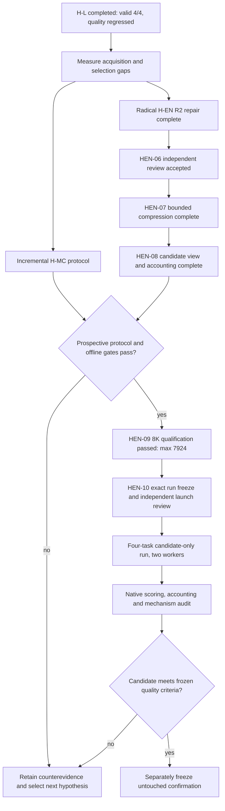

# Current benchmark evolution DAG

Status: navigation view only. Current as of 2026-09-27, after the G01
shared-reliability four-task campaign and frozen G02 multi-repository cohort.

Current G02 node: an [exposed NodeBB offline selector diagnostic](../../../../../implementation/agent-reasoning-engine/packages/evolution-runtime/evidence/g02-cross-layer-nodebb-diagnostic-r1/RESULT-NOTE.md)
raised native File-F1 above DSH but left Span-F1 below it. The next causal
frontier is bounded, task-anchored cross-layer source acquisition before
model finalization, with receipt-bound delivery and opt-in final selection.
Run this on the exposed case as a mechanism test, then freeze a fresh DSH
comparison; do not promote the offline diagnostic or revise the failed cohort.

Current G01 node: the [prospective shared-reliability campaign](../../../../../implementation/agent-reasoning-engine/packages/evolution-runtime/evidence/g01-shared-reliability-campaign-r1/RESULT-NOTE.md)
**passes** its all-four-valid aggregate accuracy/token/time rule. C control
activated fallback once and completed; Go and Rust passed all four per-task
gates. C File-F1 tied at 1.0 and Svelte quality tied at zero. Post-score audit
shows the Svelte migration-script objective and gold workspace/client-transform
files do not obviously align; retain its frozen zero score and audit dataset
alignment before attributing that failure to the engine. Then test a materially
new quality candidate on untouched tasks. G02
cross-layer quality remains a separate active branch. No G01 worker is active.

Previous G01 node: a shared transport reliability policy is implemented for both
arms and passes 40 focused local tests. The [exposed C diagnostics](../../../../../implementation/agent-reasoning-engine/packages/evolution-runtime/evidence/g01-shared-reliability-c-diagnostics-r1/RESULT-NOTE.md)
both completed but did not activate either recovery branch, so they cannot
validate a live repair or become prospective accuracy evidence. Next: probe
recovery deterministically at the transport boundary, then freeze an untouched
cohort with the policy explicit in the definition and both arm freezes.

Current G01 node: the [prospective fallback-only reasoning-view campaign](../../../../../implementation/agent-reasoning-engine/packages/evolution-runtime/evidence/g01-reasoning-fallback-campaign-r1/RESULT-NOTE.md)
**fails** its all-four-pairs-valid rule. Go, Svelte, and Rust each passed all
four accuracy/token/time task gates, but C was unscored (control bounded-view
denial; candidate output-cap exhaustion). No fallback activated, so the
three wins do not validate reasoning omission. The single-command driver
completed freeze through summary. Next: implement and validate a shared,
predeclared reliability treatment for bounded-view and fixed-output-cap
failures, then freeze a new untouched cohort. Keep these four tasks exposed
and do not relabel this campaign. No G01 worker is active.

Previous G01 node: the [prospective reasoning-free-view campaign](../../../../../implementation/agent-reasoning-engine/packages/evolution-runtime/evidence/g01-reasoning-view-campaign-r1/RESULT-NOTE.md)
**fails** its predeclared all-pairs-valid, quality, and duration gates. It
repaired the exposed archive admission mechanism but globally changing the
historical view regressed Go Span-F1 and increased Svelte token/time cost;
Rust control returned `glm.incomplete-output`. Next candidate: retain the
ordinary view when it fits and omit historical reasoning only as an 8K
admission fallback. Test this separately; do not reinterpret either failed
campaign. The new one-command G01 campaign driver is ready for the next
fresh definition. No G01 worker is active.

Previous G01 node: the [unchanged-arm eight-task replication](../../../../../implementation/agent-reasoning-engine/packages/evolution-runtime/evidence/g01-identifier-itt-replication-r1/RESULT-NOTE.md)
**fails** its all-pairs-valid rule. Seven pairs scored and descriptively favor
ARE on accuracy, tokens, and duration, but the eighth Svelte candidate hit
`bounded-view-not-admitted` after a large retained-reasoning exchange. The
next bounded hypothesis is to keep the raw exchange and receipts unchanged
while projecting a reasoning-free historical assistant view, then diagnose
on the exposed task and freeze an untouched successor cohort. Do not reclassify
this admission error as abstention or repair the completed campaign. No G01
worker is active.

Previous G01 node: the [prospective identifier-aware four-language campaign](../../../../../implementation/agent-reasoning-engine/packages/evolution-runtime/evidence/g01-identifier-itt-campaign-r1/RESULT-NOTE.md)
passed its predeclared aggregate rule with all eight arms natively scored;
the predeclared abstention-zero policy was unused. Candidate macro
Span/File-F1 rose `0.022165/0.071429 → 0.193051/0.412500`, while total
known model tokens and duration fell 39.55% and 26.23%. C tied on Span-F1;
Go, Svelte, and Rust passed all four per-task gates. Next DAG nodes: (1)
audit mechanism activation and validity receipts, (2) freeze a larger
untouched ContextBench replication without changing this result, and (3)
resume ARE×DSH and the third benchmark under their separate objectives.
No G01 worker is active.

Previous G01 node: the [prospective distinctive-source four-language campaign](../../../../../implementation/agent-reasoning-engine/packages/evolution-runtime/evidence/g01-distinctive-campaign-r1/RESULT-NOTE.md)
completed with one fresh Svelte four-gate win but rejected the aggregate pass:
Rust control abstained, so only three pairs scored. Conditional three-pair
accuracy, tokens, and duration favored the candidate, while Go cost/time
regressed and C File-F1 tied. Next G01 DAG nodes are (1) define and test an
explicit, predeclared abstention scoring policy, (2) design a bounded stop
that avoids Go-like overhead without losing source recall, and (3) freeze an
untouched, activation-aware cohort. These are new hypotheses, not revisions
to the completed campaign. No worker is active.

Latest G01 node: the [distinctive-source exposed Svelte diagnostic](../../../../../implementation/agent-reasoning-engine/packages/evolution-runtime/evidence/g01-distinctive-svelte-diagnostic-r1/RESULT-NOTE.md)
recovered a scoreable source selection: native Span/File-F1
`0.246068/0.285714`, 52,278 known model tokens, parser plus CSS selector
selected. It is post-hoc mechanism evidence only. The follow-up guarded
revision passes 26 focused local tests across the G01 path and needs its own
frozen snapshot. Next: choose untouched source-only tasks without gold access,
predeclare a matched cohort and decision rule, then run the existing pair
driver and pinned scorer. Do not repair the older failed campaign by
reinterpretation. No worker is active.

Latest G01 node: the [objective-anchor four-language campaign](../../../../../implementation/agent-reasoning-engine/packages/evolution-runtime/evidence/g01-objective-campaign-r1/RESULT-NOTE.md)
ran a new template-aware anchor and substantive-read gate on untouched C,
Go, JavaScript, and Rust tasks. C and Rust passed all four per-task gates;
Go tied at zero quality with large cost savings; Svelte was unscored in both
arms. Only three pairs scored, so the predeclared aggregate pass is rejected.
The Svelte candidate offered only an unrelated CSS blog post, exposing a
distinctive-term acquisition failure. Next runnable G01 product frontier:
gold-blind task-distinctive search/read admission before early finish,
validated on exposed tasks then frozen on new tasks. No worker is active.

Latest G01 node: the [four-language aggregate campaign](../../../../../implementation/agent-reasoning-engine/packages/evolution-runtime/evidence/g01-aggregate-campaign-r1/RESULT-NOTE.md)
ran the fixed adaptive shortlist against native convergence on frozen C, Go,
JavaScript, and Rust tasks. Three pairs scored; Go candidate produced no final
context, so the predeclared all-four-scoreable aggregate rule rejects a pass.
Descriptive scored-pair macro Span/File-F1 and summed token/time metrics favor
candidate, but C File-F1 regressed and Rust Span-F1 tied at zero. Go's only
offered range was unrelated, and GLM abstained. The next runnable G01 frontier
is gold-blind task-relevant acquisition and early-resolution control, followed
by a fresh untouched cohort. Do not force an irrelevant final handle. Keep
the current campaign as failed/inconclusive
evidence, not an ARE proof. No worker is active.

Latest G01 node: the [adaptive-shortlist cohort](../../../../../implementation/agent-reasoning-engine/packages/evolution-runtime/evidence/g01-terminal-shortlist-adaptive-cohort-r1/RESULT-NOTE.md)
completed two sealed, native-scored pairs. Candidate improved Span-F1 and
File-F1 on both. Clap Rust passed all four gates with 41.67% fewer tokens and
42.64% less time; GitHub CLI Go improved quality but used 24.90% more tokens
and 27.18% more time because control finished after only eight calls. Reject
strict per-task four-gate replication. Next: predeclare a larger aggregate
campaign that reports each regression, and design a gold-blind stop policy
for sparse evidence and early task resolution. No worker is active.

Latest G01 node: the [clap Rust cap-12 pair](../../../../../implementation/agent-reasoning-engine/packages/evolution-runtime/evidence/g01-terminal-shortlist-cap12-rust-r1/RESULT-NOTE.md)
was the first live run of the single-JSON pair driver; it completed ordered
dispatch, pre-score sealing, pinned native scoring, and decision output.
Both arms scored Span/File-F1 `0/0`; candidate reduced tokens 70.30% and
time 57.95%. Reject the four-gate claim. The candidate stopped with only one
eligible wide source read. Next hypothesis: make the early stop conditional
on enough distinct delivered source evidence, with a bounded later cap;
freeze and score on untouched tasks. No worker is active.

Latest G01 node: the opt-in [cap-12 terminal-shortlist candidate](../../../../../implementation/agent-reasoning-engine/packages/evolution-runtime/evidence/g01-terminal-shortlist-cap12-cohort-r1/RESULT-NOTE.md)
passed all four strict native gates on a fresh GitHub CLI Go task, saving
55.72% tokens and 53.46% time. Its predeclared zstd C task was unscored in
both arms due to different runtime errors, so that cohort is inconclusive.
A separately frozen [Svelte JavaScript extension](../../../../../implementation/agent-reasoning-engine/packages/evolution-runtime/evidence/g01-terminal-shortlist-cap12-svelte-r1/RESULT-NOTE.md)
also passed all four gates with the unchanged candidate, saving 51.58%
tokens and 27.87% time. These are two prospective cross-repository scored
wins, not broad campaign proof. The pair driver now covers dispatch, sealing,
and scoring. Diagnose the unscored runtime paths and run a larger untouched
cohort. No worker is active.

Latest G01 node: the [fixed terminal-shortlist replication cohort](../../../../../implementation/agent-reasoning-engine/packages/evolution-runtime/evidence/g01-terminal-shortlist-cohort-r1/RESULT-NOTE.md)
completed on predeclared zstd C and NodeBB JavaScript tasks. Candidate improved
Span-F1, File-F1, and known tokens on both, but zstd took 8.22% longer while
NodeBB took 1.43% less time. The strict four-gate replication rule therefore
**fails**. Both tasks are exposed. Next: diagnose timing and terminal-selection
mechanics from receipts, then freeze a materially different gold-blind
candidate and untouched multi-repository cohort. No worker is active.

Latest G01 node: the [fresh terminal-shortlist pair](../../../../../implementation/agent-reasoning-engine/packages/evolution-runtime/evidence/g01-terminal-shortlist-fresh-r1/RESULT-NOTE.md)
passed Span-F1, File-F1, known-token, and duration gates on one untouched
GitHub CLI task: candidate `1.000000/1.000000` versus control
`0.323182/0.666667`, with 1.62% fewer tokens and 20.29% less time. The
receipt-bound shortlist offered eight wide source ranges and GLM selected
both gold files. Its fixed multi-repository replication is reported above;
the one-task win does not prove broad ARE advantage. No worker is active.

Latest G01 node: the [fresh matched paged-search r3 pair](../../../../../implementation/agent-reasoning-engine/packages/evolution-runtime/evidence/g01-api-search-r3-fresh-r1/RESULT-NOTE.md)
scored final Span/File-F1 `0/0` in both arms. R3 never paged or acquired;
candidate used about 4.94% fewer tokens but 9.16% more elapsed time. Both
trajectories reached two of three gold files, yet terminal packets offered
only a non-gold pull-request-template read. Reject r3. Next test an opt-in,
gold-blind terminal shortlist of delivered base reads on an untouched task,
or pivot to G02's cross-layer selector frontier. No worker is active.

Latest G01 node: the [fresh matched API-search r2 pair](../../../../../implementation/agent-reasoning-engine/packages/evolution-runtime/evidence/g01-api-search-r2-fresh-r1/RESULT-NOTE.md)
scored Span/File-F1 `0/0` in both arms. R2 activated and delivered one
bounded `_test.go` read but the terminal selector chose the same wrong
config-command range as control. Its 20.75% token and 16.62% duration
reductions do not meet the high-level accuracy goal; control encountered one
gold file during exploration while r2 encountered none. Reject this arm. Next
form a materially different gold-blind cross-layer acquisition/selection
hypothesis and test it on an untouched task, or move to G02's comparable
cross-repository frontier. No worker is active.

Latest G01 node: the [fresh-task API-search screen](../../../../../implementation/agent-reasoning-engine/packages/evolution-runtime/evidence/g01-api-search-fresh-r1/RESULT-NOTE.md)
scored final Span/File-F1 `0/0`, with zero new acquisitions. Its exact
`PublicKey` search found both gold files, but the objective's “public key” did
not activate the compound-identifier rule, and `pkg/` was excluded by the
shared neighborhood policy. GLM later read those files but selected only an
unrelated SSH-key handle. The refrozen control abstained, so this is not a
matched comparison. Reject accuracy. Next choose between a generic
compound-identifier/`pkg/` revision on a different untouched task with a
scoreable control preflight, and a G02 cross-repository acquisition/selection
hypothesis. The opt-in r2 compound-identifier/`pkg/` implementation is
fixture-tested and its matched live outcome is reported above. No worker is
active.

Latest G01 node: the [fresh same-task objective-search pair](../../../../../implementation/agent-reasoning-engine/packages/evolution-runtime/evidence/g01-objective-search-fresh-r1/RESULT-NOTE.md)
scored Span/File-F1 `0/0` for both arms. Candidate used more known tokens and
time, and its exact-token/two-segment trigger made zero acquisitions. Reject
the arm. Next runnable product work: fixture-test a generic API-identifier
match with bounded `lib`-level search admission and file diversity, then
freeze a new unscored task and matched control before any model dispatch.
Do not reuse this now-exposed task for prospective proof. Its subsequent
API-search diagnostic is reported above. No worker is active.

Latest G01 node: the [live search-follow-through screen](../../../../../implementation/agent-reasoning-engine/packages/evolution-runtime/evidence/g01-search-followthrough-live-r1/RESULT-NOTE.md)
completed under 8K with six delivered, selected reads. It selected one
`zstd_compress.c` span and reached File-F1 `0.22222`, but Span-F1 remained
`0`; the six-read cap was mostly spent on other files. Reject accuracy.
The subsequent objective-search pair is reported above. Keep the exposed
zstd trajectory diagnostic only. No worker is active.

Latest G01 node: the [receipt-backed exposed development run](../../../../../implementation/agent-reasoning-engine/packages/evolution-runtime/evidence/g01-source-neighborhood-live-r1/RESULT-NOTE.md)
delivered three actual source neighborhoods under 8K, but selected only
`zstd_compress_internal.h` and scored `0` Span/File-F1. A receipt audit found
that one-line `zstd_compress.c` search hits were delivered, but not followed by
wide reads or terminally selected. The subsequent bounded search-follow-through
screen is reported above. Keep this failed
arm and the synthetic upper bound as diagnosis only; require an untouched
task before any prospective quality or efficiency claim. No worker is active.

Preceding G01 frontier: the [source-floor exposed screen](../../../../../implementation/agent-reasoning-engine/packages/evolution-runtime/evidence/g01-source-floor-exposed-r1/README.md)
rejected both an eight-handle final-selection floor and a regional-diversity
refinement. The latter reached mean Span-F1 `0.049038` on the two exposed
HEN-11 tasks, below HEN-10's `0.073272` development threshold. Task 1 had
correct-file reads but missed the labeled lines; task 4 remained below its
nonregression floor. A [provider-free upper bound](../../../../../implementation/agent-reasoning-engine/packages/evolution-runtime/evidence/g01-source-floor-exposed-r1/UPPER-BOUND-RESULT-r1.md)
found score headroom when nearby base lines were synthetically expanded, but
none were delivered to GLM. The subsequent receipt-backed neighborhood and
search-follow-through live screens are reported above. Do not promote
the offline selector or upper bound, and do not rerun the exposed tasks as a
fresh claim. No G01 dispatch is active.

Current G02 frontier: the [four-task cohort](../../../../../implementation/agent-reasoning-engine/packages/evolution-runtime/evidence/g02-fixed-candidate-multirepo-r1/RESULT-NOTE.md)
rejected broad generalization. Three fixed-candidate pairs passed all four
strict gates, but the second NodeBB pair lost both native quality metrics.
Next, use that now-exposed failure for diagnosis only, choose a materially
different gold-blind cross-layer acquisition/selection mechanism, and test it
on an untouched task. Alternatively, prioritize G01's larger unresolved
accuracy frontier; G03's bounded positive evidence does not close its own
generalization question. The fixed G02 candidate and sealed-pair tools remain
available as development controls. No dispatch is active.

Preceding G02 frontier: the [ui.enabled pair](../../../../../implementation/agent-reasoning-engine/packages/evolution-runtime/evidence/g02-fresh-ui-enabled-r1/RESULT-NOTE.md)
and [webhook pair](../../../../../implementation/agent-reasoning-engine/packages/evolution-runtime/evidence/g02-fresh-webhook-r1/RESULT-NOTE.md)
both passed strict Span-F1, File-F1, token, and wall-time gates on untouched
Flipt Go tasks with the same fixed candidate. The second gain is narrow and
absolute quality low; the selector traded File-F1 for Span-F1 there. The
planned multi-repository cohort is reported above. Do not call two Flipt tasks a
full ContextBench campaign or a solution to the cross-benchmark objective. The reusable
[sealed-pair scorer](../../../../../implementation/agent-reasoning-engine/benchmarks/contextbench-v1/score-sealed-pair.py)
checks both prediction seals and emits one joint decision, cutting manual
comparison overhead; the [pair sealer](../../../../../implementation/agent-reasoning-engine/benchmarks/contextbench-v1/seal-pair.py)
cuts manual receipt construction. No dispatch is active.

Preceding execution node: [r1b](../../../../../implementation/agent-reasoning-engine/packages/evolution-runtime/evidence/g02-source-relations-1177-r1b/RESULT-NOTE.md)
and [r2](../../../../../implementation/agent-reasoning-engine/packages/evolution-runtime/evidence/g02-source-relations-1177-r2/RESULT-NOTE.md)
both rejected the source-relationship packet on the exposed Flipt task. R2
delivered component-relevant schema ranges but scored Span/File-F1
`0.50902`/`0.56000` versus DSH `0.54523`/`0.71429`; an offline receipt-bound
selection replay only reached `0.52582`/`0.71429`. A subsequent
[r3 deprecation-closure screen](../../../../../implementation/agent-reasoning-engine/packages/evolution-runtime/evidence/g02-source-relations-1177-r3/RESULT-NOTE.md)
still failed live quality, but the pre-existing focused selector passed all
four gates offline on that exposed trajectory. This led to the fresh pair
above. That exposed sequence is closed; do not rerun packet wording or ranges
on the same task. Its former next-step instruction is superseded by the
fresh-pair qualification above.

Preceding frontier: the [fresh component-packet pair](../../../../../implementation/agent-reasoning-engine/packages/evolution-runtime/evidence/g02-fresh-component-1177-r1/RESULT-NOTE.md)
rejected G02 quality despite 86.53% fewer tokens and 71.23% less wall time.
ARE Span/File-F1 `0.47204`/`0.50000` trailed DSH
`0.54523`/`0.71429`. The component selector abstained, and ARE's six
selected files were all relevant but missed wider configuration-contract
evidence. The subsequent relationship-packet screens are recorded above;
do not promote the fresh-pair candidate or count the post-hoc OCI selector
replay as prospective evidence. No dispatch is active.

Latest G02 frontier: broad hints passed an exposed screen but a fresh NodeBB
pair missed File-F1. Normalizing double-encoded issue text and capping at
16 calls passed the exposed NodeBB task, then failed both quality metrics on
a fresh Go pair despite large token/time savings. Twenty calls and a
unique-path/schema-neighborhood primer also failed exposed Go quality. The
receipt-bound initial source packet did deliver six real pinned-base reads,
but failed both native quality metrics on the exposed Go task. The next
mechanism must improve task-wide acquisition and final selection; more initial
delivery alone is insufficient. Keep
the existing DSH rows as development controls; require an untouched matched
task before promotion. See the [Go pair](../../../../../implementation/agent-reasoning-engine/packages/evolution-runtime/evidence/g02-normalized-clauses-16-go-r1/RESULT-NOTE.md)
and [source-packet result](../../../../../implementation/agent-reasoning-engine/packages/evolution-runtime/evidence/g02-initial-source-packet-go-r2/RESULT-NOTE.md).

The packet run's offline summary-linked selector lifted File-F1 above DSH but
not Span-F1; one-read-per-path compression sharply regressed spans. The next
prospective G02 candidate must improve localization as well as file coverage.
Do not treat that post-run selector replay as a live benchmark result.

The next exposed Go live screen with narrow-final-read guidance improved both
quality metrics and cut model tokens, but still failed native quality versus
DSH. The next bounded hypothesis is issue-wide clause coverage (including late
sections) plus compound-identifier search; check its gold-free source hints
offline before spending model calls. See the
[narrow-final result](../../../../../implementation/agent-reasoning-engine/packages/evolution-runtime/evidence/g02-narrow-final-evidence-go-r3/RESULT-NOTE.md).

The follow-up [issue-wide-hints screen](../../../../../implementation/agent-reasoning-engine/packages/evolution-runtime/evidence/g02-issue-wide-hints-go-r4/RESULT-NOTE.md)
confirmed the new bundle/integration hints reached the model but were never
read; quality fell sharply. Stop enlarging hint lists. Next evaluate a bounded
receipt-backed focused source packet, preserving the useful r3 prompt and
packet as the comparison. Then require untouched matched confirmation before
any promotion.

The [focused-packet screen](../../../../../implementation/agent-reasoning-engine/packages/evolution-runtime/evidence/g02-focused-packet-go-r5/RESULT-NOTE.md)
passed Span-F1 and efficiency but failed File-F1. Its post-run named-backend
selector replay passed both quality metrics without another model call, but
was designed on the exposed result. Next: make active-component/sibling
selection general and predeclared, freeze its implementation and task picker,
then run a fresh matched ARE/DSH pair. Do not count the replay as a pass.

An audit found that compact prompt construction omitted the ranked-source
primer in earlier diverse-primer/no-archive screens. Those screens remain
valid observations of their other interventions, but not tests of primer
delivery. A [corrected exposed-task G02 screen](../../../../../implementation/agent-reasoning-engine/packages/evolution-runtime/evidence/g02-delivered-primer-r2/RESULT-NOTE.md)
verified the primer in the first captured request but was rejected: File-F1
fell to `0.27586` versus pinned DSH `0.4`, and wall time rose to 317.83
versus 223.41 seconds. Select a materially different mechanism and test it
on an untouched task; do not rerun this exposed primer screen.

Current execution order: pin a reusable development control, run a bounded ARE
treatment hypothesis, score immediately with the fast screen, then reject or
promote. Only promotion triggers a fresh matched comparison on an untouched
cohort and independent result review. See the
[fast research loop](BENCHMARK-EVOLUTION-WORKFLOW.md#fast-research-loop-current).

The H-EN diagram and queue below are retained historical context, not an active
launch instruction. G01 v22 rejected HEN-11. G02's newer ranked task 2 beat
DSH on quality and tokens, but task 3 lost Span-F1. After credential repair,
focused source hints and delivered-test closure improved exposed task 3 beyond
historical DSH quality with fewer tokens. R2b task 2 stopped unscored; R2c
task 2 beat historical DSH quality and tokens but lost the prior ARE perfect
score. The strict two-task development gate remains failed. G03's expansion to
a fresh sixteen-question cohort is complete:
5K ARE scored 11/16 with a large accuracy and cost advantage over control,
subject to two invalid control judge outputs. See the
[G03 result](../../../../../implementation/agent-reasoning-engine/packages/evolution-runtime/evidence/longmemeval-fast16-v1/RESULT-NOTE.md).
The live frontier returns to G01 and G02. No dispatch is currently active.
G02's [fresh paired probe](../../../../../implementation/agent-reasoning-engine/packages/evolution-runtime/evidence/g02-fresh-pair-20260926/RESULT-NOTE.md)
has now rejected the R2c-plus-bounded-primer candidate: on the valid
JavaScript pair, ARE had nearly equal Span-F1 and higher File-F1 but used
4.757x the tokens and 5.34x the wall time of DSH. On Go, ARE scored while
DSH stopped unscored at its 1M-token budget. Do not aggregate the unscored
control as a quality win. The follow-on [16-call finalization screen](../../../../../implementation/agent-reasoning-engine/packages/evolution-runtime/evidence/g02-callcap16-r1/RESULT-NOTE.md)
passed on the exposed JavaScript task: native Span/File-F1 `0.39564`/`0.28571`,
58,670 tokens, 142.68 seconds versus pinned DSH `0.37685`/`0.14286`, 82,817
tokens, 178.5 seconds. Its four recoveries do not prove the mechanism. The
fresh [JavaScript pair](../../../../../implementation/agent-reasoning-engine/packages/evolution-runtime/evidence/g02-callcap16-confirm-r1/RESULT-NOTE.md)
then rejected that candidate for native quality: ARE Span/File-F1
`0.08893`/`0.17391` versus DSH `0.39608`/`0.4`, although ARE used 90.62%
fewer tokens and 46.53% less time. The Go pair was stopped before dispatch.
Source-diverse 16-, 24- and 32-call treatment screens also failed quality;
the 32-call result still recovered only three distinct archive outputs across
22 recoveries. A recovery memo and demand-mode recovery did not fix that
failure. [Removing the archive catalog](../../../../../implementation/agent-reasoning-engine/packages/evolution-runtime/evidence/g02-no-archive-r1/RESULT-NOTE.md)
raised exposed-task Span-F1 to `0.51869` with fewer tokens and less time than
the pinned DSH row, but File-F1 `0.38462` missed `0.4`. A subsequent
[direct-evidence instruction](../../../../../implementation/agent-reasoning-engine/packages/evolution-runtime/evidence/g02-direct-evidence-r1/RESULT-NOTE.md)
retained File-F1 `0.38462` and reduced Span-F1 to `0.41118`. Both are rejected.
The next G02 gate requires a materially different acquisition or selection
mechanism, then an untouched prospective task before promotion; do not spend
another run on terminal wording alone. A gold-blind filename/task filter
subsequently improved the exposed no-archive row post hoc, but the
[fresh pair](../../../../../implementation/agent-reasoning-engine/packages/evolution-runtime/evidence/g02-task-path-prospective-r1/RESULT-NOTE.md)
rejected the filter: ARE Span/File-F1 fell from `0.30517`/`0.66667` to
`0.29638`/`0.58824`. DSH stopped unscored at its request budget after
988,911 known tokens; do not infer a paired quality win. The next mechanism
must recover semantically relevant support files without brittle filename
matching, and the next matched control should use a prospectively bounded
task selection rather than task-shopping. For G01,
choose a new 8K hypothesis after HEN-11. The G02 opt-in token stop and native
score collector remain available in the [workflow](BENCHMARK-EVOLUTION-WORKFLOW.md#g02-low-overhead-screen-boundary).

The former H-L qualification DAG is complete and is preserved in its run-specific
evidence. [BENCHMARK-EVOLUTION-WORKFLOW.md](BENCHMARK-EVOLUTION-WORKFLOW.md) is
the hash-pinned predecessor workflow imported by the runtime and therefore keeps
its historical queue state unchanged. Current successor construction state is
owned by the [multi-cycle runtime plan](../../../../../goals/projects/agent-reasoning-engine/plans/multi-cycle-evolution-runtime/PLAN.md) and the
[HEN-07/HEN-08 provider-free receipt](../../../../../implementation/agent-reasoning-engine/packages/evolution-runtime/evidence/HEN-07-08-PROVIDER-FREE-COMPLETION.v1.json).

No fresh control is needed for exploratory screens. Fresh matched controls are
required for a promoted comparative claim. H-MC and H-EN remain separate
historical mechanisms.

## Immediate Frontier

Historical snapshot (superseded by the current execution order above): the operational frontier was the three-objective continuation in
[BENCHMARK-EVOLUTION-WORKFLOW.md](BENCHMARK-EVOLUTION-WORKFLOW.md): G01 v22 is
complete and rejects HEN-11, so its next node is selection of a materially
different hypothesis; G02 needs a broader prospective cohort after its bounded
single-task score; and G03 needs a larger prospective cohort after its accepted
four-task confirmation. No branch has an active dispatch, and the branches do
not admit one another or add a fresh control arm.

HEN-06 through HEN-08 are complete at the provider-free local construction
ceiling. The balanced compressor reduces 320 R7 hints to 64 across four task
views, keeps each payload below 4,096 bytes, and retains seven of nine previously
missing labeled paths in post-hoc evaluation without labels in selection.

HEN-09 is complete. Its first exact composition retained the full audit view in
every request and was rejected after 48 populated overflows (maximum 9,873).
The successor retained the audit object in evidence while projecting an
adaptive path/range-only view. All 93 exact tokenizer requests passed with zero
generation calls or retries; the initial, populated, and terminal maxima were
4,544 / 7,924 / 3,867. The two retained attempts account for 186 tokenizer calls
in total and zero generation calls. The immediate frontier is HEN-10: register and freeze the
four-task candidate run, obtain independent launch review, then dispatch only
if that review admits it. Live benchmark dispatch is not authorized by HEN-09.

## Open Questions

Will the adaptively projected H-EN hints improve native context selection in the
four-task candidate-only run? Is retaining seven of nine post-hoc R7 missing
paths sufficient, or should a later hypothesis trade more payload space for acquisition?
Can H-MC avoid exposed-task leakage? Which frozen quality threshold should
advance a candidate to untouched confirmation while fresh controls remain
suspended?
