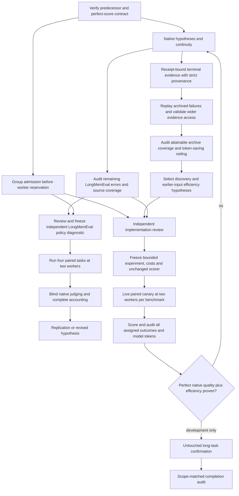

# Perfect-score successor campaign

Status: authorized candidate implementation; live successor runs require a frozen,
reviewed experiment. The active user goal is: “continue until we have reach perfect
score,”. This goal remains active; neither implementation tests nor the prior pilot
prove achievement.

## Objective and evidence contract

Preserve the initial objective: improve reusable ARE reasoning and evidence
retention, beginning with GLM small-window qualification. Continue LongMemEval and
ContextBench at 8,000 input plus reserved output tokens. Require at least 15% less
cumulative model input plus output per benchmark, including ingestion, reasoning,
cached inputs, failed calls and judging.

Treat perfect score strictly: all evaluated LongMemEval answers correct and all
ContextBench selections complete, with maximum native span/file quality metrics.
Better averages, valid-but-incorrect answers, missing tasks, or a passing software
test suite do not satisfy this goal. Retain every assigned task and failed attempt.
Smaller diagnostic cohorts can advance the work but cannot establish broader
benchmark perfection. Confirmation must use untouched evidence; full-benchmark
claims require full-benchmark evaluation. Do not read gold in generators, tune
answers to individual test labels, weaken metrics, or hide failed model calls.

Current authoritative predecessor: ../dual-benchmark-8k-v1/AMENDED-RESULTS.json.
LongMemEval: 7/8 correct, 68.28% fewer tokens. ContextBench: 4/8 valid selections,
16.07% macro Span-F1, 9.41% fewer tokens. These results contradict achievement.

## Method and construction boundary

Objective → gap → competing hypotheses → reviewed selection → frozen native
D01/D03 experiment → bounded execution → D02 observation → D04 decision → D07/D08
research and work evidence → successor. Keep source-linked continuity with v1;
never mutate its freezes or evidence. The exact construction scope is this v2
candidate directory and explicitly reviewed additive adapters. This is native
user-directed prototype construction under D65, not authority admission, release,
publication or deployment.

## Hypotheses and competing explanations

- C-state: receipt-bound, base-projectable evidence handles remain available after
  recycling and prevent empty or invalid terminal selections. Null: available
  handles are irrelevant, too coarse or insufficient for correct source selection.
- C-stop: retained progress can identify an earlier useful terminal decision.
  Null: stopping saves tokens by sacrificing needed exploration or coverage.
- C-output: bounded output allocation or explicit recovery avoids incomplete
  responses. Null: additional attempts consume savings without improving quality.
- L-scope: a generic answer policy preserves the scope of applicable preferences
  already present in retained evidence, without adding task-specific facts. Null:
  the error is stochastic reasoning or missing evidence, so a policy change does
  not improve replicated correctness. The observed remaining preference miss had
  all user turns retained; adding more history is not yet the supported remedy.

- C-discovery: a task-derived ledger of unresolved evidence needs improves which
  source is discovered before finalization. The ledger must use public task and
  model-plan evidence only. Null: it adds overhead without finding missing source.
- C-input: reducing repeated input or unnecessary earlier calls supplies the
  remaining savings while preserving quality. Null: smaller prompts merely buy
  more calls until the same stop, or lose needed evidence. Select one concrete
  ablation after input-cost attribution; this is not yet a live-ready treatment.

Test mechanisms separately before combining them. Exact H72 compatibility has a
three-handle limit; this cannot become a ceiling on the objective. Any wider schema
is a separately versioned candidate with strict validation and 8K admission.
Never create a read ID for evidence that was not delivered to the model.

## Work DAG

## Current frontier and operational lane

| Lane | Owner | Work | Gate / close condition |
| --- | --- | --- | --- |
| Product | coordinator | Group-aware candidate scheduler and regression tests | Unequal-duration tests prove no cross-benchmark starvation; preserve accounting/resume semantics |
| Product | terminal-evidence helper | Provenance-safe terminal projection, schema, private resolution and integration design | No synthetic evidence, no edited base lines, no lost fourth candidate due to implicit H72 ceiling |
| Product | coordinator | Native research records, LongMemEval failure/source analysis, episode integration | All hypotheses, limits and scorer mappings reviewed before live freeze |
| Operational | coordinator | Provider token accounting and host/guest disk guards | Required before every live dispatch; no uncertain spend reused |
| Operational | coordinator | Exact clone/checkout checks and completed-cell cleanup | Pinned revision survives actual clone; evidence retained after cleanup |
| Review | independent helper | Frozen implementation and result audit | No claim of perfection from incomplete or narrow evidence |

No live successor is running at this plan's creation. Each model experiment gets
an explicit cumulative ceiling before dispatch; the user goal has no total token
budget. Start with two workers per benchmark and use measured health to justify
four. Preserve all previous results. The confirmed eight-request overlap is useful
capacity evidence, not a permanent provider guarantee.

## Open questions

How much of native source-selection error is missing evidence versus coarse read
ranges or reasoning? Does a bounded handle page omit necessary candidates? Can
earlier stopping preserve maximum quality? How do memory improvements transfer to
histories beyond the current oracle subset? These remain empirical questions, not
reasons to lower the goal.

## Objective hierarchy

Enduring objective: Improve reusable ARE reasoning, useful continuity, recovery, correctness and completed outcomes within cumulative model input plus output tokens.

Initial GLM objective: Finish GLM-5.3-flash qualification, beginning with small context windows and useful reasoning-state recovery under pressure.

Current milestone: Clear the fixed ContextBench contract through frozen evidence-led rounds while keeping ContextBench diagnostics distinct from semantic retention and repair correctness.

## Research method

objective → gap → question → competing hypotheses → selection → experiment/tasks/criteria → results → observations → reviewed decision → successor

## Fixed decision rule

Every assigned outcome remains in its denominator. Perfect ContextBench requires
span coverage, span precision, span F1, file coverage and file precision each equal
to 1 for every evaluated outcome, with valid completed selection and independently
reconstructed export. Perfect LongMemEval requires every assigned answer complete
and correct under its declared native judge; this is judge-scoped evidence, not
independent proof of truth. Both benchmarks also require at least 15% cumulative
input plus output savings separately, including all failed, ingestion, reasoning
and judging tokens, no unknown usage, and every request admitted within 8,000.
A local replay or policy-only ablation cannot satisfy the full-task efficiency
contract. Do not equate an aggregate average, exposed cohort or infrastructure
pass with full-benchmark qualification.

## Updated frontier after offline implementation

All 106 offline tests pass, including receipt-bound terminal review through real
recycling and independent native export. Five archived failures replay correctly.
The working candidate is not yet a newly scored model run.

The [receipt cost audit](contextbench/TOKEN-ANALYSIS.md) proves that another
35,001 treatment tokens must be removed to reach the prior control's 15% target.
All last calls combined cost only 28,811. Terminal recovery alone cannot close
this gap on the fixed trajectories; it addresses completion and provenance.

Do not spend another full ContextBench cohort merely to hope that this terminal
change also solves discovery and efficiency. The evaluator-only
[archive-coverage audit](contextbench/REPRESENTATION-CEILING.md) is complete: none
of five failed valid-read archives can reach perfect Span-F1 even with unlimited
handles. Their ceilings are 21.04%, 16.90%, 46.51%, 47.18% and 0%. Whole-read
coarseness adds no loss in these cases; usable source coverage is insufficient.
Choose a bounded discovery/input ablation and freeze it before the next full run. The LongMemEval scope-policy runner can be reviewed and frozen independently
while that work proceeds. Its four paired tasks have a 64,000 generation-token
ceiling; native judging requires a separately reserved and source-bound budget.
Keep those diagnostic costs distinct from full-trajectory savings.

The prior two/four workers per benchmark executions are capacity evidence only.
Start any next dual live round with two per benchmark, then require measured
provider health, known usage and host-disk headroom before four. Current host free
space is about 13 GB; WSL's much larger virtual free-space figure is insufficient
for admission. Source-copy reservations and post-audit cleanup remain mandatory.

The real LongMemEval tokenizer preflight completed successfully: eight exact
requests measured, zero answer generations. The largest prompt plus reserved
1,024-token output is 3,748 tokens, within the 8,000 cap. See
[preflight/result.json](longmemeval/preflight/result.json). This is admission
evidence, not a scored benchmark result. The source history is not padded to fill
the available context window.
