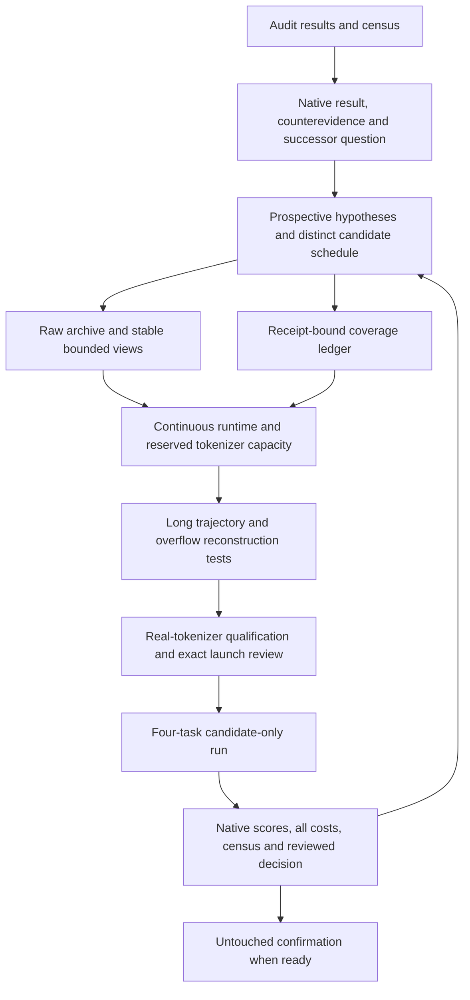

# Successor candidate: bounded archive views and an evidence coverage ledger

## Evidence and objective

The query-archive candidate completed two of four tasks. Two latest-only exchanges
measured 8,079 and 8,034 tokens and were correctly denied. The two completed
outputs scored 0.00% and 41.91% span-F1; their exported unions covered 0.00% and
30.30% of reference spans. All confirmed observations reached projection and all
projected events reached export. Five changed current-source lines on task 3 had
no unchanged base mapping; retain that qualification. Raw acquisition versus
confirmed delivery and semantic understanding remain distinct.

Source evidence: [audited results](query-archive-descriptive-live-r1/RESULT-REVIEW.json),
[census](query-archive-descriptive-live-r1/POSTRUN-ANALYSIS.json), and
[structural source alignment](query-archive-descriptive-live-r1/SOURCE-ALIGNMENT.json).
No reference paths, ranges, patches or answers may enter the candidate's input.

The objective remains reusable reasoning/context retention, perfect native
quality within measured 8K requests, honest cumulative model tokens, and untouched
confirmation. The original 15% savings target remains unproven. No fresh controls.

## Competing hypotheses and selection

H-B: immutable raw evidence plus measured bounded working views prevents the
mandatory-exchange failures, while a compact deterministic coverage ledger helps
the investigator acquire missing relevant context. Strong success requires all
four tasks valid and perfect within the existing limits. Any nonperfect or
invalid task fails that success criterion.

H-I: admission repair improves completion but the coverage ledger does not improve
search or interpretation enough to reach perfect quality. Successful admission
alone must never count as quality success.

H-T: view reduction hides useful details, the ledger directs attention to
irrelevant visited sources, or repeated metadata consumes budget; quality remains
poor or worsens. Retaining raw bytes alone does not prove recoverability or use.

Selected construction direction: H-B. It addresses two observed gaps together.
The next candidate changes admission and working-state representation; one run
cannot isolate their causal contributions. Adaptive output reservation remains
an alternative hypothesis, not an unmeasured fallback. Do not simply increase the
window or hard-code smaller read arguments around these two observed overages.

## Mechanism

1. Preserve exact original assistant messages and raw tool results once in the
   guarded journal before projection. Include enough information to reconstruct
   rejected latest-exchange requests; tokenizer hashes alone are insufficient.
2. Reuse measured aggregate admission to produce a stable working view of the
   newest tool exchange. Whole-line or whole-observation omissions must be explicit,
   with archive identity and valid continuation arguments. Failed tool results
   retain their failure meaning. If mandatory framing cannot fit, fail honestly.
3. Freeze each admitted view by exact call/result identity. Replay only stable
   versions; never reuse one read ID for different visible bytes. Raw archives,
   admitted views and successfully delivered observations are separate states.
4. Retrieve older stable views using the existing deterministic task/query ranking.
   Every final request is measured. Bound tokenizer work and reserve tokenizer
   capacity for final selection; do not assume unused model budget provides it.
5. Build a small coverage ledger from successfully receipt-bound evidence and
   verified source metadata: source/revision identity, merged delivered ranges,
   known total extent, and gaps in visited sources. This is not relevance truth,
   semantic memory, reference coverage or a requirement to read every file.
   Keep source versions separate and label stale/current versus base explicitly.
6. Bound ledger size and report omitted entries. Task instructions and tool schemas
   remain protected. The investigator decides which sources merit further reading.
   All ledger and replay tokens count toward model usage.

The reusable mechanism is exact external evidence with bounded immutable views
and an explicit record of observed versus unobserved material. Files/lines are
this benchmark's adapter; the core distinction applies to other source units.
No claim of non-code transfer follows from this experiment.

## DAG and acceptance

Keep the same four task identities, GLM low reasoning, two workers, 384K campaign,
96K/96 model calls per task, and measured 8K requests. Preserve 88K/95 exploration
and 8K/one final call. No phase transfer, hidden gold, automatic model retries or
replacement tasks. Exact tokenizer allocation must be declared and tested before
launch. Require real raw-to-view-to-delivery reconstruction, no fabricated source
coverage, all failure costs, full native scoring and all-task perfect quality.

Product frontier: prospective registration, view/provenance construction and
coverage-ledger tests. Operational owner: research operator. Exact source freeze,
real tokenizer qualification, D:/WSL storage admission and clean settlement affect
live launch only. Controls, worker expansion, release and matched-savings claims
remain deferred. Product evidence does not grant publication authority.

## Open Questions

How much observed evidence remains undelivered? Can the ledger improve exploration
without reinforcing an irrelevant initial source choice? Can continuation recover
all omitted raw evidence within budget? How should tokenizer capacity be allocated
without wasting probes? Does the candidate improve native quality and survive
untouched tasks? Can the same mechanism be demonstrated outside code tasks?
