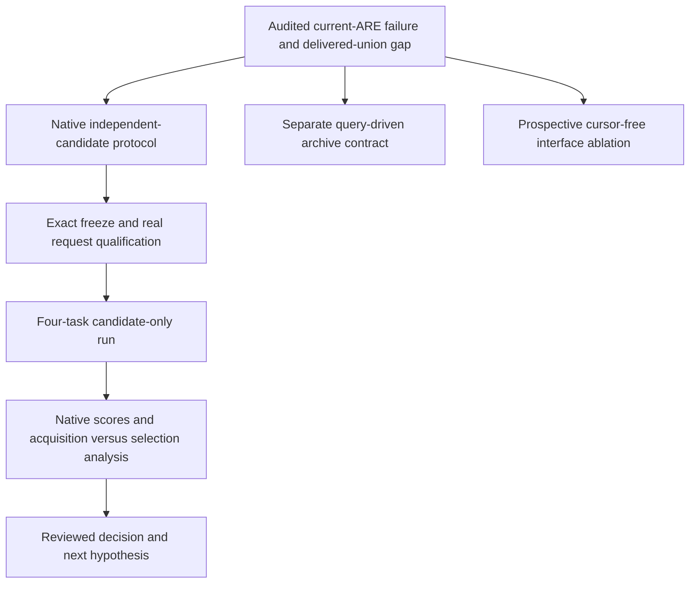

# Next experiment: independent investigations

The completed current-ARE candidate produced four valid results but no perfect
result. Independent review approved result integrity. All four tasks were
missing reference spans from the confirmed delivered-evidence union. Improving
final selection alone cannot recover evidence that was never delivered.

The next candidate is the existing retained independent-investigation runtime:
plan three task-derived questions, investigate each with a separate short
history, then join receipt-bound findings and select final source context.
Source search/read/list tools replace the current ARE recovery-page workflow.
This is an alternative architecture, not the separate, still-unimplemented
query-driven external-archive design. No controls are added or refreshed.

## Hypotheses and criteria

H-I: independent investigations increase acquisition breadth enough to reach
perfect native span/file quality on all four exposed tasks under the same
cumulative model-token ceiling. Any valid non-perfect task refutes that strong
claim for this run. H-0: decomposition duplicates work or misses dependencies,
so the candidate still fails. H-J: acquisition improves but the finding join or
terminal selection loses useful evidence. Measure acquisition versus selected
coverage before deciding which explanation merits a new experiment.

Use the same four task identities, GLM 5.3 Flash, low reasoning, measured 8K
requests, 96K total tokens / 96 calls per task, and two workers. Planning gets
4K / 2 calls; each investigation 24K / 24 calls; the join 20K / 22 calls, with
at least 8K reserved for finalization and no phase transfers. All costs count.
Total campaign reservation remains 384K. No retries, replacement tasks, hidden
gold in inputs or quality claims from infrastructure-only tests.

Report task-level native quality, confirmed evidence coverage, total tokens,
unknowns and validity. Historical current-ARE results are descriptive reference
only; no fresh matched savings or isolated causal claim. Retain the original
15% efficiency target as unproven and require untouched confirmation before
claiming benchmark completion.

## Ordered DAG and lanes

Product frontier: reuse the tested retained investigation runner; register its
exact treatment and qualify the live composition. Operational prerequisites:
source availability, credentials, D:/WSL headroom, guarded artifacts and exact
launch review. Owner: coordinator. The query-driven archive and cursor-interface
study are parallel research tasks and do not block this ready candidate.

## Open Questions

Will independent searches cover the missing evidence, or duplicate it? Does the
join preserve useful findings? Can a later query-driven archive or deterministic
pagination interface reduce overhead? None of these mechanisms is proven by the
current candidate's failure. Full benchmark generalization remains untested.
