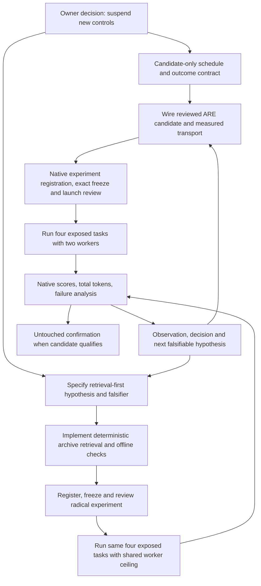

# Candidate-only research plan

Owner direction: “we should stop the branch of control, and focusing in only improving results and radicals”.
This prospective plan supersedes the next-run instructions requiring fresh controls
in NEXT-DAG.md, COMPACT-RETRIEVAL-FIRST-SCREEN-DRAFT.md and the historical R3 work DAG.
Frozen experiments, scores and registered records remain historical evidence.
No new control-arm runs are to be scheduled in this research track.

## Objective and interpretation

Improve ARE's general ability to retain and retrieve useful evidence within a
measured 8K request window. Pursue perfect native span/file quality, complete
accounting and efficient long-task completion, then untouched confirmation.
The original 15% total-model-token reduction remains a research target. With
fresh controls suspended, matched-control savings are not evaluable; report
raw total tokens and clearly labeled historical differences, never a newly
validated percentage against unmatched historical runs. Perfect quality alone
is not proof of generalization or token savings.

Current ARE changes are now an improvement candidate, not a refreshed control.
Independent investigations are an existing alternative candidate. The genuinely
different retrieval-first architecture remains a separate hypothesis requiring
its own implementation; do not relabel independent investigations as that design.
The same GLM model, low reasoning, 8K admission, 96K tokens / 96 calls per task,
source access and native evaluator remain. All failed/unknown work is accounted.

## Task order and DAG

The two branch results may be analyzed independently as they arrive. Joining
both branches is not required to launch or learn from the ready ARE candidate.
Across this 8K track, use at most two simultaneous workers; parallel research
preparation does not authorize four simultaneous provider workers.

1. Candidate-only scheduling is implemented in candidate-only-schedule.mjs.
   Default: current ARE, all four exposed tasks, at most 384,000 model tokens.
   Optional independent-investigations candidate: four tasks, same limit.
   Both together: eight outcomes, at most 768,000 tokens. No minimal-history arm.
2. Adapt the production outcome, queue, storage, freeze and score composition to
   this separate schedule schema. The historical twelve-slot verifier must not
   be bypassed or supplied a truncated schedule. This integration is pending.
3. Register the prospective hypothesis/experiment and its source bindings in the
   native evolution research method. Link the owner decision and historical R3
   observation explicitly; do not edit old registered records to change history.
4. Review the exact joined sources, qualify storage and initial requests, then
   run the ready four-task candidate. Keep measured admission for later requests.
5. In parallel, bound retrieval-first's archive, ranking, prompts and ablation.
   Register its hypothesis, falsifier, criteria and budget before live testing.
6. Score every assignment, record all costs, analyze failures, and propose the
   next hypothesis. Gold labels stay evaluator-only. Do not tune to hidden tasks.
7. Run untouched confirmation after the development candidate meets its declared
   quality criteria. Report efficiency evidence separately and its limitations.

## Construction and operations

Product frontier: candidate-only live composition, using the independently
reviewed retention/admission repairs. The candidate schedule has three passing
regression tests. The prior twelve-assignment stress was offline, not GLM scores.

Operational prerequisites for a live run: exact candidate freeze, native
registration and launch review; source availability, credentials, D:/WSL storage
admission and bounded output persistence. Owner: current research coordinator.
C: is excluded from this track's storage guard. No extra clones or cache copies
are needed for schedule construction. No publication or release is authorized.

Deferred work: the radical implementation does not block the repaired candidate.
Fresh controls are suspended, not a pending prerequisite. Other experiment
tracks are not cancelled by this file. A process check found no active local
8K comparison runner; a separate larger-window finish process was left intact.

## Open Questions

The exact retrieval-first mechanism and its ablation remain to be specified.
Candidate-only live composition and native registration remain to be completed.
Generalization and the original matched 15% efficiency claim remain unproven;
resuming controls would require a later explicit change of research direction.
