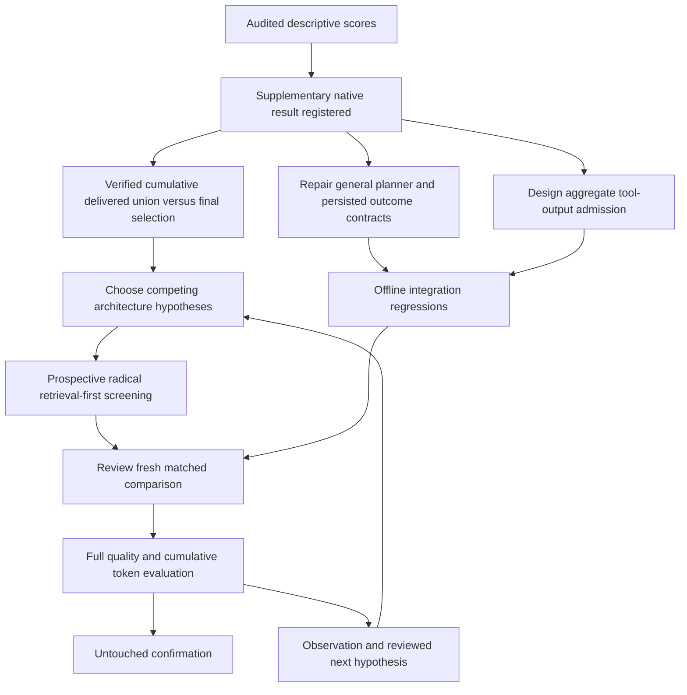

# Next work after measured completed-selection quality

The [independent result audit](compact-descriptive-live-r1/RESULT-REVIEW.json)
approved 691 evidence bindings. Completed-selection span-F1 is 0%, 48.51%,
47.91%; no full campaign pass or accepted savings exists. The original comparison
and its twelve assignments/costs remain unchanged. The measured outputs are
exposed development evidence, never untouched confirmation.

The completed union analysis uses the pinned evaluator semantics: trajectory
coverage accumulates exported steps. It verifies all confirmed source-tool
observations were projected and exported, with no unmapped changed lines in the
three completed outputs. The earlier individual-step interpretation was incorrect;
see TRAJECTORY-SEMANTICS-CORRECTION-R1.json. No repeat evaluation was needed.
Future diagnostics must likewise bind source revisions, deduplication, exact
delivered-only provenance and native evaluator semantics before execution. A union-derived
score is a diagnostic ceiling, not model-selected performance or a success claim.
No reference spans or evaluator output may enter future generation inputs.

The radical branch changes architecture, not research discipline: persistent
reasoning-state carryover versus external evidence storage and fresh retrieval.
Register competing explanations, treatment differences and failure criteria
before new model calls. Include retrieval/planning calls in total token costs.
Keep the original GLM/8K conditions and fresh controls. Neither survivor scoring
nor an easier task replaces perfect quality and at least 15% total token savings.

Product frontier: independent review of supplementary native registration and
union analysis, then exact retrieval/ablation design in
[the screening draft](COMPACT-RETRIEVAL-FIRST-SCREEN-DRAFT.md). Shared implementation repairs can proceed independently.
Operational residue: current concurrent larger-window changes stay intact;
reviewed historical copies isolate this diagnostic. No publication, cleanup,
release or infrastructure change is authorized by these results.

## Open Questions

Delivered-union completeness and native semantics; whether loss occurs during
retrieval, retention or selection; reviewed radical-branch screening protocol;
full comparison and untouched confirmation. Research authority and original
criteria remain in [the comparison protocol](COMPACT-COMPARISON-LIVE.md).
