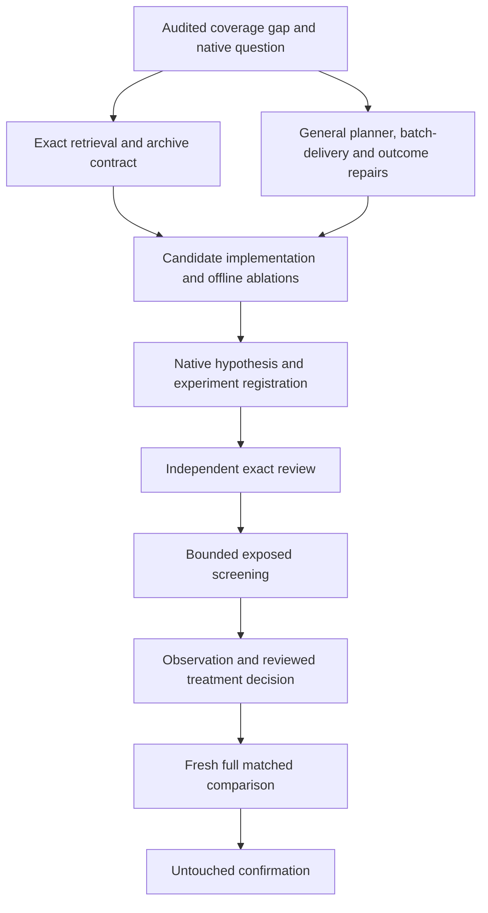

# Candidate retrieval-first screening design

Status: prospective draft, not launch approval or evidence of effectiveness.

The audited comparison failed. Three survivors have low confirmed exported-union
span coverage, and final selection accounts for only a small additional coverage
loss. Exact supplementary native records and their next question are in
[RESEARCH-RESULT-R3.json](compact-comparison-production-live-r1/RESEARCH-RESULT-R3.json).
The [union analysis](COMPACT-DELIVERED-UNION-RESULT-R1.json) is exposed development
evidence. It must not supply reference spans, filenames from gold, or answers to
model inputs.

## Competing hypotheses

- H-R: Fresh retrieval against a deterministic external evidence archive can
  acquire more relevant context with fewer total model tokens than carrying
  persistent working conversation/state. The model sees the task, current
  evidence and explicit unresolved questions; older evidence is retrieved by
  handle or query, not automatically replayed.
- H-D: Architecture is not the principal cause. General batch-aware delivery,
  coherent source passages and schema/provenance repairs suffice in the existing
  architecture. This is an active competitor, not an intentionally weak baseline.
- H-0: Neither change yields the required quality and token reduction under the
  fixed small-window conditions.

Both treatment branches use the same receipt-bound tools and source permissions.
Deterministic archive storage and index operations need no model calls. Any model
query planning, summarization, retrieval judgment or final selection is charged
in full. The archive stores actual evidence and delivery status, not presumed
model understanding. Failed and unknown requests remain in accounting.

## Required decisions before implementation or model execution

1. Specify the exact retrieval policy and ablation. Do not simultaneously change
   the model, source access, tool schema, output budgets and memory architecture
   while attributing any gain solely to memory.
2. Define bounded passages and aggregate delivery admission. Query results must
   fit with the task, tools, retained reasoning, margin and response reserve;
   overflowing candidates must not be dispatched. Pagination preserves exact
   provenance and resumes without silently discarding remaining results.
3. Define the external archive schema, confirmed-delivery transitions, retrieval
   inputs, allowed deterministic ranking features and final-selection mapping.
   User/task text and observed sources are allowed; gold is evaluator-only.
4. Specify a fixed exposed screening cohort, fresh controls, stopping rule and
   token/call budget prospectively. Screening remains additional evidence and
   does not replace the original full twelve-assignment comparison. A reviewed
   later decision can nominate a treatment for a fresh full comparison.
5. Register the selected hypothesis, counterhypotheses, implementation binding,
   experiment criteria, task DAG and exact launch review. Offline integration
   tests must cover all observed shared failures before paid generation.

## DAG and acceptance

The original objective remains perfect native selected span/file quality plus at
least 15% fewer total model tokens against both fresh controls, with complete
outcome accounting, measured 8K requests and untouched confirmation. Screening
success cannot clear these gates. Main comparison repairs remain useful whether
H-R, H-D or neither wins. No additional workers are introduced by this draft.

## Open Questions

Exact retrieval/ablation contract, archive format, preregistered screening cohort
and budgets, and generalization beyond code. The research method and original
acceptance criteria remain owned by [the comparison protocol](COMPACT-COMPARISON-LIVE.md).
