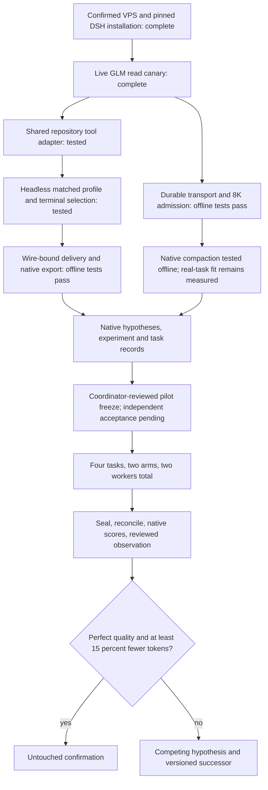

# External harness comparison: execution DAG

Status: owner-directed implementation in progress; no live benchmark admission.
Objective: reusable ARE reasoning support, original GLM 8K qualification, perfect development quality and >=15% cumulative token savings against the new external control. Preserve original issue-resolution duties, failed costs and the research ontology. Historical controls remain separate.

## Ordered DAG

1. Complete: installation and live GLM compatibility canary. Preserve its failures and 13,849 model tokens separately.
2. Complete component: shared five-tool adapter, four local tests and five actual-VPS tests. [Implementation evidence](DEEPSEEK-MATCHED-TOOLS.md).
3. Complete offline: [headless composition and terminal selection](DEEPSEEK-HEADLESS-INTEGRATION.md) pass a four-turn actual-DSH/scripted-provider fixture. The implementation composes that adapter into DSH headless with only the agreed repository task capabilities and a source-bound terminal selection tool. Use the same task instruction, source tools, final selection contract and output policy in ARE. Retain each harness's native reasoning/history strategy. Do not silently disable competitor memory.
4. Complete offline: [streaming wire exporter](DEEPSEEK-WIRE-EXPORT.md), ten tests pass. Bind actual wire requests/receipts to tool results and terminal selection. Reuse native source projection/export; never forge ARE's nonstreaming request digest for DSH's streaming requests. Confirm selected evidence was delivered successfully, not merely executed or archived.
5. [Durable transport](DEEPSEEK-DURABLE-TRANSPORT.md) now has fourteen tests for accounting, admission, bounded reads and graceful shutdown. A [real five-call qualification](deepseek-durable-live-evidence/README.md) passed with 9,635 tokens and a valid native export; both processes settled cleanly. Complete long-history qualification and paired-run manifest verification. All failures, retries and compaction calls count. Unknown usage blocks savings claims.
6. [Native 8K profile](DEEPSEEK-8K-PROFILE.md) passes eleven scripted actual-DSH calls including two compactions and exact low reasoning fields. Qualify real requests under 8K with equal output reservations and useful tool/history capacity. Provider catalog capacity is distinct from the experimental limit. Preserve task/branch identity if qualification fails. The 512-output canary is not the benchmark policy.
7. Register competing hypotheses H-ARE/H-null/H-external/H-instrument, prospective experiment and work tasks with exact source/model/task/budget bindings. Independently review the complete execution candidate and freeze before dispatch.
8. Run all eight assigned outcomes: original four exposed tasks, one paired repetition, two workers total, max96K tokens/96 calls per arm. Rotate pair order. Keep original issue investigation and attempted patch duties. No task replacement or historical-control substitution.
9. Seal all outcomes, reconcile complete input/output costs, score using isolated unchanged native evaluator, review observation and decision. Require perfect treatment Span/File-F1 per task plus >=15% savings against this external control. Patch correctness remains separately unproved without an oracle.
10. Continue to untouched confirmation or a discriminating successor; four exposed tasks cannot clear full benchmark scope. LongMemEval needs its own adapter/protocol.

## Product frontier and operations

Coordinator owns construction and result joins. Current runnable frontier is durable accounting and 8K qualification; headless composition, terminal selection and wire-bound export are tested offline. Independent review, exact experiment freeze, source/evaluator readiness, provider limits and fresh VPS capacity gate live scoring. Existing presentation services are outside the change scope. Large source caches remain bounded on the VPS; synchronize small verified evidence to WSL. Publication/release and broader VPS operations are separate residue.

## Open questions

Does DSH's native compaction fit exact8K under matched capabilities? Which final-selection interface stays symmetric without adding free calls? Can the external harness achieve better quality at lower cost? How will the outcome generalize beyond exposed development tasks and coding? Answer through measured experiments, not assumptions about ARE's superiority.

## Exploratory execution amendment

The active objective is a real comparison, not a claim that the development
quality/savings target has already been met. The coordinator reviewed and froze
an exploratory pilot while independent acceptance remains pending. No benchmark
clearance or release follows from this limited review. Pilot 61 failed on
credential ownership and provider role mapping; pilot 62 failed on clone trust
and provider output-field mapping. Both are retained with H-instrument supported.
Separate successor 63 preserves the four tasks and per-arm budgets and fixes
those integration causes. Its supervisor runs on the VPS; score only after all
assigned outcomes settle. Do not restart any of these paid stages.

## Current next frontier

Pilot 63 is fully settled and scored where eligible. Native-8K qualification 64
also failed. Follow [the control-fit DAG](DEEPSEEK-CONTROL-FIT-DAG.md); audit the
existing lossless codec before introducing another pagination implementation.
No paid predecessor should be restarted.
