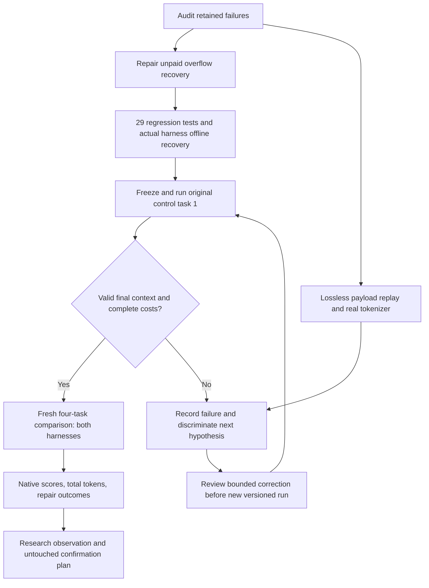

# Next control-fit experiment

## Execution superseded by full-window73

The owner requested GLM's maximum supported context. The next experiment is the
[four-pair1M comparison](DEEPSEEK-FULL-WINDOW-DAG.md), already dispatched with two
workers. The old8K control-success prerequisite no longer gates the comparison.
History below remains evidence, not the current execution order. Native DSH can
continue after a failed pre-step summary; the proxy's former paid-length poison
therefore confounds qualifications64,68 and71 as native-capability evidence.

Objective: obtain an interpretable real ARE-versus-DSH comparison at 8K. Preserve
the initial GLM qualification goal, reusable reasoning support, original issue
and patch duties, research hypotheses and eventual 15% cumulative-token target.
The completed pilot is evidence of failure, not benchmark clearance.

## Evidence and competing hypotheses

Pilot 63 produced four ARE context outputs and no DSH final contexts. All four
DSH stops followed measured request admission failure. Native-8K qualification
64 instead exhausted a 190-token output cap. Neither harness attempted edits.
ARE used 108 archived-read recovery calls across the four tasks.

H-payload: repeated source metadata consumes the remaining request space.
H-capacity: native approximate pressure and output reservation prevent useful
compaction despite space in the measured GLM context.
H-objective: the final-context workflow draws attention away from repair duties.
H-null: resolving these constraints will not produce a useful ARE advantage.
Do not decide quality or savings from failed outputs or prompt-byte reduction.

## Ordered DAG

The adapter audit found a measurement defect: an unpaid window denial permanently
poisoned the proxy and returned generic HTTP502, while native overflow retries
were disabled. H-recovery predicts that HTTP400 context_length_exceeded plus
bounded native recovery restores useful continuation. This must be tested before
attributing pilot63 failures to harness capability.

Completed: lossless replay65; eight tokenizer-only measurements66; transport and
export regression tests (29/29); actual offline DSH recovery67 (exit0, two summary
requests, no provider calls). Compression fits two of four denied requests;
it is not sufficient by itself. Full original/encoded reservations are retained
in deepseek-payload-tokenizer-66/evidence/RESULTS.json.

Completed experiment: deepseek-recovery-68/PLAN.json. It changes only unpaid
window-denial semantics and restores native recovery counts. Raw tool payloads,
fixed task1, measured8K admission, GLMlow and96K total cap remain fixed. No new
ARE calls occur during this qualification. A success requires native source-bound
export and complete accounting, not just process exit0. Paid length termination
still stops the adapter and remains an explicit compatibility limitation.

Qualification68 observed native recovery after one unpaid denial, but failed on
a truncated2048-token summary:17 paid calls,78,695tokens, zero unknown usage.
Nine summary calls consumed46,671tokens (59.31%). Native compaction independently
rejects max-tokens checkpoints; changing proxy error handling alone cannot fix
this. The next candidate H-checkpoint-growth tests whether bounded checkpoint
content preserves source evidence and next actions without growing each cycle.
First inspect native extension/configuration surfaces, then implement and qualify
offline before a new single-control run. Do not silently alter the native
algorithm, raise budgets, or call this a stock-harness comparison. H-payload
remains a separate symmetric branch, with only two-of-four tokenizer fit so far.
OBSERVATION.json retains this as a candidate, not native-admitted research state.

After successful qualification, freeze a fresh common profile and all eight outcomes. Keep
all failures and costs, source-selection scores separate from repair outcomes,
and gold outside generation. Register the observation and rejected hypotheses;
independent review and untouched confirmation are required for broader acceptance.

## GLM compatibility qualification71

Qualification69 completed with9paid calls and32,214tokens, no valid export. Native
pruning leaves plain-text gaps inside serialized JSON. The strict exporter now
matches the pinned default pruning transform and credits only complete visible
observations; hidden middle rows are not recovered from the execution archive.
Actual pruner boundary cases and retained real messages validate this projection.

Source dictionaries now render through native DSH tools and retain exact decoded
source identity. Actual offline DSH delivered18 encoded tool messages and exported
48source reads. The47 regression tests pass. Replay70 reduced the retained denial
from8901 to8177reserved tokens at2048output, so no model generation was dispatched
under profile70. Its two tokenizer calls and failed pre-measurement setup remain.

Qualification71 uses1800output, preserving the8000window,512margin,96K total cap,
fixed task1, GLMlow, native compaction and prior checkpoint guidance. The measured
replay reserves7929tokens. This is a combined fit configuration, not isolated
causal proof. The same guidance, encoding and output cap are required in the
fresh paired run. Native checkpoint69 research records retain the original and
enduring objectives; broader quality and15% savings gates remain separate.

Qualification71 is terminal:19paid calls,86,096known tokens,zero unknown usage.
All requests fit8K and a source patch was produced (correctness unverified).
The sixth summary truncated at1800output tokens. No final source selection exists.
Next: diagnose checkpoint identifier/content growth before a new paid candidate;
changing provider adapters is unnecessary because the official plugin works.

## Product frontier and operations

Product frontier: corrected control qualification, followed conditionally by a fresh paired comparison. The existing
VPS has the scoped credential and pinned runtime; all previous run processes
are terminal. Future live diagnostics require their own exact recorded envelope.
No release or production-service change is required. Synchronize compact evidence;
retain source caches on the VPS and avoid another full ARE rerun during control
qualification.

## Open questions

Can lossless factoring alone fit all four observed requests? Does GLM understand
the source dictionary without quality loss? Are restrictive pages necessary?
Will either harness attempt a repair after the transport issues are resolved?
