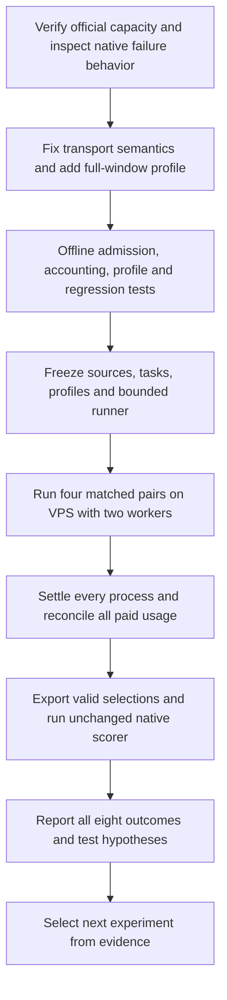

# GLM full-window harness comparison — round 73

Status: all eight runs settled, complete accounting verified, and all three valid selections scored. See [the report](deepseek-full-window-73/REPORT.md) and [completed research records](deepseek-full-window-73/RESEARCH-RESULT.json). No successor dispatched.

## Objective and method

The initial objective is to improve reusable ARE reasoning continuity and quality
while reducing model tokens. The current bounded question is how the existing ARE
harness compares with official DeepSeek Harness using the same GLM model and real
ContextBench tasks. This experiment does not clear the original 8K chapter or prove
cross-domain improvements. The earlier 15% token-reduction target remains a research
target, not a result.

Owner instruction: “instead of doing this with 8k l;ets use it with the max glm can go”.
This supersedes the undispatched 8K comparison72 and control-success prerequisite.
Route CA2-ROUTE-IMPLEMENT, request dsh-full-window73. Existing owner authorization
covers isolated VPS execution. CAV2-D65 construction chain: bounded experiment
specification → implementation → preflight evidence → frozen execution → scored
observations → reviewed successor. No authority promotion or release admission.

Research ontology: objective → evidence gap → question → competing hypotheses →
selected experiment → outcomes → observations → decision → successor. Each stage
below owns its input, result, and falsifier. Candidate evidence only.

## Evidence and hypotheses

- Official [GLM API model page](https://docs.z.ai/guides/vlm/glm-5.3-flash)
  specifies 1M context. Configure 1,000,000 total input-plus-output tokens; do not
  infer an exact API limit of 1,048,576 from the released model architecture.
- Rounds63–71 do not establish ARE superiority. Unpaid overflow was previously
  converted into fatal proxy errors; paid `length` still poisoned the proxy through71.
  Native DSH's pre-step compactor catches a failed summary and can continue the turn.
- H1: removing artificial 8K pressure permits useful DSH completion and comparison.
- H2: remaining failures are caused by harness/tool/termination behavior rather than
  context capacity. Test by observing request sizes and exact failure classes.
- H3: ARE's state mechanisms improve selected-source quality per total model token
  even without small-window pressure. Four tasks give descriptive evidence only.
- Alternative: improvements disappear without compaction pressure; retain this
  counterevidence rather than changing tasks or reporting only passing attempts.

## Frozen treatment choices

Four existing pinned tasks: zstd, simdjson, cli, svelte, exact cohort from pilot63.
Two workers, one per arm of a pair; no nested model agents or automatic run restarts.
Same GLM-5.3-Flash endpoint, low reasoning, 2,048 output cap, 512 token margin,
96 calls and 4,000,000 cumulative model tokens per arm. Cumulative budget is a
ceiling, not a target. Full context is capacity, not synthetic padding. Both input
and output tokens, including summaries and failures, count.

DSH catalog 1,000,000 and ordinary native compaction threshold0.9; retain native
pruning. Raw matched source tools, no dictionary encoding or special350-word
summary guidance. ARE uses its existing runner, with recycle threshold990,000.
These are two different harness policies under the same capacity, not a pure
single-feature ablation. Same tool capabilities and task sources; internal prompts
and state behavior differ and must be included in the report.

32MiB request-body ceiling, 512MiB guarded evidence per model worker, 8GiB VPS free
space reserve. Source clones stay on the VPS. Local synchronization excludes source
clones and session caches. Retain only run-owned evidence; do not delete past runs.

## DAG and gates

A through H are complete. I selected the proposed larger-output experiment and independent tool-response diagnostic audit; neither is dispatched. D required relevant tests and review of actual generated profiles. E did not require any task to succeed.
Infrastructure failures remain distinct from model/task failures. G requires exact
source delivery and terminal selection evidence; failed arms stay in the assigned
cohort. Gold data is used only after generation; never placed in model containers.

Report completion counts, native span/file precision, recall and F1, total tokens,
maximum request size, compactions, patch attempts, and unknown usage. Source-selection
scores do not prove patch correctness. Compare quality and tokens jointly; a cheap
failure is not efficiency. Four previously investigated tasks do not support a
population claim or a held-out generalization claim.

## Open questions

Does the API admit an actual near-1M request? Official capacity and configuration
alone do not prove boundary acceptance. Natural task runs measure only observed
request sizes. Do results survive more tasks and higher reasoning/output budgets?
Does full-window behavior remove the need for the earlier 8K adaptations? These
questions belong to the post-run decision, not silent mid-run changes.
