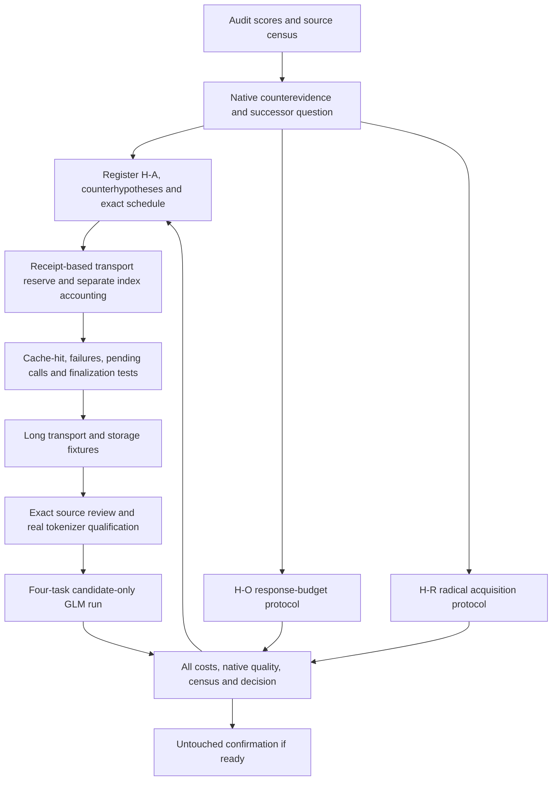

# Successor hypotheses after bounded archive/frontier R1

## Objective and evidence

Keep reusable ARE reasoning/context retention as the objective. Perfect native
quality on every fixed task remains required, followed by untouched confirmation.
The original >=15% total model-token reduction target remains unproven. Fresh
controls are suspended by owner direction; historical comparisons are descriptive.
Do not replace tasks, hide failures, expose gold, or claim non-code transfer.

R1: three completions, one response truncated at2048output tokens; all four
assignments cost226272tokens/64calls with no unknown usage. Native span-F1 on
completed tasks2/3/4 is.7638544869/.4651219021/.0097502736. Union span coverage
is.6235333881/.3030350767/.0076490790. All66/26/69confirmed observations reach
projection; all66/28/69mapped delivered events reach export. Task3 has59 unmapped changed-line occurrences across repeated observations,
not59unique lines (41snapshot-line identities across two edited snapshots). Task2 selection loses only.00560
coverage; tasks3/4 lose none relative to their exported unions.

Sources: [reviewed scores](bounded-archive-frontier-descriptive-live-r2/RESULT-REVIEW.json),
[census](bounded-archive-frontier-descriptive-live-r2/POSTRUN-ANALYSIS.json),
[live result audit](bounded-archive-frontier-production-live-r1/RESULT-REVIEW.json).

All three completed tasks stopped exploration at conservative operation headroom,
not actual tokenizer exhaustion: charged144/144/142 versus actual transport
requests39/37/39 at final completion. Cache hits and separate index measurements
consume that conservative operation count. Last discovery responses requested
more tools. This establishes an artificial cutoff, not the quality of hypothetical
extra exploration. Eight invalid read calls and one failed edit also remain costs.

## Competing hypotheses and selection

H-A (selected incremental experiment): reserve actual request-tokenizer capacity
using exact transport receipts and an explicit bound on each in-flight operation;
account index-tokenizer requests separately. Removing cache-hit/index cross-charging
allows more useful acquisition within the same8K/96Kmodel budgets. Falsifier:
all-task perfect quality still fails, or additional exploration fails to improve
missing evidence. Report completion, union coverage, final precision/F1 and total
model tokens separately. Do not declare success merely because calls increase.

H-N (counterhypothesis): exploration policy and interpretation dominate the gap;
extra capacity yields repetition, irrelevant sources or more cost. More reads are
not necessarily useful evidence. Task4's very low overlap makes this plausible.

H-O (separate response-budget alternative): explicit larger or adaptive response
reservation prevents truncation but crowds out source evidence inside8K. Requires
prospective transport/profile/phase changes, measured request admission and exact
accounting. Do not alter the frozen run or silently retry truncated calls. Keep
this separate from H-A to make its additional mechanism visible.

H-R (radical acquisition alternative): a deterministic source inventory and
query-driven evidence acquisition stage before open-ended patch exploration finds
relevant sources missed by conversation-led search. Preserve the same task and
issue-resolution attempt protocol. No reference annotations or test answers may
enter retrieval. All model-assisted query/ranking work counts toward the same
budget. Candidate design must expose inventory omissions, source versions and
observed versus merely retrieved material. Register a bounded protocol before
implementation or live testing; this is not yet launch-ready.

H-A is the next runnable construction frontier. H-O and H-R remain explicit
alternative branches; they are not extra controls and must not silently combine
with H-A. If response truncation recurs, retain it and use that result to decide
whether H-O should become the next selected experiment.

## DAG, gates and owners

Product owner/operator: coordinator. Product frontier: native registration then
H-A construction; no source changes to R1. Keep the same four identities, two
workers,8Krequests,96K/96calls per task,88K/95exploration plus8K/one final call,
384Kcampaign,2048output cap for H-A, no retries or phase transfers. Charge every
provider request, including failed/unknown attempts. Preserve a32-request-tokenizer
final reserve against the actual192transport ceiling; handle cached operations
without claiming new transport usage. Keep the separate index-tokenizer ceiling
and all its receipts. Test actual receipt growth and pending capacity, not just
an abstract operation counter. Pending observations remain unconfirmed until a
successful matching model receipt; do not credit end-of-loop raw outputs.

Operational owner: research operator. Source freeze/review, model-disabled real
qualification, D:/WSL storage and clean supervised settlement gate live launch.
They do not block local candidate construction. Worker expansion, controls,
release and matched-savings claims remain deferred.

## Open Questions

Does corrected capacity improve relevant acquisition or only spend more tokens?
How much unconfirmed evidence remains at the cutoff? Are repeated read schema
failures a learned behavior issue or a useful opportunity for deterministic tool
feedback? Which acquisition strategy transfers beyond source-code tasks? Can
perfect quality and token efficiency survive untouched confirmation?
