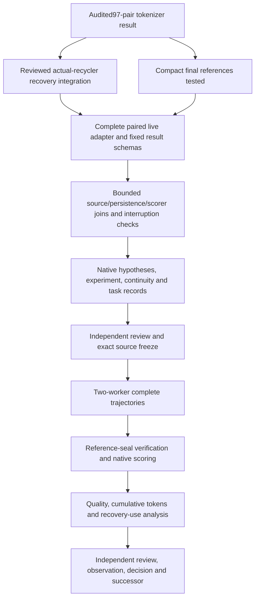

# Next complete-trajectory recovery experiment

Candidate plan; no provider generation is admitted by this document. Enduring objective: improve reusable ARE reasoning-state retention and useful recovery. Initial objective: finish GLM-5.3-flash qualification starting at small windows. Required outcome remains perfect benchmark quality and at least 15% cumulative model-token reduction separately for ContextBench and LongMemEval, with complete accounting and broader confirmation. The completed tokenizer study is input-only supporting evidence, not completion of that objective.

## Gap and competing hypotheses

The repaired demand projection saves 12.32% input over 97 archived boundaries, below 15% even before opening/output costs. Newly available recovery has not yet been used by GLM in full trajectories. Missing discovery and selection errors remain documented quality deficits.

H1: demand-driven access to a complete, fresh archive reduces repeated exploration and prompt input enough to meet the total-token target while enabling perfect treatment selections. H0: the additional opening turn, reduced visibility or ongoing discovery deficiencies erase savings or prevent perfect quality. A completed valid comparison below either gate is counterevidence to this joint claim. Infrastructure, missing results or unknown usage make it inconclusive rather than falsifying a mechanism.

Selection posture: proceed toward one full-trajectory visibility comparison. Do not add a task-specific search strategy or tune against reference locations to make it pass. A claim-ledger/discovery policy remains a separate future hypothesis if this experiment fails.

## Fixed comparison to preregister

Retain the same four exposed discovery tasks in paired eager and demand arms, yielding eight assigned trajectories. Both arms share repaired archive freshness, compact cursor, history retention, tool semantics, source access, output policy, exact 8K request admission and the same terminal evidence policy. Freeze that common policy explicitly; if the independently tested diversity ranking is adopted, adopt it in both arms and identify this as a new baseline. The varying factor is eager catalog visibility versus demand opening.

Use the actual source order, GLM profile and pinned native evaluator. Count every generation, reasoning, cached input, failed/unknown request and any judge call. Do not infer full savings from tokenizer-only counts. All assigned controls and treatments must finish with valid native exports and accounted usage; treatment must achieve Span-F1 and File-F1 of 1 on every task, with at least 15% aggregate cumulative-token reduction and no quality regression. Preserve every task and failure. These exposed development outcomes still require broader untouched confirmation before benchmark-wide claims.

Before dispatch, register exact numerical call/token reservations using the existing source/configuration evidence. No lowering a cap, replacing failed tasks, skipping expensive controls, reusing partial failed-stage measurements or post-result criterion changes.

## Ordered work and DAG

B has passed ten actual-recycler/native-export synthetic tests and independent review. C has passed three test groups including a 12.8 MB persisted-result case and independent helper review. The fixed trajectory sealing adapter additionally passes two test groups; its independent review and live-wrapper integration remain separate gates. D must bind every fixed slot, including failures/undispatched placeholders, to strict usage validation before final sealing. E must verify source preparation and output size before any model request, await actual worker/transport settlement, and keep native references isolated until generation is sealed. No old failed global seal is recreated.

## Product and operational responsibilities

Current product frontier: join the reviewed episode adapter, persistence and scorer into a complete paired runner. Coordinator owns those joins, numerical reservations, native research records and result integrity. Runtime tests must exercise real recycler/native export with synthetic transport before provider use.

Operational prerequisites affect the live stage: measure actual D: and guest capacity, declare bounded source-working and evidence footprints, use shared storage guards and verify cleanup before removing disposable data. Existing tokenizer stages remain at a 32 MiB cap, 1 GiB D: reserve and 8 GiB guest reserve; do not silently reuse an insufficient footprint contract for full source work. Any different full-trajectory storage budget requires explicit evidence and review. C: is excluded. User-owned VHD reclamation is deferred and is not implied by guest cleanup.

No simultaneous benchmark branches or four-worker ramp until shared provider/storage supervision is admitted. Broader untouched LongMemEval confirmation remains parallel planning work, not cleared by ContextBench results. No release, commit or authority promotion is part of this research round.

## Open questions

What exact source/evidence footprint does the full runner require? Which existing result schema/validator will cover every slot and cost field? Will recovered evidence reduce repeated work sufficiently to exceed 15% total savings? Will the model open/refresh correctly, and can it discover/select every required span and file? These are execution and empirical questions to resolve without relaxing the objective.

## Implementation update

The fixed-slot helper and isolated-source orchestration pass seven tests and independent R2 review. The paired eager/demand runner passes eleven tests, including an actual Git/bounded recycler/native export synthetic pair. Pair review caught an infrastructure failure that did not stop the next arm; the corrections and regression tests passed independent R2 pair review (67 source bindings, eleven tests). No provider benchmark result follows from synthetic transport.

The [footprint diagnostic](TRAJECTORY-FOOTPRINT.json) measures about 67 MiB of predecessor non-source files. Propose a separate full-trajectory evidence cap of 128 MiB and disposable-source envelope of 2 GiB, retaining the 1 GiB physical D: reserve and 8 GiB guest reserve. These are candidate budgets requiring implementation, prospective records and review; the frozen tokenizer stage remains 32 MiB. Remaining open questions are shared reservation enforcement, request-byte/receipt binding, global settlement and native scorer hydration.

## Storage and supervision implementation

The 128 MiB evidence guard and separate 2 GiB source monitor are implemented and independently reviewed (15 tests); the source envelope is not a kernel quota. The global two-worker supervisor and reference sealing are independently reviewed (7 tests), retaining all assigned tasks and unresolved accounting. The new request verifier passes two tests and independently reconstructs 218 saved model requests/605,550 tokens in a read-only replay; independent verifier review approved 69 exact bindings and reproduced the replay. Native scorer integration, underlying HTTP settlement evidence, source preparation checks and prospective native launch records remain. No new provider calls or benchmark score occurred during these construction checks.

## Native scorer and prospective records

Native scorer integration passed independent R2 review (72 bindings), including a complete four-task/eight-arm synthetic pipeline. Final source/configuration revalidation prevents a result from passing after evaluation-time drift. The prospective protocol now fixes two native hypotheses, one native experiment, source-bound cohort and six-task native work plan rooted in the predecessor question. Record verification passed; prospective review is pending. Remaining work is the source-bound launcher, durable terminal, underlying transport settlement, fresh capacity/source preflight and independent launch freeze before model generation. No new benchmark score is claimed.
