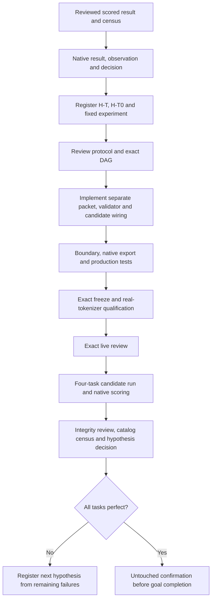

# Measured terminal catalog: candidate protocol

Status: prospective design, not live admission. This is an improvement branch
after the ranked-source radical trial. Preserve its frozen implementation/results.

## Objective and evidence

Keep ARE's reusable objective: preserve usable, provenance-bound reasoning
evidence under limited context, improve native quality and token efficiency.
Perfect native quality on every fixed task and untouched confirmation remain
unachieved. The original 15% total-model-token target remains unproven.
No fresh controls, reference answers in generation, retries or replaced tasks.

The reviewed [postrun census](ranked-source-production-live-r1/POSTRUN-ANALYSIS.json)
found all 93/68/3/124 confirmed observations projected and exported. Acquisition
coverage remains incomplete on every task. The
[packet census](ranked-source-production-live-r1/TERMINAL-CAPACITY-CENSUS.json)
shows 93/63/3/79 eligible unique observations, but final packets list only
32/32/3/32. Their measured text uses 628/576/118/778 tokens of the 2048-token
state allowance. The catalog omits 61/31/0/47 eligible observations.
These counts do not establish that omitted evidence is relevant or that the
selector alone caused the final-coverage loss.

## Hypotheses and decision

- Selected H-T: a measured wider terminal catalog improves access to evidence
  already delivered during investigation, reducing avoidable finalization loss.
- Counter H-T0: the current catalog already contains the useful evidence;
  widening adds distraction and tokens without improving final quality.
- Retained H-A: missing source acquisition dominates quality. Wider finalization
  cannot supply unread reference material. A separate acquisition hypothesis
  remains necessary if the cumulative confirmed coverage is insufficient.

Change only terminal catalog capacity in the next candidate. Keep ranked hints,
source tools, exploration prompts, ordering, exact-range deduplication, native
projection and accounting unchanged. Use a distinct candidate identity and
source-bound registration. Do not credit hints or auto-select omitted evidence.

## Bounded implementation contract

1. Add a distinct packet version supporting at most 128 opaque handles. Keep
   one handle per eligible observation; preserve the existing ordering and exact
   provenance mapping. No grouping, synthetic spans or extra source acquisition.
2. Keep the existing 8192-byte/2048-token terminal text bounds. Try unique prefix
   sizes from the available count capped at128, then96/64/48/32/24/16/8/4/2/1,
   skipping sizes not smaller than the preceding trial. Select the first prefix
   whose actual rendering fits both bounds. At most11 tokenizer measurements;
   do not assume token counts are monotonic or claim maximal packing.
3. Measure/admit the entire request, including schema, within8000 tokens. Keep
   output cap2048, finalization8000tokens/one model call, exploration88000/95,
   total96000/96 per task and384000 across the four-task campaign. Keep two workers.
4. Validate the entire submission schema, all handle identities, uniqueness,
   source bindings, receipt delivery and native reconstruction. A larger packet
   is not permission to submit unlisted handles or exceed response limits.
5. Keep explicit omitted counts and failure evidence. Preserve predecessor files.
   No runtime fallback to another candidate, automatic retry or budget transfer.

## DAG and evidence gates

Product frontier: protocol review and native research registration. Runnable work:
validate the prospective contract, then implement after review. Research operator
owns qualification, process settlement and WSL storage checks for affected live
stages. Fresh controls, release and deployment are deferred operational work.

Test more than32 valid bindings; rejection of duplicate/unknown handles; output
and full-request limits; nonmonotonic token measurements; bounded fit attempts;
exact receipt/export reconstruction; unknown spend and persistence failures.
Report all four outcomes/costs, cumulative source coverage, catalog inclusion,
selected coverage, F1 and actual tokens. Historical comparisons are descriptive.
No new scorer-based oracle may supply decisions to generation.

## Open Questions

Will wider visibility improve final selection or increase distraction? How much
loss happens before catalog rendering versus selection? Can a terminal-only
change generalize beyond code? What acquisition hypothesis addresses missing
coverage if H-T helps selection but cannot reach perfect quality? Independent
protocol review must resolve implementation gaps before live admission.
