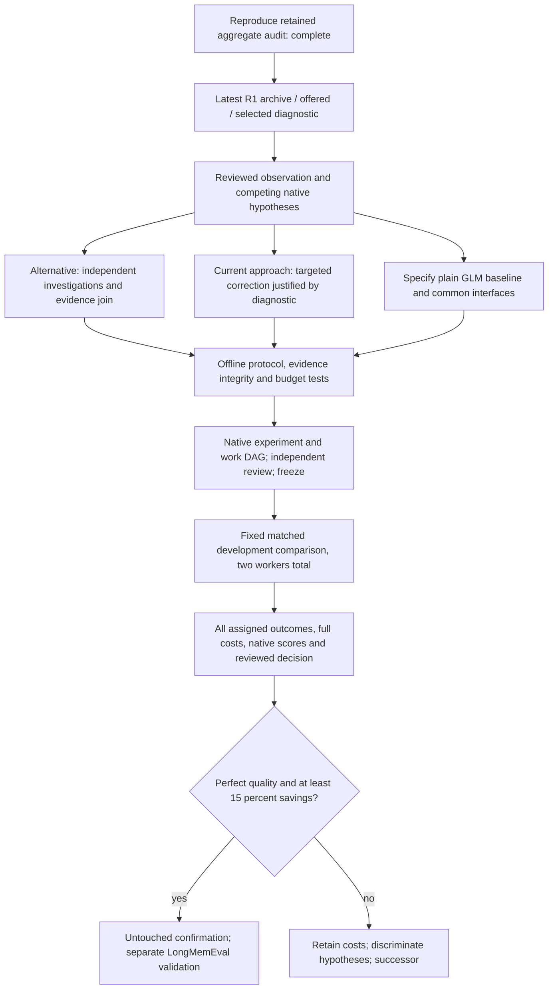

# Alternative architecture branch: independent investigations

Status: candidate plan supported by a reproduced aggregate audit. No new model calls, native experiment admission or performance claim. This plan supplements the current research line; it does not rewrite failed experiments.

## Objective and continuity

Improve reusable ARE context management and complete GLM small-window qualification. Keep exact 8K request admission including output reserve, perfect treatment Span-F1 and File-F1 on every fixed ContextBench task, all assigned outcomes valid, known accounting and at least 15% cumulative model-token reduction. LongMemEval still needs untouched confirmation. Four exposed tasks cannot prove full-benchmark or cross-domain perfection.

Preserve objective → question → competing hypotheses → prospective experiment/tasks/criteria → observation → reviewed decision → successor. Native registration, independent review and freeze precede new generation. The original R1 inconclusive observation in RECOVERY-TRAJECTORY-R1-POSTRUN.json remains unchanged. The separate partial-score review is diagnostic evidence, not a replacement result.

## Evidence and correction to the proposal

[Reproducible audit](ARCHITECTURE-BRANCH-AUDIT.json) verifies retained historical source bindings and the latest partial result review. Run `python3 development/agent-reasoning-engine/planning/representation-preferences/dual-benchmark-8k-v2/contextbench/audit-architecture-branch.py` from the repository root to reproduce it. It reads existing aggregates, not gold data.

External evidence storage and on-demand recovery already exist in [DEMAND-RECOVERY.md](DEMAND-RECOVERY.md). The latest [runner](discovery-v1/run-recovery-pair.mjs) enables discovery retention in both arms and varies eager versus demand recovery. Calling its control plain GLM would be incorrect. A plain-model baseline must be separately specified and executed under common source tools, terminal representation and budgets.

Historical discovery archive recall for control/treatment was 11.79%/9.23% on task 1, 31.04%/40.84% on task 3 and 29.57%/24.19% on task 4. Selection cannot recover absent evidence on those trajectories. Task 2 treatment had complete archive coverage and feasible perfect whole-read selection, but actual selected recall was 94.93%. This shows both discovery and selection problems can occur. These are historical results, not new R1 coverage measurements.

Latest R1 partial scores show zero Span/File F1 on both completed task-1 arms and worse treatment than control on task 2. Only four of eight arms completed. No causal effect or accepted savings follows from the incomplete comparison.

## Distinct intervention

H-alt: separate bounded investigations of unresolved questions, each starting with a fresh working context and joining through a receipt-bound evidence store, improve discovery and final selection while reducing repeated prompt tokens relative to the current continuous trajectory.

The changed mechanism is decomposition and independent exploration, not renaming the archive. A coordinator produces public-task-derived questions. Each investigation receives the original objective, its question, explicit constraints and selected receipt-bound evidence. It can search previously unseen source through the same tools. It returns evidence references, unresolved questions and claims marked as provisional; source observations remain immutable and separate from claims. A join step resolves conflicts and selects final evidence. Fresh contexts must respect the provider's reasoning/tool protocol; resetting context cannot silently drop an unfinished tool exchange.

H-null: decomposition loses cross-question dependencies and duplicates discovery, so its planning/join costs erase savings or reduce quality. H-selection: the decisive limitation is final evidence representation/selection; independent exploration adds cost without resolving it. H-current: a targeted correction to the existing trajectory is sufficient. Keep these explanations distinct.

No task IDs, reference paths, evaluator witness identities or gold-derived terms may enter decomposition, ranking or prompts. Implement the mechanism generically. Component results cannot clear the full-trajectory goal.

## DAG and task order

1. Adapt the existing evaluator-only ceiling diagnostic to latest R1 paths and terminal packet binding. Score archive/offered/selected coverage for completed arms; retain all eight rows and failure statuses. Use read-only isolated evaluation, existing source trees and a fresh bounded diagnostic directory. Expose aggregate metrics only. Verify selected metrics equal the already reviewed native scores.
2. Register the diagnostic observation and reviewed interpretation without modifying R1's inconclusive disposition. Decide whether alternative exploration, selection repair or both deserve implementation. Historical evidence motivates exploration; it does not preselect a winner.
3. Implement a small independent-investigation candidate after fixing exact state/claim/reference contracts. Prospectively select maximum investigations, scheduler, per-step allocations and join policy. All planning, investigation, summarization, reasoning, cached-input, failed and finalization model tokens count under a shared per-task ceiling. No per-investigation budget multiplication.
4. Define plain GLM, current ARE and alternative arms on identical tasks/model/source availability and common scoring semantics. Freeze ordering/counterbalancing, repetitions, baseline policy and exact budgets before outcomes. The proposed three-arm run has 12 assigned outcomes for four tasks; it is a new experiment, not an extension of eight-arm R1. Report alternative versus both baselines; do not select the easier comparator after scoring.
5. Repair shared provider-health integration and persist process-closure evidence separately from accounting rejection in the successor. Any tokenizer timeout change must be symmetric and prospectively declared. It is an operational change, not the quality hypothesis.
6. Review and freeze before dispatch. Begin with at most two workers total, sequential benchmark stages and D:/WSL guards. Four-worker expansion requires separate capacity evidence. A proposed one-in-three experiment allocation is a research budget preference, not an admitted scheduling rule.
7. Record all outcomes, native metrics and cumulative tokens, then reviewed decisions and next questions. Keep broader untouched confirmation and LongMemEval open.

## Product frontier and operational ownership

Current product frontier: completed evidence audit; latest-R1 coverage diagnostic is the next runnable construction task. Alternative runtime and native prospective records are not implemented/admitted yet. Coordinator owns diagnostic, implementation, evidence accounting and joins. Independent review is required before new generation.

Causal prerequisites for live stages: exact tested candidate, native records, reviewed freeze, known bounded budgets, provider failure handling and D:/WSL capacity. Shared multi-benchmark supervision is required only for simultaneous dispatch. User-controlled VHD reclamation, release, publication and deployment remain separate operational residue; none is authorized by this plan. C: is excluded from storage gates. Preserve frozen files and failed costs.

## Open questions

Does latest R1 lose coverage during discovery, packet construction or selection? Can independent questions be generated without adding excessive tokens or duplicating searches? Is final whole-read granularity an independent ceiling? Which generic conflict-resolution policy preserves evidence under 8K? Can savings and perfect quality replicate on untouched tasks and in LongMemEval? Exact branch allocations and plain-model baseline still require prospective specification before execution.
