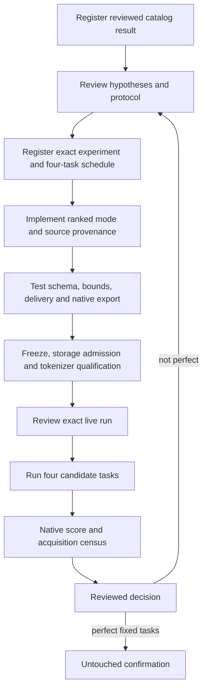

# Ranked source reads: candidate research protocol

Status: proposed for design review; no runtime implementation or live admission.

The enduring objective is reusable ARE reasoning and evidence retention within
total model input plus output tokens. The initial objective remains GLM-5.3-flash
qualification under small windows. Perfect native quality on every fixed task and
untouched confirmation remain required; the original ≥15% token reduction target
is unproven. No fresh controls are authorized.

## Evidence and question

The [reviewed catalog census](measured-terminal-catalog-production-live-r1/POSTRUN-REVIEW.json)
shows zero omitted eligible handles and equal final/exported-union span recall on
all four tasks. Three unions remain incomplete. Task3 has two unmapped changed-line
occurrences; task2 has full recall but extra selected material. The [run](measured-terminal-catalog-production-live-r1/RESULT-SUMMARY.md)
used333,626tokens with0perfect outcomes. These observations locate losses without
proving a causal benefit or failure of any one mechanism.

Existing literal `search` already returns source observations. `rank_sources`
instead returns at most five path/range hints and requires a separate model-chosen
read. Its usage was0/1/1/4 successful calls; subsequently read hinted paths were
0/0/0/7. Counts do not prove that every successful raw output reached the model.

Question: can a model's ranked retrieval request directly deliver bounded,
verified source windows, reducing the extra pointer-to-read step and increasing
useful evidence coverage within the same budget?

## Competing hypotheses

- H-R: executing ranked retrieval and source reads together increases confirmed
  useful span coverage per model token and reduces navigation-only calls.
- H-R0: ranking relevance is the limiting factor; direct windows deliver more
  irrelevant bytes and increase token use without useful coverage.
- H-R1: the model's initial interpretation and queries are the limiting factor;
  an optional ranked-read mode receives little use or repeats the wrong region.

Select H-R as a radical change to retrieval execution. Retain H-R0/H-R1 as explicit
counterhypotheses. Do not interpret a zero-use run as evidence that direct reads
improved acquisition. Keep wider terminal catalogs and the existing literal search.

## Proposed bounded construction

Extend the distinct candidate's `search` tool with an explicit ranked mode, using
its existing native multi-observation delivery contract. Default literal mode
retains its current behavior. Ranked mode accepts the query, requires base revision,
empty path prefix and offset0, and allows limit1..5. Reject unsupported combinations
with schema-complete diagnostics; never reinterpret a literal query silently.

For ranked mode, reuse the pinned index and ranking order. Verify each hint against
the source manifest and execute actual native base reads for its exact range
(at most40lines per hint). Return exact source bytes and hashes as observations
under the actual model-requested `search` call. No fabricated tool calls, receipts,
or evidence credit from hints alone. Source snapshots and observation handles
must reconstruct through the native evaluator unchanged.

Limit the complete ranked response to8,192UTF-8bytes. Keep the largest ranked prefix
that fits by exact serialized byte measurement; record omitted windows and read
failures. No implicit second page, query expansion, path guessing, retry or hidden
model call. An empty response is explicit. Every offered observation still needs
a successful model request receipt before it earns confirmed-delivery credit.
Native measured request admission remains mandatory; byte fit is not token fit.

Do not change literal search, edits, ranking algorithm, archive behavior, terminal
ordering, task issues, or reference evidence. Do not use gold to select query terms,
files, windows, limits or defaults. Runtime construction follows reviewed design.

## Fixed experiment and measurements

Use the same four exposed ContextBench tasks, GLM8K, at most two shared workers,
96Ktokens/96calls per task (88K/95exploration;8K/1final),384K campaign total,
2048output cap, no retries or budget transfers. The full native request must remain
below7,999projected tokens. All failures and costs stay in the denominator.

Primary campaign acceptance remains all four perfect native scores, complete
accounting, verified windows, long trajectories and post-score integrity. Local
mechanism evidence records requested mode, ranked windows returned, bytes offered,
receipt-confirmed observations, union/final coverage, model tokens and failures.
Compare historical runs descriptively only; no matched savings claim. Native
span/file precision and recall remain visible, including task2 precision failures.

Before paid generation: test all schema fields and unsupported combinations;
tampered hints/hashes; exact bytes/ranges; partial output and omission accounting;
zero credit without dispatch; complete delivery/export reconstruction; actual8K
admission; failures without retry; and process/storage settlement. Real tokenizer
qualification covers initial and representative ranked-read/final requests.

## DAG and responsibilities

Product frontier: reviewed result registration, protocol review, then construction.
Coordinator owns hypotheses, source bindings, implementation and interpretation.
Research operator owns WSL/D disk capacity and process settlement at qualification
and live stages. Those checks block their affected stage only. Release, publishing,
larger windows and new controls remain deferred.

## Open Questions

Does the current ranker find useful windows? Will the model request ranked mode?
Does removing a navigation step save enough tokens to offset larger source output?
How much is source acquisition versus task misunderstanding or unmapped edits?
Evidence from four exposed coding tasks cannot establish general model improvement;
untouched confirmation and LongMemEval remain separate obligations.
