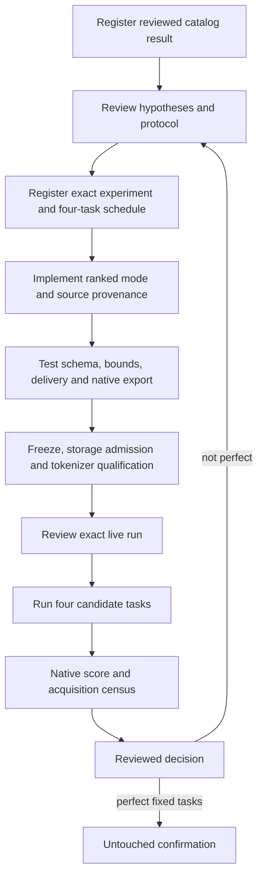

# Ranked source reads: candidate research protocol

Status: R2 proposed for design review; supersedes R1 construction details only.
R1 and its review remain historical evidence. No runtime or live admission.

The enduring objective is reusable ARE reasoning and evidence retention within
total model input plus output tokens. The initial objective remains GLM-5.3-flash
qualification under small windows. Perfect native quality on every fixed task and
untouched confirmation remain required; the original ≥15% token reduction target
is unproven. No fresh controls are authorized.

## Evidence and question

The [reviewed catalog census](measured-terminal-catalog-production-live-r1/POSTRUN-REVIEW.json)
shows zero omitted eligible handles and equal final/exported-union span recall on
all four tasks. Three unions remain incomplete. Task3 has two unmapped changed-line
occurrences; task2 has full recall but extra selected material. The [run](measured-terminal-catalog-production-live-r1/RESULT-SUMMARY.md)
used333,626tokens with0perfect outcomes. These observations locate losses without
proving a causal benefit or failure of any one mechanism.

Existing literal `search` already returns source observations. `rank_sources`
instead returns at most five path/range hints and requires a separate model-chosen
read. Its usage was0/1/1/4 successful calls; subsequently read hinted paths were
0/0/0/7. Counts do not prove that every successful raw output reached the model.

Question: can a model's ranked retrieval request directly deliver bounded,
verified source windows, reducing the extra pointer-to-read step and increasing
useful evidence coverage within the same budget?

## Competing hypotheses

- H-R: executing ranked retrieval and source reads together increases confirmed
  useful span coverage per model token and reduces navigation-only calls.
- H-R0: ranking relevance is the limiting factor; direct windows deliver more
  irrelevant bytes and increase token use without useful coverage.
- H-R1: the model's initial interpretation and queries are the limiting factor;
  an optional ranked-read mode receives little use or repeats the wrong region.

Select H-R as a radical change to retrieval execution. Retain H-R0/H-R1 as explicit
counterhypotheses. Do not interpret a zero-use run as evidence that direct reads
improved acquisition. Keep wider terminal catalogs and the existing literal search.

## Proposed bounded construction

Extend the distinct candidate's existing `search` schema with one optional field:
`mode`, enum `literal` or `ranked`, absent meaning `literal`. Do not use validator
coercion or mutation to apply that default. Keep the existing required fields
`query`, `path_prefix`, `offset`, `limit`, `revision`, and reject unknown fields.
Literal mode removes only `mode` before delegating to the unchanged native search.
Thus old calls keep their original behavior and native diagnostics.

For ranked mode, the closed schema and semantic validation require nonempty
`query` of at most4,096Unicode characters AND4,096UTF-8bytes, valid round-tripUTF-8
(no lone surrogates), `revision: base`, `path_prefix: ""`, `offset: 0`, and integer
`limit`1..5. Reject every invalid field before querying or reading. Report all
validation errors using bounded diagnostics: at most32issues, each with fixed
error code and JSON pointer capped256UTF-8bytes, plus total/omitted issue counts.
Never echo arbitrary input values or unbounded error strings. Oversized complete
arguments (>8,192UTF-8bytes) receive one fixed input-size error before validation.
These extra bounds apply to ranked mode only; a malformed mode is a schema error.

Reuse the existing pinned index, ranking order and hint validator. For the first
`limit` hints (at most5), validate the manifest/base/hash/range identity, then
execute native base `read_file` for the exact hinted range (at most40lines). Verify
the returned path, full-file hash, base revision, start/end, byte_count and exact
snapshot-derived bytes. Return actual observations under the model's real `search`
call; internal native reads are not fabricated model tool calls or extra receipts.
Credit requires successful model delivery of the resulting observations.

Read attempts proceed in rank order. Stop at the first native read-size rejection
`repository.read-too-large-use-smaller-range`; retain only the preceding successful
prefix and record fixed code `read-size-limit` and zero-based failed hint index.
Do not skip that hint, shrink its range, retry, or read later hints. Every other
read failure, malformed result, manifest/hash/revision/range/snapshot mismatch, or
ranking service failure is an integrity/infrastructure failure: abort the episode,
retain all model spend, and do not return partial successful tool evidence.

After these at most5attempts, consider successful-prefix lengths from longest to
zero. Construct the entire result, attach native `read_id` and `retrieval_handle`
values using the actual `search` call ID, serialize with native `stable()` compact
JSON, and choose the first prefix <=8,192UTF-8bytes. At most6byte measurements; no
monotonicity assumption or extra read is needed. The response cap includes the
`ok`/`output` envelope, all source bytes/hashes/handles and all metadata. It excludes
only the outer conversation message wrapper, which the native tokenizer measures.
Later attachment must be idempotent and byte-identical; assert this in integration.

Use a closed result envelope. Success: `ok:true`, and `output` with `observations`
and a closed `ranked_read` metadata object. Metadata contains only:
`schema: are.ranked-read/v1`, `index_digest`, `query_digest`, `partial_index`,
`omitted_query_terms`,
`matching_windows`, `available_hints`, `requested_limit`, `attempted_reads`,
`successful_reads`, `returned_windows`, `omitted_hints`, `unattempted_hints`,
`byte_omitted_windows`, `read_stop_code` (null or `read-size-limit`), and
`read_stop_index` (null or0..4). Counts must reconcile: available<=5;
omitted_hints=matching_windows-returned_windows;
unattempted_hints=available_hints-attempted_reads;
byte_omitted_windows=successful_reads-returned_windows. Index query truncation uses
the existing nonnegative `omitted_query_terms` count.
No raw query or path strings occur in this metadata. Digest strings are64hex;
counts are nonnegative safe integers; successful_reads<=attempted_reads<=limit.

If zero observations fit, return an explicit empty success with the same omission
accounting. It grants no source evidence. If even the zero-observation envelope
cannot fit, abort as an invariant failure. Failed validation uses `ok:false` with
bounded `issues`, `total_issues` and `omitted_issues`; it grants no observations.
For diagnostics, serialize issue prefixes from at most32 down to zero and choose
the first complete envelope <=8,192bytes, updating omitted_issues exactly. An
empty diagnostic list still reports total_issues and cannot imply valid input.
Validate schema and byte limits on both success and error paths.

No implicit page, query expansion, path guessing, model call, budget transfer or
retry. Every offered observation still needs a successful model request receipt
before confirmed-delivery credit. Native measured request admission remains
mandatory; byte fit is not token fit. Unreturned snapshots may remain audit evidence
but cannot become delivered observations or terminal selections.

Do not change literal search, edits, ranking algorithm, archive behavior, terminal
ordering, task issues, or reference evidence. Do not use gold to select query terms,
files, windows, limits or defaults. Runtime construction follows reviewed design.

## Fixed experiment and measurements

Use the same four exposed ContextBench tasks, GLM8K, at most two shared workers,
96Ktokens/96calls per task (88K/95exploration;8K/1final),384K campaign total,
2048output cap, no retries or budget transfers. The full native request must remain
below7,999projected tokens. All failures and costs stay in the denominator.

Primary campaign acceptance remains all four perfect native scores, complete
accounting, verified windows, long trajectories and post-score integrity. Local
mechanism evidence records requested mode, ranked windows returned, bytes offered,
receipt-confirmed observations, union/final coverage, model tokens and failures.
Compare historical runs descriptively only; no matched savings claim. Native
span/file precision and recall remain visible, including task2 precision failures.

Before paid generation: test all schema fields, omitted/literal/ranked mode and unsupported combinations;
tampered hints/hashes; exact bytes/ranges; empty results; deterministic failed/oversized prefixes;
metadata count reconciliation; attached-handle inclusive byte fitting and idempotence;
zero credit without dispatch; complete delivery/export reconstruction; actual8K
admission; failures without retry; and process/storage settlement. Real tokenizer
qualification covers initial and representative ranked-read/final requests.

## DAG and responsibilities

Product frontier: reviewed result registration, protocol review, then construction.
Coordinator owns hypotheses, source bindings, implementation and interpretation.
Research operator owns WSL/D disk capacity and process settlement at qualification
and live stages. Those checks block their affected stage only. Release, publishing,
larger windows and new controls remain deferred.

## Open Questions

Does the current ranker find useful windows? Will the model request ranked mode?
Does removing a navigation step save enough tokens to offset larger source output?
How much is source acquisition versus task misunderstanding or unmapped edits?
Evidence from four exposed coding tasks cannot establish general model improvement;
untouched confirmation and LongMemEval remain separate obligations.
