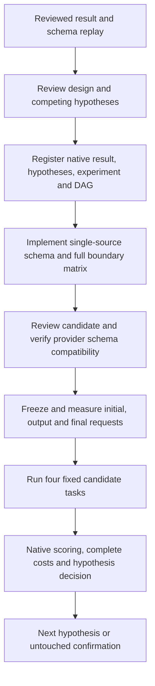

# Ranked tool schema agreement

Candidate design for review, not a registered or admitted live experiment.

## Objective and evidence

Keep reusable ARE reasoning/evidence retention as the objective, GLM-5.3-flash
8K as the initial qualification, and perfect native quality on every fixed task
plus untouched confirmation as completion. The original 15% total model-token
reduction remains unproven. No fresh control runs.

The reviewed [ranked run](ranked-read-production-live-r1/RESULT-REVIEW-R1.json)
has four valid tasks, zero perfect, 337030 tokens and 95 calls. Mean span-F1 is
0.36332406471879203. The [schema audit](RANKED-SCHEMA-AGREEMENT-AUDIT-R1.json)
replays actual arguments against the advertised schema: all 30 rejected ranked
calls passed that schema. Runtime rejected 29 nonempty path prefixes and one
limit above five. The model's description did mention restrictions, but its
machine-readable contract did not encode them. These are system contract errors;
their contribution to the score regression is not yet established.

## Competing hypotheses and selection

H-S: exposing and validating the same structural schema reduces rejected calls,
leaving more of the fixed token budget for useful evidence acquisition.

H-R: ranking relevance and model query formation dominate quality; eliminating
schema disagreement reduces errors without improving relevant coverage or F1.

H-P: requests for path prefixes express necessary scoped retrieval. Truthful
restrictions may reduce useful searches; a bounded scoped-ranking mechanism is
the radical alternative. Keep it separate so the next run changes one mechanism.

Select H-S for the next improvement design. H-P remains a radical branch to
register separately based on evidence. No new control branch or causal claim.

## Proposed construction

Create one source for the tool's structural schema and runtime compilation.
Preserve literal calls and all existing native retrieval semantics. When mode is
ranked, publish the same base revision, empty path prefix, zero offset and limit
1..5 constraints enforced by the validator. Use a conditional schema or equivalent
explicit alternatives; verify provider compatibility before selecting the exact
representation. Do not silently strip a requested prefix, clamp a limit, or treat
the rejected calls as successful historical observations.

Audit all schema-expressible constraints, required fields, unknown fields, enums,
types and boundaries in both modes. Keep UTF-8, byte limits and source integrity
checks explicit as semantic constraints that standard structural schemas do not
fully express. Retain bounded all-error diagnostics; do not add a field-specific
repair loop. No ranking, prompt advice, evidence selection or budget change in
this experiment. Frozen implementations and results stay immutable.

## Measurements and falsifiers

Before live work, require zero advertised/runtime structural disagreements over
the 50 recorded ranked calls and a boundary matrix covering every field in both
modes. The 30 old invalid calls must now be rejected by the advertised schema;
the 20 successful calls must remain structurally accepted. This deterministic
gate proves contract agreement, not model behavior.

Keep all four tasks and count malformed/invalid calls and failures. Runtime
rejection rate is rejected ranked calls / requested ranked calls; zero requested
calls makes that mechanism test inconclusive. Historical rate is 30/50 = 0.6.
Compare total input+output tokens, confirmed source delivery, exported-union span
recall and native span/file F1. Q is the equal-task mean of
10000 * exported_union_span_recall / total_model_tokens.

Provisional support requires complete evidence/accounting, some confirmed ranked
use, rejection rate below 0.6, Q above the measured-terminal historical baseline
0.042836065931818576 by more than 1e-12, and mean span-F1 at least that baseline
0.39681048402826774 minus 1e-12. A valid complete run missing these thresholds is
counterevidence; missing accounting or zero use is inconclusive. Also report
deltas to the immediately preceding ranked candidate. Comparisons are descriptive.
Perfect quality on all tasks and untouched confirmation remain separate mandatory
completion gates; the support thresholds do not weaken them.

## DAG and work boundaries

Product frontier: design review and native research registration. Construction
waits for those gates. Qualification/source freeze and WSL storage/process checks
are operational prerequisites at their exact live stages, owned by the research
operator. Same four tasks, two workers, 8K, 96K tokens/96 calls per task, 384K
campaign, no retries/transfers/gold/replacement tasks. Release remains deferred.

## Open Questions

Does the provider preserve conditional tool schemas? Does clearer schema guidance
change GLM behavior, or only rejection classification? Does path-scoped retrieval
offer the larger gain? Generalization beyond these exposed tasks is unproven.
