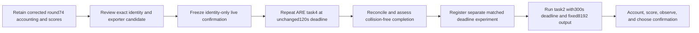

# Round 75: offline audit, corrected result, and candidate repair

The audit found two different infrastructure problems. ARE encountered a provider
call-ID collision. DSH's task-one selection was incorrectly rejected because our
read-only export container lacked writable temporary storage. No paid model calls
were made in this round.

The corrected round74 result is **DSH 3/4 valid scored selections and ARE 2/4**.
The original generation, costs, source freeze, and failed outcomes remain retained.
[Corrected results](CORRECTED-RESULTS.json) supersede the original completion count,
without overwriting [the original report](../deepseek-output-74/REPORT.md).

## ARE cause and repair

The retained 251-message history contains the same provider tool-call ID,
`call_-7246127973206583352`, at message indices67 and248. The first call searched
Svelte tests for `html_hydration`; the later call searched Svelte source for
`hydration_html_changed`. Different calls shared one identity. The pending-history
projection correctly detected conflicting content but could not continue.

The isolated candidate scopes tool-call identities by request digest, dispatch
sequence, public response digest, and call index before any tool execution.
Provider IDs and the deterministic mapping are retained in the durable receipt.
Names, arguments, content, and result pairing are unchanged. Duplicate IDs within
one provider response still fail before execution. The policy changes transport
identity, so an incompatible saved client cannot silently resume under it.

The candidate worker enables this policy; the shared implementation and historical
snapshot are unchanged. This is a tested candidate, not a production deployment or
a completed live-model validation. See [exact five-file derivation](DERIVATION.json).

## DSH cause and correction

The frozen source mapper compares current-source observations with the pinned base
using temporary files for `git diff`. On the selected read
`3086c6ba892883aa25c282ae8e8c3ce992b768503f596cde650a46c481a95f9a`, it failed with
`EROFS` while creating `/tmp/are-cb-source-map-*`. The exporter collapsed that
instrument error into `selected-source-not-delivered-or-invalid`.

Replaying the **unchanged frozen exporter** with a32MiB writable tmpfs mounted at
`/tmp` succeeds. The container otherwise remains read-only, networkless, and
memory-bounded. All636 frozen source files verify unchanged. The same frozen
native evaluator gives task one **Span F1 2.60% and File F1 28.57%**. Its cost
remains380,058 tokens. No retries, new model calls, altered selections, or credit
for invented evidence were involved.

The isolated candidate also retains structured export diagnostics in failed
outcome rows. Future exports must use the scratch mount documented in
[the environment correction](finisher-scratch.patch). The original environment
failure is retained in [diagnostic replay](DSH-DIAGNOSTIC.json), alongside the
[corrected export](DSH-CORRECTED-EXPORT.json) and
[native score](DSH-CORRECTED-SCORE.json).

## What the corrected comparison says

| Task with both valid | ARE Span F1 | DSH Span F1 | ARE File F1 | DSH File F1 | ARE tokens | DSH tokens |
| --- | --- | --- | --- | --- | --- | --- |
|1, zstd|0%|2.60%|0%|28.57%|208,741|380,058|
|3, cli|53.67%|51.25%|80%|80%|240,586|307,103|

ARE's21.66% token reduction with slightly higher Span F1 on task three remains a
useful single example. Task one favors DSH on quality despite its higher token
use. This prevents a general quality-preserving efficiency claim.

Both task-two runs still have unknown paid usage. Exact aggregate totals and
savings remain unavailable. ARE task four remains a failed historical run; an
offline repair does not make it successful. Source-selection scores do not prove
patch correctness, near1M retention, or8K qualification.

## Validation

All12 tests pass: eight inherited output/accounting tests and four new identity
regressions. The retained history reproduces the original conflict. Structural
replay with scoped identities removes that collision; this replay does not rewrite
historical read IDs or score the failed run. A separate three-response HTTP
loopback test exercises the actual transport, recycler, persistence, delivery
binding, and terminal selector with reused provider IDs. Both source reads remain
separately attributable,450 synthetic model tokens reconcile, and no unknown usage
is created. The first test run had a cleanup-order error; it is retained in
`TESTS-initial.txt` and fixed in the final suite. See [test results](TESTS.txt).

The frozen DSH export was also replayed successfully in the networkless container.
Local artifacts remain bounded; source clones stay on the VPS. Review was performed
by the coordinator, not an independent subagent.

## Next DAG and decision

The enduring objective remains reusable reasoning quality and continuity with at
least15% fewer total input plus output tokens without quality loss. Original GLM
and8K qualification remains a separate milestone. These are exploratory diagnostic
findings; native records are registered after analysis, not presented as prospective
preregistration.

Do not mix the identity change and the deadline intervention into one claimed
single-variable experiment. Both prospective phases retain1M capacity, original
call/token budgets, zero automatic retries, and bounded VPS evidence. No successor
is launched by this audit. A live provider check remains necessary for the new
internal-ID policy. Native hypotheses, observations and decision are recorded in
[research results](RESEARCH-RESULT.json).

## Open questions

- Does GLM accept the remapped tool IDs consistently across long live trajectories?
- Does repairing the collision improve task-four completion and quality?
- Does300s resolve task-two timeouts, or only postpone a provider stall?
- Can authoritative provider records recover the two missing usage totals?
- Which untouched tasks can confirm quality-preserving token savings?
