# Live findings: identity repair and deadline comparison, rounds 76–78

We have two valid scored live outcomes and two fully accounted failed outcomes.
ARE's corrected identity candidate completes task four. DSH completes task two
with high reference-span coverage. ARE's task-two failure is now attributable to
its response-batch ceiling. These findings are clear; a whole-benchmark efficiency
or superiority claim is not established.

All four newly assigned runs settled. **106 model calls used 864,835 tokens**, with
**zero unknown-usage calls** in this continuation. Failed calls and the failed
candidate are included. Round 74's two historical unknown-usage calls remain
unknown; these new results do not repair their accounting.

## Newly executed outcomes

Both harnesses used GLM-5.3-flash, configured 1M context capacity, 8,192 output tokens,
low reasoning, the pinned ContextBench tasks, and zero automatic retries.

| Round | Task and harness | Change under test | Calls | Total model tokens | Valid source selection | Span F1 | File F1 |
| --- | --- | --- | --- | --- | --- | --- | --- |
|76|Svelte, ARE|Scoped tool IDs, 120s deadline|3|6,627|No|—|—|
|77|Svelte, ARE|Corrected reasoning binding for scoped IDs, 120s|49|186,628|Yes|28.64%|28.57%|
|78|simdjson, ARE|Original round 74 generation;300s deadline only|32|83,935|No|—|—|
|78|simdjson, DSH|Original round 74 generation;300s deadline only|22|587,645|Yes|78.70%|57.14%|

Span F1 measures overlap with reference source spans. File F1 measures overlap of
selected files. Both balance precision and recall. These are source-selection
scores; they do not prove the attempted patch passes correctness tests. Failed
selections remain failures, not zero-cost successes.

## Identity fix: qualified live, with a retained failed attempt

Round 76 exposed a missing integration test. The provider accepted remapped tool
IDs, but retained-reasoning evidence still hashed the original message. Later
prompt measurement failed with `unbound-retained-reasoning`. Its 6,627 tokens remain
in the record. A new reasoning-bearing loopback regression reproduced this exact
failure before the repair and passed afterward.

Round 77 derives reasoning evidence after normalization, while retaining the
provider-message digest and provider-to-runtime ID mapping. It completed after 49
calls. The audit verifies 126 distinct runtime IDs across 48 tool-bearing responses;
no raw provider ID happened to repeat in this live sample. The deterministic
round 75 replay establishes the collision mechanism; this live run establishes
provider acceptance and sustained operation with reasoning and delivery binding.
Neither result alone proves broad reliability.

The same task's earlier DSH run used 441,105 tokens and scored 4.67% Span F1 and
16.67% File F1. Round 77 ARE used **57.69% fewer tokens** and scored higher on both
metrics. This is a **descriptive historical comparison on one exposed task**, not
a fresh matched trial or a whole-benchmark gain. Even including the failed
round 76 attempt, these two ARE attempts used 193,255 tokens; their costs are not
hidden in the successful-run figure.

## Deadline hypothesis: success does not establish necessity

Round 78 deliberately starts from round 74 generation, without the new ID policy.
Only the two nominal deadlines changed from 120,000 to 300,000ms. Token and call
budgets remained fixed. ARE's timer covers its model request; DSH's timer covers
tokenizer plus model, as before. This declared difference is preserved.

ARE's longest model request was 9.900s. DSH's longest model request was approximately
78.396s and its longest whole attempt approximately 78.782s, measured from retained
journal file timestamps. **No completed request exceeded 120s.** DSH's successful
selection therefore does not establish that the longer deadline caused success.
The earlier timeouts remain genuine observations, with unresolved usage.

ARE instead stopped on `glm.tool-calls-invalid`. Its failure-only diagnostic
records `tool_calls` as an array of **nine entries**, exceeding the harness's
**eight-call ceiling**. All 83,935 tokens are known. This is a harness policy limit,
not evidence that GLM's context capacity is insufficient. The failure path did not
retain the tool-call contents; their names and argument validity cannot be inferred.

DSH produced a valid native selection, with essentially 100% reference-span recall
and 64.89% span precision, giving 78.70% Span F1. ARE has no comparable quality score
on this new pair. Its lower spending cannot be counted as quality-preserving savings
when it did not complete.

## What is established and what remains open

Established: a working live ARE identity candidate, a reproducible integration bug
and repair, a strong DSH task-two source-selection result, exact new costs, and a
specific remaining ARE failure at the tool-batch boundary. The earlier corrected
round 74 result remains DSH 3/4 and ARE 2/4 for that cohort. Combining successful runs
from different policies and rounds must not be presented as a new four-task cohort.

Not established:15% fewer tokens without quality loss across the benchmark, general
ARE superiority, patch correctness, or retention near 1M capacity. Maximum observed
input in this continuation was 47,132 tokens for DSH and 6,569 for ARE, far below 1M.
The original GLM and 8K context-retention qualification remains a separate milestone.

The reusable implementation lessons extend beyond this coding task: provider IDs
need an occurrence scope; derived receipts must bind the exact runtime representation;
and evaluator infrastructure failures must remain distinct from model/evidence
validity failures. These improve attribution and recovery, not benchmark answers.

## Validation and research method

The corrected identity candidate passes 12 offline tests, including the actual
transport, recycler, durable ledger, delivered-source binding, terminal selection,
reused IDs, and reasoning-bearing messages. The deadline candidate passes 11 tests,
including delayed-response success/failure and known/unknown usage accounting.
No model gold was mounted during generation. Postprocessing verified frozen sources
and journals, used bounded writable scratch with read-only source mounts, and used
the unchanged frozen native evaluator. No paid run or scoring result was overwritten.

Each round has prospective native hypotheses and an experiment record, followed by
retained outcomes, observations and a reviewed decision. Completed native records
verify:8 per round, 24 across these three rounds. Review was by the coordinator, not
an independent reviewer. Registration grants no implementation or release authority.

No paid model worker remains active for these rounds. Source clones and complete
sessions remain on the VPS; bounded evidence is retained locally. The shared
production implementation is not promoted from these isolated candidates.

## Next research DAG

The objective remains reusable reasoning quality and useful continuity with at least
15% fewer cumulative input plus output tokens without quality loss. The next question
is whether bounded complete-response validation and corrective feedback can preserve
useful trajectories when a model returns an over-limit tool batch.

```mermaid
flowchart LR
 A[Retain nine-call failure and exact costs] --> B[Audit complete response schema and execution boundary]
 B --> C[Register feedback hypothesis and competing null]
 C --> D[Implement bounded diagnostics and public failure capture]
 D --> E[Test all response fields, zero premature tool execution, and accounting]
 E --> F[Freeze a fresh task 2 trial with original budgets]
 F --> G[Run, reconcile, and score]
 G --> H[Review quality per total token and select confirmation]
```

The execution ceiling stays eight; simply raising it would not test the proposed
recovery mechanism. All corrective model calls must count toward the existing
budgets. This successor is proposed, not dispatched. Separate confirmation is
required before combining identity and response-recovery policies into a broader
comparison.

## Evidence and open questions

- [Round 76 failed candidate and costs](../deepseek-identity-76/RESULTS.json),
  [research records](../deepseek-identity-76/RESEARCH-RESULT.json).
- [Round 77 live result](../deepseek-identity-77/RESULTS.json),
  [research records](../deepseek-identity-77/RESEARCH-RESULT.json),
  [regression before repair](../deepseek-identity-77/REGRESSION-BEFORE.txt).
- [Round 78 pair results](RESULTS.json), [accounting](evidence/ACCOUNTING-VERIFICATION.json),
  [research records and DAG](RESEARCH-RESULT.json), [prospective plan](PLAN.md).
- [Corrected round 74 cohort](../deepseek-audit-75/CORRECTED-RESULTS.json).

Open questions: can bounded feedback repair over-limit batches without increasing
overall token use? Does the identity policy remain stable when a live provider ID
actually repeats? Can authoritative provider records recover historical unknown
usage? Which untouched tasks will confirm quality-preserving efficiency?
