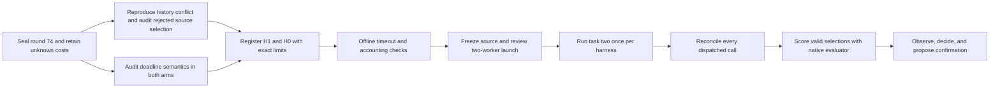

# Candidate successor: response deadline at larger output allowance

This is a proposal, not a dispatched experiment. The round 74 report also found an ARE history-projection conflict and a DSH
source-selection export failure. Offline reproduction and diagnosis of these
failures must precede a new paid launch; preserve the existing scored outcomes. Source evidence: [deadline audit](DEADLINE-AUDIT.json),
[prospective round 74 plan](PLAN.md), and the settled results when available.

The enduring objective is reusable reasoning quality and useful continuity with
at least 15% fewer cumulative model input plus output tokens without quality loss.
The original GLM qualification and small-window objective remains in the research
lineage. This full-window harness comparison does not clear the 8K benchmark.

Question: with 1M context capacity and 8,192 output tokens fixed, does a longer
per-call deadline restore complete responses and measurable task outcomes?

H1: the 120-second deadline interrupts otherwise useful longer generations;
a matched 300-second allowance will produce complete responses on the failed
pair. H0: provider stalls, invalid responses, or harness behavior persist, and
more waiting does not restore valid selections. Complete but irrelevant answers
also count against the proposed mechanism. Task two failed on both harnesses;
ARE records its deadline explicitly, while DSH timing supports an inference.

Before launch, determine whether the existing deadlines cover tokenizer plus
model or only model. Declare the comparison precisely; do not silently combine a
deadline increase with retries, recovery changes, different prompts, or a larger
output allowance. Retain the 1M context, 8,192 output, 96-call and 4M-token limits,
low reasoning, zero automatic retries, and source-selection evaluator. Freeze
any justified wall-clock adjustment before launch. Keep two workers on the VPS
and bounded local evidence with a disk reserve.

The first pair is diagnostic, not a replacement for its failed historical
outcomes. Exact aggregate cost requires complete usage for every paid call.
A new complete run cannot repair missing historical usage. No token-savings
claim follows from finishing one pair; a separately frozen full cohort and
untouched confirmation would follow only after a reviewed decision.

## Open questions

- Why did ARE hit `history-projection.pending-content-conflict` on task four?
- Which selected source range failed DSH delivery or validity checks on task one?
- Does 300 seconds allow complete responses, or merely postpone a stall?
- Can transport diagnostics preserve timeout identity without changing recovery?
- Can unknown provider usage be reconciled from an authoritative provider source?
- Do additional tokens improve reference overlap and useful outcomes?
- If completion improves, which new confirmation cohort tests generalization?
