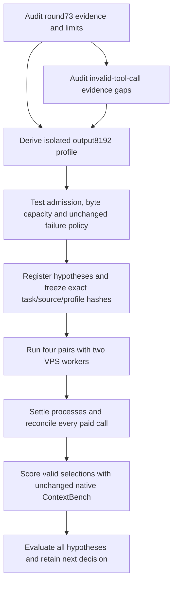

# Round 74: matched larger output allowance

Status: preparation; no model dispatch yet. Owner request: “do next”.

## Objective and evidence

Continue the original objective: reusable ARE reasoning quality and continuity,
with at least 15% fewer model tokens without losing quality. This is a four-task
exploratory harness comparison, not an entire benchmark clearance or a release.

[Round 73](../deepseek-full-window-73/REPORT.md) yielded ARE 2/4 valid selections
at 590,389 tokens and DSH 1/4 at 606,538. Three DSH runs stopped at the 2,048-token
output cap; two ARE runs failed the tool-call array check. No compaction occurred.
The only paired valid task favored DSH, with both source-selection scores poor.

H1: increasing the matched output allowance to 8,192 permits more valid selections
and improves quality per total token. Mechanism: complete reasoning/tool arguments
can fit in one response. Falsifier: truncations or invalid completions persist, or
extra output tokens do not improve completion and quality.
H0: output capacity is not the primary remaining limitation; harness behavior and
source selection still dominate. Retain failures and counterevidence.

## Controlled comparison

Use the same four pinned tasks, GLM endpoint, low reasoning, 1,000,000 context,
4M cumulative tokens, 96 calls, two workers, prompts, tools, pruning and recovery
policies as round 73. Only the model output allowance changes to 8,192. Increase
response-byte ceilings to admit that output; this is instrumentation capacity.
Add failure-only tool-call shape metadata to ARE receipts, without changing the
request, tool execution, rejection rule or recovery behavior. Historical round 73
receipts cannot distinguish absent, empty or over-eight arrays; do not invent it.

Work in an isolated derivation of the round-73 source snapshot. Shared source and
historical freezes stay intact. Document exact changed files and hashes. All model
calls, including failed calls, count. No paid-run retry, success-only reporting or
change to the cohort after observing results. Historical comparison is descriptive:
there is one exposed run per configuration, no simultaneous replicated control.

## DAG and gates

D65 product frontier: bounded benchmark candidate and tested instrumentation.
Owner-directed IMPLEMENT route dsh-output74 authorizes these exact local/VPS effects.
Research records remain candidate evidence and grant no authority or release rights.
Method: objective → gap → question → competing hypotheses → frozen experiment →
observations → reviewed decision → successor. Native records precede paid dispatch.

Operational owner: coordinator. Exact prerequisites: mounted existing GLM secret,
pinned DSH/image, canonical read-only source cache, 8GiB VPS free-space reserve,
512MiB evidence guards, 2GiB worker RAM. Source clones remain on VPS; local evidence
archive is capped at 64MiB compressed and 256MiB extracted. No operational blocker
is assumed; verify these before dispatch. Publishing, release and larger studies
are deferred operational residue and are not prerequisites for this experiment.

Report completion counts, every task's native span/file F1, all input/output tokens,
unknown usage, maximum observed input/reservation, output-cap terminations, exact
available tool-shape diagnostics and compactions. Compare paired valid cohorts;
never compare valid-only means from different task sets as a treatment gain.
Source-selection F1 does not prove patch correctness. Gold remains outside all
model containers and is consulted only after generation finishes.

## Open questions

Can 8,192 output tokens remove the observed cap failures? Are ARE's invalid tool
arrays absent, empty or too large? Do any savings preserve source-selection quality?
Do results survive replications and unseen tasks? This run does not approach or
validate the provider's near-1M context boundary.
