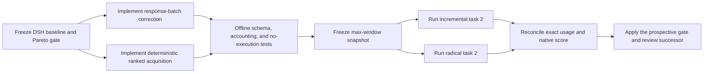

# Full max-window research cycle 79

## Objective

Establish clear task-2 ContextBench evidence that an ARE treatment can beat the
fixed DSH result while preserving exact accounting. The enduring project goal is
reusable reasoning quality and useful continuity with at least 15% fewer total
model tokens and no quality loss. Source-selection scores do not establish patch
correctness.

## Fixed baseline and decision rule

The frozen DSH task-2 outcome from round 78 used GLM-5.3-flash, a configured
1,000,000-token context capacity, an 8,192-token output cap, and the unchanged
native scorer. It completed with 78.69999049700657% Span F1, 57.14285714285715%
File F1, 22 model calls, and 587,645 total model tokens.

A new ARE outcome is a score win only when it is a valid native source selection,
all dispatched request usage is known, and it Pareto-dominates the DSH result:
neither F1 metric is lower and at least one is strictly higher. This rule is fixed
before dispatch. Token use is reported separately; a score win does not by itself
clear the enduring 15% efficiency objective.

## Research question and competing hypotheses

- **Null:** neither treatment produces a valid Pareto score win; the prior 8K ARE
  wins do not reproduce under the max-window harness.
- **Incremental:** bounded rejection and corrective feedback for responses with
  more than eight tool calls preserves the trajectory without executing any call
  from the rejected batch. Every rejected and corrective call remains inside the
  original 96-call and 4,000,000-token limits.
- **Radical:** deterministic ranked source acquisition, derived only from the
  issue text and pinned base repository, gives the model useful paths and line
  ranges before open-ended exploration. Hints grant no source evidence; the model
  must still use `read_file` and submit delivered read IDs. This changes the source
  acquisition strategy rather than adjusting a limit.

## Execution DAG

## Boundaries

- The task, base commit, model, context capacity, output cap, scorer, and DSH
  baseline stay fixed.
- At most two model workers run concurrently.
- No gold/reference patch is mounted during generation.
- Complete source clones and session journals stay on the VPS. Only bounded review
  evidence returns to this checkout.
- A response containing more than eight calls executes zero of those calls.

## Open Questions

Can either treatment reproduce a Pareto score win in a fresh max-window run? Does
the winner also use at least 15% fewer total model tokens than DSH? If both branches
fail, which observed acquisition or selection loss supports the next hypothesis?
