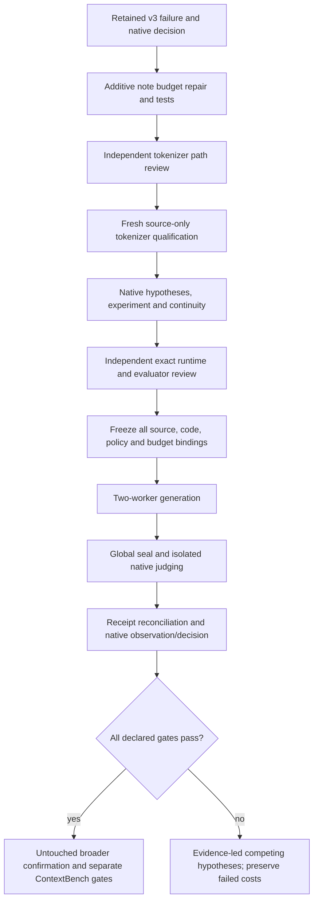

# LongMemEval note-v4 prospective protocol

Objective: reusable ARE reasoning-state retention with GLM-5.3-flash, perfect treatment quality and at least 15% complete model-token savings separately on LongMemEval and ContextBench. Exact request input plus reserved output must be at most 8,000 tokens. Four development tasks cannot establish full-benchmark perfection.

## Evidence and intervention

The [bounded-v3 reconciliation](postrun-bounded-v3-r1/RECONCILIATION.json) records 370,852 known tokens, treatment 4/4 correct, and two failed control ingestion updates at the 384-token output limit. Control completion was 2/4; comparison inconclusive. Its evidence and failed costs remain unchanged. Native predecessor records: [observation](postrun-bounded-v3-r1/OBSERVATION.json), [decision](postrun-bounded-v3-r1/LEARNING-DECISION.json).

Increase only control ingestion's total completion allowance from 384 to 768 tokens, including reasoning. Keep the query-free 120-word note instruction, source order, four task IDs, treatment retrieval, final answer prompt, 1,024-token final-answer allowance, temperature and reasoning policy unchanged. Recompute note carry estimates at 768. Fresh qualification may split chunks to preserve request admission; any change must be recorded before freezing. Prior outcome exposure makes this a development repair, not untouched confirmation.

H-budget: additional completion capacity removes note truncations and allows a complete comparison. Alternative H-protocol: additional capacity does not reliably prevent truncation or note retention still loses answer evidence. For the ARE comparison, H-retention predicts perfect treatment quality and at least 15% savings; H-null predicts quality loss or insufficient savings. A valid complete comparison failing quality or savings is counterevidence. Incomplete execution or unknown usage is inconclusive. No lower acceptance thresholds, replacement tasks or automatic retries.

## Execution and accounting

Use pinned source-s-v4 and existing isolated reference-s-v3, with exact source/question/type/date binding. No downloads, clones or gold access during generation. Regenerate tokenizer qualification using adapter-note-v4; never reuse the old 384-token qualification. Control ingestion reserves at most 6,976 input plus 768 output = 7,744 tokens. Final answers reserve at most 8,000. Derive planned call count and generation ceiling from fresh qualified chunks; maximum 248 generation calls, 256 tokenizer calls, two pair workers. Judge ceiling remains eight calls and 64,000 tokens. Count ingestion, note carry, final answers, reasoning, cached tokens, failures and judging; include all eight assigned slots.

Every carried-note request is remeasured at dispatch. Runtime failures stop dependent work; capacity, unknown usage and persistence failures stop shared dispatch. Seal generation and settle transports before isolated native judging. Reconcile raw dispatch receipts with sealed totals. A comparison qualifies only if all eight answers and judgments complete, treatment is 4/4 correct, quality does not regress, total model-token savings reaches 15%, usage is fully known and every request fits 8K. This does not close the campaign.

## Storage and D65 boundary

Continue the user-authorized bounded D: policy in [operating amendment](OPERATING-RESERVE-AMENDMENT.md): verify Ubuntu's actual D: backing volume and guest identity; require 1 GiB host and 8 GiB guest reserve plus 32 MiB launch growth. Each generation or evaluation output is capped at 32 MiB with 8 MiB reserved for its final artifact. No C: capacity dependency. Existing source-only rows and isolated references are reused. This scope does not amend ContextBench's storage policy.

Product frontier: qualify and test the additive note-v4 control repair, review exact code, freeze, run, judge, reconcile and register native results. Operational owner: coordinator monitors D: and preserves frozen evidence. Deferred operational work: physical VHD reclamation remains user-controlled; release, deployment and shared multi-benchmark capacity supervision are separate. No publication, promotion or authority effect is granted.

## DAG

## Open Questions

Does the extra allowance prevent truncation? Does the same 120-word note protocol preserve sufficient evidence? Does treatment replicate on untouched histories? Can the separate ContextBench branch reach perfect quality and 15% savings? Concurrent two-plus-two and four-worker stages require measured shared capacity and remain unproven.
