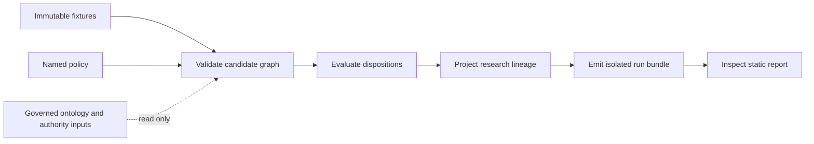

# Ontology Candidate-Graph Prototype

## What This Module Owns

This module owns a finite, candidate-only validation and inspection boundary
for four Evidence kinds. It can state what one pinned policy did with one
fixture; it cannot decide ontology truth, admit relation meaning, mutate
authority, or call its projection canonical.

## Module Map

## Capabilities

| Capability | Outcome | Main contracts |
| --- | --- | --- |
| Validate Candidate Graph | Fail closed on malformed nodes, edges, endpoint pairs, cardinality, inverse storage, and grounding cycles | `domain.md`, `operations.md` |
| Evaluate Relation Candidates | Produce a policy-bounded disposition with a stable reason | `operations.md`, `states.md` |
| Project Research Lineage | Produce a deterministic, read-only view of the valid grounding chain | `queries.md`, `mappings.md` |
| Emit Run Evidence | Bind exact inputs, evaluator, outputs, projection, and isolation proof without authorizing anything | `interfaces.md`, `events.md` |

## Domain Concepts

| Concept | Type | Key constraint |
| --- | --- | --- |
| CandidateNode | Entity | One of four finite kinds; cannot self-declare authority |
| CandidateEdge | Entity | Forward verb only; `authority_effect: none` |
| RelationCandidate | Entity | Inspectable proposal outside the admitted edge grammar |
| PolicyDisposition | Value Object | Exactly pass, fail, or indeterminate with typed reason |
| ResearchLineageProjection | Read Model | Pure derivation from validated run data |
| RunReceipt | Evidence Record | Immutable binding, never promotion or admission |
| IsolationAttestation | Evidence Record | Denied write plus before/after governed-input digests |

## Concept Registry

| Concept | ID | Type |
| --- | --- | --- |
| CandidateNode | `ocgp.CandidateNode` | Entity |
| CandidateEdge | `ocgp.CandidateEdge` | Entity |
| RelationCandidate | `ocgp.RelationCandidate` | Entity |
| PrototypePolicy | `ocgp.PrototypePolicy` | Rule |
| PolicyDisposition | `ocgp.PolicyDisposition` | Value Object |
| ValidateGraph | `ocgp.ValidateGraph` | Operation |
| EvaluateCandidate | `ocgp.EvaluateCandidate` | Operation |
| EmitRunBundle | `ocgp.EmitRunBundle` | Operation |
| InspectResearchLineage | `ocgp.InspectResearchLineage` | Query |
| PrototypeCLI | `ocgp.PrototypeCLI` | Interface |
| ResearchLineageProjection | `ocgp.ResearchLineageProjection` | Read Model |
| RunReceipt | `ocgp.RunReceipt` | Evidence Record |
| IsolationAttestation | `ocgp.IsolationAttestation` | Evidence Record |
| DispositionRecorded | `ocgp.DispositionRecorded` | Event |

## Concept Graph

| From | Edge | To | Evidence |
| --- | --- | --- | --- |
| `ocgp.ValidateGraph` | validates | `ocgp.CandidateNode` | `operations.md#validategraph` |
| `ocgp.ValidateGraph` | validates | `ocgp.CandidateEdge` | `operations.md#validategraph` |
| `ocgp.PrototypePolicy` | governs | `ocgp.EvaluateCandidate` | `operations.md#evaluatecandidate` |
| `ocgp.EvaluateCandidate` | produces | `ocgp.PolicyDisposition` | `states.md#disposition-state` |
| `ocgp.InspectResearchLineage` | projects | `ocgp.ResearchLineageProjection` | `queries.md#inspectresearchlineage` |
| `ocgp.EmitRunBundle` | produces | `ocgp.RunReceipt` | `operations.md#emitrunbundle` |
| `ocgp.RunReceipt` | binds | `ocgp.IsolationAttestation` | `events.md#run-bundle-emission` |

## Acceptance Contract

The Design may hand off to Plan only when:

1. all six baseline architecture views are authored;
2. the exact Design scope extractor and two-pass selector return
   `design-validator-pass`;
3. the positive, negative, indeterminate, determinism, and isolation witnesses
   are specified but not misreported as executed;
4. the worked example preserves `D2 contradicts D1` outside grounding closure;
5. all files retain the candidate/read-model/receipt authority boundary.

This is design acceptance only. Runtime acceptance remains absent.

## Aspect Docs

| Aspect | Contains |
| --- | --- |
| [Domain](domain.md) | Record shapes and invariants |
| [Operations](operations.md) | Validation, evaluation, and emission behavior |
| [Queries](queries.md) | Inspectable read models |
| [Interfaces](interfaces.md) | CLI and filesystem boundaries |
| [States](states.md) | Disposition state model |
| [Events](events.md) | Evidence events, not domain authority events |
| [Mappings](mappings.md) | Source-to-projection transforms |
| [Glossary](glossary.md) | Local terms and forbidden collapses |

## Dependencies and Consumers

| Direction | Surface | Contract |
| --- | --- | --- |
| Depends on | `cyberAlchemy-v2/ontology/canonical-kinds/{EDGES,ALLOWED-EDGES}.yaml` | Pinned read-only grammar |
| Depends on | CyberAlchemy ontology and authority definitions | Meaning and claim boundary |
| Produces for | future ontology Plan | Architecture and planned witnesses |
| Produces for | future IOLM adapter | Stable run bundle and projection contract only |

## Claim Ceiling

If implemented and all finite witnesses pass, the result may be called an
**ontology-oriented candidate-graph validation and inspection prototype**. It
still may not be called the canonical ontology, an admitted semantic policy, a
promotion runtime, or production-ready.
