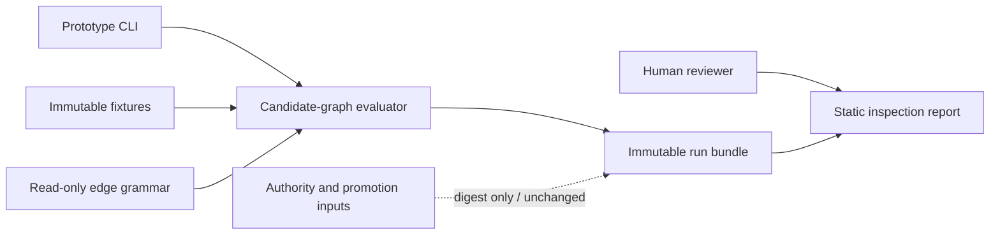
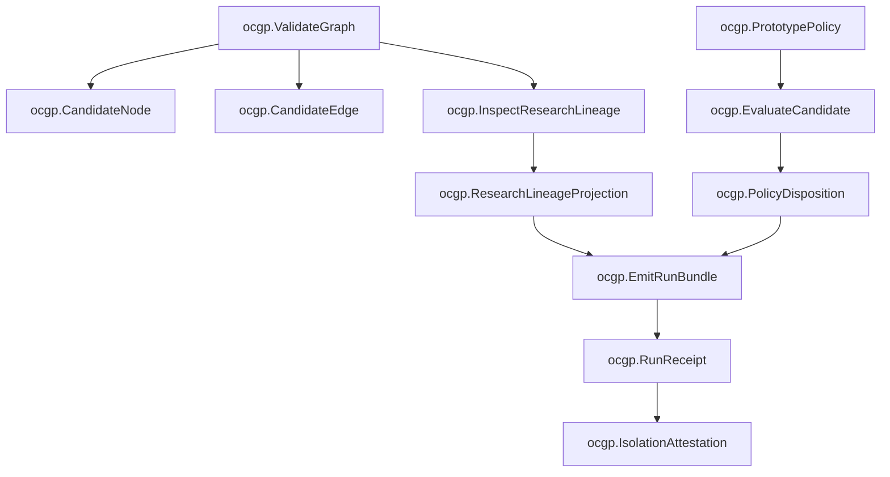
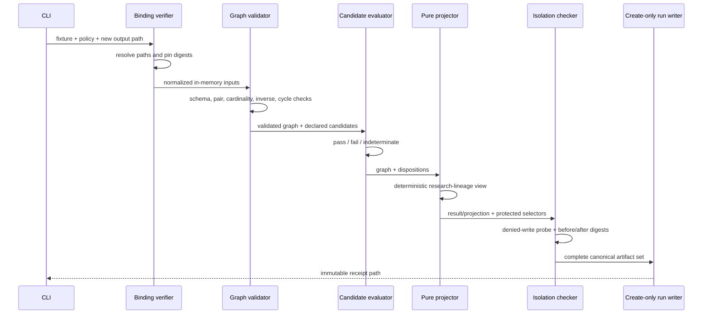
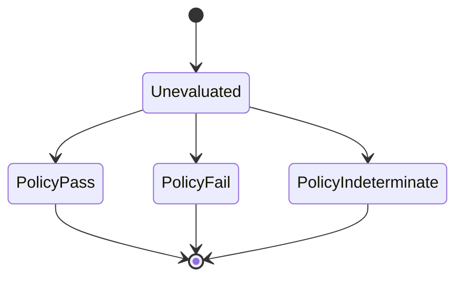
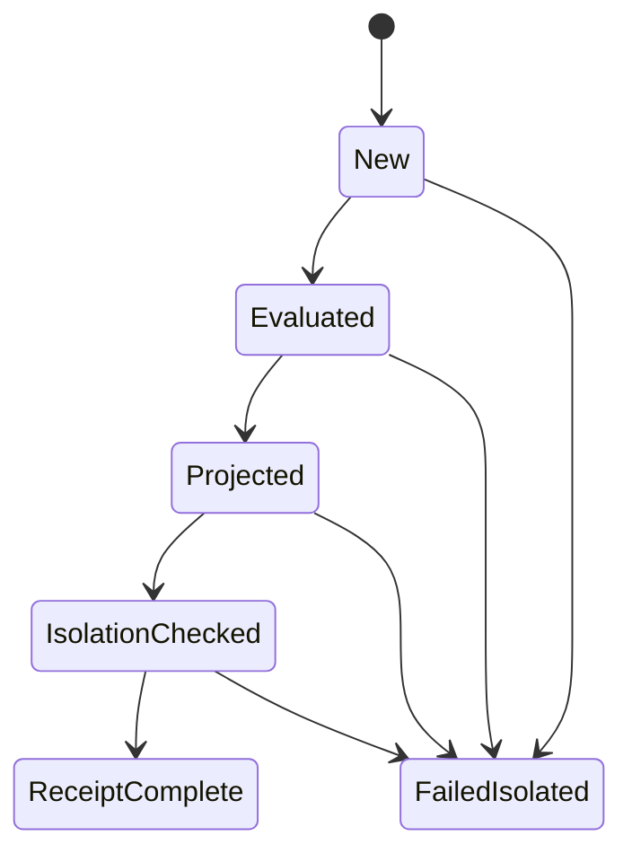

# Architecture: Ontology Candidate-Graph Prototype

## Design Intent

Build the smallest falsifiable ontology-oriented runtime boundary: a pure
validator and projector over immutable candidate fixtures, with all writes
confined to a new run directory. The architecture deliberately separates
structure, policy disposition, projection, evidence, human inspection, and
authority.

## Inputs

- [Define SPEC](../define/SPEC.md)
- [Domain records](../define/domain.md)
- [Operations](../define/operations.md)
- [Queries](../define/queries.md)
- [Interfaces](../define/interfaces.md)
- [States](../define/states.md)
- [Events](../define/events.md)
- [Mappings](../define/mappings.md)
- exact scope: [DESIGN-SCOPE-MANIFEST.json](DESIGN-SCOPE-MANIFEST.json)
- exact selection: [DESIGN-SELECTION-RESULT.json](DESIGN-SELECTION-RESULT.json)

## Authority Model

```text
governed ontology definitions + edge grammar
                | read-only, digest-pinned
                v
candidate fixture -> finite policy evaluator -> policy disposition
                                              -> candidate read model
                                              -> run evidence

policy disposition -X-> semantic admission
candidate read model -X-> canonical ontology
run evidence         -X-> promotion or publication
```

The ontology route owns the candidate contract. The finite edge-law owner owns
policy behavior. A future implementation owner may write isolated run output.
Existing authority owners retain all admission, promotion, lifecycle, and
publication decisions.

## 1. Context View



The human reads and navigates the report but does not approve meaning through
the report. The CLI has no mutation-capable authority interface.

## 2. Capability View



## 3. Concept/Type View

| Concept ID | Type | Owned invariant |
| --- | --- | --- |
| `ocgp.CandidateNode` | Entity | Four kinds, complete provenance/governance fields, `authority_effect: none` |
| `ocgp.CandidateEdge` | Entity | Forward admitted verb, resolved endpoints, allowed kind pair |
| `ocgp.RelationCandidate` | Entity | Inspectable but excluded from admitted graph closure |
| `ocgp.PrototypePolicy` | Rule | Closed-world grammar, cardinality, cycle, disposition vocabulary |
| `ocgp.PolicyDisposition` | Value Object | Terminal result for exactly one candidate-policy binding |
| `ocgp.ResearchLineageProjection` | Read Model | Pure validated grounding closure |
| `ocgp.RunReceipt` | Evidence Record | Exact input/output/evaluator binding |
| `ocgp.IsolationAttestation` | Evidence Record | Denied-write and before/after digest evidence |

Forbidden type edges:

- a `RunReceipt` does not produce an authority decision;
- a `PolicyDisposition` does not transition promotion state;
- a `ResearchLineageProjection` does not write a `CandidateNode`;
- a `RelationCandidate` does not enter closure without a named admitted policy.

## 4. Operation/Flow View



No partial result becomes a complete receipt. A rerun creates a new directory.

## 5. State View

### Evaluation state



### Run state



There is no transition from either state machine into authority lifecycle.

## 6. Dependency/Interface View

| Boundary | Direction | Version rule | Failure behavior |
| --- | --- | --- | --- |
| Fixture JSON | inbound | explicit `schema_version`; digest pinned | reject unknown/missing fields |
| Policy JSON | inbound | explicit policy ID/version plus source grammar digests | reject stale or mismatched binding |
| Ontology grammar YAML | inbound read-only | exact SHA-256 | stop on drift |
| CLI arguments | inbound | candidate-v1 | reject path escape, existing output, or implicit defaults |
| Run bundle JSON | outbound local | candidate-v1 canonical serialization | incomplete directory, no complete receipt |
| Static report | outbound local read model | derived from bound run JSON | display binding error; never reinterpret |
| Future IOLM adapter | deferred outbound | must consume run contract without changing it | separate adapter/version decision |

## Significant Behavior Scenario

Stimulus: evaluate the five-node Poker Team financial-settlement evidence graph
from [EXAMPLE.md](EXAMPLE.md) plus the separate
`C-SPECIALIZES-D2-D1` candidate.

Preconditions:

- fixture, policy, schemas, and grammar resolve to pinned digests;
- output path does not exist;
- authority, promotion, and ontology source roots are non-writable.

Ordered response:

1. the five Evidence nodes and five admitted edges validate;
2. grounding closure is exactly `F1 -> R1 -> D1`;
3. `D1` preserves the declared O13 Gauge contract while `D2` preserves the
   backend Histogram registration;
4. `D2 contradicts D1` remains visible but does not compose or decide which
   Poker Team owner should repair the mismatch;
5. the `specializes` candidate returns `policy-indeterminate` with
   `POLICY_OWNER_UNBOUND`;
6. two equivalent executions produce byte-identical comparison artifacts;
7. protected CyberAlchemy and Poker Team selectors retain identical
   before/after digests;
8. the receipt states `authority_effect: none` and the evidence ceiling.

Failure: any stale digest, illegal edge, grounding cycle, output overwrite, or
write-capability success blocks receipt completion.

Observable evidence: canonical result JSON, projection JSON, isolation
attestation, artifact digest map, and static report.

Acceptance owner: ontology edge-law owner for machine behavior; Poker Team
finance/backend observability owners retain the domain repair decision; a named
human product reviewer owns only later static-report acceptance.

## Triggered Extensions

### Authority and Trust

- enforcement is inside the evaluator before projection;
- policy ID, owner, version, and digest are mandatory;
- unknown relation policy is indeterminate, never allowed by default;
- there is no authority writer, promotion API, or owner-decision serializer;
- a forged receipt fails because every input/output and evaluator is digest
  bound;
- owner review remains outside the prototype.

### State and Event

Disposition and run states are append-free terminal records. Re-evaluation
creates a new identity; no state is updated in place. Evidence events live only
inside one run receipt and cannot be replayed into authority.

### Persistence and Concurrency

Fixtures and policies are immutable stores with zero prototype writers. The
only writer uses create-only semantics against one isolated run root. An
exclusive create check prevents concurrent runs from claiming the same run ID.
Atomic temporary-to-final rename may be used inside that new run directory, but
the complete receipt is written last.

### Integration and Versioning

Fixture, policy, run, receipt, and projection shapes each carry independent
versions. Consumers must reject unknown major versions. The future IOLM adapter
is downstream and may not make its snapshot the source of ontology meaning.

### Quality

The required quality property is deterministic reproducibility:

```text
same canonical inputs + same policy digest + same evaluator digest
  => byte-identical result, projection, and comparison receipt bodies
```

Run IDs and wall-clock observations, if retained, live outside compared bodies.
The validation owner must test two fresh output directories.

## Concern-to-View Trace

[Design selection result](DESIGN-SELECTION-RESULT.json) passed with a stable
two-pass fixed point and selected:

| Concern | Disposition | Output |
| --- | --- | --- |
| authority | required | `architecture:authority-trust` |
| state/event | required | `architecture:state-event` |
| persistence | required | `architecture:persistence-concurrency` |
| integration | required | `architecture:integration-versioning` |
| performance/determinism | required | `architecture:quality` |
| UX | required | `ux-plan` |
| validation | required | `validation-contracts` |

Security, external-failure compensation, service reliability, migration,
rollout, and privacy/data-lifecycle were detector-negative and retained as
`not-applicable-with-rationale`. Result digest:
`016a202266bb963f8c078d449389d55307338a8125b80e9255ec59c0e15c0f9d`.

## Planned Witness Boundary

[PLANNED-WITNESSES.json](PLANNED-WITNESSES.json) and
[VALIDATION-CONTRACTS.md](VALIDATION-CONTRACTS.md) describe future executable
witnesses. They are authored Design contracts, not Plan evidence and not
executed proof.

## Design Claim

This file can reach `design-validator-pass`. That status means the closed
Design denominator and selected outputs are coherent. It does not mean the
prototype works at runtime.
