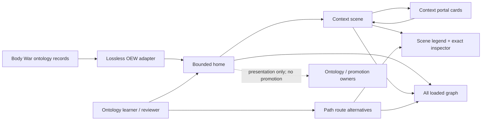
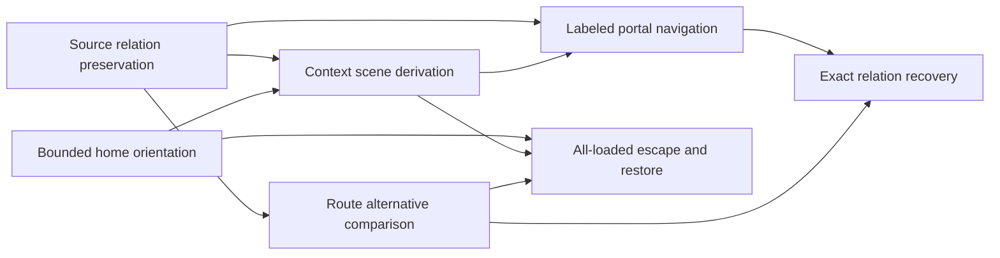
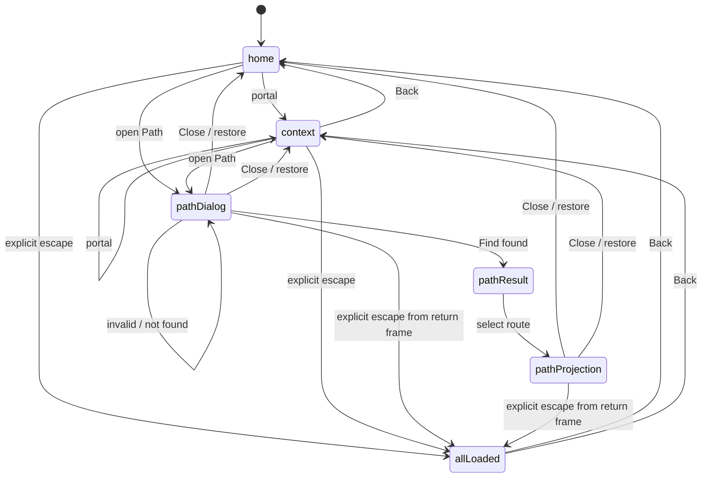

# OEW Focus Scene Visual Language and Cluster Navigation

Status: discovery-mode Design; not normal Design admitted
Target: `cyberalchemy-v2:ontology-evidence-workbench-focus-scene:visual-language-cluster-navigation`
Phase verdict: block before Plan
Authority effect: none

## Design Intent

Make the first Body War scene readable without hiding the complete loaded
graph. The default is a four-context home; labeled context portal cards reveal
why another context is reachable; Path shows relation-bearing route
alternatives. Every view preserves exact source identities and says plainly
that presentation grouping is not ontology membership.

The smallest coherent first proof is:

```text
bounded context home
  -> one source-backed context scene
  -> labeled portal with exact constituent relations
  -> exact Back restoration
  -> explicit all-loaded escape
```

Path is a dependent second design unit. It consumes the same lossless relation
record, inspector, legend, scope fingerprint, and store boundaries, but it does
not have to ship in the first portal round-trip proof.

## View 1 — Context



Context rules:

- `projects/body-war/ontology/business/**` owns canonical business meaning.
- The adapter preserves source records; it does not reinterpret them.
- A context scene derives membership only from the context anchor plus direct
  source `owns` relations.
- A portal card summarizes crossings and membership proofs. It is not an edge
  between contexts.
- A route alternative is an algorithmic projection, not a cluster or ontology
  branch.
- The workbench is local, read-only, and has no promotion authority.

## View 2 — Capability



Capability obligations:

- source preservation is a prerequisite for portals and Path;
- all presentation states bind graph snapshot, filter fingerprint, rule ID,
  rule version, admitted node/edge digests, and completeness qualifier;
- every navigation transition is reversible and restores its initiating
  control's focus when the source frame still exists;
- exact predicate and direction remain available without color or hover.

## View 3 — Concept and Type

### Owner split

| Concept | Owner | Contract |
| --- | --- | --- |
| canonical concept/relation meaning | Body War node/relation record plus `owner_route` | only source owner may revise meaning |
| lossless relation record | `body-war-adapter-writer.mjs` | preserve identities, endpoints, direction, authority, evidence |
| context scene and crossings | `knowledgeFocusScene.ts` | pure projection over admitted graph |
| route result | new adjacent `knowledgePathProjection.ts` | sole route derivation owner |
| committed navigation frame and Path session | existing `store.ts` | stores fingerprint-bound results; derives nothing |
| portal/card/Path display | existing React components | render supplied records without semantic inference |
| legend | new stateless `KnowledgeSceneLegend` | describes only active scene tokens and exact fields |

### Candidate relation projection

```ts
type SourceDirection = "directed" | "symmetric" | "view-only" | "unavailable";
type ProjectedDirection = "forward" | "backward" | "bidirectional";
type TraversalPolicy = "source-directed" | "projected-undirected";
type DirectionAgreement =
  | "with" | "against" | "symmetric" | "view-only" | "unavailable";
type SourceAuthorityEffect =
  | "none" | "staging" | "projection" | "owner-decision"
  | "blocked" | "unavailable";
type ProjectionAuthorityEffect = "none";

interface ExactProjectedRelation {
  graphEdgeId: string;
  sourceRelationId: string;
  graphSourceNodeId: string;
  graphTargetNodeId: string;
  sourceConceptId: string;
  targetConceptId: string;
  sourcePredicate: string;
  presentationRelation: string;
  projectedDirection: ProjectedDirection;
  sourceDirection: SourceDirection;
  sourceAuthorityEffect: SourceAuthorityEffect;
  projectionAuthorityEffect: ProjectionAuthorityEffect;
  mappingLoss: "exact" | "generalized" | "lossy";
  evidence: Array<{ path: string; selector: string; sha256: string }>;
}
```

Required invariants:

- `graphSourceNodeId` and `graphTargetNodeId` identify presentation endpoints;
  source concept IDs identify ontology records. A total sidecar mapping binds
  each graph endpoint to exactly one source concept for this prototype.
- `graphEdgeId` and `sourceRelationId` remain separate even when their suffixes
  happen to match. Endpoint/predicate tuples are never edge identity.
- `projectionAuthorityEffect` is emitted by the projection owner and is always
  `"none"`; it cannot copy or override `sourceAuthorityEffect`.
- `concept_role` is the sole primary icon semantic key. `business_kind` remains
  a visible text chip. Candidate state, confidence, and authority never fold
  into the icon.
- Edge color is keyed by exact `sourcePredicate`, not unique edge ID and not
  the coarse `presentationRelation`. Exact predicate text confirms the meaning;
  presentation relation may still select a redundant line-pattern family.

## View 4 — Operation and Flow

### Load and enter the home

```text
verify admitted Body War run
  -> load exact graph + sidecar
  -> verify lossless required relation fields
  -> derive four authored home context IDs
  -> render heading, purpose, count, cards, legend, provenance
  -> focus the home heading
```

Home source IDs, in stable order:

- `presentation:body-war.business.context.identity-consent`
- `presentation:body-war.business.context.route-expansion`
- `presentation:body-war.business.context.geometry-evidence`
- `presentation:body-war.business.context.score-preview`

### Enter and return from a context portal

```text
activate labeled portal card
  -> push exact NavigationFrame + initiating control
  -> derive target context anchor + direct owns members + crossings
  -> render target purpose/member count/proofs
  -> focus target context heading
  -> Back pops byte-equivalent frame and restores initiating portal focus
```

Identity's expected portal groups are:

| Target context | Purpose | Owned members | Crossing source relations |
| --- | --- | ---: | --- |
| Activity Evidence | Owns redacted run summaries and submitted activity evidence. | 2 | `capability-dependency-1`, `capability-dependency-2` |
| Suggested Track Route Expansion | Owns runner-created route suggestions and consented candidate evidence without source-backed promotion. | 3 | `capability-dependency-9`, `capability-dependency-10` |
| Candidate Geometry Evidence | Candidate context for ephemeral provider streams and private activity-derived geometry. | 1 | `capability-dependency-14` |

### Compare a route

```text
open Path
  -> capture return frame and invoker without pushing navigation history
  -> choose from/to and traversal policy
  -> Find runs deterministic all-shortest-paths
  -> result remains in sheet until one route alternative is selected
  -> selected route becomes a relation-bearing path projection
  -> Close restores captured frame and invoker focus
```

Policy semantics proposed for successor Define:

- `source-directed`: directed relations traverse source to target; symmetric
  relations traverse both ways; `view-only` and `unavailable` are excluded.
- visible `Connections either way` maps exactly to `projected-undirected`;
  projected graph endpoints may be traversed in either direction, with
  `directionAgreement` retaining `with`, `against`, `symmetric`, `view-only`,
  or `unavailable` truth.
- `source-directed` is disabled until every in-scope relation has preserved
  source direction.
- `not-found` leaves the canvas frame unchanged.

Path derivation scope is the **full admitted presentation graph before scene
projection**, restricted by the user's current node/edge filters captured in
the query fingerprint. It is not limited to the active scene. Portal counts
use the same captured filter fingerprint: filtered-out crossings and members
are excluded from visible counts, while the card discloses `filtered view` and
the unfiltered source totals separately. Changing filters marks existing route
results and portal read models stale before recomputation.

### Escape to all loaded

The design recommends one unambiguous escape:
`Show all loaded graph — {loaded node count} nodes, {loaded relation count}
relations`. `all_loaded` means the full admitted presentation graph before
scope projection; it does not mean ontology completeness. Activating it pushes
the current frame, and Back restores filters, selection, viewport, and focus.
This recommendation supersedes the research candidate phrase “complete
current-filter graph”; successor Define must approve the choice.

## View 5 — State



`KnowledgeScopeKind` candidate values are `home | focus | context | path |
all_loaded`. Existing one-hop `focus` remains distinct from context ownership.
Every navigation frame has this candidate shape and is serialized as canonical
JSON: UTF-8, sorted object keys, array order preserved, no insignificant
whitespace, then SHA-256.

```ts
interface NavigationFrame {
  schemaVersion: "oew.navigation-frame.v1";
  frameId: string;
  scopeKind: "home" | "focus" | "context" | "path" | "all_loaded";
  scopeId: string;
  graphSnapshotId: string;
  filterFingerprint: string;
  ruleId: string;
  ruleVersion: string;
  admittedNodeIds: string[];
  admittedGraphEdgeIds: string[];
  selectedGraphNodeId: string | null;
  selectedGraphEdgeId: string | null;
  viewport: { x: number; y: number; zoom: number; width: number; height: number };
  initiatingControlId: string | null;
}
```

Path owns a local return frame and never enters navigation history. Opening
all-loaded from Path clears the Path session and pushes its return frame—not
the route projection—onto history. If the initiating control no longer exists,
recovery focuses the restored scene heading and announces that fallback.
Snapshot/filter drift marks a Path result stale, removes its projection,
announces the change at `[data-testid="path-status"][tabindex="-1"]`, clears
the stale route, and returns focus to the invoker or scene-heading fallback.
Exact byte restoration is required only at the same viewport dimensions. After
a responsive dimension change, logical state restores and the scene performs
one zero-duration fit with `data-restore-mode="reflowed"`.

## View 6 — Dependency and Interface

| Boundary | Direction | Contract | Owner | Guard |
| --- | --- | --- | --- | --- |
| Body War ontology records | source -> adapter | canonical meaning, relation identity, direction, evidence, authority | Body War ontology owners | read-only digests and `owner_route` |
| adapter sidecar | adapter -> derivations | total endpoint/edge/source mapping | OEW adapter owner | fail closed on absent or lossy required field |
| focus derivation | graph -> context scene | anchor plus direct `owns` members and exact crossings | `knowledgeFocusScene.ts` | pure deterministic fixture |
| route derivation | graph + query -> route result | fingerprint-bound ordered exact steps | `knowledgePathProjection.ts` | canonical query/hash/tie order |
| workbench state | UI -> store | frames and committed Path result only | `store.ts` | no local BFS or duplicate graph |
| renderer | read models -> user | cards, edges, legend, focus, responsive layout | existing components + stateless legend | selectors and browser assertions |
| local gateway | browser <-> local bytes | token, loopback, GET/HEAD, no outbound | existing gateway | inherited OEW negative tests |
| ontology/promotion owners | no direct write | no UI admission or authority change | source lifecycle owners | `projectionAuthorityEffect:"none"` |

## Provisional Concern-to-View Trace

This table guides the discovery brief. It is not a
`DesignSelectionResult`; the normal selection protocol remains blocked.

| Concern | Provisional disposition | Accountable owner | Contributing/artifact owner | Validator owner | View/output |
| --- | --- | --- | --- | --- | --- |
| authority/trust | required | Body War ontology and OEW authority owners | architecture owner | future Design selector/validator | Views 1, 3, 6; exact dual-authority fields |
| security/abuse | required | local viewer security owner | inherited OEW gateway owner | later negative HTTP/browser owner | View 6; loopback/token/no-outbound boundary |
| state/event | required | navigation workflow owner | `store.ts` owner | later state/browser owner | View 5; frames, Path session, stale recovery |
| persistence/concurrency | required | workbench state owner | `store.ts` owner | later unit-test owner | ephemeral committed result only; no second store |
| integration/versioning | required | adapter/interface owner | adapter and derivation owners | later adapter validator | Views 3 and 6; versioned exact relation/frame/query contracts |
| privacy/data | required | source data owner | gateway and inspector owners | later isolation owner | local read-only evidence; no outbound transport |
| quality/performance | required | UI quality owner | derivation and renderer owners | later unit/browser owner | bounded default, deterministic IDs, responsive geometry |
| UX/accessibility | required | UX owner | component and human-study owners | later browser/human owners | `UX-PLAN.md` |
| validation | required | successor Design owner | later Plan owner | distinct future validators | `VALIDATION-CONTRACTS.md` |

The missing approved successor Define, exact manifest, denominator receipt,
and fixed-point selection are a blocking lifecycle concern; this table cannot
satisfy that gate by itself.

## Visual Grammar Decisions

### Cards and icons

- Context portal cards show destination label, one-sentence purpose, owned
  member count, unique crossing count, and an expandable exact relation list.
- Primary icon tokens are `role-authority`, `role-evidence`, `role-workflow`,
  and `role-projection`, sourced only from `concept_role`. Suggested artwork is
  landmark, document-check, route, and layers respectively; visible role text
  is mandatory, so artwork is never the only cue.
- `business_kind` remains a visible chip such as `bounded context` or
  `capability`. Unsupported roles render `Role unavailable`, not a guess.
- Portal artwork may reuse the target role icon, but the portal's semantic scent
  comes from its label, purpose, counts, and relation disclosures.

### Relations

The intended rule is **one stable color per exact relation type**. In the
source model, relation type means `sourcePredicate`: every `owns` edge uses the
same color, every `depends_on` edge uses another, and so on. This makes the
relationship scannable by color without inventing a separate color for each of
the 231 edge instances.

`PredicateStyleRegistry` names a static table owned by the existing graph
renderer; it is not a new service, state machine, or semantic owner. It maps
the 23 predicates admitted by the frozen Body War fixture to unique semantic
tokens. The source predicate remains the meaning owner.

| Source predicate | Stable color token | Hue family |
| --- | --- | --- |
| `awards` | `edge-predicate-awards` | gold |
| `becomes` | `edge-predicate-becomes` | violet |
| `changes_state_of` | `edge-predicate-changes-state-of` | rose |
| `consumes` | `edge-predicate-consumes` | orange |
| `contains` | `edge-predicate-contains` | purple |
| `contests` | `edge-predicate-contests` | crimson |
| `controls` | `edge-predicate-controls` | red |
| `defends` | `edge-predicate-defends` | emerald |
| `depends_on` | `edge-predicate-depends-on` | blue |
| `does_not_promote` | `edge-predicate-does-not-promote` | silver |
| `exposes` | `edge-predicate-exposes` | cyan |
| `governed_by` | `edge-predicate-governed-by` | burgundy |
| `maps_to` | `edge-predicate-maps-to` | indigo |
| `owns` | `edge-predicate-owns` | amber |
| `participates_in` | `edge-predicate-participates-in` | lime |
| `produces` | `edge-predicate-produces` | green |
| `projects` | `edge-predicate-projects` | teal |
| `provides` | `edge-predicate-provides` | aqua |
| `reads` | `edge-predicate-reads` | sky |
| `records` | `edge-predicate-records` | slate blue |
| `supports` | `edge-predicate-supports` | chartreuse |
| `transitions_to` | `edge-predicate-transitions-to` | magenta |
| `validates` | `edge-predicate-validates` | mint |

The implementation token table must resolve every token to unique light- and
dark-theme colors that meet the edge contrast threshold. A new predicate has
no guessed color: it renders with `edge-predicate-unmapped`, keeps its exact
text, and fails palette-totality acceptance until the presentation owner adds
an explicit token.

The two coarse presentation relations retain only redundant pattern cues:

| Presentation relation | Pattern token | Pattern | Static direction cue |
| --- | --- | --- | --- |
| `builds_on` | `edge-pattern-builds-on` | solid | arrow marker plus `->` text |
| `related` | `edge-pattern-related` | `6 4` dash | arrow or double marker plus `->`/`<->` text |

The active-scene legend lists each visible source predicate with its stable
color token. Thus color provides fast recognition and the label verifies it.
Forced colors may replace the palette with system colors, so pattern, marker,
visible predicate label, and direction text remain mandatory.

## Significant Behavior Scenario

Stimulus: from the bounded home, a keyboard user enters Identity and Consent,
predicts and opens Activity Evidence, returns, then asks for Activity Evidence
to Authentication and Consent using source direction.

Preconditions: admitted 237-node/231-relation Body War fixture; lossless exact
relation fields; no active stale result.

Expected response:

1. Home shows the four exact contexts and focuses its heading.
2. Identity derives 2 nodes, 1 internal relation, and 5 crossings.
3. Activity Evidence portal exposes purpose, 2 members, and two crossings.
4. Enter/Space open the same context; Back restores the exact Identity frame.
5. Path returns two two-step alternatives:
   `context-2 -> capability-dependency-1` and
   `context-3 -> capability-dependency-2`.
6. Each step exposes graph edge ID, source relation ID, exact predicate,
   endpoints, projected/source/traversal direction, mapping loss, evidence,
   and both authority fields.
7. Closing Path restores the captured frame and invoker focus.

Failure/recovery: missing source direction disables source-directed Find with a
named prerequisite; no route leaves the canvas unchanged; stale fingerprints
invalidate the result; Back never synthesizes a new frame.

Acceptance owner: later Plan browser validator plus a separate human-study
owner. This Design executes neither.

## Unit Split

### Unit A — Identity portal round trip

Lossless relation contract -> bounded home -> Identity context -> three portal
cards -> one portal entry -> exact Back/all-loaded restoration -> scene legend
and provenance. This is the smallest unit that tests whether context areas and
evidence-bearing portals make the graph understandable.

### Unit B — relation-bearing Path

Deterministic route derivation -> Path-local session -> alternative cards ->
selected route projection -> exact close/all-loaded recovery. It depends on
Unit A's relation contract, inspector, legend, scope fingerprints, and store
rules but does not block Unit A's coherence.

## Decisions and Gaps

Selected as discovery recommendations:

- bounded home, context portal cards, separate route alternatives;
- adapter-first lossless relation preservation;
- existing store/focus/renderer owners plus one pure route module and one
  stateless legend;
- no freshness warning when compact qualified build/adapter provenance is
  visible;
- redundant icon/text and relation color/pattern/text/marker cues;
- explicit all-loaded escape and exact restoration.

Normal Design remains blocked by the missing approved successor Define. See
[DEFINE-DELTA-REQUEST.md](DEFINE-DELTA-REQUEST.md). No Work Pack, task, SWU,
implementation, or Plan handoff is authorized.
