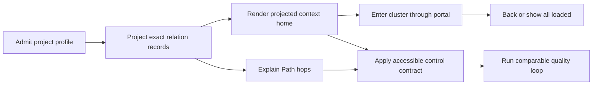

# Ontology Evidence Workbench Semantic Navigation

## What This Module Owns

This candidate package specifies a profile-driven presentation layer that
turns an admitted ontology projection into a bounded, explainable, keyboard-
operable navigation surface. It owns presentation semantics and validation
contracts; it does not own ontology meaning, membership, promotion, or the
underlying project vocabulary.

## Module Map

## Capabilities

| Capability | What | Key aspects | Detail |
| --- | --- | --- | --- |
| ProjectProfileAdmission | Admits one frozen project profile without promoting it | operation, mapping, state | Contexts, predicates, Path choice, copy, icons, counts, ceilings |
| LosslessRelationPresentation | Makes exact relation identity recoverable in every scene | mapping, query, interface | Exact predicate color; presentation pattern; redundant text/direction |
| ProjectedContextNavigation | Presents bounded home, portal clusters, Back, and explicit all-loaded escape | operation, query, state | Projection is not ontology membership |
| PathExplanation | Presents named endpoints and complete directed hop records | query, state, mapping | Comparator or route-local profile choice; no semantic effect |
| AccessibleWorkbenchOperation | Defines focus, mode, disclosure, contrast, card/icon, and recovery behavior | operation, interface | Keyboard-first and non-color-recoverable state |
| ComparableQualityLoop | Replays a frozen profile and emits atomic deltas | operation, event | No universal UX score; human claims remain separate |

## Domain Concepts

| Concept | Type | Key constraints |
| --- | --- | --- |
| SemanticNavigationProfile | ValueObject | frozen, digest-bound, project-owned choices |
| RelationPresentationRecord | Mapping | exact source identity plus non-authoritative redundant encodings |
| NavigationFrame | State | projection, filters, selection, direction, viewport and focus restoration |
| ProjectedCluster | ViewModel | profile-selected navigation scope, never ontology membership |
| PathHop | ValueObject | source/projected/traversal directions remain distinct |
| QualityDelta | Event | atomic baseline-to-current disposition, not a score |

## Concept Registry

| Concept | ID | Type |
| --- | --- | --- |
| [AdmitProjectProfile](operations.md#admitprojectprofile) | oewsn.AdmitProjectProfile | Operation |
| [DeriveRelationPresentation](operations.md#deriverelationpresentation) | oewsn.DeriveRelationPresentation | Operation |
| [EnterProjectedCluster](operations.md#enterprojectedcluster) | oewsn.EnterProjectedCluster | Operation |
| [RestoreNavigationFrame](operations.md#restorenavigationframe) | oewsn.RestoreNavigationFrame | Operation |
| [ApplyAccessibleControlContract](operations.md#applyaccessiblecontrolcontract) | oewsn.ApplyAccessibleControlContract | Operation |
| [RunComparableQualityLoop](operations.md#runcomparablequalityloop) | oewsn.RunComparableQualityLoop | Operation |
| [ReadProjectedHome](queries.md#readprojectedhome) | oewsn.ReadProjectedHome | Query |
| [ReadRelationDetails](queries.md#readrelationdetails) | oewsn.ReadRelationDetails | Query |
| [ReadPathExplanation](queries.md#readpathexplanation) | oewsn.ReadPathExplanation | Query |
| [SemanticNavigationSurface](interfaces.md#internal-semanticnavigationsurface-interface) | oewsn.SemanticNavigationSurface | Interface |
| [NavigationState](states.md#navigationstate) | oewsn.NavigationState | StateMachine |
| [QualityDeltaRecorded](events.md#qualitydeltarecorded) | oewsn.QualityDeltaRecorded | Event |
| [SourceEdgeToPresentationRecord](mappings.md#sourceedgetopresentationrecord) | oewsn.SourceEdgeToPresentationRecord | Mapping |

## Feature Concept Graph

| From | Edge | To | Evidence | Notes |
| --- | --- | --- | --- | --- |
| oewsn.AdmitProjectProfile | produces | oewsn.ReadProjectedHome | operations.md#admitprojectprofile | Profile admission opens only presentation behavior |
| oewsn.DeriveRelationPresentation | maps | oewsn.SourceEdgeToPresentationRecord | mappings.md#sourceedgetopresentationrecord | Exact source fields are preserved |
| oewsn.SemanticNavigationSurface | exposes | oewsn.ReadRelationDetails | interfaces.md#internal-semanticnavigationsurface-interface | Visual and accessible relation identity agree |
| oewsn.EnterProjectedCluster | transitions | oewsn.NavigationState | operations.md#enterprojectedcluster | Pushes a restorable frame |
| oewsn.RestoreNavigationFrame | enforces | oewsn.NavigationState | operations.md#restorenavigationframe | No silent state loss |
| oewsn.RunComparableQualityLoop | produces | oewsn.QualityDeltaRecorded | events.md#qualitydeltarecorded | Atomic deltas only |

## Normative Boundaries

1. The source ontology and admitted graph remain read-only.
2. Cluster, portal, icon, color, pattern, Path, and count presentation have
   `authority_effect: none` and create no ontology membership or branch.
3. One stable color is keyed by exact `sourcePredicate`; one stable pattern is
   keyed by `presentationRelation`; text and direction remain sufficient
   without color.
4. Each relation instance exposes source, exact predicate, source-record
   direction, projected direction when different, target, provenance, and
   authority ceiling. Path also exposes traversal orientation.
5. Inert edges are not sequential focus stops. Actionable relation instances
   expose focus, identity, and a declared Enter/Space action.
6. Entry is an owner-approved projected home. `Show all loaded graph` is the
   explicit escape and never claims ontology completeness.
7. All dismissal and Back transitions have declared restoration targets.
8. Body War profile choices remain project-owned and cannot be inferred by
   the reusable core.
9. Browser automation proves deterministic mechanics only. Human
   comprehension, trust, workload, preference, and task success require an
   authorized human study.

## Aspect Docs

| Aspect | Contains |
| --- | --- |
| [Glossary](GLOSSARY.md) | local terms, owner choices and authority ceilings |
| [Operations](operations.md) | profile, relation, navigation, controls and audit behavior |
| [Queries](queries.md) | bounded home, relation and Path read models |
| [Interfaces](interfaces.md) | project profile, presentation surface and audit runner |
| [States](states.md) | navigation and audit lifecycles |
| [Events](events.md) | non-authoritative quality-delta evidence |
| [Mappings](mappings.md) | source relation, profile and delta projections |

## Cross-Feature Dependencies

| Capability | Depends on | Via | Why |
| --- | --- | --- | --- |
| ProjectProfileAdmission | Body War UX audit profile | digest-bound JSON | First witness and unresolved owner choices |
| LosslessRelationPresentation | OEW adapter graph and sidecar | read-only admitted records | Exact predicate, direction, provenance and authority |
| ComparableQualityLoop | frozen audit protocol and baseline | browser runner | Comparable before/after evidence |

## Produces For

| Consumer | Consumes capability | Via | What |
| --- | --- | --- | --- |
| OEW UI overlay | semantic-navigation contract | typed view models | bounded scenes and accessible controls |
| Project profile owner | owner-decision gates | explicit profile fields | approved contexts, Path choice and zero-count policy |
| Task Session | approved work pack | one selected SWU | bounded implementation and receipts |
| UX audit owner | ComparableQualityLoop | frozen delta receipt | fixes, regressions, keeps and residue |

## Acceptance

Acceptance is the conjunction of CR-01 through CR-12 under their original
evidence classes and ceilings. Hard gates cannot be traded against soft flags,
screenshot findings, or human-study questions. Cross-scene relation encoding,
activation/result/dismissal/restoration, desktop/narrow/keyboard/color-mode
coverage, exact source provenance, and zero external network are all required
for the local Body War prototype receipt.

## Non-Goals

- Ontology authoring, correction, membership inference, promotion, or release
- A universal UX score or automated comprehension claim
- Automatic selection of project profile choices
- New package manifests, runtime roots, services, external integrations, or deployment
