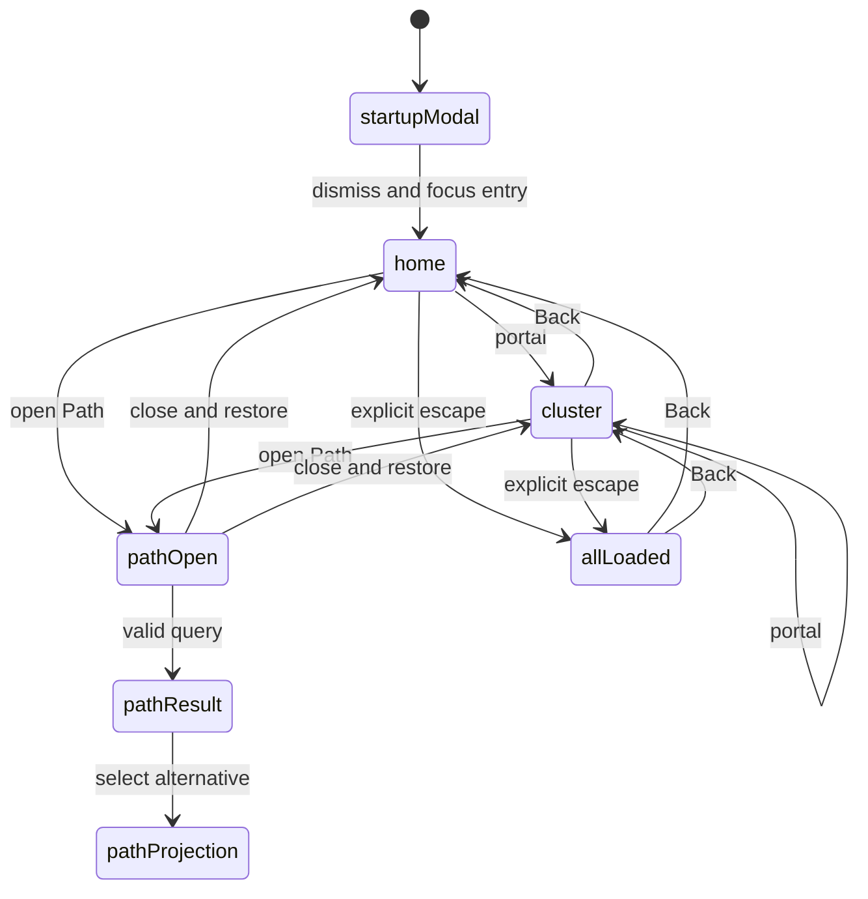

# State Machines: OEW Semantic Navigation

## NavigationState

### Invariants

- Exactly one primary scene and one selected view mode exist.
- Transient surfaces declare activation, result, dismissal, and restoration.
- Every committed scene binds profile, graph, sidecar and filter fingerprints.
- Stale fingerprints invalidate Path/portal results before reuse.
- Scene changes never change ontology or promotion authority.

## AuditSeriesState

`draft-profile -> frozen-baseline -> implementation-pending -> current-run -> delta-recorded`

Changing a frozen profile field starts a new audit series. Unexercised cells
remain residue, never pass.
