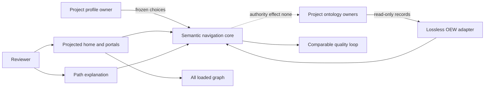
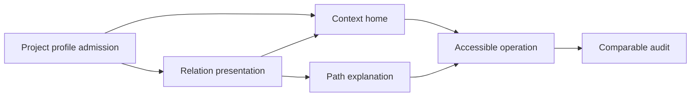

# Architecture Bundle: OEW Semantic Navigation

## Design Intent

Replace the all-graph-first black-box experience with a bounded, profile-owned
navigation model while retaining exact access to every admitted relation and an
explicit full-graph escape. The architecture is a pure presentation layer over
read-only graph and sidecar records; ontology and promotion authority remain
outside it.

## Inputs

- [Define specification](../define/SPEC.md)
- [Glossary](../define/GLOSSARY.md)
- [Verified change requests](../../ontology-evidence-workbench-focus-scene/reviews/2026-07-31-ux-ui-quality-loop/findings.md)
- [Body War profile](../../ontology-evidence-workbench-focus-scene/reviews/2026-07-31-ux-ui-quality-loop/BODY-WAR-PROFILE.json)
- [Frozen baseline](../../ontology-evidence-workbench-focus-scene/reviews/2026-07-31-ux-ui-quality-loop/BASELINE-COVERAGE.json)
- Design scope and selection: `DESIGN-SCOPE-MANIFEST.json`,
  `DESIGN-SELECTION-RESULT.json`

## 1. Context View



## 2. Capability View



Profile admission gates only dependent behavior. Relation presentation is the
shared semantic seam for graph, selected relation, portal and Path scenes.

## 3. Concept and Type View

```text
SemanticNavigationProfile
  -> ProjectedCluster[]
  -> predicateColorMap
  -> presentationPatternMap
  -> PathPolicy
  -> zeroCountPolicy
  -> restorationTargets
  -> evidenceCeilings

SourceEdge + EvidenceSidecar
  -> RelationPresentationRecord
  -> GraphEdgeView | PortalRelationView | PathHop

NavigationFrame
  -> home | cluster | path | all_loaded
```

`RelationPresentationRecord` is the only renderer input allowed to describe a
relation. It preserves graph/source identities, endpoints, exact predicate,
source direction, projected direction, provenance, source authority and
projection authority none. Path adds traversal orientation without rewriting
the record.

## 4. Operation and Flow View

### Entry and portal round trip

```text
validate frozen profile and source digests
  -> derive approved home cards and current-projection counts
  -> render candidate-local projection copy and provenance ceiling
  -> focus graph-entry heading
  -> activate portal
  -> push NavigationFrame plus invoker
  -> derive target projected cluster and exact crossings
  -> focus target heading
  -> Back restores scope, filters, selection, direction, viewport and focus
```

### Relation disclosure

```text
select actionable edge instance
  -> resolve one RelationPresentationRecord
  -> render exact predicate text, directions, endpoints, provenance, authority
  -> use stable predicate color and presentation pattern as redundant cues
  -> Close/Escape restores the edge instance or declared fallback
```

### Path explanation

```text
open Path and capture return frame
  -> choose named From and To endpoints
  -> apply approved comparator or route-local policy
  -> produce ordered alternatives over admitted graph/filter fingerprint
  -> render complete hop records plus traversal orientation
  -> declare non-membership/non-authority
  -> cancel/close restores invoker and frame
```

## 5. State View

The normative state machine is [NavigationState](../define/states.md#navigationstate).
State is owned by the OEW UI store; derivations remain pure. A committed frame
contains profile, graph, sidecar and filter fingerprints; scope; admitted node
and edge IDs; selected node/relation; direction mode; viewport; and initiating
control. Drift invalidates dependent read models before display.

Exactly one mode is selected. Modal, disclosure, Path and inspector state is
separate from graph scope so dismissal does not silently change the scene.

## 6. Dependency and Interface View

| Boundary | Direction | Contract | Owner | Guard |
| --- | --- | --- | --- | --- |
| project ontology | source -> adapter | exact concept/relation meaning and evidence | project ontology owners | read-only digests; no presentation promotion |
| admitted graph/sidecar | adapter -> semantic core | total identity, direction, provenance and authority fields | OEW adapter owner | fail closed on missing/lossy field |
| project profile | profile owner -> semantic core | context, relation, Path, count, copy, icon and ceiling choices | project owner | owner-pending blocks dependent behavior |
| semantic core | pure derivations -> UI store | relation records, clusters, frames, Path results | semantic-navigation owner | no DOM or local duplicate graph |
| UI store | state -> renderers | selected scene/mode/transient surface | OEW UI owner | deterministic transitions/restoration |
| browser runner | exact build -> evidence | frozen task/control/state/mode matrix | UX evidence owner | loopback, no outbound, atomic deltas |
| ontology/promotion route | no write | authority effect none | source lifecycle owners | no UI control can promote |

## Significant Behavior Scenario

Stimulus: a keyboard-only reviewer enters Body War, chooses the Suggested Track
portal, selects a relation, opens a reverse Path alternative, closes it, and
returns Home.

Acceptance requires bounded entry; named portal scope; exact predicate and all
three direction concepts; stable color/pattern plus text; visible focus;
complete Path hops; explicit non-authority language; and exact Back/Close focus
restoration. Any missing source field, owner choice, contrast threshold, or
restoration target fails the relevant behavior without falling back to the full
graph.

## Triggered Architecture Extensions

### Authority and trust

- Profile admission authorizes presentation choices only.
- `projectionAuthorityEffect` is always `none` and cannot copy source authority.
- `Show all loaded graph` means full admitted projection, not complete ontology.
- No color, icon, cluster, portal, route, count, audit or receipt can promote.

### Integration and versioning

- `semantic-navigation-profile.v1` and `relation-presentation-record.v1` are
  versioned candidate interfaces.
- Unknown versions fail closed; optional profile fields have explicit defaults
  only when the schema declares them.
- Current focus-scene records are adapted at one boundary; renderers never
  parse raw sidecar fields independently.

### Quality

- Named enabled text: minimum 4.5:1.
- Required graphical boundary/focus/edge: minimum 3:1.
- Forced colors, grayscale and reduced motion retain predicate text, line
  pattern, direction marker/text and focus.
- Quality thresholds prove only named mechanics and measurements.

### Validation

`VALIDATION-CONTRACTS.md` owns fixtures, matrices and claim ceilings. Planned
witnesses are Design contracts and begin Plan as `plan-evidence-pending`.

## Decision Log

| ID | Decision | Status | Owner |
| --- | --- | --- | --- |
| D-01 | core is reusable; Body War is a replaceable first profile | selected | semantic-navigation owner |
| D-02 | exact `sourcePredicate` keys stable color | selected | project profile owner supplies mapping |
| D-03 | `presentationRelation` keys stable pattern | selected | semantic-navigation owner |
| D-04 | contexts, Path choice and zero-count policy remain explicit inputs | selected | Body War profile owner |
| D-05 | first implementation unit is pure relation-record derivation and fixtures | selected | Plan owner |

## Risks and Gaps

- Owner decisions OD-01–OD-04 block only their declared dependent units;
  OD-04 is the sole owner input to candidate first-unit SWU-OEWSN-004.
- Current upstream overlay/patch synchronization must be preflighted before any
  product mutation.
- Cross-scene relation stability and full recovery matrix are unexecuted.
- Screenshot hierarchy and human comprehension remain separate evidence lanes.
