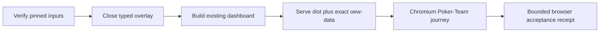

# Ontology Evidence Workbench Thin Prototype

## What This Module Owns

This development package specifies one local, read-only, browser-testable OEW
journey over the existing Poker-Team evidence bundle. It owns the clean
authoring boundary and execution contract; it does not own a dependency graph,
new runtime, ontology meaning, promotion, or the historical OEW work pack.

## Module Map

## Capabilities

| Capability | What | Key aspects | Detail |
| --- | --- | --- | --- |
| ExactInputAdmission | Reject drift and admit one executable same-origin loader boundary before build | verification, mappings | Existing archive, manifest, overlay, patch, fixture, and adapter outputs only |
| ThinDashboardBuild | Build the OEW surface inside the pinned workspace | operation, state | Strict TypeScript, focused typed tests, core build, Vite build |
| FailClosedEvidenceGateway | Serve dashboard and exact immutable evidence on loopback | interface, operation | Token, containment, allowlist, no outbound proxy |
| PokerEvidenceJourney | Inspect the selected Poker-Team finding and its grounding | query, UX | Trust rail, F1 → R1 → D1, D2 residue, view parity, receipt drawer |
| BrowserWitnessReceipt | Record the exact local run for Task Session closeout review | event, mapping | Browser identity, hashes, assertions, network and teardown proof |

## Domain Concepts

| Concept | Type | Key constraints |
| --- | --- | --- |
| [ThinPrototypeRun](states.md#thinprototyperun) | State | local, finite, fail-closed, authority effect none |
| [AdmittedInputSet](mappings.md#admittedinputset) | Value Object | exact paths and digests; zero new manifests |
| [EvidenceGateway](interfaces.md#internal-evidencegateway-interface) | Interface | loopback, token-protected, three immutable data routes |
| [PokerEvidenceJourney](queries.md#pokerevidencejourney) | Query | deterministic F1 opening and visible D2 conflict residue |
| [BrowserWitnessReceipt](events.md#browserwitnessrecorded) | Evidence | not product, ontology, release, or production authority |

## Concept Registry

| Concept | ID | Type |
| --- | --- | --- |
| [ExactInputAdmission](operations.md#verifyexactinputs) | oewtp.ExactInputAdmission | Operation |
| [CloseTypedOverlay](operations.md#closetypedoverlay) | oewtp.CloseTypedOverlay | Operation |
| [BuildThinDashboard](operations.md#buildthindashboard) | oewtp.BuildThinDashboard | Operation |
| [ServeEvidenceGateway](operations.md#serveevidencegateway) | oewtp.ServeEvidenceGateway | Operation |
| [RunPokerBrowserWitness](operations.md#runpokerbrowserwitness) | oewtp.RunPokerBrowserWitness | Operation |
| [PokerEvidenceJourney](queries.md#pokerevidencejourney) | oewtp.PokerEvidenceJourney | Query |
| [EvidenceGateway](interfaces.md#internal-evidencegateway-interface) | oewtp.EvidenceGateway | Interface |
| [ThinPrototypeRun](states.md#thinprototyperun) | oewtp.ThinPrototypeRun | State |
| [BrowserWitnessRecorded](events.md#browserwitnessrecorded) | oewtp.BrowserWitnessRecorded | Event |
| [AdmittedInputSet](mappings.md#admittedinputset) | oewtp.AdmittedInputSet | Mapping |

## Feature Concept Graph

| From | Edge | To | Evidence | Notes |
| --- | --- | --- | --- | --- |
| oewtp.ExactInputAdmission | produces | oewtp.AdmittedInputSet | operations.md#verifyexactinputs | Exact inputs only |
| oewtp.CloseTypedOverlay | enforces | oewtp.BuildThinDashboard | operations.md#closetypedoverlay | Strictness remains enabled |
| oewtp.EvidenceGateway | exposes | oewtp.PokerEvidenceJourney | interfaces.md#internal-evidencegateway-interface | Three immutable documents |
| oewtp.RunPokerBrowserWitness | queries | oewtp.PokerEvidenceJourney | operations.md#runpokerbrowserwitness | One Chromium journey |
| oewtp.RunPokerBrowserWitness | produces | oewtp.BrowserWitnessRecorded | events.md#browserwitnessrecorded | Evidence ceiling stays local |

## Normative Boundaries

1. The new development package contains no `package.json`.
2. Runtime work stays under the existing OEW implementation package and pinned
   Understand-Anything workspace.
3. No implementation SWU may modify the old OEW development package.
4. No source admission or authored plan counts as a working browser prototype.
5. The loader must resolve its relative `/oew-data/` base against the current
   page origin, reject cross-origin bases, append the run token to all three data
   URLs, and preserve `credentials: "omit"`.
6. A passing browser receipt proves one local automated Poker-Team journey
   only.
7. `authority_effect` remains `none`; no edit, accept, promote, publish,
   release, or production control is exposed.

## Aspect Docs

| Aspect | Contains |
| --- | --- |
| [Glossary](GLOSSARY.md) | Local terms and authority ceilings |
| [Operations](operations.md) | Build and witness behavior |
| [Queries](queries.md) | Human-visible evidence journey |
| [Interfaces](interfaces.md) | Loopback gateway and local runner contracts |
| [States](states.md) | Fail-closed run lifecycle |
| [Events](events.md) | Non-authoritative run evidence |
| [Mappings](mappings.md) | Exact source-to-runtime bindings |

## Cross-Feature Dependencies

| Capability | Depends on | Via | Why |
| --- | --- | --- | --- |
| ThinDashboardBuild | pinned Understand-Anything core/dashboard | existing pnpm workspace | Reuse build ownership |
| PokerEvidenceJourney | Poker-Team financial-settlement evidence | admitted adapter bundle | Finite semantic witness |
| BrowserWitnessReceipt | global Playwright Chromium | exact executable path and digest | Real browser evidence without another package |

## Produces For

| Consumer | Consumes capability | Via | What |
| --- | --- | --- | --- |
| Task Session | approved plan | one selected SWU | bounded source mutation and receipt |
| Human reviewer | PokerEvidenceJourney | browser | trust and evidence inspection |
| Eventual independent L2 lane | BrowserWitnessReceipt | stable handle | candidate input for a separately owned verifier; not automatic promotion |

## Acceptance

- Dashboard build reaches Vite with strict TypeScript unchanged.
- The exact OewApp `/oew-data/` composition resolves against the current page
  origin; cross-origin/malformed bases fail before fetch.
- Focused typed OEW tests are explicitly discovered and pass.
- Only `127.0.0.1` is bound and no outbound request occurs.
- The first HTML request authenticates the query token and establishes one
  run-scoped `HttpOnly; SameSite=Strict; Path=/` cookie for static assets.
- `/oew-data/presentation-graph.json`,
  `/oew-data/evidence-sidecar.json`, and
  `/oew-data/adapter-receipt.json` require an explicit query token because the
  dashboard loader fetches them with `credentials: "omit"`; all three are
  digest-bound.
- Chromium opens `/?oew=1&token=<token>` and proves the trust rail, F1
  grounding, D2 residue, view parity, inspector source identity,
  `authority_effect: none`, and receipt commit with no console errors.
- Owned processes terminate, the port releases, and the temporary root is
  removed in `finally`.
- OEW-owned package manifests remain exactly one, with zero new manifests.
- A read-only Task Session closure audit accepts the receipt only at the fixed
  one-local-journey claim ceiling; an independent immutable verifier remains L2.

## Non-Goals

- General runtime abstraction
- Static UI reimplementation
- Firefox, full accessibility conformance, or broad responsive matrix
- Editing, collaboration, promotion, publication, release, deployment, or
  production readiness
- Ontology correctness beyond the displayed, receipt-bound fixture
