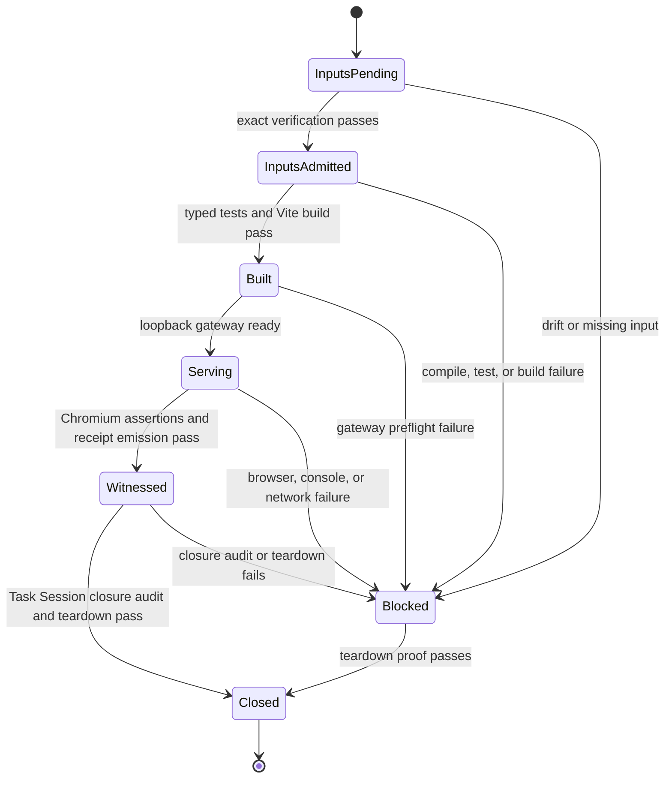

# State Machines: OEW Thin Prototype

## ThinPrototypeRun

### Invariants

| ID | Invariant |
| --- | --- |
| I1 | Every failure is terminal for the current run |
| I2 | Serving never precedes a successful build |
| I3 | Browser acceptance never precedes exact gateway readiness |
| I4 | Closure requires browser/process termination, port release, and temporary-root absence |
| I5 | Every state has `authority_effect: none` |
| I6 | Witnessed proves one local automated journey only; it is not independent immutable verification |
