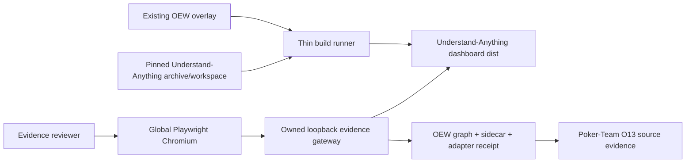
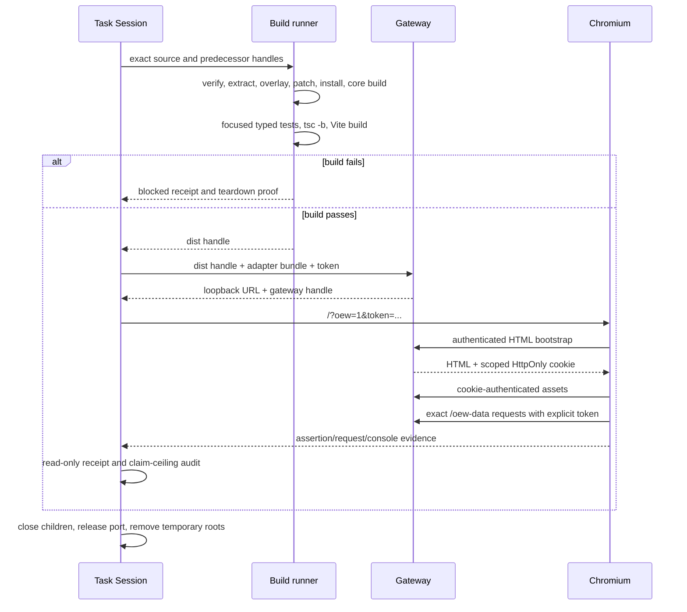
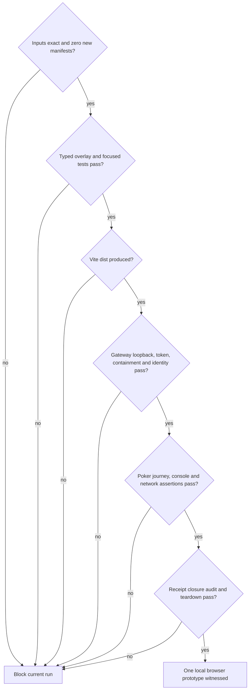

# Architecture Bundle: OEW Thin Prototype

## Design intent

Deliver one local, browser-testable Poker-Team evidence journey by reusing the
pinned Understand-Anything workspace and existing OEW UI. Keep dependency
ownership upstream, keep adapter behavior in the existing implementation
package, and keep this new development package as the sole authoring/control
surface.

## Inputs and evidence state

- Approved Define: [SPEC.md](../define/SPEC.md)
- Glossary: [GLOSSARY.md](../define/GLOSSARY.md)
- Approved research:
  `../../ontology-evidence-workbench/research/2026-07-29-runtime-rebuild-lessons/findings.md`
- Closed scope: [DESIGN-SCOPE-MANIFEST.json](DESIGN-SCOPE-MANIFEST.json)
- Selection receipt:
  [DESIGN-SELECTION-RESULT.json](DESIGN-SELECTION-RESULT.json)
- Design evidence ceiling: `design-validator-pass` after deterministic
  validation; Plan evidence starts separately at `plan-evidence-pending`

## 1. Context view



Ownership boundaries:

- Understand-Anything owns pnpm, TypeScript, Vitest, Vite, core, and dashboard.
- The existing OEW implementation package owns adapter scripts, overlay,
  fixtures, gateway, runner, and generated run evidence.
- This new development package owns Define, Design, Plan, and closeout targets.
- Poker-Team, ontology, authority, Inventory, Arcanum, and the old OEW
  development package are read-only sources.

## 2. High-level structure view

```text
new development package (no package.json)
  Define / Design / Plan / closeout targets
            |
            | one selected SWU through Task Session
            v
existing OEW implementation package (one command registry)
  overlay repair
  thin build runner
  evidence gateway
  browser runner and bounded acceptance receipt
            |
            v
temporary pinned Understand-Anything workroot
  existing workspace -> core build -> dashboard typed tests -> Vite dist
```

The system adds behavior, not another runtime root. Direct script invocation is
allowed; a package-script edit is neither required nor authorized.

## 3. Low-level component view

| Component | Responsibility | Inputs | Outputs | Failure boundary |
| --- | --- | --- | --- | --- |
| Typed executable-loader closure | Remove the measured strict-TypeScript errors, resolve OewApp's relative evidence base same-origin, and keep exact overlay admission aligned | three OEW modules, read-only OewApp contract, and existing source manifests | type-correct admitted overlay with executable data URLs | no `@ts-nocheck`, strictness weakening, cross-origin base, or topology change |
| Thin build runner | Materialize and build a fresh pinned workspace | archive, patch, current admitted overlay, tool paths | retained immutable dist plus build handle | stop before serve on any drift/test/build failure |
| Evidence gateway | Serve retained dist and three exact data documents | dist handle, verified adapter run, token | loopback URL and gateway handle | reject token/path/method/identity/network violations |
| Browser acceptance runner | Exercise one Poker-Team journey | URL, token, browser identity, assertion contract | browser acceptance receipt | console, request, assertion, or teardown failure blocks |
| Task Session closure audit | Read-only check of the receipt, source bindings, claim ceiling, and cleanup | browser acceptance receipt plus expected inputs | pass/blocked closeout | stale, incomplete, mismatched, leaked-child, or overstated receipt blocks |

## 4. Workflow process view



## 5. Decision flow view



`W` does not imply ontology correctness, product acceptance, promotion,
release, deployment, or production readiness.

## 6. Dependency/interface view

| Interface | Producer | Consumer | Version/binding | Compatibility rule |
| --- | --- | --- | --- | --- |
| pinned workspace | retained upstream archive | thin build runner | commit plus archive digest | no ambient/global fallback |
| overlay admission | existing manifests plus typed-repair receipt | thin build runner | exact file list and digests | extra, missing, or stale file blocks |
| dist handle | thin build runner | gateway | output tree digest | gateway refuses missing/drifted dist |
| evidence bundle | verified adapter run | gateway and UI loader | graph/sidecar/receipt digests | three routes only; total mappings required |
| loopback handle | gateway | browser runner | token, port, PID, source/build digests | no non-loopback or outbound target |
| browser receipt | browser runner | Task Session closure audit and human reviewer | Playwright/Chromium identity plus assertions | bounded local-prototype evidence only |
| SWU terminal receipt | Task Session | Invoke Refresh closeout | exact target inventory and baseline | no inferred targets or automatic next mutation |

## Significant behavior scenario

Stimulus: an evidence reviewer opens the tokenized OEW dashboard for the
admitted Poker-Team adapter run.

Preconditions:

- exact pinned workspace and current overlay admitted;
- typed build and focused tests passed;
- gateway verified the adapter receipt and bound its three artifacts;
- Chromium identity and token digest are recorded.

Ordered response:

1. Trust rail names the admitted source run and authority effect.
2. F1 opens as the selected evidence.
3. Grounding trace reveals F1 → R1 → D1.
4. D2 remains visible as conflict residue.
5. Outline and table preserve the selection.
6. Inspector exposes Poker-Team source path/digest and
   `authority_effect: none`.
7. Receipt drawer exposes the pinned commit and terminal evidence.

Failure/recovery:

- missing or invalid bootstrap authentication returns HTTP 401/403 before the
  application can render;
- after valid bootstrap, any invalid bundle identity/digest/schema renders the
  fail-closed alert and no graph;
- unknown evidence selection visibly recovers to F1;
- no partial graph is rendered behind a bundle-validation error;
- the current run terminates and cleans up rather than retrying silently.

Observable evidence: named browser assertions, console/request logs, one
screenshot, source/build/browser digests, closure-audit verdict, and teardown
proof.

Acceptance owner: OEW prototype Task Session owner; ontology and release owners
remain outside this acceptance boundary.

## Triggered architecture extensions

### Authority and trust

- Admission accepts bytes for one run; it does not accept ontology meaning.
- Browser and Task Session closure receipts have `authority_effect: none`.
- No UI control can edit, accept, promote, or publish.

### State and event

- The run state machine is terminal on failure.
- A browser acceptance receipt is an event/evidence handle, not a lifecycle
  promotion.

### Persistence and concurrency

- Repository source is modified only by one selected Task Session SWU.
- Temporary workroots and gateway state have one owner per run.
- Generated receipts use unique run directories; completed receipts are
  immutable inputs to successors.

### Security and abuse

- Bind only `127.0.0.1`.
- Require a high-entropy query token for the initial HTML bootstrap, set a
  run-scoped `HttpOnly; SameSite=Strict; Path=/` cookie for static assets, and
  require the explicit query token for `/oew-data/*` because its loader uses
  `credentials: "omit"`.
- The cookie omits `Secure` only because the bounded gateway is local HTTP; a
  fresh context and token are destroyed at teardown.
- Reject traversal, encoded traversal, unknown routes, unsupported methods,
  symlink escape, proxy targets, and outbound requests.
- Set `Referrer-Policy: no-referrer`; persist only the token digest and expire
  the cookie when the browser context closes.

### Integration and versioning

- Bind the pinned upstream commit and current adapter schemas.
- Treat changes to bundle schema, dashboard entry contract, or global
  Playwright/Chromium identity as new evidence requiring a fresh run.

### Quality

- Required thresholds: zero strict-TypeScript errors, explicit focused-test
  discovery, exact relative-base same-origin request composition, zero browser
  console errors, zero outbound requests, all named assertions pass, owned
  processes closed, port released, temporary roots absent, and zero new package
  manifests.

## Concern-to-view trace

| Concern | Primary class | Disposition | Owner | View/extension |
| --- | --- | --- | --- | --- |
| exact input and no promotion | authority | required | OEW prototype owner | authority and trust |
| token/path/network boundary | security | required | security-risk owner | security and abuse |
| terminal run lifecycle | state-event | required | workflow owner | state and event |
| run directories and child ownership | persistence | required | persistence owner | persistence and concurrency |
| pinned workspace and bundle contracts | integration | required | interface owner | integration/versioning |
| person navigates changed evidence surface | ux | required | UX plan owner | [UX-PLAN.md](UX-PLAN.md) |
| measurable local witness thresholds | performance/quality | required | service owner | quality |
| planned positive and negative witnesses | validation | required | design owner | [PLANNED-WITNESSES.json](PLANNED-WITNESSES.json) |
| migration, rollout, privacy, service reliability, irreversible compensation | respective | not applicable with rationale | named in selection receipt | baseline views only |

## Risks and decisions

| ID | Risk/decision | Treatment |
| --- | --- | --- |
| D-01 | A “new package” is misread as a new npm package | README/spec forbid `package.json`; manifest count is acceptance evidence |
| D-02 | Existing L1 lock ceremony is imported and recreates churn | fast lane uses exact predecessor receipts and current allowlists; independent immutable L1 remains later |
| D-03 | Focused tests pass only because they were not discovered | invoke exact typed-test paths and record discovered test names/count |
| D-04 | Browser proves UI reachability but not evidence trust | assert graph/sidecar/receipt identity, source paths, authority effect, and visible residue |
| D-05 | Generated receipt overstates readiness | fixed one-local-journey claim ceiling plus read-only Task Session closure audit; independent immutable verification remains L2 |
| D-06 | Old package changes during execution | baseline fingerprint and Task Session write-scope rejection |
| D-07 | Shared overlay repair stales the historical exact L1 build lock | fast lane never consumes or edits that lock; record expected staleness and defer a separately owned L2 rebind |
| D-08 | `new URL(file, "/oew-data/")` throws before fetch | SWU-001 owns same-origin resolution against page origin and proves exact OewApp composition plus cross-origin/malformed negatives |

## Planned witness status

All witnesses in [PLANNED-WITNESSES.json](PLANNED-WITNESSES.json) are Design
contracts only. They are unexecuted and do not count as Plan or runtime
evidence.
