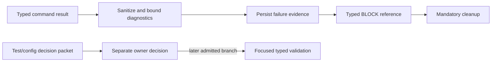

# OEW Typed-Test Recovery

## What This Module Owns

This private development capability makes acceptance-critical OEW builder
failures diagnosable without retaining a failed workspace or weakening
cleanup. It preserves the proved test/configuration incompatibility as a
separate owner decision instead of choosing a repair under research authority.

It owns producer-local failure evidence and the successor patch/binding
contract. It does not own Task Session internals, public schemas, retries,
network authorization, product semantics, or SWU completion.

## Module Map

## Capabilities

| Capability | Outcome | Key aspects |
| --- | --- | --- |
| PreserveFailureEvidence | One bounded, sanitized failure artifact exists before cleanup | `RunTypedGate`, `WriteFailureEvidence`, `FailureEvidenceState` |
| RouteCompatibilityDecision | The proved incompatibility reaches its owner with both repair branches and claim ceilings intact | `PrepareCompatibilityDecision`, `CompatibilityDecisionPacket` |
| BindTerminalEvidence | Planning and terminal receipts can reference the producer artifact without owning it | `FailureEvidenceReference`, `TerminalEvidenceSlot` |

## Domain Concepts

| Concept | Type | Key constraints |
| --- | --- | --- |
| `oewfr.FailureEvidenceRecord` | Entity | private, bounded, sanitized, digest-bound, `authority_effect: none` |
| `oewfr.FailureEvidenceReference` | Value Object | normalized path, digest, schema, producer, gate, issue |
| `oewfr.CommandResult` | Value Object | transient stdout/stderr plus command identity and exit |
| `oewfr.CompatibilityDecisionPacket` | Value Object | test-side and config-side options, evidence, costs, invalidation conditions |
| `oewfr.RecoveryState` | State | prepared, running, blocked-evidenced, blocked-unavailable, cleanup-failed, passed |

## Concept Registry

| Concept | ID | Type |
| --- | --- | --- |
| Preserve failure evidence | `oewfr.PreserveFailureEvidence` | Capability |
| Route compatibility decision | `oewfr.RouteCompatibilityDecision` | Capability |
| Bind terminal evidence | `oewfr.BindTerminalEvidence` | Capability |
| Run typed gate | `oewfr.RunTypedGate` | Operation |
| Write failure evidence | `oewfr.WriteFailureEvidence` | Operation |
| Prepare compatibility decision | `oewfr.PrepareCompatibilityDecision` | Operation |
| Read failure evidence reference | `oewfr.ReadFailureEvidenceReference` | Query |
| Failure evidence record | `oewfr.FailureEvidenceRecord` | Entity |
| Failure evidence reference | `oewfr.FailureEvidenceReference` | Value Object |
| Compatibility decision packet | `oewfr.CompatibilityDecisionPacket` | Value Object |
| Recovery state | `oewfr.RecoveryState` | State |
| Typed gate failed | `oewfr.TypedGateFailed` | Event |
| Failure evidence persisted | `oewfr.FailureEvidencePersisted` | Event |

## Feature Concept Graph

| From | Edge | To | Evidence |
| --- | --- | --- | --- |
| `oewfr.PreserveFailureEvidence` | owns | `oewfr.WriteFailureEvidence` | [operations](operations.md#writefailureevidence) |
| `oewfr.RunTypedGate` | produces | `oewfr.TypedGateFailed` | [events](events.md#typedgatefailed) |
| `oewfr.WriteFailureEvidence` | produces | `oewfr.FailureEvidencePersisted` | [events](events.md#failureevidencepersisted) |
| `oewfr.FailureEvidenceReference` | references | `oewfr.FailureEvidenceRecord` | [interfaces](interfaces.md#terminal-evidence-reference) |
| `oewfr.RouteCompatibilityDecision` | owns | `oewfr.PrepareCompatibilityDecision` | [operations](operations.md#preparecompatibilitydecision) |
| `oewfr.PrepareCompatibilityDecision` | produces | `oewfr.CompatibilityDecisionPacket` | [mappings](mappings.md#compatibility-evidence-to-decision-packet) |
| `oewfr.BindTerminalEvidence` | depends_on | `oewfr.PreserveFailureEvidence` | [interfaces](interfaces.md#terminal-evidence-reference) |

## Invariants

1. A failing acceptance-critical command can never produce a success handle.
2. Failure evidence is written outside the temporary workroot before cleanup.
3. Evidence is sanitized and bounded; raw environment and failed workspaces are
   never retained.
4. Evidence-persistence and cleanup failures remain stronger distinct blockers.
5. A failure reference never authorizes retry, mutation, completion, or
   promotion.
6. Research evidence cannot select test-side versus config-side repair.
7. Patch0004 and binding006 remain immutable predecessor evidence; repairs use
   successor artifacts.

## Aspect Docs

- [Operations](operations.md)
- [Queries](queries.md)
- [Interfaces](interfaces.md)
- [States](states.md)
- [Events](events.md)
- [Mappings](mappings.md)
- [Glossary](GLOSSARY.md)

## Cross-Feature Dependencies

| Capability | Depends on | Why |
| --- | --- | --- |
| PreserveFailureEvidence | private OEW builder | producer owns command execution and cleanup |
| RouteCompatibilityDecision | OEWSN patch/binding chain | predecessor identities remain immutable until a later selected branch |
| BindTerminalEvidence | OEWSN planning/admission | output must be admitted before execution |

## Non-goals

- retrying or completing SWU-OEWSN-006;
- changing `restoreRelationFocus` product behavior;
- selecting or implementing the test-side versus config-side repair;
- adding a new diagnostic skill or public OEW schema;
- retaining a failed workroot or dependency store;
- repairing the separate Inventory append-candidate defect;
- deployment, release, production, or ontology promotion.
