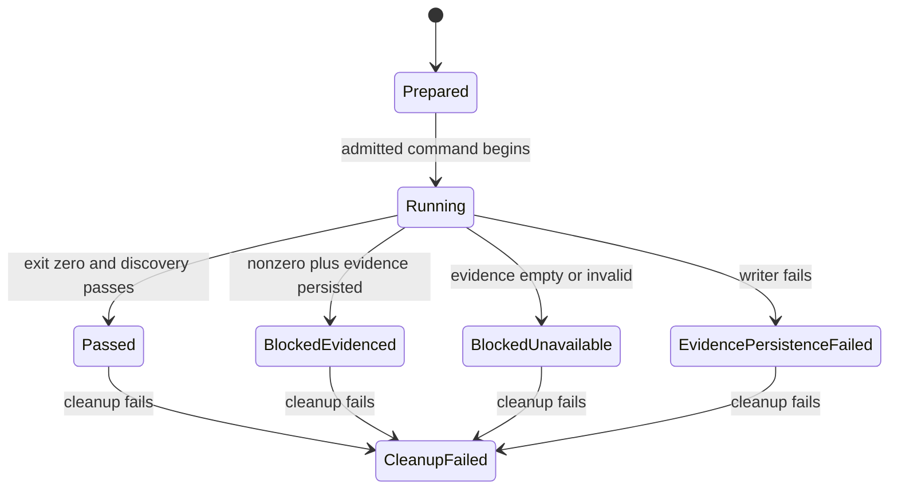

# States: OEW Typed-Test Recovery

## RecoveryState

Invariants: no blocked state emits a success handle; cleanup is attempted in
every terminal path; consumed authorization remains consumed; retry remains
false unless a later owner supplies fresh authority.

