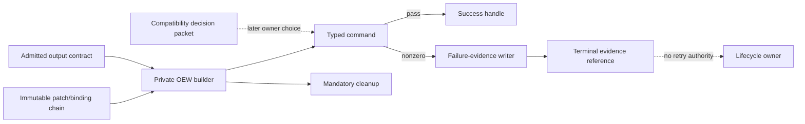
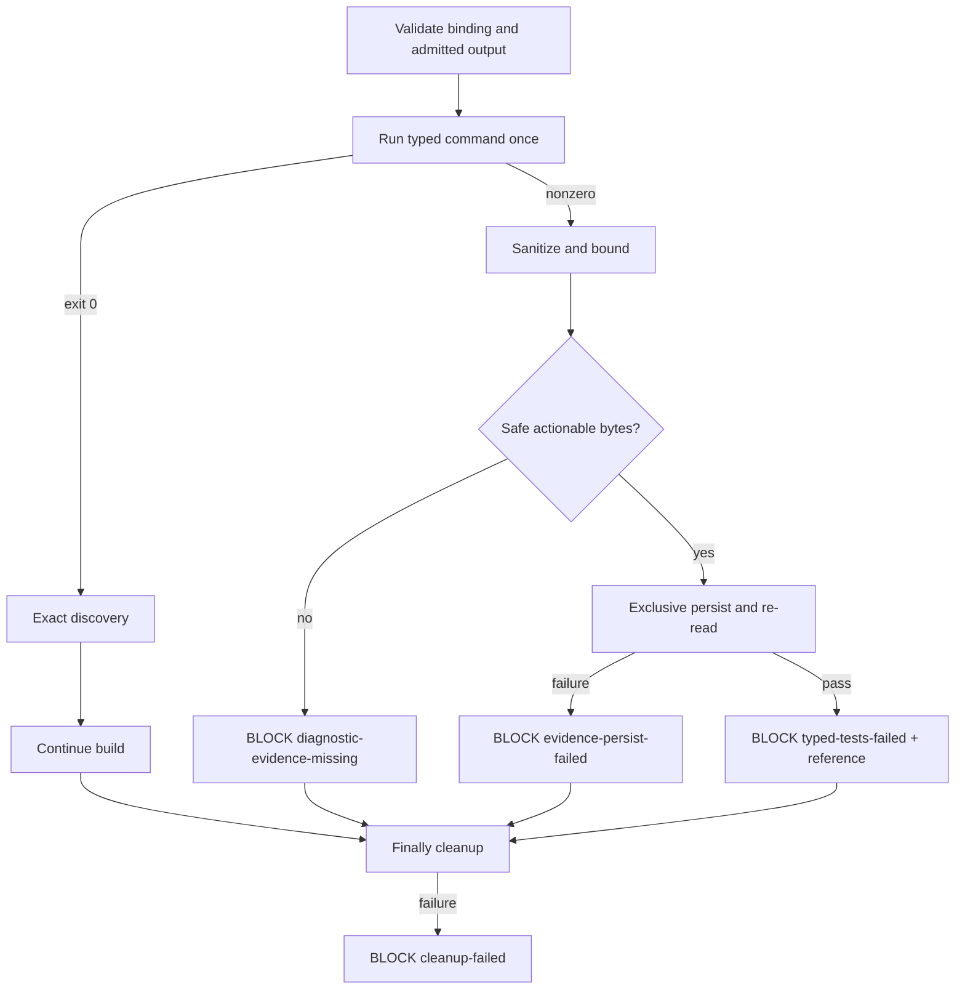

# Architecture Bundle: OEW Typed-Test Recovery

## Design Intent

Preserve actionable, privacy-bounded diagnostics across mandatory cleanup and
route the separate test/configuration incompatibility to its owner without
selecting a repair. The implementation remains private, candidate-local, and
non-authoritative.

## 1. Context View



## 2. High-Level Structure View

1. `CommandRunner`: injected execution boundary returning full transient
   `CommandResult`.
2. `DiagnosticSanitizer`: pure allowlist, redaction, digest, and deterministic
   head/tail bounding.
3. `FailureEvidenceWriter`: contained exclusive persistence plus re-read and
   secret validation.
4. `TypedGateFailureMapper`: selects the original or stronger blocker and
   attaches only a reference.
5. `CleanupFinalizer`: always removes workroot/store and reports cleanup
   independently.
6. `CompatibilityDecisionPacket`: non-selecting test-side/config-side option
   boundary owned by a later Decision Gate.

## 3. Low-Level Components View

```text
buildThinPrototype(options)
  options.commandRunner ?? command
  options.failureEvidenceWriter ?? writeFailureEvidence
  -> run exact typed command once
  -> if nonzero:
       sanitize(commandResult)
       write exclusive admitted artifact
       throw ThinBuildError(issue, evidenceReference)
  -> finally cleanup workroot/store

FailureEvidenceRecord
  identity: work-pack, SWU, attempt, binding digest
  result: block, gate, issue
  command: allowlisted id/program/args/cwd-role/exit/duration
  streams: original digest/size + bounded redacted head/tail
  inputs: relative path/digest/size
  authorization: allowed/used/consumed/retry=false
  cleanup: intent in artifact; final result in terminal receipt
  privacy: redaction version, no environment, sanitized-byte secret scan
  ceiling: diagnostic only, authority_effect=none
```

The evidence artifact is written before cleanup, so it records cleanup intent;
the terminal receipt joins the final cleanup result. The record never claims
cleanup succeeded before `finally` completes.

## 4. Workflow Process View



## 5. Decision Flow View

| Decision | Selected rule | Reason |
| --- | --- | --- |
| DOM test environment | unresolved owner decision | research proves incompatibility but explicitly leaves test-side versus config-side repair unselected |
| Success diagnostics | hash-only receipt remains | no need to retain bounded text on success |
| Failure diagnostics | one private artifact plus generic reference | survives cleanup without owner collapse |
| Workspace retention | forbidden | privacy and boundedness |
| Writer failure | stronger BLOCK | evidence must fail closed |
| Cleanup failure | strongest distinct BLOCK | cleanup remains invariant |
| Retry | outside package | consumed authorization cannot be renewed by implementation |

## 6. Dependency Interface View

| Boundary | Contract | Owner | Guard |
| --- | --- | --- | --- |
| compatibility repair | later selected test-side or config-side branch preserves predecessor digests | OEWSN patch/config owner | separate Decision Gate and fresh Invoke admission |
| builder command | injected runner returns full transient result | private OEW builder | one invocation; no hidden network authority |
| failure output | admitted normalized collision-reject path | OEWSN planning | reject escape/symlink/collision before command |
| evidence record | `oew.failure-evidence.v1` | private OEW producer | size, redaction, secret scan, claim ceiling |
| terminal receipt | generic evidence reference plus authorization and cleanup state | Task Session consumer | BLOCK when required reference missing/invalid |
| browser focus | real DOM acceptance | later Task Session/browser owner | no unit-fixture substitution |

## Triggered Extensions

### Failure and compensation

There is no retry or compensating product action. The recovery path is evidence
preservation, mandatory cleanup, and an explicit later authorization gate.
Evidence writer failure and cleanup failure are separately typed and ordered.

### Persistence and concurrency

The artifact writer creates one file exclusively at a normalized contained
path. It rejects collision, symlink escape, partial overwrite, and a second
artifact. No mutable shared store is introduced.

### Integration and versioning

`oew.failure-evidence.v1` is a private candidate contract. Unknown
schema/version/digest inputs fail closed. A successor compatibility binding is
not designed until the owner selects a repair. Public Task Session receives
only a generic reference if separately maintained.

### Data lifecycle and security

The record omits environment, credentials, tokens, absolute temp paths,
lockfile contents, dependency trees, and source workspaces. Sanitized bytes are
size-capped and secret-scanned before the artifact becomes referencable.

### Quality

Deterministic no-network fixtures cover success, nonzero, empty, oversized,
secret, path escape, writer failure, cleanup failure, missing reference,
stop-on-block, observer non-authority, and static Node incompatibility.

## Significant Behavior Scenario

An injected typed-test command exits 1 with an oversized stream containing
`ReferenceError: document is not defined` and a secret marker. The builder
invokes it once, runs no following command, hashes original bytes, redacts the
marker, retains bounded actionable head/tail text, writes one admitted artifact
outside the workroot, throws a typed BLOCK with its reference, consumes no new
  retry authority, and removes workroot/store. Any persistence or cleanup failure
becomes a stronger blocker.

## Decision Log

| ID | Decision | Status |
| --- | --- | --- |
| D-OEWFR-01 | test-side versus config-side compatibility repair | owner decision required; not selected |
| D-OEWFR-02 | retain real DOM behavior as a later browser acceptance obligation | selected boundary |
| D-OEWFR-03 | write one private bounded artifact before cleanup | selected from accepted research |
| D-OEWFR-04 | terminal receipt joins a reference, not raw diagnostics | selected |
| D-OEWFR-05 | public Task Session maintenance and Inventory repair remain separate | selected owner boundary |

## Risks and Residue

- Focus behavior under a real DOM remains unproved until a separately admitted
  successor build/browser run.
- Test-side versus config-side repair requires a separate Decision Gate; this
  package provides evidence only.
- The exact later retry and any dependency fetch require fresh authority.
- Another selected test/import may fail after the proved incompatibility is
  repaired.
- Public Task Session evidence-reference support may still need a separately
  approved maintenance package.
