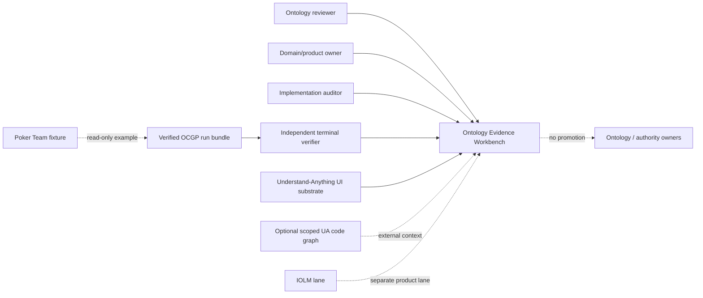
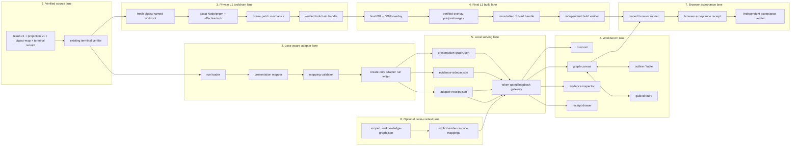
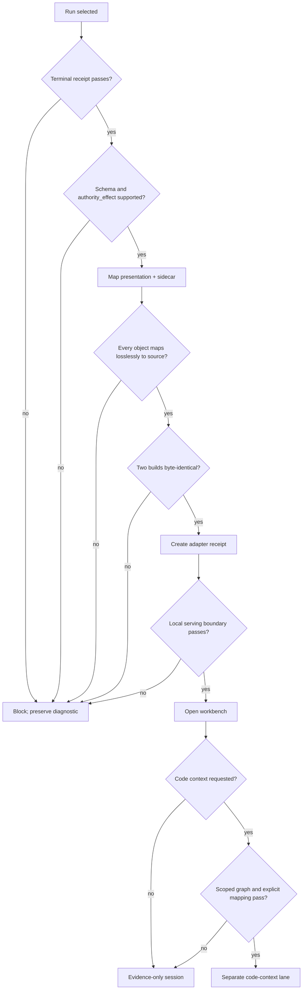

# Ontology Evidence Workbench Architecture

Status: Design authored; validator evidence recorded separately
Target: private local prototype
Upstream: Understand-Anything pinned at
`2cda14e89535049e49120198886bc0b82e9e630f`

## Design Thesis

Use Understand-Anything for what it does well—interactive graph layout,
navigation, search, guided learning, local serving, and visual affordances—while
retaining CyberAlchemy's verified candidate bundle as the only evidence source.

The core boundary is:

```text
exact evidence graph != generalized presentation graph
```

The evidence sidecar makes this inequality inspectable rather than implicit.

## First Working Version

The first working version is one private, local Poker evidence-review
interface—not a reusable UI platform and not a sequence of isolated component
demos.

```text
verified Poker adapter run
  → exact-source store
  → persistent trust rail
  → graph / outline / table workspace
  → exact evidence inspector
  → search, keyboard, and Poker grounding walkthrough
  → receipt drawer
  → responsive automated behavior
```

The reviewer can select `F1`, trace the exact `F1 → R1 → D1` grounding path,
keep the `D2` contradiction visible, inspect the indeterminate `specializes`
candidate and `POLICY_OWNER_UNBOUND`, and open the receipts that justify every
verified label. The UI remains read-only and always displays
`authority_effect: none`.

The remaining delivery boundary is four units:

```text
008F complete UI source
  → 013B immutable final build + independent build verifier
  → 014 browser acceptance producer
  → 014V independent acceptance verifier
```

Completed `006P` and `007` are retained. L2 code context, editing, automatic
promotion, multi-user service, public release, and manual UX claims are not
part of this version.

## View 1 — Context



### Context Rules

- Poker Team and IOLM remain read-only.
- Understand-Anything is an upstream UI dependency, not an ontology owner.
- A terminal receipt admits a bundle to OEW; it does not admit ontology meaning.
- Optional code analysis is separately generated, separately named, and
  separately styled.

## View 2 — High-Level Structure



## View 3 — Low-Level Components

| Component | Responsibility | Inputs | Outputs | Failure posture |
| --- | --- | --- | --- | --- |
| `source-admission` | invoke existing independent verifier and bind exact bytes | run directory | `VerifiedRunHandle` | fail closed |
| `candidate-reader` | parse supported result/projection/receipt versions | verified handle | exact in-memory source graph | fail closed |
| `presentation-mapper` | map nodes/edges into UA-compatible vocabulary | source graph, mapping table | presentation graph + mapping rows | fail on unknown/unmapped type |
| `mapping-validator` | prove totality, one-to-one refs, relation preservation, and authority ceiling | source graph, outputs | validation result | fail closed |
| `canonical-json` | stable sort/serialization for adapter outputs | logical records | deterministic bytes | fail closed |
| `adapter-run-writer` | create a new immutable output directory; write receipt last | validated bytes | three-file adapter run | no overwrite |
| `upstream-lock` | bind repository, commit, license, file digests, and patch set | lock file, fetched source | pin verification result | fail on drift |
| `viewer-build` | build unmodified L0 or patch-overlay L1 viewer from pin | verified upstream source | viewer artifact + digest | fail on patch/build/test |
| `l1-toolchain-bootstrap` | prove isolated materialization using exact tools, one declared network/cache mode, and a self-owned fixture patch | verified L0 handle, upstream lock, fixture overlay/patch, effective package/lock | immutable L1 toolchain handle + verifier receipt | fail on workspace fallback, drift, reapply, tool mismatch, or residue; makes no final feature-build claim |
| `l1-final-build` | materialize the complete 007 + 008F overlay after all feature source exists | verified toolchain handle, first-working-version overlay manifest/patches, effective package/lock | immutable L1 build handle + producer receipt | fail on input/tool/lock drift, workspace fallback, patch drift/reapply, test/build failure, or residue |
| `l1-build-verifier` | recompute build inputs, tools, patch pre/postimages, output digest, cleanup, and protected equality | build handle + producer receipt | verifier receipt | independent process; fail closed |
| `viewer-gateway` | loopback/token/path-contained GET/HEAD serving | viewer + adapter run | local session | deny other methods/paths |
| `workbench-store` | shared selection/filter/tour/view state | loaded read models | ephemeral UI state | reset safely |
| `graph-canvas` | pan/zoom/layout/path emphasis using UA patterns | presentation graph, view state | spatial view | equivalent views remain available |
| `evidence-inspector` | render exact source relation, policy, provenance, digests | sidecar ref | human-readable exact record | never fall back to generalized semantics |
| `trust-rail` | show source/adapter verification and authority ceiling | receipts | persistent status | block “verified” label on missing proof |
| `outline-table` | equivalent non-spatial navigation/audit | presentation + sidecar | outline/table | required for accessibility |
| `code-context-adapter` | load separately generated UA graph and explicit mappings | scoped graph + mapping | namespaced secondary lane | cannot alter grounding |
| `browser-acceptance-runner` | run pinned Firefox/Chromium journeys against an admitted build while owning environment, ports, and child PIDs | verified L1 build handle, Poker adapter run, exact browser lock | screenshots, logs, producer receipt | `finally` tears down only owned children and proves port release |
| `browser-acceptance-verifier` | independently recompute semantic, browser, isolation, teardown, residue, and authority checks | browser producer receipt and retained evidence | terminal L1 verifier receipt | producer cannot accept itself |

### Data Contracts

`presentation-graph.json` follows the pinned UA `KnowledgeGraph` shape.

`evidence-sidecar.json` minimally contains:

```json
{
  "schema_version": "oew.evidence-sidecar.v1",
  "source_run": {
    "run_id": "SWU-OCGP-008",
    "terminal_receipt_sha256": "<digest>",
    "authority_effect": "none"
  },
  "nodes": {
    "presentation:F1": {
      "source_ref": "F1",
      "source_kind": "Finding",
      "source_artifact": "result.v1.json"
    }
  },
  "edges": {
    "presentation:F1->R1": {
      "source_relation": "derives-from",
      "presentation_relation": "builds_on",
      "mapping_loss": "generalized",
      "policy_disposition": "policy-pass",
      "diagnostics": []
    }
  }
}
```

`adapter-receipt.json` binds input/output digests, adapter/upstream versions,
mapping counts, determinism result, protected-source check, and authority
ceiling.

`l1-toolchain-handle.json` binds the verified L0 input, upstream/effective lock,
exact Node/pnpm bytes, declared `online` or admitted `isolated-store` mode,
fresh-workroot proof, fixture patch pre/postimages, protected-set equality, and
cleanup/residue state. It makes no feature-build claim.

`l1-build-handle.json` consumes that verified toolchain handle and binds the
complete final overlay pre/postimages, typed test/build results, output digest,
protected-set equality, and cleanup/residue state. It is immutable and is
accepted only by a separate verifier.

## View 4 — Workflow Process

### Build a View

```text
select run
  -> verify terminal receipt
  -> load exact supported records
  -> map to presentation graph + lossless sidecar
  -> validate total mapping and authority ceiling
  -> canonicalize and compare repeat build
  -> write new adapter run
  -> verify adapter receipt
  -> start token-gated loopback viewer
```

### Materialize the L1 Workbench

```text
verify retained L0 handle and exact tool bytes
  -> create fresh digest-named private workroot
  -> select online or admitted isolated-store mode
  -> frozen install with no workspace fallback
  -> verify and apply self-owned fixture patch once
  -> emit immutable toolchain handle
  -> cleanup and independently verify toolchain evidence
  -> retain verified 007 store and author the complete 008F UI overlay
  -> create a new digest-named workroot from the toolchain handle
  -> verify and apply the complete overlay once
  -> run dashboard Vitest and tsc -b && vite build
  -> emit immutable build handle
  -> cleanup on every exit and prove residue state
  -> independently recompute and accept or reject the handle
```

### Explore Evidence

```text
search/filter
  -> select F1
  -> choose “Trace grounding”
  -> emphasize F1 → R1 → D1
  -> retain D2 contradiction as visible residue
  -> inspect exact relation/policy/source/digest
  -> open receipt drawer when trust detail is needed
```

### Add Code Context (L2)

```text
explicitly approve scoped source path
  -> generate UA code graph outside evidence lane
  -> verify graph scope/digest
  -> author explicit evidence-code mapping
  -> attach namespaced lane
  -> prove grounding and authority state unchanged
```

## View 5 — Decision Flow



## View 6 — Dependency and Interface Boundaries

| Dependency/interface | Direction | Contract | Owner | Guard |
| --- | --- | --- | --- | --- |
| OCGP terminal verifier | OEW → existing engine | pass before read-model generation | candidate engine owner | invoke exact verifier command |
| OCGP run bundle | read-only input | supported v1 files and `authority_effect:none` | candidate evidence owner | digest/path containment |
| Understand-Anything source | fetched build input | immutable commit + MIT license + file hashes | upstream/project integration owner | lock verifier |
| L1 toolchain bootstrap | L0 → workbench units | disposable workroot, exact tool/lock bytes, one declared network/cache mode, self-owned fixture patch-once, cleanup | private OEW provisioner | independent toolchain-handle verifier |
| L1 final build | completed workbench source → browser acceptance | verified toolchain handle, complete overlay, patch-once, typed test/build, cleanup | private OEW final-build owner | independent build-handle verifier |
| Understand-Anything graph | OEW → viewer | generalized presentation only | OEW adapter owner | sidecar totality |
| viewer gateway | browser ↔ local process | loopback, token, GET/HEAD, contained files | OEW UI owner | negative HTTP/path tests |
| Poker Team | read-only fixture origin | no mutation and no product verdict | Poker owners | protected digest manifest |
| IOLM | read-only adjacent lane | no Craft/frontier/source mutation | IOLM owner | forbidden-scope manifest |
| optional code graph | read-only external context | separate namespace/digest/scope | OEW code-context owner | mapping and non-interference tests |
| browser acceptance | verified L1 build → browser producer → verifier | pinned browsers, minimal environment, owned PIDs/ports, outbound observation, `finally` teardown | private OEW browser producer and distinct verifier | terminal acceptance receipt |
| authority owners | no direct write | separate decision/promotion route | ontology/authority owners | no UI admission action |

## Architecture Decisions

### ADR-OEW-001 — Evidence source stays outside UA schema

Selected. The pinned UA graph contract is a presentation format. Exact
candidate relations live in the verified source plus sidecar.

### ADR-OEW-002 — Build from an immutable upstream pin with patch overlay

Selected. L0 builds an unmodified viewer. L1 applies a small OEW-owned patch
overlay during the build. No floating `latest` dependency is admissible.

### ADR-OEW-003 — Adapter stays Node 22 ESM with built-ins

Selected for the source-admission/projector path, matching the candidate engine.
The UI build retains upstream pnpm/React dependencies behind its lock boundary.

### ADR-OEW-004 — Local read-only runtime

Selected. Runtime is loopback/token gated, makes no outbound call, and has no
mutation endpoint.

### ADR-OEW-005 — IOLM remains separate

Selected. OEW may later offer a neutral adapter receipt to IOLM, but this Plan
does not alter IOLM tasks, Craft state, or selected SWU.

### ADR-OEW-006 — Provision early; bind final feature bytes late

Superseded by the 2026-07-27 split-build repair. Historical
`SWU-OEW-006B` stopped before mutation because its required feature patch was
owned downstream and its handle would predate later feature bytes.
`SWU-OEW-006P` now proves the exact isolated toolchain/materializer with a
self-owned fixture patch. `SWU-OEW-013B` later consumes the complete 007 +
008F overlay and emits the independently verified immutable build handle consumed
by 014. `SWU-OEW-014V` remains the distinct browser-acceptance verifier.

### ADR-OEW-007 — One vertical UI slice for the first working version

Selected by the 2026-07-28 direct-user Invoke Refresh. The former
`SWU-OEW-008`–`013` component selectors are retained as superseded planning and
blocker evidence. Their unimplemented source and focused assertions are
recomposed into `SWU-OEW-008F`.

The reason is empirical: each component depended on the same store,
entrypoint, overlay manifest, package script registry, and Poker review
journey. Splitting those coordination bytes across serial selectors produced a
runtime-registry blocker before any UI mutation. `008F` therefore owns one
usable vertical workflow and all six registered focused runner paths. Build
materialization, browser lifecycle, and independent acceptance remain separate
because they have distinct inputs, side effects, and evidence owners.

## Risks

| Risk | Consequence | Guard |
| --- | --- | --- |
| generalized edge appears authoritative | semantic collapse | exact relation always shown; sidecar is mandatory |
| upstream drift breaks patch | silent UI/runtime drift | immutable pin, lock hashes, patch-apply test |
| ambient workspace/cache makes L1 appear reproducible | non-portable evidence | exact tools, effective lock, declared network/cache mode, no workspace fallback |
| producer accepts its own build/browser receipt | circular evidence | distinct fail-closed build and browser verifier steps |
| browser leaves processes or ports behind | contaminated later evidence | owned PID/port ledger, `finally` teardown, release and residue checks |
| graph beauty hides residue | misleading review | contradiction/indeterminate visible by default |
| whole-repo UA analysis leaks/private-overconsumes | privacy/token cost | opt-in scoped L2 only |
| browser loads arbitrary files | source exposure | path containment, allowlist, token, loopback |
| IOLM scope collision | competing UI lifecycle | distinct implementation root and explicit non-goal |
| visual-only accessibility | reviewers cannot inspect | equivalent outline/table and keyboard contract |

## Evidence Ceiling

This architecture and its later Design validator prove only that the design is
complete and its architecture decisions are selected. Upstream build compatibility, adapter
determinism, browser behavior, accessibility, privacy, and usability remain
planned witnesses until execution.

The rejected 2026-07-27 audit supplied substantive candidate findings, not an
accepted review result. This refresh independently adopts build-order option A
from the user's direct instruction; it does not retroactively accept that
audit, select an SWU, or prove any L1 runtime claim.

## Open Questions

See [../define/SPEC.md](../define/SPEC.md#open-questions).
