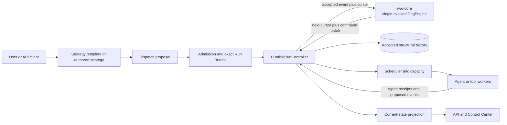
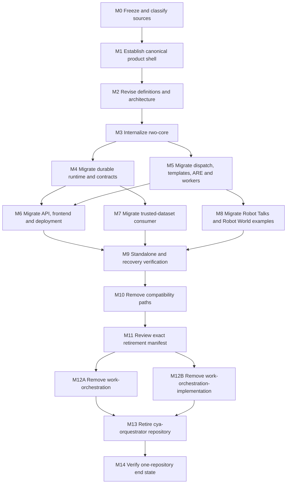

# CyberAlchemy Orchestrator Consolidation Plan

Status: planning candidate  
Checked: 2026-09-13  
Authority effect: none  
Target repository: `/home/vrondelli/projects/cyberAlchemy-v2`

## Decision

CyberAlchemy Orchestrator should become one standalone product rooted at
`cyberAlchemy-v2/orchestrator`. Its `product/` child explains product identity,
purpose, journeys, outcomes, and roadmap. Shared authority and ontology live at
the Orchestrator root because they govern every Orchestrator context. The
separate `cya-orquestrator` repository is a migration source, not a permanent
product boundary.

RWO should remain individually testable and versioned as an internal package
named `rwo-core`. It should not remain a separate repository or independently
deployed service. The orchestrator reuses it through a small stable API.

The evolved `DagEngine` becomes the single structural transition engine inside
`rwo-core`. The historical RWO reducer remains only as a temporary differential
reference. A run must never pass through both reducers.

Migration completion requires removal of these exact legacy directories:

- `/home/vrondelli/projects/cyberAlchemy-v2/work-orchestration`
- `/home/vrondelli/projects/cyberAlchemy-v2/work-orchestration-implementation`

Their surviving responsibilities move under `orchestrator`; they do
not remain as compatibility packages. After the canonical product is proven
self-contained, `/home/vrondelli/projects/cya-orquestrator` is also retired so
there is only one product repository.

## Product boundary

The general orchestrator owns:

- strategy templates and dispatch proposals;
- admission of an exact run bundle;
- run, attempt, lease, deadline, cancellation, and recovery lifecycles;
- the sole accepted-history write boundary;
- command scheduling, capacity, worker and provider adapters;
- receipts, reconciliation, lifecycle records, and read projections;
- API, Control Center, deployment, and operator-facing explanations.

`rwo-core` owns:

- uniform leaf and composite Work definitions;
- typed events, connections, graph validation, and composition compilation;
- all, any, and quorum release rules;
- deterministic application of one accepted event to one cursor;
- zero-or-more immutable command intents;
- versioned replay semantics and structural errors.

`rwo-core` must not depend on the service host, storage implementation,
scheduler, frontend, ARE, model provider, agent runtime, deployment, or domain
acceptance rules. It receives facts that have already crossed the orchestrator's
acceptance boundary and returns a pure structural decision.

## How a general agent run interacts with RWO



An agent does not mutate the DAG. It returns a typed receipt and a proposed
event. The controller validates identity, attempt, fence, authority reference,
and payload, then atomically accepts the event, the next RWO cursor, and the
complete command batch. RWO determines structural progress; the orchestrator
owns durability and execution. Domain owners still decide truth, acceptance,
promotion, and external-effect authority.

## Target package shape

```text
cyberAlchemy-v2/orchestrator/
  README.md
  product/
    README.md
    IDENTITY.json
    PRODUCT-THESIS.md
    PRODUCT-JOURNEY.md
    ROADMAP.md
  authority/
    definitions/
    constitutions/
    decisions/
  ontology/
    business/
    system/
    bridge/
  contracts/
  capabilities/
    strategy-authoring/
    dispatch/
    dispatch-templates/
    agent-execution/
    durable-runs/
    recovery/
    are-integration/
  rwo/
    Cargo.toml
    src/
    tests/
    legacy-fixtures/
  runtime/
    Cargo.toml
    src/
    tests/
  frontend/
  deployment/
  examples/
    robot-talks/
    robot-world/
    trusted-dataset/
  tests/
  docs/
  migration/
```

This is a logical package map. A separate crate is justified only when it
enforces a real dependency boundary. It must not create a second orchestration
engine or duplicate the accepted-history transaction.

`product/` is explanatory and product-specific. `authority/` owns normative
Orchestrator meanings, scoped constitutions, and owner decisions used across
product, contracts, RWO, runtime, frontend, deployment, examples, and tests.
`ontology/` owns the cross-context business, system, and bridge projections.
Neither shared surface is nested inside `product/`.

## Definitions migration

The existing product-local `ORCH-D*` source is the predecessor for
`orchestrator/authority/definitions/`. It already covers Run Bundle, semantic
work identity, run, attempt, accepted history, receipt, reconciliation,
lifecycle, projection, lab, and effect disposition. The migrated source governs
all Orchestrator contexts rather than living beneath the explanatory
`orchestrator/product/` package.

Before implementation migration, revise `ORCH-D1` so the product is a general
agent orchestrator rather than a surface limited to one adopted bounded-work
capability. Preserve the authority and truth boundaries in that definition.
Add synchronized definitions and index entries for at least:

| Needed term | Required distinction |
| --- | --- |
| Strategy | Declarative orchestration intent, separate from an admitted run |
| Strategy Template | Reusable parameterized strategy, separate from a concrete dispatch |
| Dispatch Proposal | Reviewable instantiated plan, separate from admission and execution |
| Lane | A typed coordination role or tension, separate from a worker process |
| Agent Assignment | Binding of an agent capability to one command or lane for one attempt |
| Work Definition | Immutable leaf/composite structural meaning |
| Work Graph | Validated compiled structure consumed by `rwo-core` |
| Structural Transition | Pure event-and-cursor reduction result |
| Command Intent | Immutable requested action, separate from execution and effect |
| Agent Turn | One bounded worker interaction within an execution attempt |
| Capability Adapter | Transport/executor binding that cannot change structural meaning |
| RWO Core | Internal reusable structural kernel and its dependency boundary |
| Orchestrator Runtime | Durable host that owns accepted history and execution lifecycle |
| Run Template | Saved user-facing configuration that produces a dispatch proposal |

Do not allocate new global `CAV2-D*` identifiers for product-local terms. The
definitions file and index must change together, and each durable definitions
artifact must carry its unresolved questions.

## Migration DAG



## Migration stages

| Stage | Work | Exit evidence |
| --- | --- | --- |
| M0 | Record both Git states; inventory tracked, modified, and untracked files; classify source, generated output, evidence, dependency, cache, and secret-bearing local state; capture digests. | Machine-readable manifest with no unclassified source file and an explicit owner-work preservation list. |
| M1 | Create the `orchestrator/` product root in CyberAlchemy v2. Put product explanation under `orchestrator/product/` and shared authority and ontology at the Orchestrator root without claiming predecessor acceptance. | The root package and its context boundaries validate structurally from the canonical repository. |
| M2 | Reconcile shared definitions and ontology plus the older product architecture with the newer merged architecture and general-agent direction. | Definitions/index drift checks pass; ontology consumers resolve the shared paths; architecture says one transition engine and one accepted-history owner. |
| M3 | Create internal `orchestrator/rwo`; move Work types, compiler, graph validation, and evolved DagEngine behind one API; retain legacy fixtures for differential tests. | `rwo-core` tests pass; no production code calls the historical reducer; equivalent legacy fixtures replay identically or have documented intentional version differences. |
| M4 | Move controller, history port, scheduler, coordination, supervisor, recovery, worker protocol, receipts, and release conditions into the product runtime. | Crash/restart, duplicate, conflict, retry, cancellation, deadline, quorum, and unknown-effect tests pass. |
| M5 | Move generic native dispatch, strategy contracts, ARE integration, agent execution, and template capability. Keep Robot Talks as a template/example rather than a hard-coded product mode. | A user-authored strategy and a saved template compile into the same versioned run contract and use the same checked intent boundary. |
| M6 | Move the API, Control Center, run pages, recovery UI, VPS/Gateway packaging, and operator explanations. | API/frontend tests and the Tastecheck-derived run-page checks pass against the canonical service. |
| M7 | Rebind trusted-dataset materialization to the public internal RWO contract; regenerate current bindings while preserving old receipt provenance. | Adapter compiles and its conformance journey passes without cross-repository paths. |
| M8 | Rebind Robot Talks and Robot World. Preserve world-specific dynamics and evidence outside the orchestrator core. | The eight-agent paired-tension strategy and Robot World contract journey run as ordinary product templates/examples. |
| M9 | Build and test from a clean standalone CyberAlchemy v2 checkout. Scan active inputs for old paths and exercise durable recovery. | Zero live dependency on `cya-orquestrator` or `projects/cyberalchemy-orchestrator`; source, runtime, API, UI, and consumer suites pass. |
| M10 | Remove temporary compatibility aliases and the legacy runtime dependency. Keep only approved provenance artifacts. | Repeated clean-checkout test passes and no active reference requires the compatibility layer. |
| M11 | Produce an exact retirement manifest for both named legacy directories and the standalone repository. | Reviewer can map every deleted path to a migrated digest, preserved evidence item, or disposable cache classification. |
| M12A | Remove `/home/vrondelli/projects/cyberAlchemy-v2/work-orchestration` through a reviewed Git change. | The path is absent and all migrated capability-definition, schema, validator, and negative-test responsibilities pass in the product package. |
| M12B | Remove `/home/vrondelli/projects/cyberAlchemy-v2/work-orchestration-implementation` through a reviewed Git change. | The path is absent and runtime, contracts, extensions, fixtures, frontend, and deployment pass from `orchestrator/`. |
| M13 | Retire `/home/vrondelli/projects/cya-orquestrator` after preserving owner-controlled work and migration provenance. | No build, test, documentation, deployment, or runtime input depends on the standalone checkout. |
| M14 | Verify the one-repository end state from a clean checkout. | CyberAlchemy v2 builds, tests, serves, and exercises its consumer journeys while both legacy in-repository paths and the standalone repository dependency are absent. |

M0 through M2 are definition and planning work. Later stages require a separate
implementation route and exact authorization. Current Goals validation is
blocked, so this plan cannot be registered as admitted execution state yet.

## Selective-copy rules

1. Never use an unqualified recursive copy or `rsync --delete` between these
   dirty trees.
2. Drive migration from a manifest containing source path, destination path,
   source digest, destination digest, classification, and merge decision.
3. Merge changed files by responsibility. Do not assume the newer standalone
   file supersedes the CyberAlchemy v2 file.
4. Exclude `target`, `node_modules`, Playwright browser state, temporary sockets,
   process state, and local secrets from source migration.
5. Place selected run fixtures under tests or examples; place audit evidence
   under migration/evidence; do not ship arbitrary local run state as product
   source.
6. Preserve existing immutable receipts and generated artifacts when they are
   cited as evidence. Regenerated artifacts must identify the new canonical
   source and must not rewrite old evidence in place.
7. Commit migration stages in reviewable slices with exact paths.

## Verification surface

The canonical checkout must prove:

- composition and graph validation;
- deterministic transition and replay across supported engine versions;
- all, any, quorum, fan-out, fan-in, terminal, impossible-join, and cycle cases;
- atomic event, cursor, and complete command-batch acceptance;
- duplicate and conflict behavior;
- attempt identity, leases, fences, deadlines, cancellation, and retry rules;
- restart recovery and unknown external-effect reconciliation;
- dispatch proposal validation and explicit admission;
- generic agent and tool adapter conformance;
- saved-template instantiation and version pinning;
- API and frontend rendering of current state, history, receipts, blockers, and
  lifecycle boundaries;
- trusted-dataset, Robot Talks, and Robot World consumer journeys;
- clean-checkout build without either legacy repository path;
- a repository scan showing no live old-path references.
- filesystem assertions that both
  `/home/vrondelli/projects/cyberAlchemy-v2/work-orchestration` and
  `/home/vrondelli/projects/cyberAlchemy-v2/work-orchestration-implementation`
  are absent.

## Retirement decisions

- **Keep RWO:** yes, as the internal `rwo-core` package with a stable public API,
  independent tests, and engine-version compatibility.
- **Keep a separate RWO repository:** no. The repository split is the source of
  the current broken relative dependencies and ownership ambiguity.
- **Keep both DagEngine and the historical reducer in production:** no. Evolve
  DagEngine into the RWO transition implementation and retain the old reducer
  only until differential migration evidence is complete.
- **Remove `work-orchestration`:** required in M12A after its capability model,
  schemas, validation, tests, and provenance have migrated.
- **Remove `work-orchestration-implementation`:** required in M12B after its
  runtime, contracts, extensions, evidence, frontend, and deployment have
  migrated.
- **Retire the standalone repository eventually:** yes, after M9-M12 and
  an exact deletion manifest; M13 makes this an explicit completion step.
- **Delete Robot World:** no. It remains a domain consumer and product example;
  only duplicated integration machinery may retire after replacement proof.

## Open Questions

- Should the internal crate retain the familiar package name `rwo-core`, or use
  a broader name while preserving RWO as the architectural concept? Recommendation:
  keep `rwo-core` to make the dependency boundary explicit.
- Which standalone run outputs are release fixtures or audit evidence?
  Recommendation: decide during M0 by reference and reproducibility, not by
  directory name alone.
- Should trusted-dataset materialization call `rwo-core` directly or consume the
  orchestrator service contract? Recommendation: direct use is acceptable only
  for pure compile/reduce behavior; durable execution should use the service.
- Which compatibility window is required for persisted run versions created by
  the current DagEngine? Recommendation: support replay by recorded engine
  version and prohibit in-place semantic upgrades.
- Which owner will accept the revised product-local definitions and authorize
  final repository retirement?
