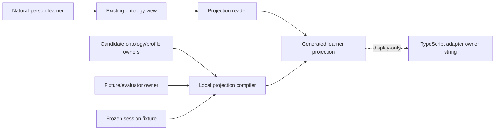
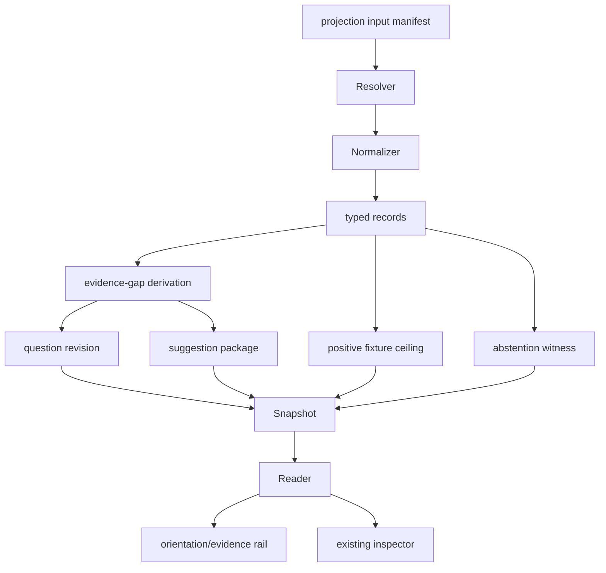
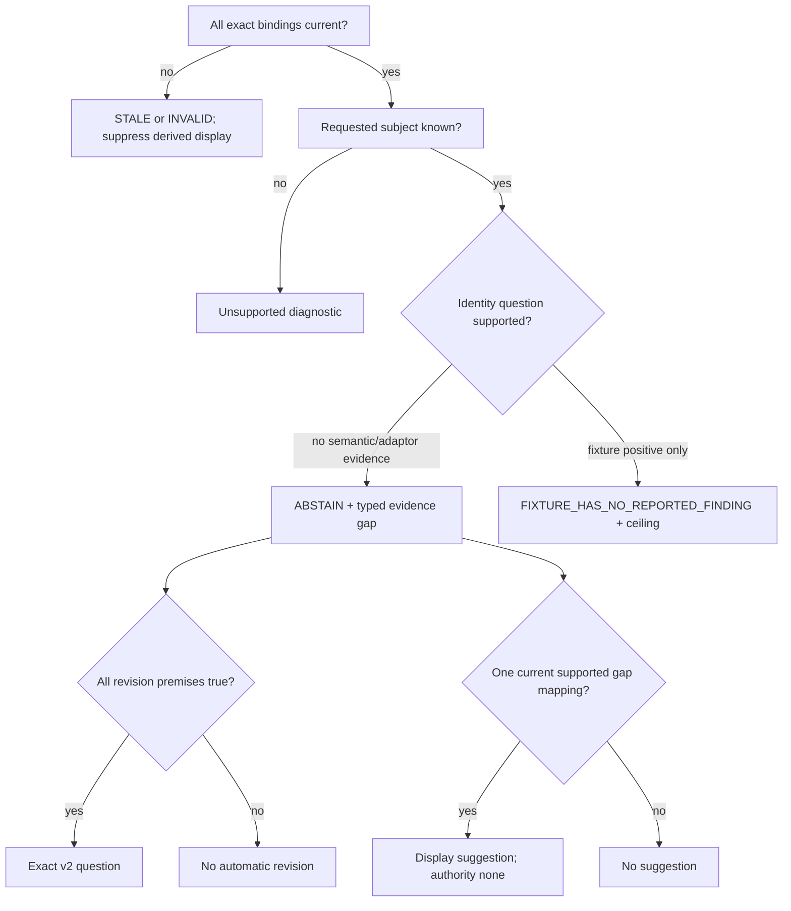

# Architecture Bundle: Learner Projection And Next-Route Guide

## Design Intent

Compile a disposable projection from exact source bindings, then render it as a
read-only learner guide in the existing ontology-view host. Keep the compiler,
projection snapshot, session fixture, host view, and governed route owner
separate so a persuasive display cannot become semantic or execution authority.

## Inputs

- [SPEC.md](SPEC.md)
- [SOURCE-CONTRACTS.md](SOURCE-CONTRACTS.md)
- [WITNESS-CONTRACTS.md](WITNESS-CONTRACTS.md)
- closed scope: `DESIGN-SCOPE-MANIFEST.json`
- deterministic selection: `DESIGN-SELECTION-RESULT.json`

## 1. Context View



The dotted route edge is presentation, not a semantic or workflow transition.

## 2. High-Level Structure View

| Component | Responsibility | Owns | Must not own |
| --- | --- | --- | --- |
| Binding resolver | Verify in-root paths, digests, JSON pointers, and contract version. | Currentness decision. | Source meaning or rebinding. |
| Projection compiler | Normalize allowed record/relation classes and deterministic derivations. | Generated snapshot/receipt. | Canonical ontology, learner-view mutation admission, owner-resolved semantic admission, or destination-owner admission. |
| Projection reader | Expose current typed records and diagnostics. | Read API. | Mutation or network access. |
| Learner guide controller | Synchronize focus and chosen presentation. | View/session presentation state. | Learner comprehension. |
| Orientation and evidence rail | Explain layers, proof tiers, abstention, question revision, and suggestion package. | Rendered semantic contract. | Route execution. |
| Acceptance harness | Validate fixture, mutation, parity, keyboard, and side-effect constraints. | Candidate receipts. | Human comprehension or promotion. |

## 3. Low-Level Component View



Expected implementation artifacts are a versioned projection schema, compiler,
validator, frozen fixture/manifest, generated snapshot, compiler receipt, host
integration, and browser acceptance harness. Names are fixed in the Plan.

## 4. Workflow Process View

```text
bind current sources
  -> validate digests and selectors
  -> normalize allowed records/relations
  -> evaluate positive and abstention witnesses
  -> derive exact question revision
  -> derive display-only suggestion
  -> canonicalize and write snapshot + receipt
  -> load snapshot in existing host
  -> synchronize focus and proof-tier presentation
  -> run deterministic and browser acceptance
```

Any failed binding or invariant terminates before a current snapshot or
suggestion is exposed.

## 5. Decision Flow View



## 6. Dependency / Interface View

| Interface | Direction | Contract | Failure behavior |
| --- | --- | --- | --- |
| Source files -> resolver | inbound | exact path/digest/pointer set | fail closed, no rebind |
| Compiler -> snapshot | outbound local file | schema-valid, canonical order, authority none | atomic failure, no partial current output |
| Snapshot -> reader | inbound browser | same-origin local JSON or embedded generated data | show diagnostic, suppress guide |
| Reader -> host view | internal | stable IDs/classes/proof tiers/validity | no semantic inference from geometry |
| Host -> learner | rendered | orientation, focus, evidence, question, suggestion | never claim comprehension/authority |
| Suggestion -> workflow owner | reference only | literal candidate string and prerequisites | no action, request, or workflow state |

## Significant Behavior Scenario

Stimulus: the learner focuses `implementation.payment.LegacyLimitRule` and asks
whether it is a DomainSpec Rule.

Preconditions: all frozen digests match; the binding is empty and non-current;
the source digest is example-only; no native-adapter receipt exists; and no
owner-resolved semantic-admission receipt exists. A learner-view mutation-
admission receipt may be present or absent and does not change this response.

Ordered response:

1. show separate semantic/profile/observation/finding layers;
2. return `ABSTAIN` rather than an identity verdict;
3. enumerate the typed evidence gap;
4. show the exact v2 evidence-requirement question;
5. show `TypeScript adapter owner` with witness/prerequisites/invalidation and
   `authority_effect: none`;
6. emit no mutation, outbound request, route selection, registration, or
   dispatch event.

Failure/recovery: any stale input changes validity to stale, removes the
derived question/suggestion, and displays the exact failed binding. A successful
regeneration may restore current status.

Acceptance owner: deterministic fixture owner for data behavior; learner-view
owner for host integration; browser-mechanics reviewer for candidate UI
evidence. None can promote ontology or claim comprehension by itself.

## Triggered Extension: Authority / Trust

- Trust boundary: generated suggestion versus governed workflow admission.
- Enforcement: schema forbids execution/admission fields; compiler hard-codes
  `authority_effect: none`; UI exposes no action control; browser harness fails
  on outbound or workflow-like events.
- Forgery control: every displayed record carries exact source digest and
  selector; stale bytes invalidate the snapshot.
- Bypass control: the host may not construct suggestions from geometry or free
  text when the compiled package is unavailable.
- Admission separation: learner-view mutation admission authorizes only the
  accepted host write scope. It cannot be read as semantic evidence, cannot
  close the typed evidence gap, and cannot establish destination-owner identity
  or admission.

## Triggered Extension: State / Event

Only projection validity has a state machine. There are no domain events or
workflow transitions. `current -> stale/invalid` suppresses derived display;
regeneration is the only return path.

## Triggered Extension: Persistence / Concurrency

- The compiler is the only writer for the generated snapshot and receipt.
- Writes use temporary output plus atomic replacement.
- Concurrent compiler runs are serialized or fail with an explicit conflict;
  no last-writer-wins currentness claim.
- Generated artifacts are non-authority read models and may be discarded.
- Personal session text is not persisted in L0/L1.

## Triggered Extension: Integration / Versioning

- Projection schema and derivation contract have explicit versions.
- The host accepts only supported versions and exact record classes.
- Unknown/new fields may be ignored only when the schema marks them optional;
  unknown record/relation classes block.
- Host integration remains behind learner-view mutation admission and must
  preserve current ontology-view behavior.

## Triggered Extension: Quality

Required candidate quality checks: byte-identical replay, fail-closed mutants,
record/view parity, keyboard reachability, visible non-color proof-tier labels,
zero unexpected console errors, zero outbound requests, and zero execution-like
events. No latency or comprehension threshold is claimed.

## Triggered UX Companion

The natural-person plus changed-semantic-surface predicate selects
[UX-PLAN.md](UX-PLAN.md). It defines orientation, focus, evidence inspection,
abstention, recovery, keyboard mechanics, and research boundaries without
claiming accessibility acceptance or comprehension.

## Concern-To-View Trace

| Concern | Primary class | Output | Accountable owner | Artifact owner | Validator owner |
| --- | --- | --- | --- | --- | --- |
| non-executing suggestion | authority | authority/trust extension | workflow-admission owner | architecture owner | Invoke Design validator |
| projection validity | state-event | state/event extension | learner-projection owner | architecture owner | Invoke Design validator |
| generated snapshot writer | persistence | persistence/concurrency extension | projection implementation owner | architecture owner | Invoke Design validator |
| existing host contract | integration | integration/versioning extension | learner-view owner | architecture owner | Invoke Design validator |
| deterministic and browser mechanics | performance/quality | quality extension | learner-view owner | architecture owner | Invoke Design validator |
| natural-person learner surface | ux | UX plan | UX plan owner | UX plan owner | Invoke Design validator |
| fixture and mutation proof | validation | witness contracts | design owner | plan/work-pack owner | Invoke Design validator |

Exact signal IDs, dispositions, and fixed-point evidence are generated in
`DESIGN-SELECTION-RESULT.json`.

## Planned Witness Boundary

All witnesses in [WITNESS-CONTRACTS.md](WITNESS-CONTRACTS.md) are planned. No
fixture, host integration, browser check, accessibility review, or human study
has run for this design.
