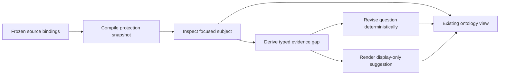

# Learner Projection And Next-Route Guide

## What This Module Owns

This feature owns the deterministic assembly and read-only presentation of an
exact-bound learner projection for one implementation-conformance fixture. It
preserves separately owned semantic, profile, observation, finding, session,
gap, and workflow-admission records without combining their authority.

It does not own ontology meaning, source adapters, owner-resolved semantic-
admission evidence, learner comprehension, destination-owner identity or
admission, workflow admission, execution, or promotion.

## Module Map

## Capabilities

| Capability | What | Key aspects |
| --- | --- | --- |
| CompileProjection | Regenerate one projection snapshot from exact immutable bindings. | [CompileLearnerProjection](OPERATIONS.md#compilelearnerprojection), [BoundInputsToProjection](MAPPINGS.md#boundinputstoprojection) |
| InspectEvidence | Explain one focused subject without crossing its proof ceiling. | [InspectFocusedSubject](QUERIES.md#inspectfocusedsubject), [ProjectionReader](INTERFACES.md#projectionreader) |
| RefineQuestion | Convert the frozen broad identity question into the declared evidence-requirement question. | [IdentityQuestionToEvidenceQuestion](MAPPINGS.md#identityquestiontoevidencequestion) |
| SuggestEvidenceRoute | Render one invalidatable, non-executing verification package. | [GetRouteSuggestion](QUERIES.md#getroutesuggestion), [EvidenceGapToSuggestionPackage](MAPPINGS.md#evidencegaptosuggestionpackage) |
| RenderLearnerGuide | Add the synchronized learner-guide projection to the existing owned view. | [LearnerGuideView](INTERFACES.md#learnerguideview), [ProjectionValidity](STATES.md#projectionvalidity) |

## Domain Concepts

| Concept | Type | Key constraints |
| --- | --- | --- |
| ProjectionInputBinding | Value Object | Exact path, digest, selector/pointer, owner, proof tier, invalidation rule. |
| LearnerProjectionSnapshot | Entity | Generated and disposable; `authority_effect: none`; never canonical ontology. |
| ProjectionRecord | Entity | Exactly one record class and one owner boundary. |
| EvidenceGap | Entity | Demonstrable absence in frozen inputs; not a semantic verdict. |
| SessionQuestion | Entity | Exact fixture or session text; not a canonical graph node. |
| RouteSuggestionPackage | Entity | Destination string, question, witness, prerequisites, invalidation; display only. |
| ProjectionValidity | State | `current`, `stale`, or `invalid`; stale/invalid suppress explanation and suggestion. |

## Concept Registry

| Concept | ID | Type |
| --- | --- | --- |
| ProjectionInputBinding | learner_projection.ProjectionInputBinding | Value Object |
| LearnerProjectionSnapshot | learner_projection.LearnerProjectionSnapshot | Entity |
| ProjectionRecord | learner_projection.ProjectionRecord | Entity |
| EvidenceGap | learner_projection.EvidenceGap | Entity |
| SessionQuestion | learner_projection.SessionQuestion | Entity |
| RouteSuggestionPackage | learner_projection.RouteSuggestionPackage | Entity |
| ProjectionValidity | learner_projection.ProjectionValidity | State |
| CompileLearnerProjection | learner_projection.CompileLearnerProjection | Operation |
| InspectFocusedSubject | learner_projection.InspectFocusedSubject | Query |
| GetRouteSuggestion | learner_projection.GetRouteSuggestion | Query |
| ProjectionReader | learner_projection.ProjectionReader | Interface |
| LearnerGuideView | learner_projection.LearnerGuideView | Interface |
| BoundInputsToProjection | learner_projection.BoundInputsToProjection | Mapping |
| IdentityQuestionToEvidenceQuestion | learner_projection.IdentityQuestionToEvidenceQuestion | Mapping |
| EvidenceGapToSuggestionPackage | learner_projection.EvidenceGapToSuggestionPackage | Mapping |

## Feature Concept Graph

These are module-contract relationships, not relations emitted into the
semantic ontology.

| From | Edge | To | Evidence | Notes |
| --- | --- | --- | --- | --- |
| learner_projection.CompileLearnerProjection | produces | learner_projection.LearnerProjectionSnapshot | [operation contract](OPERATIONS.md#compilelearnerprojection) | Generated artifact only. |
| learner_projection.InspectFocusedSubject | queries | learner_projection.LearnerProjectionSnapshot | [query contract](QUERIES.md#inspectfocusedsubject) | Read-only. |
| learner_projection.LearnerGuideView | exposes | learner_projection.InspectFocusedSubject | [interface contract](INTERFACES.md#learnerguideview) | No authority effect. |
| learner_projection.BoundInputsToProjection | produces | learner_projection.ProjectionRecord | [mapping contract](MAPPINGS.md#boundinputstoprojection) | Preserves record class. |
| learner_projection.IdentityQuestionToEvidenceQuestion | produces | learner_projection.SessionQuestion | [mapping contract](MAPPINGS.md#identityquestiontoevidencequestion) | Deterministic fixture rule only. |
| learner_projection.EvidenceGapToSuggestionPackage | produces | learner_projection.RouteSuggestionPackage | [mapping contract](MAPPINGS.md#evidencegaptosuggestionpackage) | Display-only. |

## Non-Collapse Invariants

1. Concept is not profile; profile is not observation; observation is not
   finding; finding is not semantic admission.
2. Focus is presentation state, not understanding or identity.
3. `FIXTURE_HAS_NO_REPORTED_FINDING` is not positive per-assertion proof.
4. `ABSTAIN` is mandatory for `LegacyLimitRule` under the frozen inputs.
5. A route suggestion cannot confirm, select, register, dispatch, execute,
   promote, publish, release, deploy, or make outbound requests.
6. Any digest or required-selector drift sets the snapshot to `stale` or
   `invalid` and suppresses derived display.
7. Learner-view mutation admission permits only the accepted host write scope;
   it cannot satisfy, replace, or imply owner-resolved semantic-admission
   evidence or destination-owner admission.

## Aspect Docs

| Aspect | Contains |
| --- | --- |
| [Operations](OPERATIONS.md) | Snapshot compilation and fail-closed rules. |
| [Queries](QUERIES.md) | Focused inspection and suggestion reads. |
| [Interfaces](INTERFACES.md) | Compiler/reader and existing HTML host boundary. |
| [Mappings](MAPPINGS.md) | Exact projection, question revision, and suggestion derivations. |
| [States](STATES.md) | Snapshot validity state machine. |
| [Glossary](GLOSSARY.md) | Feature-local terms and forbidden collapses. |

## Cross-Owner Dependencies

| Dependency | Owner boundary | Required use |
| --- | --- | --- |
| Candidate ontology and profiles | implementation-conformance ontology/profile owners | Read exact frozen records only. |
| Supplied facts and evaluator result | evidence/evaluator owner | Preserve fixture-only ceiling. |
| Existing HTML projection host | learner-view/navigation owner | Mutation requires separate learner-view mutation admission. |
| Session question text | session/privacy owner | L0 uses frozen fixture text only; retention is deferred. |
| Rule-identity semantic admission | semantic/implementation-conformance owner | An owner-resolved receipt is evidence input; learner-view mutation admission cannot supply it. |
| Route destination string | TypeScript projection owner | Display exact candidate string only; neither owner identity nor destination admission is established. |

## Acceptance Boundary

The first product claim is mechanical: frozen inputs deterministically produce
the expected projection, positive-fixture ceiling, abstention, exact question
revision, and display-only suggestion; stale and mutant inputs fail closed.
Human comprehension, accessibility acceptance, and route usefulness require
separate later evidence.

## References

- Accepted research: [../findings.md](../findings.md)
- Exact synthesis: [../receipts/learning-graph-synthesis-revised.json](../receipts/learning-graph-synthesis-revised.json)
- Source contracts: [SOURCE-CONTRACTS.md](SOURCE-CONTRACTS.md)
- Architecture: [ARCHITECTURE.md](ARCHITECTURE.md)
- Work pack: [WORK-PACK.md](WORK-PACK.md)
